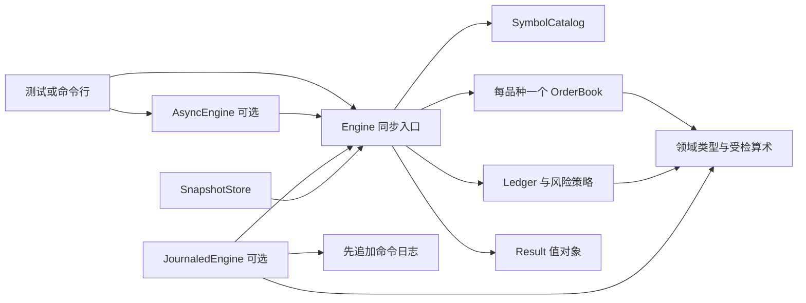
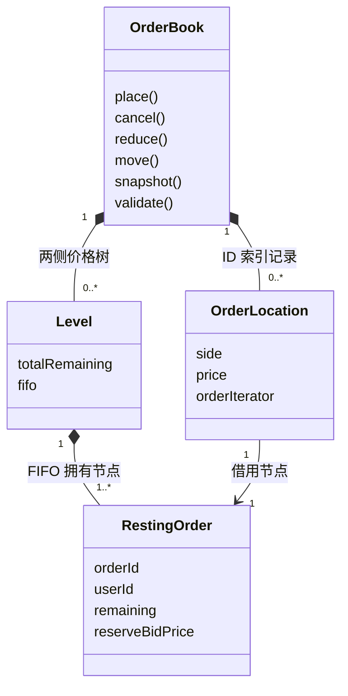
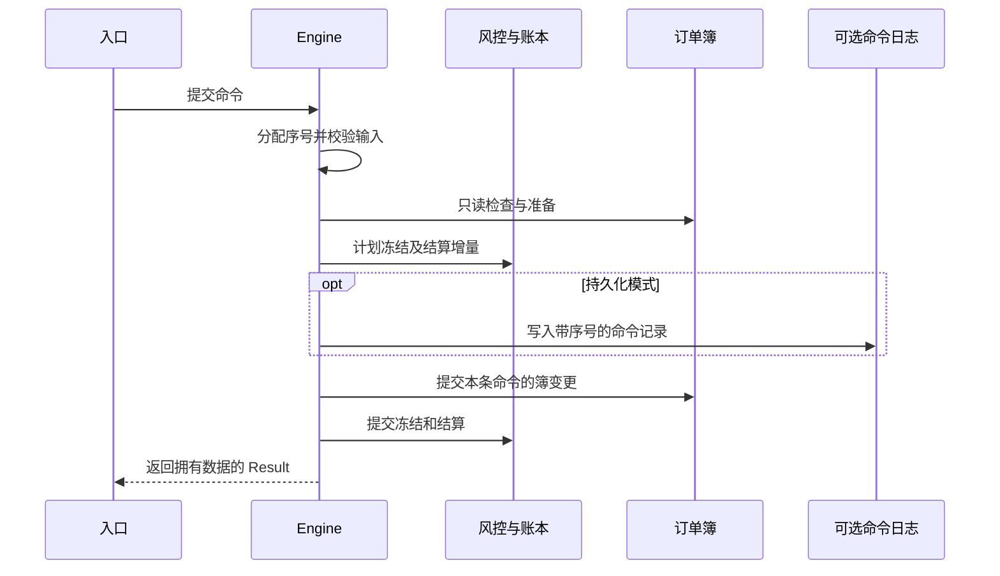

# C++ 学习工程的架构

教程先用一个同步的 `Engine` 串起路由、风控、撮合和结算。订单簿可以单独测试，账户模块可以用手写成交事件测试。随后把同一个同步入口放进有界队列后的单写者线程。这样可用同一批输入比较单线程、异步入口、替代订单簿和重放的输出。

## 1. 目标能力

| 里程碑 | 可观察成果 | 前置条件 |
| --- | --- | --- |
| 单品种撮合 | GTC、带价限 IOC、FOK_BUDGET、撤单、减量、改价、有序事件、L2 | 值类型、受检算术、FIFO、稳定索引 |
| 现货引擎 | 多品种、账户资金变更与状态、冻结、成交结算、maker/taker 费、余额和单用户报告 | 在一条命令边界维护簿、账户和事件的一致性 |
| 工程化 | 基线与替代簿差分测试，异步入口与有界背压，快照和追加日志，按序恢复 | 可复现的状态及事件、明确的接受和确认时刻 |
| 期货进阶 | 期货持仓、待成交敞口、盘口估值、同币种保证金、开平仓和反手 | 复用撮合规则，以独立风险策略处理期货会计 |

批量注册品种和账户走教学用结构化命令。可对照 Java 的二进制帧与分片报告，C++ 的持久化格式、结果结构和 API 类型是课程自己的协议。独立市价单、订单簿完整历史、Java 二进制兼容、不同币种的保证金抵扣和生产网络网关留作扩展。

## 2. 模块边界与依赖



`OrderBook` 拥有订单与档位。它接收已规范化的命令并产生值事件，与余额和文件解耦。`Ledger` 拥有账户、资金流水、冻结、费用、用户期货持仓及待成交量，并保存价格缓存。`SpotRisk` 和 `FuturesRisk` 操作传入的暂存账本。`Engine` 通过品种表找到簿、校验输入、协调风控和结算，按命令序号返回一个 `Result`。读查询也在 `Engine` 所有者上执行，使用序号标识观察位置。日志、快照只交换规范化数据。

建议保持以下工程布局。目录随着对应课程出现。Day 01 只需要头文件、金额实现、演示和测试。

```text
exchange-lab/
├── CMakeLists.txt
├── include/exchange/
│   ├── notional.hpp
│   ├── units.hpp
│   ├── model.hpp
│   ├── order_book.hpp
│   ├── engine.hpp
│   ├── ledger.hpp
│   ├── async_engine.hpp
│   ├── persistence.hpp
│   ├── positions.hpp
│   ├── java_position_order.hpp
│   └── futures_risk.hpp
├── src/
├── app/main.cpp
├── tests/
└── bench/
```

### 接口如何逐步长出来

| 首次出现 | 学习工程接口 | 返回值与状态 |
| --- | --- | --- |
| Day 01 | `exchange::quote_notional(quantity, price, quote_scale)` | `optional<int64_t>`。纯计算，非法输入或溢出为空 |
| Day 06–07 | `Price`、`Quantity`、`NotionalSteps`、`Money`、`SymbolSpec`、`Command`、`RestingOrder`、`Event`、`CommandResult`、`Result` | 单位在 `units.hpp`，领域记录在 `model.hpp`。簿产生命令状态及事件，`Result` 再携带引擎序号 |
| Day 09–11 | `OrderBook::best_bid`、`best_ask`、`find_order`、`validate`、`snapshot(depth)`、`resting_orders` | 管理单品种价档、FIFO 与 ID 索引。查询按值返回 |
| Day 12–15 | `place(const PlaceOrder&, Seq)`、`cancel(const CancelOrder&)`、`reduce(const ReduceOrder&)`、`move(const MoveOrder&, Seq)` | 单簿先计划成交和准备余量，再提交，按值返回 `CommandResult` |
| Day 17–20 | `Engine::execute(const Command&) -> Result`、`Ledger`、`SymbolCatalog`、报告查询 | 扩展 Day 07 的 `Command` 载荷，`Engine` 分配序号，结果在完整状态边界生成 |
| Day 24 | `Book` 运行期接口 | `Engine` 经工厂取得一种实现，沿用 Day 09–15 的语义 |
| Day 27–29 | `AsyncEngine::submit(Command)`、`close()`、`Journal`、`SnapshotStore` | 返回 `variant<future<Result>, SubmitError>`。满队列或已关闭时同步给出错误。持久化按 `Engine` 序号 |
| Day 31 | `SpotRisk`、`FuturesRisk`、`MarginPosition`、`LastPrice` | 同一 Engine 按规格类型分派，共用现金。盘口缓存与兼容键表参与决策 |
| Day 32 | v2 日志与快照，v1 读取 | 保存规格、仓位、价格缓存与配置；24 组合、72 次场景和独立进程恢复 |

`OrderKey` 由 `SymbolId` 和 `OrderId` 组成。单簿索引用 `OrderId`，`UserId` 用于撤改的所有者校验。活动 ID 在品种内唯一。订单离簿后可复用 ID，`Seq` 仍区分不同命令。课程用序号和实际入队次序重建 FIFO，外部时间戳保留为元数据。`OrderBook` 按对象持有树和链，禁止会令索引句柄失效的复制和移动。需要转移所有权时移动拥有它的 `unique_ptr`。

## 3. 订单簿与事件契约

- 买盘从高到低，卖盘从低到高。档内 FIFO。可成交条件为买入价限大于等于对手卖价，卖出价限小于等于对手买价。成交数量取两边剩余量的最小值，成交价用 maker 挂价。
- `PlaceOrder` 用 `LimitPrice` 或 `BudgetLimit` 表示互斥约束，预算值是 `Σ(价格步数 × 手数)`。`Side` 决定它是买方上限还是卖方下限。预算试算只读且与执行处在同一所有者内，失败时整笔拒绝。
- GTC 的剩余量入簿，IOC 的剩余量拒绝。部分减量保持队列位置，减尽移除。改价先验证买单预留价，再摘旧节点、尝试成交和重挂余量，同价改价也进队尾。
- `Result` 有 `Seq`、`Status`、按值拥有的 `vector<Event>` 及可选的查询载荷。非法输入、重复活动 ID、未知品种、资金不足等用独立状态码。有效 IOC 或预算单即使发生余量拒绝，仍能报告命令已处理。`Trade` 记录 maker/taker 的 ID、用户、方向所需上下文、成交价量和各自是否完全成交。`Reduce` 记录被撤减的订单、方向、量和是否已离簿。`RejectRemainder` 记录未成交量及原因。一次命令内先按 maker 扫描顺序记录成交，再记录余量拒绝。
- 每档总量等于该档活动订单剩余量之和，活动量大于 0。每条活动订单同时出现于一个档位和 ID 索引。空档删除，索引无悬空引用，命令结束时同品种盘口不交叉。L2 复制每侧请求深度内的价、量、笔数。
- 数量分解用当前请求解释。下单量 = 成交量 + 新挂余量 + 拒绝余量。对已挂订单，原始委托量 = 历史成交量 + 已撤减量 + 当前余量。C++ 内部按 `remaining` 保存活动量。当前接口无永久订单状态表。

基线用卖盘 `std::map<Price, Level, AskOrder>`、买盘 `std::map<Price, Level, BidOrder>`。每个 `Level` 拥有 `std::list<RestingOrder>` 和总量。ID 索引 `std::unordered_map<OrderId, OrderLocation>` 保存方向、价和链表迭代器。删除链表节点前移除索引句柄，使用本地值副本生成事件。插入跨三处状态，任何可能抛出的分配放在提交之前或由局部回滚保护。按 ID 定位可撤减节点的期望成本为 `O(1)`，按键找到所属价档另花 `O(log(P+1))`。Day 24 通过 `OrderQueue` 在链表和池队列间选择，复用同一价格树与撮合代码。池版额外保留一个改价准备槽，容量拒绝在提交前发生。



删除订单时先抹掉 `OrderLocation`，再删除实际节点。图中 `Level` 至少拥有一条订单，指命令提交后的稳定状态。

## 4. 单条命令的提交边界



单簿在 Day 12–16 已用只读计划准备事件和余量，再提交节点变更。Day 17–20 的同步引擎按规范化活动订单重建目标簿，并复制账本。它先在暂存账本冻结新单，再在暂存簿执行，并按成交价量及最终挂单核对结算。两份暂存状态成功后通过不抛出的交换提交。单簿保持不可复制，重建会重新生成索引。Day 21 测量这份开销，后续可通过预构建节点、预留结果缓冲或撤销记录缩小准备范围。

现货 `Ledger` 记录每个订单的冻结额、账户可用余额和交易所费用，结算完成后按币种核对 `Σ可用 + Σ冻结 + 费用 = Σ净入金`。撤减或拒绝释放未消费的冻结，买方释放价格差及适用的手续费差。基线先支持非负费率且 maker 费不超过 taker 费，卖单可成交价须覆盖适用费用。改价和预算单按同一规则预检实际成交计划。`Engine` 还统一校验 ID、价格、数量和规模上限。有符号整数运算在运算前检查，禁止把对象内存直接当持久化字节序列。

## 5. 选型与演进

| 设计点 | 基线 | 对照与选择条件 |
| --- | --- | --- |
| 价格档位 | 有序树，稀疏价格自然映射 | 已知很窄的 tick 范围可以试数组和位图。价格稀疏时数组浪费容量 |
| 档内节点 | `std::list`，可按迭代器摘除且节点稳定 | `vector` 顺序访问连续，中间删除移动元素。性能课用池索引和 generation 在紧凑存储中保持句柄稳定 |
| 查询和结果 | 值快照与值事件，读端独立持有 | 借用 `span` 可限制在同步消费期间。跨线程必须先复制或转移拥有权 |
| 替换订单簿 | 到出现第二种实现才引入运行期接口 | 模板策略允许静态分派，编译依赖、构建时间和代码体积需评估 |
| 并发入口 | 有界 mutex 队列加单写者，锁只保护队列及关闭状态 | SPSC ring 用于单生产者实验，不能直接接多个调用线程。多品种分片要另外处理多用户结算边界 |
| 持久化 | 版本化快照与可重放命令日志，规范排序后编码 | 只保存最终快照简单，但无法恢复快照之后的命令。日志的写入、flush 和 OS 耐久点分别说明 |

异步入口在队列锁内接纳命令，`Engine` 在取出时分配 `Seq`。满队列或关闭发生于接纳之前，没有引擎序号。关闭时停止接纳、排空并完成已接受命令的 future，工作线程最后 join。future 在结算后完成。返回值和事件在队列或回调之间转移所有权，业务回调在锁外执行。若线程异常退出，已接受的 future 必须以错误完成，等待者得以退出。

日志记录显式版本、长度、序号、命令载荷和校验。输入变更命令及业务拒绝可以重放。查询不改变领域状态，恢复允许日志序号出现查询造成的空洞，仍要求日志记录严格递增。使用已提交快照序号过滤更早的记录。从快照和完整日志的最大序号继续。重启前最后一次变更之后的查询序号可能未保存，跨进程观察位置以运行实例标识和序号共同区分。对完整但损坏的记录停止恢复，截断尾帧按明确恢复策略处理。基础演示验证进程重启与尾帧故障，断电耐久需要按目标 OS 另行实现和验证写盘屏障。每次恢复重建索引，恢复期间不向在线订阅者重发历史回调。

继续阅读 [Java 与 C++ 对照](java-cpp-comparison.md) 或查看 [逐课依赖与验收](learning-roadmap.md)。
