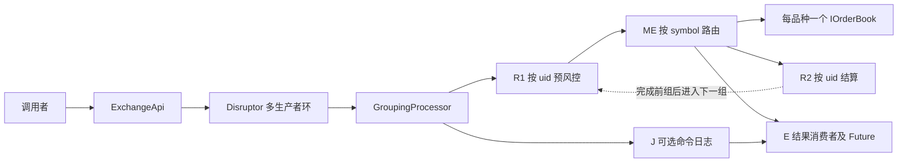
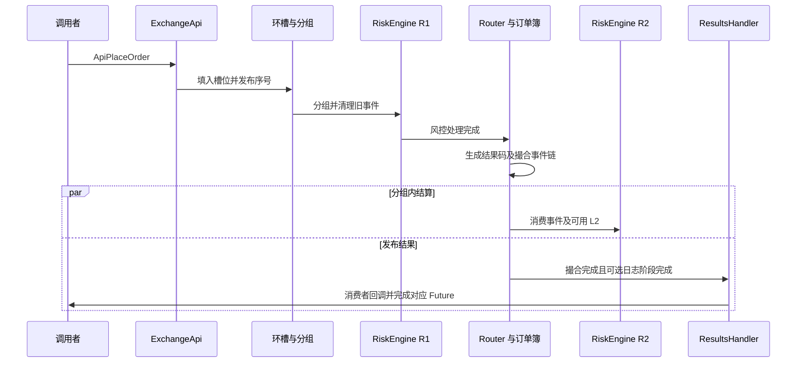
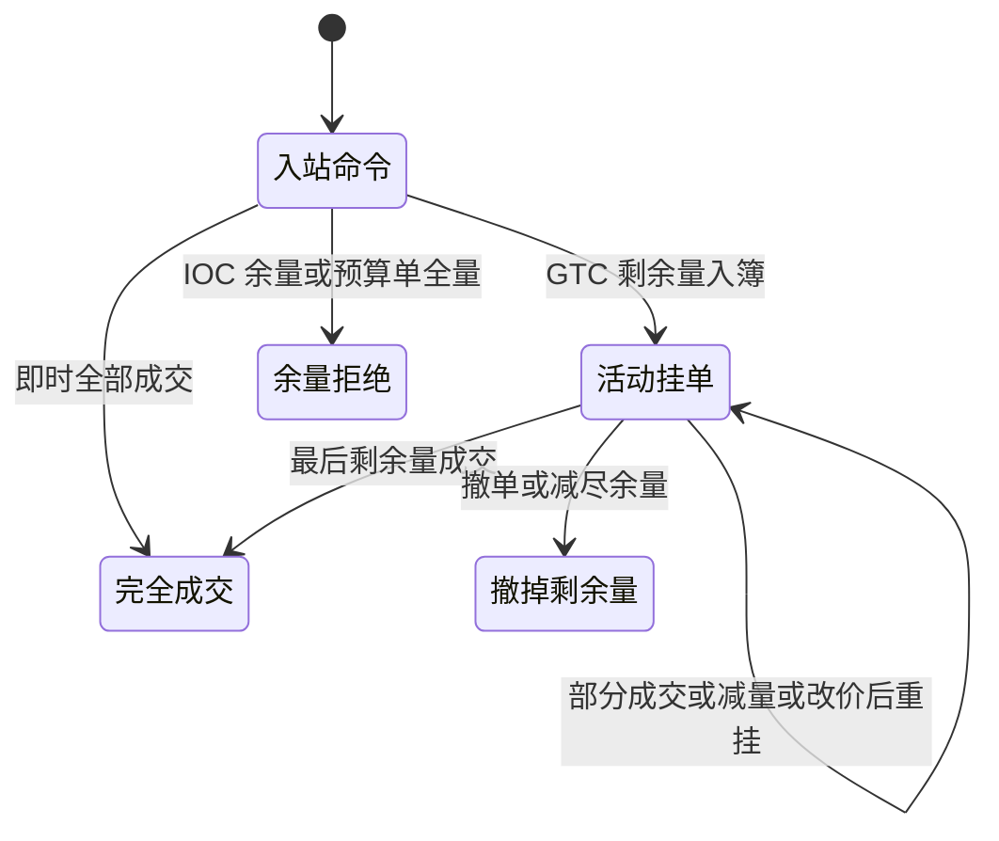

# Java exchange-core 架构与核心源码分析

本报告依据工作区 `exchange-core` 的提交 `2f8548749839e9095c8dc597e4b61521d259fa5d`。正文中的行为描述来自该提交的可执行路径。标为「推导」的内容来自代码结构或约束。源码链接固定到该提交，便于在 GitHub 对照。 [提交记录](https://github.com/exchange-core/exchange-core/commit/2f8548749839e9095c8dc597e4b61521d259fa5d)

## 1. 工程边界与模块

这是一个 Maven Java 库，编译目标为 Java 8。入口是 `ExchangeCore` 和它提供的 `ExchangeApi`，调用者在进程内提交命令、注册结果消费者。主源码在 `src/main/java/exchange/core2/core/`，测试包含订单簿单元测试、Cucumber 场景、集成和性能用例。Disruptor 管理事件环和阶段依赖，Eclipse Collections 提供原始整数键集合，`exchange.core2:collections` 提供基数树和对象池，Chronicle Bytes/Wire 和 LZ4 用于二进制数据及持久化。仓库 README 将 FIX/REST 网关和集群列为后续事项。 [Maven 依赖与构建配置](https://github.com/exchange-core/exchange-core/blob/2f8548749839e9095c8dc597e4b61521d259fa5d/pom.xml#L45) · [README 的待办](https://github.com/exchange-core/exchange-core/blob/2f8548749839e9095c8dc597e4b61521d259fa5d/README.md#L265)

| 目录或入口 | 职责 | 入口 |
| --- | --- | --- |
| `ExchangeCore`、`ExchangeApi` | 装配分片、阶段依赖、生命周期、命令发布及异步结果关联 | [ExchangeCore 构造器](https://github.com/exchange-core/exchange-core/blob/2f8548749839e9095c8dc597e4b61521d259fa5d/src/main/java/exchange/core2/core/ExchangeCore.java#L76) · [ExchangeApi 发布](https://github.com/exchange-core/exchange-core/blob/2f8548749839e9095c8dc597e4b61521d259fa5d/src/main/java/exchange/core2/core/ExchangeApi.java#L75) |
| `common/`、`common/api/`、`common/cmd/` | 外部命令、内部可变命令槽、订单、品种规格、行情、事件、配置 | [OrderCommand](https://github.com/exchange-core/exchange-core/blob/2f8548749839e9095c8dc597e4b61521d259fa5d/src/main/java/exchange/core2/core/common/cmd/OrderCommand.java#L27) · [CoreSymbolSpecification](https://github.com/exchange-core/exchange-core/blob/2f8548749839e9095c8dc597e4b61521d259fa5d/src/main/java/exchange/core2/core/common/CoreSymbolSpecification.java#L30) |
| `orderbook/` | 单品种活动订单、撮合、撤改、盘口及状态遍历 | [IOrderBook](https://github.com/exchange-core/exchange-core/blob/2f8548749839e9095c8dc597e4b61521d259fa5d/src/main/java/exchange/core2/core/orderbook/IOrderBook.java#L41) |
| `processors/` | 用户及品种路由、风控、分组、结算、结果和二进制命令 | [MatchingEngineRouter](https://github.com/exchange-core/exchange-core/blob/2f8548749839e9095c8dc597e4b61521d259fa5d/src/main/java/exchange/core2/core/processors/MatchingEngineRouter.java#L50) · [RiskEngine](https://github.com/exchange-core/exchange-core/blob/2f8548749839e9095c8dc597e4b61521d259fa5d/src/main/java/exchange/core2/core/processors/RiskEngine.java#L59) |
| `processors/journaling/` | 可替换的快照和命令日志实现 | [ISerializationProcessor](https://github.com/exchange-core/exchange-core/blob/2f8548749839e9095c8dc597e4b61521d259fa5d/src/main/java/exchange/core2/core/processors/journaling/ISerializationProcessor.java#L15) |
| `SimpleEventsProcessor`、`IEventsHandler` | 将内部命令结果转成调用者可消费的事件 | [事件适配器](https://github.com/exchange-core/exchange-core/blob/2f8548749839e9095c8dc597e4b61521d259fa5d/src/main/java/exchange/core2/core/SimpleEventsProcessor.java#L23) |

实线表示装配出的依赖或调用。E 等待所有撮合阶段，并在开启日志时等待 J。E 与 R2 同在撮合之后，装配没有规定每条命令先完成 R2 才回调 E。R2 的分组衔接由 master 在组边界调用 slave 的 `handlingCycle`，slave 在撮合序列可读后处理前一组。`run` 初始化 slave 的序列位置。理解这点才能解释为何异步下单得到成功码和账户结算完成是两个观察时刻。 [阶段装配](https://github.com/exchange-core/exchange-core/blob/2f8548749839e9095c8dc597e4b61521d259fa5d/src/main/java/exchange/core2/core/ExchangeCore.java#L162-L211) · [Master 组边界](https://github.com/exchange-core/exchange-core/blob/2f8548749839e9095c8dc597e4b61521d259fa5d/src/main/java/exchange/core2/core/processors/TwoStepMasterProcessor.java#L122) · [Slave 消费边界](https://github.com/exchange-core/exchange-core/blob/2f8548749839e9095c8dc597e4b61521d259fa5d/src/main/java/exchange/core2/core/processors/TwoStepSlaveProcessor.java#L77)

## 2. 一条下单如何走完

1. `NEW_ORDER_TRANSLATOR` 把价格、预留价格、量、订单号、方向、类型、品种、用户、时间戳等写入环槽，结果设为 `NEW`。异步分支在发布时用环序号注册 promise 回调，结果阶段移除对应项。普通异步接口只取结果码，完整应答接口使用 `Function.identity()` 返回槽中原对象。推导是调用方跨槽位生命周期保存原对象有复用风险。 [发布与异步转换](https://github.com/exchange-core/exchange-core/blob/2f8548749839e9095c8dc597e4b61521d259fa5d/src/main/java/exchange/core2/core/ExchangeApi.java#L190-L211) · [新单转换](https://github.com/exchange-core/exchange-core/blob/2f8548749839e9095c8dc597e4b61521d259fa5d/src/main/java/exchange/core2/core/ExchangeApi.java#L427)
2. `GroupingProcessor` 标记组号，清理槽里的 `matcherEvent` 和 `marketData`，按数量及空闲时的时间条件切组。重置、快照的首条命令和部分批量／报告末帧会触发新组。结果消费者可受 `GROUPING_CONTROL` 控制。 [分组循环](https://github.com/exchange-core/exchange-core/blob/2f8548749839e9095c8dc597e4b61521d259fa5d/src/main/java/exchange/core2/core/processors/GroupingProcessor.java#L145-L233) · [ResultsHandler](https://github.com/exchange-core/exchange-core/blob/2f8548749839e9095c8dc597e4b61521d259fa5d/src/main/java/exchange/core2/core/processors/ResultsHandler.java#L18)
3. R1 在用户所属分片查用户和品种，按配置执行现货冻结或期货保证金检查。只有 `VALID_FOR_MATCHING_ENGINE` 才让 `IOrderBook.processCommand` 受理下单。调用 `newOrder` 后分派器返回 `SUCCESS`，订单实际成交、挂簿或未成交拒绝由事件和簿状态表达。 [风控检查](https://github.com/exchange-core/exchange-core/blob/2f8548749839e9095c8dc597e4b61521d259fa5d/src/main/java/exchange/core2/core/processors/RiskEngine.java#L358) · [订单簿命令分派](https://github.com/exchange-core/exchange-core/blob/2f8548749839e9095c8dc597e4b61521d259fa5d/src/main/java/exchange/core2/core/orderbook/IOrderBook.java#L176)
4. 撮合路由器按 `symbol & (numShards - 1)` 选择品种分片，风险处理器用相同形式按 `uid` 分片，分片数要求是 2 的幂。每个品种有一份簿。同一品种的订单由同一个撮合处理器顺序执行。撮合和账户的分片轴不同，一次成交可能影响两个风险分片。 [品种路由与查簿](https://github.com/exchange-core/exchange-core/blob/2f8548749839e9095c8dc597e4b61521d259fa5d/src/main/java/exchange/core2/core/processors/MatchingEngineRouter.java#L233-L268) · [匹配分片校验](https://github.com/exchange-core/exchange-core/blob/2f8548749839e9095c8dc597e4b61521d259fa5d/src/main/java/exchange/core2/core/processors/MatchingEngineRouter.java#L85-L105) · [用户分片](https://github.com/exchange-core/exchange-core/blob/2f8548749839e9095c8dc597e4b61521d259fa5d/src/main/java/exchange/core2/core/processors/RiskEngine.java#L354)
5. R2 消费 `TRADE`、`REDUCE` 和 `REJECT` 结算。内部拒绝事件插到链头，成交事件按扫单次序追加。对外适配器先发命令结果，再发聚合成交及拒绝（或单个减量），最后发有值的 L2。`api.processResult` 在结果消费者之后执行。事件池化开关 `EVENTS_POOLING` 当前为 `false`，Direct 的订单和档位对象池仍独立存在。 [事件构造](https://github.com/exchange-core/exchange-core/blob/2f8548749839e9095c8dc597e4b61521d259fa5d/src/main/java/exchange/core2/core/orderbook/OrderBookEventsHelper.java#L44-L119) · [对外事件顺序](https://github.com/exchange-core/exchange-core/blob/2f8548749839e9095c8dc597e4b61521d259fa5d/src/main/java/exchange/core2/core/SimpleEventsProcessor.java#L28-L123) · [结果装配和池化开关](https://github.com/exchange-core/exchange-core/blob/2f8548749839e9095c8dc597e4b61521d259fa5d/src/main/java/exchange/core2/core/ExchangeCore.java#L198-L211)

在结构上，`ExchangeCore` 是装配入口，`ExchangeApi` 的 translator 负责 API DTO 与环槽的转换，`IOrderBook.OrderBookFactory` 允许按配置选择订单簿策略。`SimpleEventsProcessor` 将内部结果适配成回调。`PerformanceConfiguration.DEFAULT` 采用基础配置的 Naive 簿和阻塞等待，latency / throughput 配置使用 Direct 与忙等，分片数也有差别。 [基础及性能配置](https://github.com/exchange-core/exchange-core/blob/2f8548749839e9095c8dc597e4b61521d259fa5d/src/main/java/exchange/core2/core/common/config/PerformanceConfiguration.java#L117-L161)

## 3. 订单、类型与状态

`Order` 保存 `orderId`、`uid`、`price`、`size`、`filled`、`reserveBidPrice`、`action`、`timestamp`。`OrderCommand` 和挂单实现都通过 `IOrder` 提供撮合所需字段。活动量是 `size - filled`，减量会下调 `size`。新请求可以先充当 taker，只有剩余部分需要挂簿时才创建活动订单记录。订单簿里没有独立的订单终态历史表。终态要从结果事件和上游记录重建。 [订单字段](https://github.com/exchange-core/exchange-core/blob/2f8548749839e9095c8dc597e4b61521d259fa5d/src/main/java/exchange/core2/core/common/Order.java#L38-L94) · [Naive 新单](https://github.com/exchange-core/exchange-core/blob/2f8548749839e9095c8dc597e4b61521d259fa5d/src/main/java/exchange/core2/core/orderbook/OrderBookNaiveImpl.java#L104-L141)

| 类型 | 两个实现的实际分支 | 余量处理 |
| --- | --- | --- |
| `GTC` | 带单价限值，立即尝试撮合 | 余量进入同侧对应价格档队尾 |
| `IOC` | 带单价限值，立即尝试撮合 | 余量产生 `REJECT`，不入簿 |
| `FOK_BUDGET` | 先按对手档聚合量试算完整成交总额，买方检查上限，卖方检查下限 | 满足数量和总额条件后成交，否则全量拒绝 |
| `IOC_BUDGET`、`FOK` | 枚举有编码，订单簿 switch 走默认拒绝分支 | 不挂簿 |
| 无独立限价的市价单 | API 枚举无 `MARKET`，README 的市场化表述应结合 IOC 的价格限值理解 | 教程将无价限市价单列为扩展 |

`FOK_BUDGET` 的 `price` 字段承载 `Σ(手数 × 价格步数)` 约束。Naive 试算用 `Optional<Long>` 表达流动性不足，Direct 用 `Long.MAX_VALUE` 哨兵。Direct 成交路径对卖方预算单把单价下限设为 0，对买方仍读取预算值作为限价。在所有价格为正整数且算术无溢出的域内，任何一手的价格都不可能超过已通过检查的总预算。哨兵碰到恰好等于 `Long.MAX_VALUE` 的合法总额时，两个实现可出现差异。推导来自分支结构，课程用显式试算结果和受检运算表达。 [订单枚举](https://github.com/exchange-core/exchange-core/blob/2f8548749839e9095c8dc597e4b61521d259fa5d/src/main/java/exchange/core2/core/common/OrderType.java#L20-L53) · [Naive 类型与预算分支](https://github.com/exchange-core/exchange-core/blob/2f8548749839e9095c8dc597e4b61521d259fa5d/src/main/java/exchange/core2/core/orderbook/OrderBookNaiveImpl.java#L84-L205) · [Direct 预算与限价分支](https://github.com/exchange-core/exchange-core/blob/2f8548749839e9095c8dc597e4b61521d259fa5d/src/main/java/exchange/core2/core/orderbook/OrderBookDirectImpl.java#L173-L242)

图中的名称表示业务状态。部分成交和余量拒绝可以发生在同一请求。风控失败发生在入口和订单簿之间，独立由命令结果码表达。

## 4. 价格时间优先与订单维护

**Naive。** 卖侧 `TreeMap` 价格升序，买侧逆序。以 `headMap(price, true)` 得到可成交的对手价域。每档用保持插入顺序的 `LinkedHashMap<Long, Order>` 保存 FIFO，`LongObjectHashMap<Order>` 给全簿活动订单提供 ID 查找。档内撮合用 `min(takerRemaining, maker.size - maker.filled)`，更新成交量和档位总量，成交价取 maker 价格。maker 完成后移除档内节点和 ID 索引，空档在外层遍历结束后清理。时间优先来自插入顺序，`timestamp` 没被用于档内排序。 [档与 ID 索引](https://github.com/exchange-core/exchange-core/blob/2f8548749839e9095c8dc597e4b61521d259fa5d/src/main/java/exchange/core2/core/orderbook/OrderBookNaiveImpl.java#L34-L78) · [价格范围与跨档匹配](https://github.com/exchange-core/exchange-core/blob/2f8548749839e9095c8dc597e4b61521d259fa5d/src/main/java/exchange/core2/core/orderbook/OrderBookNaiveImpl.java#L203-L280) · [FIFO 撮合](https://github.com/exchange-core/exchange-core/blob/2f8548749839e9095c8dc597e4b61521d259fa5d/src/main/java/exchange/core2/core/orderbook/OrdersBucketNaive.java#L98-L145)

**Direct。** 两侧用各自的 `LongAdaptiveRadixTreeMap<Bucket>`，另有订单 ID 基数树。每侧订单串成一条双向链，按最优价到最差价排列，同一档的节点连续。`bestAskOrder` 和 `bestBidOrder` 直接定位队首，`Bucket` 缓存尾节点、总量和笔数。同价入队接到档尾，新价档经基数树邻居定位到链中。扫单沿 `prev` 前进，避免对每个 maker 再搜一次价格树。完成的订单节点和空档进入池。 [Direct 索引与最优指针](https://github.com/exchange-core/exchange-core/blob/2f8548749839e9095c8dc597e4b61521d259fa5d/src/main/java/exchange/core2/core/orderbook/OrderBookDirectImpl.java#L46-L79) · [扫单与清理](https://github.com/exchange-core/exchange-core/blob/2f8548749839e9095c8dc597e4b61521d259fa5d/src/main/java/exchange/core2/core/orderbook/OrderBookDirectImpl.java#L250-L335) · [新旧档插入](https://github.com/exchange-core/exchange-core/blob/2f8548749839e9095c8dc597e4b61521d259fa5d/src/main/java/exchange/core2/core/orderbook/OrderBookDirectImpl.java#L485-L559) · [Direct L2 遍历](https://github.com/exchange-core/exchange-core/blob/2f8548749839e9095c8dc597e4b61521d259fa5d/src/main/java/exchange/core2/core/orderbook/OrderBookDirectImpl.java#L759-L787)

例子采用无缩放的手数和价格。卖侧有 A 在 101 排 3 手、B 同价排 2 手、C 在 103 排 4 手。买入 4 手且限价 102，会先成交 A 的 3 手，再成交 B 的 1 手，成交价都是 101。B 继续排在 101 队首且剩 1 手，C 保持 4 手。若改用限价 102 买 6 手的 IOC，A、B 依次成交 5 手，剩下 1 手拒绝。FOK 预算单若买 6 手，则可取 101 的 5 手和 103 的 1 手，总额 608，预算 608 可成交，607 时整笔拒绝且簿保持原样。

| 操作 | 查找与更新 | 观察结果 |
| --- | --- | --- |
| 撤单 | 按 `orderId` 找活动订单并验证 `uid`，摘节点、减总量、清空档 | 一条覆盖全部剩余量的 `REDUCE`，完成标记为真 |
| 减量 | 请求量必须大于 0，实际减量取请求与剩余的较小值 | 部分减量保留排队位置，减尽时摘除，发 `REDUCE` |
| 改价 | 验证所有者。现货买单新价不得超过冻结预留价。先摘旧位置，以新价尝试成交，再把剩余量放新档队尾 | 沿用 ID、历史成交量和预留价。即使新旧价格相同，源码路径仍摘除后重入队 |
| 重复 ID | GTC 先撮合，再检查余量是否能以同 ID 入簿 | 重复活动 ID 的请求仍可能造成实际成交。课程将入站重复检查提前 |
| L2 查询 | 读取每侧最优的若干价格档，返回价格、总活动量和订单数 | 深度按侧计算。命令传负深度时取全档。行情快照与磁盘状态快照用途不同 |

[Naive 撤单、减量与改价](https://github.com/exchange-core/exchange-core/blob/2f8548749839e9095c8dc597e4b61521d259fa5d/src/main/java/exchange/core2/core/orderbook/OrderBookNaiveImpl.java#L289-L427) · [Direct 撤改](https://github.com/exchange-core/exchange-core/blob/2f8548749839e9095c8dc597e4b61521d259fa5d/src/main/java/exchange/core2/core/orderbook/OrderBookDirectImpl.java#L339-L442) · [重复 ID 检查顺序](https://github.com/exchange-core/exchange-core/blob/2f8548749839e9095c8dc597e4b61521d259fa5d/src/main/java/exchange/core2/core/orderbook/OrderBookNaiveImpl.java#L104-L140) · [L2 构造](https://github.com/exchange-core/exchange-core/blob/2f8548749839e9095c8dc597e4b61521d259fa5d/src/main/java/exchange/core2/core/orderbook/IOrderBook.java#L137-L149) · [L2 命令深度转换](https://github.com/exchange-core/exchange-core/blob/2f8548749839e9095c8dc597e4b61521d259fa5d/src/main/java/exchange/core2/core/orderbook/IOrderBook.java#L201-L204)

### 复杂度及适用条件

设 `P` 为单侧价格档数，`N` 为全簿活动订单数，`k` 为参与本次撮合的 maker 数，`p` 为移除的价格档数，`b` 为预算试算扫过的档数，`d` 为每侧请求深度。记 `T_art` 为基数树一次查找、插入、删除或邻居定位的操作成本，实际常数受 64 位键分布、节点表示和分配影响。下表是由实现结构推导的成本，未计 JVM 调度、集合扩容、分配尾部成本和对外事件消费。

| 操作 | Naive | Direct |
| --- | --- | --- |
| GTC 被动入簿 | `O(log(P+1))`，两层散列按期望常数处理 | 常数次基数树操作和固定数量的链指针更新 |
| 撤单、减量、改价的索引操作 | 预期 `O(log(P+1))`。改价另计扫单 | ID 树定位和必要的价格树操作。已定位节点后改链为常数。改价另计扫单 |
| 普通扫单 | 主循环 `O(k + (1+p) log(P+1))`，散列期望成本和树遍历摊还 | `O(k + (k+p) T_art)` 为保守上界。每个完成的 maker 删 ID，空档删价格键 |
| 预算试算 | 档总量顺序遍历 `O(b)`，随后另算成交成本 | 沿档尾跳档 `O(b)`，随后另算成交成本 |
| L2 | 每侧遍历最多 `min(d,P)` 档，起始树定位另计 | 基数树 `size(limit)` 统计有界深度，`forEach/forEachDesc` 顺序输出，访问量随限定深度及树节点开销增长 |
| 常驻空间 | `O(N+P)`，另有档内散列及全簿索引开销 | 订单、档位、两类索引及预留池容量均占内存，常数因子不同 |

Naive 普通扫单还有一个源码细节。`tryMatchInstantly` 先调用 `matchingBuckets.size()`。对 `TreeMap.headMap` 产生的范围视图，OpenJDK 的实现可为计算视图大小先遍历命中档，因此单价限撮合还可能额外扫描整个可成交价域，即使 taker 在第一个档位已经能吃满。C++ 基线可用迭代器和价限判断避免这个开销。 [Naive 范围视图及 size 检查](https://github.com/exchange-core/exchange-core/blob/2f8548749839e9095c8dc597e4b61521d259fa5d/src/main/java/exchange/core2/core/orderbook/OrderBookNaiveImpl.java#L203-L236) · [OpenJDK 17 TreeMap 范围视图](https://github.com/openjdk/jdk17u/blob/master/src/java.base/share/classes/java/util/TreeMap.java)

## 5. 现货与期货账户

### 现货资金路径

`CoreSymbolSpecification` 的 `baseScaleK` 是每手对应的基础资产最小单位数，`quoteScaleK` 把「手数 × 价格步数」转换成报价资产最小单位。费率字段在实现中按每手报价资产单位使用。卖单冻结 `q × baseScaleK`。普通买单冻结 `q × (reserveBidPrice × quoteScaleK + takerFee)`。预算买单冻结 `budget × quoteScaleK + q × takerFee`。买单改价可使用预留价以内的资金，入簿后对成交余量仍按剩余挂单核对冻结。 [规格与尺度](https://github.com/exchange-core/exchange-core/blob/2f8548749839e9095c8dc597e4b61521d259fa5d/src/main/java/exchange/core2/core/common/CoreSymbolSpecification.java#L30-L49) · [金额公式](https://github.com/exchange-core/exchange-core/blob/2f8548749839e9095c8dc597e4b61521d259fa5d/src/main/java/exchange/core2/core/utils/CoreArithmeticUtils.java#L24-L43) · [现货预扣与回滚](https://github.com/exchange-core/exchange-core/blob/2f8548749839e9095c8dc597e4b61521d259fa5d/src/main/java/exchange/core2/core/processors/RiskEngine.java#L430-L503)

R2 用成交价和 maker/taker 费率结算。买方取得基础资产，卖方取得报价资产并承担对应费用。买方预扣的价格差与 maker/taker 费差在对应分支释放。`REDUCE` 和 `REJECT` 释放未成交量冻结，预算买单整笔拒绝时退回原预算及预留费。`TotalCurrencyBalanceReportQuery` 汇集盘口锁定金额、账户、费用和资金调整等区块，适合做守恒核对。`UserProfileService.balanceAdjustment` 使用每个用户的最近资金流水号防止重复或过期调整，负向调整还检查可用余额。暂停与恢复涉及移除空账户记录、在后续结算中按需恢复暂停记录，不能用一个 API 名称推断它会自动撤销所有挂单。 [拒绝和减量退款](https://github.com/exchange-core/exchange-core/blob/2f8548749839e9095c8dc597e4b61521d259fa5d/src/main/java/exchange/core2/core/processors/RiskEngine.java#L661-L684) · [买卖结算](https://github.com/exchange-core/exchange-core/blob/2f8548749839e9095c8dc597e4b61521d259fa5d/src/main/java/exchange/core2/core/processors/RiskEngine.java#L687-L790) · [资金流水和用户状态](https://github.com/exchange-core/exchange-core/blob/2f8548749839e9095c8dc597e4b61521d259fa5d/src/main/java/exchange/core2/core/processors/UserProfileService.java#L77-L174) · [余额报告](https://github.com/exchange-core/exchange-core/blob/2f8548749839e9095c8dc597e4b61521d259fa5d/src/main/java/exchange/core2/core/common/api/reports/TotalCurrencyBalanceReportQuery.java#L56-L111)

手算一笔买方 taker 成交。设 `baseScaleK=10`、`quoteScaleK=2`、`makerFee=1`、`takerFee=3`。买方以预留价 105 买 2 手，冻结 `2 × (105 × 2 + 3) = 426`。卖方在 100 等待并全部成交，卖方消耗此前冻结的 20 基础单位，收到 `2 × 100 × 2 - 2 × 1 = 398` 报价单位。买方得到 20 基础单位，实际支付 `400 + 6 = 406`，退款 20，费用账户加 8。报价资金核对 `426 = 398 + 20 + 8`。

### 期货保证金分支

`FUTURES_CONTRACT` 复用同样的簿和事件。风险侧按用户、品种持有 `SymbolPositionRecord`，保存方向、开仓量、成本累计、利润和挂单待成交量。设有符号仓位 `s`，待成交买卖量 `pb` 和 `ps`，本品种要求保证金按 `max(marginBuy × (pb+s), marginSell × (ps-s))` 计算。新增单使要求不上升时有快速放行分支。增加敞口的路径结合报价币余额、同币种其他仓位和 L2 价格缓存估算。成交先释放对应 pending，再冲销反向仓位，余量开向新方向。当前费用分支乘的是本次新开仓量。 [保证金试算](https://github.com/exchange-core/exchange-core/blob/2f8548749839e9095c8dc597e4b61521d259fa5d/src/main/java/exchange/core2/core/common/SymbolPositionRecord.java#L134-L179) · [平仓与反手](https://github.com/exchange-core/exchange-core/blob/2f8548749839e9095c8dc597e4b61521d259fa5d/src/main/java/exchange/core2/core/common/SymbolPositionRecord.java#L194-L240) · [准入与结算](https://github.com/exchange-core/exchange-core/blob/2f8548749839e9095c8dc597e4b61521d259fa5d/src/main/java/exchange/core2/core/processors/RiskEngine.java#L521-L553) · [期货事件](https://github.com/exchange-core/exchange-core/blob/2f8548749839e9095c8dc597e4b61521d259fa5d/src/main/java/exchange/core2/core/processors/RiskEngine.java#L624-L657)

源码的部分平仓路径从 `openPriceSum` 扣成交时的 `size × tradePrice`，等完全关闭时才累计利润。多品种可用保证金循环在遇到当前品种时对 `freeMargin` 赋值，其他品种则累加。[Day 31](../08-integration/day-31.md) 已通过实际 Java 方法与 C++ 的 408 行轨迹核对该行为，包含源依赖的遍历次序和 100 个多品种准入场景。课程保留覆盖赋值，修正版须另立业务语义版本。 [部分平仓](https://github.com/exchange-core/exchange-core/blob/2f8548749839e9095c8dc597e4b61521d259fa5d/src/main/java/exchange/core2/core/common/SymbolPositionRecord.java#L209-L234) · [同币种保证金循环](https://github.com/exchange-core/exchange-core/blob/2f8548749839e9095c8dc597e4b61521d259fa5d/src/main/java/exchange/core2/core/processors/RiskEngine.java#L534-L548)

## 6. 查询、配置、持久化与测试

- 批量品种和账户由 API 发布成二进制帧。`BinaryCommandsProcessor.acceptBinaryFrame` 按 transfer ID 重组，最后一帧触发解压和分派。报告由撮合和风险分片分别计算结果，再在 API 层反序列化和合并。源码包含单用户、总币种余额及状态哈希查询。 [帧重组](https://github.com/exchange-core/exchange-core/blob/2f8548749839e9095c8dc597e4b61521d259fa5d/src/main/java/exchange/core2/core/processors/BinaryCommandsProcessor.java#L95-L147) · [报告合并](https://github.com/exchange-core/exchange-core/blob/2f8548749839e9095c8dc597e4b61521d259fa5d/src/main/java/exchange/core2/core/ExchangeApi.java#L255-L275) · [报告目录](https://github.com/exchange-core/exchange-core/blob/2f8548749839e9095c8dc597e4b61521d259fa5d/src/main/java/exchange/core2/core/common/api/reports)
- API 的 `ApiPersistState` 发布一对撮合、风险快照命令。对应分片通过 `storeData` 写自己的状态，恢复构造器按快照配置加载并检查分片参数。Naive 从反序列化的档重建订单 ID 索引。运行时可选择无磁盘、仅快照、快照加日志。 [双快照命令](https://github.com/exchange-core/exchange-core/blob/2f8548749839e9095c8dc597e4b61521d259fa5d/src/main/java/exchange/core2/core/ExchangeApi.java#L388-L422) · [序列化配置](https://github.com/exchange-core/exchange-core/blob/2f8548749839e9095c8dc597e4b61521d259fa5d/src/main/java/exchange/core2/core/common/config/SerializationConfiguration.java#L20-L36) · [索引重建](https://github.com/exchange-core/exchange-core/blob/2f8548749839e9095c8dc597e4b61521d259fa5d/src/main/java/exchange/core2/core/orderbook/OrderBookNaiveImpl.java#L69-L81)
- 日志阶段记录标记为可变更的命令，查询跳过。按批次或缓冲阈值写盘，较大的块使用 LZ4。启动时可重放日志并重新启用记录，读取器对分区文件推进。`replayJournalStep` 仍抛 `UnsupportedOperationException`。结果阶段等待 J 消费序号，缓冲刷新与何时确认断电耐久需分别分析，阶段依赖本身无法证明每条回执的耐久性。 [日志写入及批次](https://github.com/exchange-core/exchange-core/blob/2f8548749839e9095c8dc597e4b61521d259fa5d/src/main/java/exchange/core2/core/processors/journaling/DiskSerializationProcessor.java#L241-L267) · [重放路径与限制](https://github.com/exchange-core/exchange-core/blob/2f8548749839e9095c8dc597e4b61521d259fa5d/src/main/java/exchange/core2/core/processors/journaling/DiskSerializationProcessor.java#L374-L445) · [缓冲写盘](https://github.com/exchange-core/exchange-core/blob/2f8548749839e9095c8dc597e4b61521d259fa5d/src/main/java/exchange/core2/core/processors/journaling/DiskSerializationProcessor.java#L649-L715)
- 订单簿共享测试覆盖买卖撤单、越权、减量、IOC、FOK 预算和改价撮合。事件适配测试覆盖命令结果与多成交、拒绝组合。持久化和日志用例比对恢复前后的状态哈希，并核对总余额。哈希适合作为快速指纹，课程验收还会比对规范化状态和事件明细。 [共享订单簿用例](https://github.com/exchange-core/exchange-core/blob/2f8548749839e9095c8dc597e4b61521d259fa5d/src/test/java/exchange/core2/core/orderbook/OrderBookBaseTest.java#L141) · [事件适配用例](https://github.com/exchange-core/exchange-core/blob/2f8548749839e9095c8dc597e4b61521d259fa5d/src/test/java/exchange/core2/core/SimpleEventsProcessorTest.java#L236) · [快照用例](https://github.com/exchange-core/exchange-core/blob/2f8548749839e9095c8dc597e4b61521d259fa5d/src/test/java/exchange/core2/tests/util/PersistenceTestsModule.java#L83) · [日志用例](https://github.com/exchange-core/exchange-core/blob/2f8548749839e9095c8dc597e4b61521d259fa5d/src/test/java/exchange/core2/tests/util/JournalingTestsModule.java#L70)

### 测试层与结论范围

订单簿共享用例给出单簿规则的期望，无法代替通过 `ExchangeApi` 执行的用户、品种、风控和结算测试。恢复用例的哈希、余额断言验证其运行条件下的恢复一致性。吞吐和尾延迟用例属于另一层，读取配置及计时边界后才可用于性能比较。README 的性能数字是该项目的历史测量。本报告没有以本次运行的墙钟时间推断 Java 或 C++ 的撮合性能。 [测试配置](https://github.com/exchange-core/exchange-core/blob/2f8548749839e9095c8dc597e4b61521d259fa5d/README.md#L259-L263) · [延迟测量用例](https://github.com/exchange-core/exchange-core/blob/2f8548749839e9095c8dc597e4b61521d259fa5d/src/test/java/exchange/core2/tests/util/LatencyTestsModule.java)

### 本次运行记录

在指定提交的临时副本上，使用 Zulu JDK 17.0.15 和 Maven 3.9.9，执行了 199 项现有用例。覆盖 Naive 与 Direct、现货与期货订单簿、档内队列、结果适配、费用、拒单和 API 示例。另用原仓库的两个恢复辅助方法各运行一次小规模现货场景，配置 2 个撮合分片、2 个风险分片、目标盘口 1000 单和 10,000 条生成命令。仅快照、快照加日志两项均通过。恢复断言来自仓库的状态哈希与全局余额检查。

JDK 17 下默认 Maven 生命周期的旧 delombok 插件与模块访问规则冲突，旧性能测试文件还引用已移除的 Nashorn 内部注解。验证在临时副本中省略该注解及其使用，直接运行资源、编译和 Surefire 3.2.5 测试目标，并为 Chronicle 依赖开放所需 JVM 模块包。原仓库源码保持原样。测试结论限于上述用例与配置。 [Maven 的 delombok 配置](https://github.com/exchange-core/exchange-core/blob/2f8548749839e9095c8dc597e4b61521d259fa5d/pom.xml#L279-L300) · [旧测试注解](https://github.com/exchange-core/exchange-core/blob/2f8548749839e9095c8dc597e4b61521d259fa5d/src/test/java/exchange/core2/tests/perf/modules/ITOrderBookBase.java#L23)

## 7. 课程采用的语义边界

| 来源 | 内容 | 处理方式 |
| --- | --- | --- |
| 源码直接确认 | FIFO、maker 价、GTC/IOC/FOK_BUDGET、撤减改、L2、现货账户、期货持仓、日志与快照 | 作为分课的行为参照 |
| 源码结构推导 | 全应答借用环槽、范围视图的额外扫描、预算哨兵边界、回执与结算之间的时序 | 通过隔离的边界用例讨论，不外推为生产故障结论 |
| C++ 课程设计 | 输入与输出按值，重复活动 ID 在任何成交前拒绝，先结算后发布结果，预算类型有独立字段 | 在课程的契约和测试中固定 |
| 进阶扩展 | 无价限市价单、止损、冰山、STP、完整网络行情、交易网关、集群 | 属于扩展题，与源码中已验证行为区分 |

[下一篇：C++ 架构设计](architecture.md)
