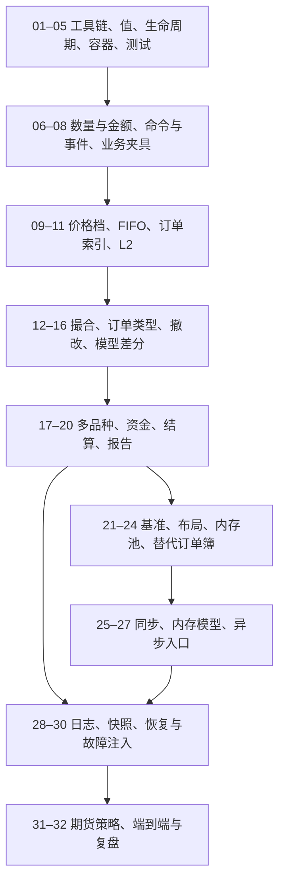

# 32 课路线图

每一课都有一个可构建的版本和一组可复现的验收条件。课程目录按 Day 编号，阶段分为 C++ 基础、业务模型、订单簿、撮合、引擎、性能、并发与恢复、集成。难度按有 Java 后端经验的读者估计，入门约 1–2 小时，常规约 2–4 小时，进阶建议拆成两次练习。时长只用于安排学习。

后续课均以前一课通过为默认条件。各课的「前置」点出当期会直接用到的知识。「读源码」中的类和方法可在[源码报告](java-source-analysis.md)找到链接。Day 01–32 均已有可跟做的正文，各阶段末尾给出验收门槛。

## 阶段一 · C++ 基础与工程环境（Day 01–05）

### Day 01 · 从一条成交金额公式搭起 C++ 工程

[阅读 Day 01 正文](../01-cpp-foundations/day-01.md)

- **前置与难度** · 能用终端运行命令，读得懂 Java 静态函数。入门。
- **学习与源码** · 从 `CoreArithmeticUtils.calculateAmountBid` 提取报价资产金额，理解最小单位、函数声明和定义、编译与链接、`int64_t`、`optional` 的基本使用以及有符号乘法边界。
- **设计与实践** · 在 `exchange-lab/` 中建立 `exchange_core` 静态库、`exchange_demo` 和 `exchange_tests`。写纯函数 `quote_notional`，命令行编译后再用 CMake 和 CTest 构建。
- **成果与验收** · `3 × 102 × 10 = 3060`。零数量成功，非法输入和溢出返回空，最大可表示值能返回。分别制造编译错误、链接错误和失败测试。
- **衔接** · Day 02 将函数的三个同型参数逐步收拢为有语义的值。

### Day 02 · 用值类型描述一笔委托

[阅读 Day 02 正文](../01-cpp-foundations/day-02.md)

- **前置与难度** · Day 01 的函数和头文件。入门。
- **学习与源码** · 读 `ApiPlaceOrder`、`Order` 和 `OrderAction`，识别请求与活动记录。讲 `struct/class` 默认访问权限、构造函数和初始化列表、`enum class`、`const` 成员函数、值拷贝和命名空间。
- **设计与实践** · 写仅用于本课的 `OrderDraft` 和 `Side`。输入相同 ID 的两份值副本，分别改数量。将拒绝非法数量的入口放在构造或工厂边界，解释哪种方案能表示业务失败。
- **成果与验收** · 非法草稿无法进入计算，拷贝后修改新对象不影响原值，无法把裸整数隐式作为 `Side`。演示复制和引用别名的不同结果。
- **衔接** · Day 03 追踪两个对象以及借用的存活时间。

### Day 03 · 生命周期、借用与 RAII

[阅读 Day 03 正文](../01-cpp-foundations/day-03.md)

- **前置与难度** · 值复制、构造函数和局部变量。常规。
- **学习与源码** · 结合 `Order` 的内部记录与 `DiskSerializationProcessor` 的 try-with-resources。讲作用域、自动和动态存储期、引用与指针、悬空借用、析构顺序、异常展开、`unique_ptr` 和所有权转移入门。
- **设计与实践** · 用构造和析构日志观察嵌套对象，写值参数和 `const&` 两种小函数。借用订单用于即时读取，用拥有值传给持久使用者。在临时文件练习 `std::ofstream` 的资源回收。
- **成果与验收** · 正常、提前返回和抛异常均能观察析构，析构顺序符合对象构造顺序的逆序。能画出返回局部引用的失效时间，使用 ASan 诊断受控的本地借用错误。
- **衔接** · Day 04 将拥有和借用的区分应用于容器。

### Day 04 · STL、迭代器和排序规则

[阅读 Day 04 正文](../01-cpp-foundations/day-04.md)

- **前置与难度** · 作用域、值、借用。常规。
- **学习与源码** · 读 `OrderBookNaiveImpl` 和 `OrdersBucketNaive` 字段，理解价格索引与订单队列是两个问题。讲泛型容器、模板实参、`vector/list/map/unordered_map`、迭代器、范围循环、`auto`、lambda 与严格弱序。
- **设计与实践** · 用五个价量值比较顺序遍历、指定键查询和删除。写升序和降序价格比较器，试一次 `vector` 扩容和 `unordered_map` rehash，记录可以继续使用的迭代器、指针和引用。
- **成果与验收** · 卖价输出 `100,101,103`，买价输出 `103,101,100`。给出等价键的比较结果，能解释 `<=` 作为比较器如何违反 irreflexivity。
- **衔接** · Day 05 把容器和金额例子变成重复可跑的测试。

### Day 05 · 组织目标、单元测试和调试

[阅读 Day 05 正文](../01-cpp-foundations/day-05.md)

- **前置与难度** · CMake/CTest 基本命令和容器。常规。
- **学习与源码** · 从 `OrdersBucketNaiveTest` 的 Arrange/Act/Assert 对照小测试。讲公开头、实现目标与链接依赖，CTest 退出码、Debug/Release、断点、ASan/UBSan，解释 `assert` 与 `NDEBUG`。
- **设计与实践** · 抽出小型 `check` 测试辅助函数，给两个靶点分配独立 CTest 名称，建立 Debug 和 Release 构建树。演示读取第一处错误、verbose build、在 LLDB/GDB 查看局部变量和调用栈。
- **成果与验收** · 两个构建目录通过同一组用例。刻意写错预期能在 Release 报错，并能通过 UBSan 找到本地故障样例的溢出点。
- **衔接** · Day 06 用相同方式测试金额及单位转换。

**阶段门槛。** 从空 build 目录能编译、链接、运行并报告失败。能讲出一个值由谁拥有，借用在哪次操作失效。

## 阶段二 · 交易业务模型（Day 06–08）

### Day 06 · 价格、数量与受检金额

[阅读 Day 06 正文](../02-trading-model/day-06.md)

- **前置与难度** · Day 01 的非负乘法、Day 02 的构造函数和 Day 05 的边界测试。常规。
- **学习与源码** · 读 `CoreSymbolSpecification`、`CoreArithmeticUtils`。区分 tick、lot、基础和报价资产最小单位。讲 `explicit`、强类型包装、`numeric_limits`、先检查再算的乘加以及负向会计调整。
- **设计与实践** · 定义 `Price`、`Quantity`、`Money` 和 `SymbolSpec`。写尺度、最小单位的转换和受检加减乘，保留 Day 01 公式作为测试夹具。预算金额与单价用不同的类型。
- **成果与验收** · 报价金额、冻结金额在零边界和最大值可核对。超界一单位返回失败，金额单位混用在编译期或构造边界被拒绝。
- **衔接** · Day 07 将强类型嵌入请求、结果和事件。

### Day 07 · 命令、事件与序号

[阅读 Day 07 正文](../02-trading-model/day-07.md)

- **前置与难度** · 强类型、枚举和值对象。常规。
- **学习与源码** · 读 `OrderCommand`、`IOrder`、`MatcherTradeEvent` 与结果码。区分一次命令处理结果、一次成交和订单剩余量。学习 `std::variant`、`std::visit`、聚合初始化及多分支穷尽检查。
- **设计与实践** · 在 `model.hpp` 定义 `OrderKey`、`PlaceOrder`、`CancelOrder`、`ReduceOrder`、`MoveOrder`、`Event`、`Result`。类型用 `LimitPrice` 或 `BudgetLimit` 表达。给一组手写事件加序号并格式化。
- **成果与验收** · 手写一条已处理的 IOC 回执，可读出两次成交和一次余量拒绝。订单 ID 与序号分离，日志输入不必从输出事件反推。
- **衔接** · Day 08 用纸面状态表定下预期。

### Day 08 · 从业务例子写出不变量

[阅读 Day 08 正文](../02-trading-model/day-08.md)

- **前置与难度** · 命令和事件的结构。常规。
- **学习与源码** · 读 `OrderBookBaseTest` 的市场化 GTC、IOC 和 FOK 预算场景。理解 BBO、maker/taker、价差、FIFO、价限和数量守恒。学习表驱动测试、`std::min`、状态转移表与测试 oracle。
- **设计与实践** · 手算 A@101×3、B@101×2、C@103×4 的例子，制作初始簿、命令、事件、末态四列表。再构造买卖镜像、时间戳逆序和同价改单例。
- **成果与验收** · 能在无引擎时断言 maker 顺序、成交价、成交量、余量和盘口。同一条输入中的「成交完成」和「余量拒绝」有可独立核对的量。
- **衔接** · Day 09 给夹具加入实体价格档。

**阶段门槛。** 价、量、金额、序号和订单 ID 在模型中可区分。用可手算的样例写出撮合期望，后续 C++ 实现不能修改期望来迁就输出。

## 阶段三 · 订单簿（Day 09–11）

### Day 09 · 买卖价档与 FIFO

[阅读 Day 09 正文](../03-order-book/day-09.md)

- **前置与难度** · `map`、`list`、严格弱序和价格时间优先。常规。
- **学习与源码** · 对照 Naive 两侧 `TreeMap` 和 `OrdersBucketNaive.put`。学习 `try_emplace`、插入迭代器与引用、链表节点稳定性。
- **设计与实践** · 实现 `OrderBook` 的两棵树和 `Level`。用内部测试构造器或夹具插入已知不可成交的活动单。维护每档余量，用 `begin` 定位最优档。
- **成果与验收** · 逆序输入仍产生正确的 BBO。相同价按插入顺序排列，外部时间戳逆序也不改队列。空簿和单侧簿可查询。
- **衔接** · Day 10 加入按 ID 寻址，替换扫描查找。

### Day 10 · 订单索引与失效规则

[阅读 Day 10 正文](../03-order-book/day-10.md)

- **前置与难度** · 价格树、链表借用和哈希表。进阶。
- **学习与源码** · 读 Naive 的 `idMap`、`cancelOrder`、`validateInternalState`。深入 `erase`、节点寿命、rehash、复制和移动对跨容器句柄的影响。
- **设计与实践** · `OrderLocation` 存方向、价和 list 迭代器。写查找、删除、空档回收和 `validate()`。用局部回滚处理插入第二个容器失败。用测试替身注入索引插入失败。
- **成果与验收** · 能核对档内和索引的一一对应。删除首、中、尾节点，重建散列表后已有链表句柄仍正确。失败插入不遗留空档或孤立节点。
- **衔接** · Day 11 从价格档投影 L2，而查询者无法修改簿。

### Day 11 · L2 快照和读边界

[阅读 Day 11 正文](../03-order-book/day-11.md)

- **前置与难度** · 价档、聚合量、只读借用。常规。
- **学习与源码** · 读 `IOrderBook.getL2MarketDataSnapshot` 和 Naive 的 `fillAsks/fillBids`。讲 `const` 遍历、返回值、`vector::reserve`、快照与视图的所有权。
- **设计与实践** · 写 `snapshot(depth)`，每侧输出价格、总量和笔数，另外提供测试用的规范化逐订单视图。比较复制值与暴露引用的观察期。
- **成果与验收** · 深度为 0、超出侧深度、空侧、单侧和重复查询均可核对。保留旧快照，再变更簿，旧快照内容保持原值。
- **衔接** · Day 12 把只读夹具换成能撮合的下单入口。

**阶段门槛。** 订单簿能解释谁拥有节点、索引如何定位节点、查询在什么时刻取得值。每次写入后都可验证所有不变量。

## 阶段四 · 撮合与订单生命周期（Day 12–16）

### Day 12 · GTC 限价撮合

[阅读 Day 12 正文](../04-matching-engine/day-12.md)

- **前置与难度** · Day 08–11 的手算夹具、价档、索引、事件值。进阶。
- **学习与源码** · 追踪 `newOrderPlaceGtc → subtreeForMatching → tryMatchInstantly → OrdersBucketNaive.match`。讲 while 循环不变量、`std::min`、擦除后继续遍历，以及 maker 价。
- **设计与实践** · `place` 先拒绝重复活动 ID，再从对手最优档扫单，推进两边余量。完成的 maker 同步删索引与节点，剩余 GTC 入队。结果事件必须在删除之前捕获必要字段。
- **成果与验收** · 同价吃单按 A 再 B，跨价成交按对手最优序。覆盖空簿、正好吃完、部分 maker、部分 taker 入簿和价限停止，验证量守恒及末态。
- **衔接** · Day 13 共用撮合循环，改变剩余量的去向。

### Day 13 · 带价限 IOC 与余量拒绝

[阅读 Day 13 正文](../04-matching-engine/day-13.md)

- **前置与难度** · 已有 GTC 循环和命令结果。常规。
- **学习与源码** · 对照 `newOrderMatchIoc`、`attachRejectEvent` 和 `SimpleEventsProcessor`。理解价限 IOC、无价限市价单和执行结果的观察差别。使用 `variant` 安全读事件。
- **设计与实践** · 复用 GTC 的价限扫单，IOC 余量生成 `RejectRemainder`，事件序列按课程契约排列。检查未知类型进入明示的拒绝路径。
- **成果与验收** · 101 两单总 5 手，限 102 的 IOC 买 6 手时成交事件合计 5 手，拒绝 1 手，103 档不动。零成交和全成交也要测试。
- **衔接** · Day 14 需要在执行前知道整笔是否能成交。

### Day 14 · FOK_BUDGET 的两遍执行

[阅读 Day 14 正文](../04-matching-engine/day-14.md)

- **前置与难度** · 受检乘加、IOC、档位总量。进阶。
- **学习与源码** · 读两版 `checkBudgetToFill`、`isBudgetLimitSatisfied` 和 Direct 的限价分支。讲只读试算、显式失败类型、空值与哨兵值的域冲突。
- **设计与实践** · 用档位总量试算 `Σqᵢpᵢ`，区分量不足、买预算不足、卖收入不足和溢出。同一所有者中试算成功后立即按相同顺序执行，买卖双方均以预算约束判定可行性。
- **成果与验收** · 买 6 手的总额 608 时，预算 607 整笔拒绝且状态相同，608 成交。卖侧验证相反不等号，测试正好等于整数上限。
- **衔接** · Day 15 把同一撮合函数用于改价后重新入场。

### Day 15 · 撤单、减量与改价

[阅读 Day 15 正文](../04-matching-engine/day-15.md)

- **前置与难度** · 订单定位、事件语义、价限撮合。进阶。
- **学习与源码** · 读两份簿的 `cancelOrder/reduceOrder/moveOrder`。学习复用内部操作、值事件的构造及多处状态同步。
- **设计与实践** · 按 ID 和用户校验，撤单和减量共用扣减逻辑，改价先检查预留价再摘旧节点。新价可先成交，剩余量入队尾。对正负量、订单不存在和越权保留明确结果。
- **成果与验收** · 减量后位置不动，同价改价排到 B 后面。现货买方超预留价失败且簿未变。撤销部分成交单只撤剩余量。
- **衔接** · Day 16 以混合命令序列查组合缺陷。

### Day 16 · 参考模型、差分与可缩减用例

[阅读 Day 16 正文](../04-matching-engine/day-16.md)

- **前置与难度** · GTC、IOC、预算、撤减改均可单独运行。进阶。
- **学习与源码** · 看 `multipleCommandsKeepInternalStateTest` 与 `IOrderBook.stateHash`。学确定性 PRNG、基于属性的断言、独立参考模型和失败样例缩减。
- **设计与实践** · 写一个小规模慢速模型，用扁平序列扫描或排序。固定种子生成有效和无效命令，每一步比较事件、活动订单次序和 L2。缩小失败序列时保留触发错误的命令前缀。
- **成果与验收** · 报告 seed、命令位置、最小复现和首个差异。针对一次有意破坏 FIFO 或漏删索引的变更，测试可以抓到。
- **衔接** · Day 17 在可靠的单簿上加多品种入口。

**阶段门槛。** 所有真实支持的订单类型和撤改经过规则样例与独立模型验证。能定位差异出现在结果事件、价格队列还是索引。

## 阶段五 · 引擎、风控与结算（Day 17–20）

### Day 17 · 多品种同步引擎与提交边界

[阅读 Day 17 正文](../05-engine-architecture/day-17.md)

- **前置与难度** · 强类型、事件、所有权及差分测试。进阶。
- **学习与源码** · 读 `MatchingEngineRouter.processMatchingCommand`、`ExchangeApi` 和 `IOrderBook.processCommand`。讲 `unique_ptr` 所有权、命令分派、单调序号、准备与提交、异常安全的基本与强保证。
- **设计与实践** · 实现 `SymbolCatalog`、`Command`、`Engine::execute`。把簿更新提炼成只读计划及应用。先实现活动订单遍历、临时重建、验证和指针交换路径，为账本原子提交留好入口。
- **成果与验收** · 两个品种可以持有同号订单而互不影响。命令可关联结果，未知品种或索引准备失败不会留下变更。
- **衔接** · Day 18 把开户、入出金和订单冻结接到准备阶段。

### Day 18 · 账户、资金流水与预冻结

[阅读 Day 18 正文](../05-engine-architecture/day-18.md)

- **前置与难度** · 受检金额、命令分派与准备阶段。进阶。
- **学习与源码** · 读 `UserProfileService.balanceAdjustment`、`suspendUserProfile` 和 `RiskEngine.placeExchangeOrder`。理解每币种可用、每订单冻结、流水幂等和买单预留价。
- **设计与实践** · 写 `Ledger` 的开户、调整、暂停和恢复。课程暂停条件要求可用余额为零且无活动冻结或订单。用纯函数计算普通买单、预算买单及卖单的冻结计划，`Engine` 将冻结与簿变更一起提交。
- **成果与验收** · 同流水号只生效一次，老流水或余额不足失败。冻结、重复下单、未知用户、暂停用户均可核对。单元夹具先验挂簿冻结，主动成交结算由 Day 19 接入后放行。
- **衔接** · Day 19 将已成交部分转换为结算分录，并退还差额。

### Day 19 · 成交结算、费用与守恒

[阅读 Day 19 正文](../05-engine-architecture/day-19.md)

- **前置与难度** · Day 12–15 的全部撮合事件、Day 18 的冻结。进阶。
- **学习与源码** · 读 `handlerRiskRelease`、`handleMatcherRejectReduceEventExchange`、`handleMatcherEventsExchangeBuy/Sell`。讲跨账本状态提交、先计算后写入、按币种聚合和同账户两种角色的增量合并。
- **设计与实践** · 批量计算 maker/taker 资金分录。成交把基础资产给买方、报价资产给卖方，另计费用。释放买方价差和 maker 费差、撤减退款、预算多余金额。覆盖跨簿与账本一次提交的失败路径。
- **成果与验收** · 复算源码报告的 `426 = 398 + 20 + 8`。验证买卖镜像、撤减、IOC、FOK、部分成交后改价，逐币种核对净入金，算术失败时簿与账本均无变化。
- **衔接** · Day 20 输出账户、委托和总额报告。

### Day 20 · 结果发布、报告和集成夹具

[阅读 Day 20 正文](../05-engine-architecture/day-20.md)

- **前置与难度** · 现货完整提交边界、L2 值快照。常规。
- **学习与源码** · 对照 `SimpleEventsProcessor`、三类 `ReportQuery` 和二进制批量帧。学习序号下的只读报告、聚合归并、状态规范化和稳定排序。
- **设计与实践** · 写批量品种/账户初始化命令、单用户及总币种报告、规范化状态指纹。给演示程序写一段「登记 → 入金 → 下单 → 成交 → 撤余量 → 查询」输入。
- **成果与验收** · 查询携带观察序号。报告中的挂单、冻结和可用资金相符。异常回调对已提交状态无影响，保留回执能跨后续命令读取。
- **衔接** · Day 21 以这套夹具建立性能负载。

**阶段门槛。** 同步入口可跑两品种的现货端到端，账本逐币种守恒。查询报告和异常路径均能通过 CTest 复现。

## 阶段六 · C++ 进阶与性能（Day 21–24）

### Day 21 · 为吞吐和尾延迟建立基线

[阅读 Day 21 正文](../06-performance/day-21.md)

- **前置与难度** · Release 构建和可确定复现的负载。常规。
- **学习与源码** · 对照 `LatencyTestsModule`、`ThroughputTestsModule` 与 README 的配置。讲 `steady_clock`、预热、p50/p99、均摊、计时器扰动和 coordinated omission。
- **设计与实践** · 写 `bench/`，分别测挂单、撤单、跨档成交及混合命令。固定 seed、分布、规模、预填状态，统计多轮吞吐、延迟和事件条数，注明测量点。
- **成果与验收** · 保存机器、编译器、编译选项、规模、重复次数和原始计数。可解释相同样本数下吞吐、平均值与 p99 可能如何背离。
- **衔接** · Day 22 从复制、分配和内存访问解释一个测量现象。

### Day 22 · 移动语义、布局与缓存局部性

[阅读 Day 22 正文](../06-performance/day-22.md)

- **前置与难度** · RAII、容器、测量基线。进阶。
- **学习与源码** · 对照 Direct 节点字段和 `OrderCommand` 环槽。系统讲左值/右值、移动构造、`std::move`、`noexcept`、拷贝消除、对齐、padding、AoS 与 SoA。
- **设计与实践** · 统计值事件复制/移动，测试连续与离散订单节点的扫描，测实际分配并记录 `sizeof` 适用边界。比较结果按值返回和重复拷贝的路径。
- **成果与验收** · 能解释移动后对象的可用范围。报告同数据规模下的分配次数、遍历时间和方差，结论注明机器及样本条件。
- **衔接** · Day 23 用稳定句柄解决紧凑节点存储的生命周期。

### Day 23 · 对象池、侵入链与句柄寿命

[阅读 Day 23 正文](../06-performance/day-23.md)

- **前置与难度** · 缓存布局、所有权、节点失效。进阶。
- **学习与源码** · 读 Direct 的 `insertOrder/removeOrder`、`ObjectsPool` 的使用。学习自由链、索引加 generation、槽位复用、容量和 generation 耗尽策略。
- **设计与实践** · 写隔离的订单节点池。用池索引连接双向链，释放时标记空槽并更新代数，拒绝旧句柄。比较 `std::pmr` 分配器替换与主动改布局的成本。
- **成果与验收** · 池满、头尾删除、重复释放、槽位重用、旧句柄访问都有用例。通过 sanitizers 验证生命周期操作。
- **衔接** · Day 24 用池承载第二种订单簿并跑同样语义。

### Day 24 · 替代订单簿及策略接口

[阅读 Day 24 正文](../06-performance/day-24.md)

- **前置与难度** · 参考模型、基准和节点池。进阶。
- **学习与源码** · 对照 `IOrderBook.OrderBookFactory` 与 `OrderBookDirectImpl`。理解双向链邻居定位、基数树思想、纯虚接口、虚析构、静态与动态分派。
- **设计与实践** · 引入 `Book` 接口，保留原树/链表版。第二版先保留价格树，每档用池句柄缓存队首与队尾，最优档仍由价格树首项提供。基数树作为比较实验，不与节点布局同时切换。
- **成果与验收** · 两种簿对同 seed 和边界用例产生一致的事件及规范状态。运行相同基准，记录变化与回归，包括池满和初始化成本。
- **衔接** · Day 25 保持单簿单写者，先测试并发入口。

**阶段门槛。** 能用差分测试更换订单簿。性能报告描述实验而不预先规定提速结果。

## 阶段七 · 并发、日志与恢复（Day 25–30）

### Day 25 · 线程、锁和有界阻塞队列

[阅读 Day 25 正文](../07-concurrency/day-25.md)

- **前置与难度** · RAII、移动和值所有权。进阶。
- **学习与源码** · 对照 `PerformanceConfiguration` 的阻塞等待与忙等。学习线程、数据竞争、`mutex`、`unique_lock`、条件变量谓词、伪唤醒、背压、`jthread` 和 join。
- **设计与实践** · 独立实现有界队列，`try_push` 满载立即返回，`pop` 阻塞到有元素或关闭。关停后停止接纳并排空。队列元素拥有命令和结果承诺。
- **成果与验收** · 容量 1、多个生产者、等待中关闭和重复关闭都能终止。测试用屏障或闩锁控制交错，避免以 sleep 判断正确性。
- **衔接** · Day 26 解释锁为什么足够，再单独试无锁交接。

### Day 26 · C++ 内存模型与 SPSC 实验

[阅读 Day 26 正文](../07-concurrency/day-26.md)

- **前置与难度** · 同步原语、线程所有权、固定容量。进阶。
- **学习与源码** · 对照 `GroupingProcessor`、`TwoStepMasterProcessor` 和 `TwoStepSlaveProcessor` 的序号可见性。学习 happens-before、`atomic`、relaxed/acquire/release、槽的发布与回收、计数器回绕和伪共享。
- **设计与实践** · 画单生产者、单消费者对每槽的拥有期，再实现固定容量 SPSC 演示。先证明发布可见，后证明消费完后才可复写。比较 mutex 队列。
- **成果与验收** · 固定容量反复绕环无重、漏、乱。用 TSan 检查支持的环境，并用时间线解释 release/acquire 保障的边界。第二个生产者由实验契约禁止。
- **衔接** · Day 27 在实际入口优先使用已通过多生产者测试的队列。

### Day 27 · 异步入口、结果与关停

[阅读 Day 27 正文](../07-concurrency/day-27.md)

- **前置与难度** · 同步引擎、Day 25 队列、Day 26 内存模型。进阶。
- **学习与源码** · 比较 `ExchangeApi.promises`、`ResultsHandler` 和 `ExchangeCore.shutdown`。学习 promise/future、move-only 工作项、业务拒绝和队列拒绝、异常传播、join 顺序。
- **设计与实践** · `AsyncEngine` 持有唯一工作线程与 `Engine`。入队成功才返回有效 future，引擎取出后分配 seq，提交后完成 future。关闭排空已接受请求。画出 Java 的品种分片和用户分片轴，分析跨分片结算仍需哪些屏障。
- **成果与验收** · 多生产者结果按 seq 重排后可用同步引擎重放。满队列、关闭竞争、工作线程异常、结果滞留均有验收。
- **衔接** · Day 28 给同一个同步命令序号写日志。

### Day 28 · 可重放命令日志

[阅读 Day 28 正文](../07-concurrency/day-28.md)

- **前置与难度** · 命令分派、RAII、受检整数与顺序边界。进阶。
- **学习与源码** · 读 `OrderCommandType.isMutate` 和 `DiskSerializationProcessor.writeToJournal`。讲显式字节序、长度前缀、版本、校验、`std::byte`、有界解析、flush 与耐久点。
- **设计与实践** · 编解码规范化命令，追加 seq、版本、长度和校验。写入失败阻止提交并将引擎置于故障态。用相同入口重放，回放抑制对外回调与再记日志。
- **成果与验收** · 往返保留每种命令，未知版本与长度异常失败，完整坏帧拒绝。查询造成的序号空洞合法，倒序和重复日志序号被拦截。重启后首条命令从可恢复序号继续，跨实例查询位置带运行实例标识。
- **衔接** · Day 29 用快照缩短重放路径。

### Day 29 · 快照、索引重建与版本

[阅读 Day 29 正文](../07-concurrency/day-29.md)

- **前置与难度** · 值快照、完整状态边界、命令编解码。进阶。
- **学习与源码** · 读 `ApiPersistState`、`storeData/loadData`、Naive 的反序列化构造器。理解状态切点、规范化排序、不可序列化的迭代器、恢复时的重新校验。
- **设计与实践** · 在命令间隙导出配置、seq、价档及 FIFO、账户、冻结、费用和资金流水。写临时文件并采用同一目录的替换策略，加载到临时状态后重建索引，再重放快照之后的日志。
- **成果与验收** · 对比纯日志、快照加尾日志与不重启三种路径的规范状态及变更命令的尾段事件。损坏快照不替换正在使用的状态。
- **衔接** · Day 30 用故障矩阵测试顺序假设。

### Day 30 · 故障注入和恢复核对

[阅读 Day 30 正文](../07-concurrency/day-30.md)

- **前置与难度** · 并发入口、日志和快照。进阶。
- **学习与源码** · 对照 `JournalingTestsModule` 与 `PersistenceTestsModule`。学习 I/O 故障注入、截断尾帧策略、恢复游标、可重复进程测试。
- **设计与实践** · 在记录写入中途、完整记录写入后、快照落地前后及关闭时终止进程或注入错误，按课堂约定判断可恢复前缀。定义未知结果的调用方重查方式，资金流水以既有序号规则防重。
- **成果与验收** · 重启后核对 FIFO、事件明细、账户余额、冻结和最后可恢复序号。坏帧、尾部截断与丢失确认的结果有明确结论，记录 OS 与刷盘条件。
- **衔接** · Day 31 将版本化状态扩展到期货仓位。

**阶段门槛。** 同一日志可重放出与同步执行一致的状态。队列关闭和重启不遗留等待者。能说明接纳、提交、确认和耐久各自发生在哪里。

## 阶段八 · 期货与系统集成（Day 31–32）

### Day 31 · 按 Java 源码接入期货风险与持仓

[阅读 Day 31 正文](../08-integration/day-31.md)

- **前置与难度** · 现货结算、事件、受检算术、状态版本。进阶。
- **学习与源码** · 读 `SymbolPositionRecord` 和 `RiskEngine.canPlaceMarginOrder/handleMatcherEventMargin`。讲有符号仓位、pending、最坏方向保证金、平仓与反手、费用口径和快照兼容。
- **设计与实践** · 提取 `SpotRisk` 和 `FuturesRisk`。从单品种手算扩展到共用币种账户，按 Java 当前行为实现盘口估值、缺失行情分支、开仓计费、部分平仓成本累计和持仓释放。保留顺序敏感的 freeMargin 赋值及源依赖次序，直接运行 Java 方法与 C++ 比较 408 行轨迹。仓位编解码与版本检查在 Day 32 实现。
- **成果与验收** · 覆盖多头开仓、同向增仓、部分平仓、完全平仓、反手、撤单释放 pending、保证金不足、仓位恢复。用手算表核对数量、成本、利润和费用；覆盖期货 FOK_BUDGET、超预留价改价、同币种现货余量与现金出金。
- **衔接** · Day 32 在独立现货及期货场景核对整条链路。

### Day 32 · 版本升级、完整集成验收与架构复盘

[阅读 Day 32 正文](../08-integration/day-32.md)

- **前置与难度** · 前七阶段门槛与期货策略。进阶。
- **学习与源码** · 回读 `ITCoreExample`、端到端费用用例和持久化用例。学习回归矩阵、可追溯测试证据与版本化的架构记录。
- **设计与实践** · 从干净工作目录按 README 构建两种簿。升级日志、快照到 v2 并读取 v1，保存价格缓存、仓位与键表次序。运行同步/异步、现货/期货、内存/纯日志/快照尾日志的 24 组合和三种子，共 72 次场景，保存 seed、日志、末态和失败复现。比较基线与替代簿的速度及内存。为 Java 式分片、STP 或网络入口挑一个扩展，写出依赖和不变量。
- **成果与验收** · 从零创建工程可运行，核心命令有正常与异常测试，同序列输出一致。逐币种现货守恒、期货持仓变化可手算，快照和日志恢复可复现。性能结论标出测量条件。
- **衔接** · 保留能独立复现的引擎版本与验收说明，扩展从当前通过的版本开始。

[开始 Day 01](../01-cpp-foundations/day-01.md) · [学习进度与阶段门槛](../appendix/learning-progress.md)
