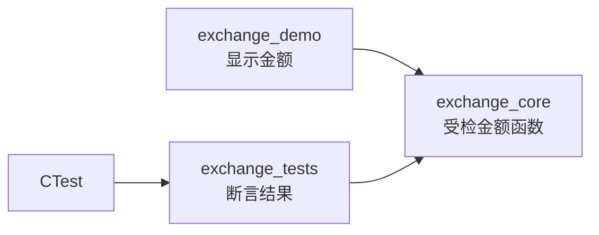

# Day 01 · 从一条成交金额公式搭起 C++ 工程

## 1. 本期内容与学习目标

一笔 3 手的订单在 102 个价格步成交，品种规定每「手 × 价格步」对应 10 个报价币最小单位。演示程序需要算出 3060，并在遇到越界输入时明确报告失败。这条公式够小，你能手算每条测试，也能借它看清 C++ 源文件怎样变成一个可执行程序。

这是[阶段一](../00-overview/learning-roadmap.md)的第一课，难度入门，预计 1–2 小时。你需要会在终端切换目录、创建文本文件，能读懂 Java 静态函数。完成后应能区分声明和定义、读出编译与链接错误、用 CMake 构建三个目标，并在 CTest 中观察成功与失败。金额函数会留在学习工程里，等 Day 06 用有单位的类型包住参数。

## 2. 业务背景与原理

假设一笔交易的计价单位是报价币的最小单位。引擎约定数量输入为整数手数，价格输入为整数步数。报价资产金额按下式计算。

$$
\mathrm{quoteNotional} = \mathrm{quantityLots} \times \mathrm{priceSteps} \times \mathrm{quoteScale}
$$

| 输入或结果 | 本例 | 单位 |
| --- | ---: | --- |
| 成交数量 | 3 | 手 |
| 成交价格 | 102 | 价格步 |
| 报价缩放系数 | 10 | 每「手 × 价格步」对应的报价币最小单位 |
| 成交金额 | 3060 | 报价币最小单位 |

账本往后会用这个金额给买方扣款、给卖方入账，再分别结算费用。如果相同的输入在一个模块算成 3060，另一个模块因溢出算成负数，余额核对就失去意义。本课先给函数定清输入域。数量可为零，价格和缩放系数必须严格为正。计算成功时返回非负金额。非法输入和结果超界共享一个空值，Day 06 再把错误细分。订单本身的有效数量将由后续入站校验要求严格为正。

不用浮点来换取更大的范围。这里需要的是整数最小单位可精确核对。若三个合法的非负整数中有两个很大，就算最终变量声明成 64 位，表达式里的乘法也仍可能超界。

## 3. Java 原始项目的实现分析

在 `CoreArithmeticUtils.calculateAmountBid(long size, long price, CoreSymbolSpecification spec)` 中，公式为 `size * (price * spec.quoteScaleK)`。`CoreSymbolSpecification` 保存 `baseScaleK`、`quoteScaleK` 和费率，`RiskEngine.handleMatcherEventsExchangeBuy` 在给卖方 maker 入账时调用金额函数，再减去 maker 费用。`calculateAmountBidTakerFee` 用于买单预冻结，额外计入每手 taker 费。 [Java 金额公式](https://github.com/exchange-core/exchange-core/blob/2f8548749839e9095c8dc597e4b61521d259fa5d/src/main/java/exchange/core2/core/utils/CoreArithmeticUtils.java#L24-L43) · [品种规格](https://github.com/exchange-core/exchange-core/blob/2f8548749839e9095c8dc597e4b61521d259fa5d/src/main/java/exchange/core2/core/common/CoreSymbolSpecification.java#L37-L45) · [卖方 maker 入账](https://github.com/exchange-core/exchange-core/blob/2f8548749839e9095c8dc597e4b61521d259fa5d/src/main/java/exchange/core2/core/processors/RiskEngine.java#L764-L770)

把这条函数放在工具类，风险的多个分支就能共享同一套尺度换算。这是可复用的设计。原方法的乘法为常数次直接运算，函数内部没有溢出检查。对 Java `long`，乘法超界后的低 64 位行为有定义。C++ 有符号运算超出可表示范围时有未定义行为，因此 C++ 版本要在乘法前检查。 [Java 语言规范的整数运算](https://docs.oracle.com/javase/specs/jls/se17/html/jls-4.html#jls-4.2.2) · [C++ 表达式结果范围](https://eel.is/c++draft/expr.pre#4)

读源码时可从 `calculateAmountBid` 反查调用点，分别标记「实际成交金额」和「预冻结」。本课实现前者的受检计算，函数接受三个整数，调用者暂时负责提供正确的单位。

## 4. 本期 C++ 知识

### 4.1 从文本到可执行文件

在 Java 中，`javac` 解析源码并输出字节码，JVM 加载类并解释或编译热点代码。常见 C++ 工具链把各个 `.cpp` 与其包含的内容作为翻译单元处理，生成包含机器码和符号引用的目标文件，再由链接器解析符号并组合可执行文件。本课在终端输入的 `c++` 是驱动程序，它按参数调用适当的工具。 [C++ 翻译阶段](https://eel.is/c++draft/lex.phases)

`#include "exchange/notional.hpp"` 让预处理器查找项目头文件并纳入声明。头文件搜索从配置的包含路径中找。`#include <cstdint>` 通过工具链的标准头搜索规则取得标准库类型。`#ifndef`、`#define`、`#endif` 构成包含保护，同一翻译单元再次包含这个头时可跳过重复内容。

函数声明给编译器足够的签名信息来检查调用。带函数体的是定义。把一个普通外部链接函数定义放在 `notional.cpp`，调用它的演示和测试都包含声明并链接同一个库。若定义被两个翻译单元各自提供，可能违反单一定义规则。`namespace exchange { ... }` 给名字分组，`exchange::quote_notional` 的 `::` 选取该命名空间下的函数。 [C++ 单一定义规则](https://eel.is/c++draft/basic.def.odr)

试着预判下面两个错误的出现时机。删掉 `#include "exchange/notional.hpp"`，编译器可能在看见调用时找不到声明。保留头文件和调用，只链接演示的目标文件，编译可以成功，链接器才会报告未定义符号。第 7 节会亲手区分它们。

### 4.2 值、整数与函数

`std::int64_t` 是可用平台上的精确 64 位有符号整数类型，范围为 $-2^{63}$ 至 $2^{63}-1$。它来自 `<cstdint>`。`std::` 表示标准库命名空间。Java `long` 固定 64 位，C++ 的裸 `long` 宽度因平台而异，因此接口显式使用 `std::int64_t`。参数按值传递，调用方与函数体内的整数变量各自持有值。`const` 标记本地变量初始化后不再赋值。`{ }` 界定作用域，`;` 结束本例的声明、表达式语句和 `return`。

对正因子 `b` 以及非负 `a`，检查 `a > max / b` 即可判断乘积是否超出上界。整数除法在这里向下取整，因此 `a == max / b` 可以计算。必须先处理 `b <= 0`，再使用除法。两次乘法分别检查。例如 `max × 1 × 2` 第一段成功，第二段失败。先算乘积再查是否为负，在 C++ 中已经经过可能的未定义行为。 [C++ 乘除运算规则](https://eel.is/c++draft/expr.mul)

`std::numeric_limits<std::int64_t>::max()` 从 `<limits>` 取得类型上界。`numeric_limits<T>` 是模板，尖括号中的类型决定要查询哪个类型的属性。本课通过它读取上界，Day 04 再专门讨论模板参数与实例化。

### 4.3 用值表达「可能失败」

`std::optional<T>` 表达一个值或空状态。`std::nullopt` 构造空状态，返回一个整数时可用它构造有值的 `optional<int64_t>`。底层由 optional 管理所含值的生命周期，值放在 optional 自身的存储内。`if (result)` 测试是否有值，`*result` 访问其中的值。只在确认有值后解引用。金额 `0` 可以是一个存在的值，`if (result)` 对它仍为真。Java 可以用 `OptionalLong` 表达相同的两态。 [C++ optional 的对象模型](https://eel.is/c++draft/optional.general)

下面是独立的两态练习。把它保存成 `optional_probe.cpp`，在 macOS/Linux 用 `c++ -std=c++20 optional_probe.cpp -o optional_probe && ./optional_probe` 运行。Windows 的 Visual Studio Developer Command Prompt 用 `cl /nologo /std:c++20 /EHsc optional_probe.cpp`，再运行 `optional_probe.exe`。

```cpp
#include <iostream>
#include <optional>

int main() {
    const std::optional<int> zero{0};
    const std::optional<int> missing{std::nullopt};

    if (zero) {
        std::cout << "present: " << *zero << '\n';
    }
    if (!missing) {
        std::cout << "missing\n";
    }
    return 0;
}
```

`int main()` 是本例的程序入口。`return 0` 向调用环境报告成功。花括号 `{0}` 初始化变量。`!` 取反，`std::cout` 表示标准输出，连续的 `<<` 把文字和整数依次写入流，`'\n'` 是换行字符。预期依次输出 `present: 0` 和 `missing`。 [C++ main 入口](https://eel.is/c++draft/basic.start.main)

本课也会用到 `std::cerr` 输出错误，`||` 表示任一条件成立且从左到右短路，`==` 比较两值是否相等，`&&` 在左边为真时才评估右边。测试里把「有值」放在 `&&` 左侧，右侧才取值。这样即使被测函数意外返回空，测试也会输出失败名称。

## 5. 架构设计与技术选型

`quote_notional` 的输入是数量、价格、缩放系数三个 `int64_t` 值，输出为报价币最小单位或空值。函数不接触文件、账户和全局可变状态。只做两次有上界检查的乘法，因此时间与额外空间都是 `O(1)`。演示程序负责打印，测试程序负责判断。两者使用相同库定义。



| 方案 | 长处 | 代价 |
| --- | --- | --- |
| 把公式直接写在 `main` | 一次编译即可看到结果 | 测试若复制公式，两处可能一起错。后续账本难以复用 |
| 头文件声明加独立实现 | 两个调用者链接同一份实现，可逐步扩成核心库 | 首次要处理目标、头文件路径和链接依赖 |
| 在更宽的整数中先计算 | 如果中间类型确实足够宽，可以简化某些溢出检测 | 三个 64 位量的乘积甚至可能超出 128 位。扩展整数也需考虑编译器兼容 |

本课采用第二种组织和除法预检。三个参数暂时同型，写错顺序会通过编译。Day 02 和 Day 06 会逐步引入专用类型。`optional` 足够回答本期调用者关心的「能否计算」，待调用者需要分别解释输入错误和容量错误时，再引入更丰富的结果类型。

## 6. 从零逐步实现

### 6.1 准备工具和目录

macOS 可以先用 `xcode-select --install` 安装 Command Line Tools。Linux 安装发行版提供的 C++ 编译工具链和 CMake，例如 Ubuntu/Debian 中的 `build-essential` 与 `cmake`，并核对版本。Windows 安装 Visual Studio 或 Build Tools 的「使用 C++ 的桌面开发」工作负载，从对应的 Developer Command Prompt 运行命令。CMake 需要 3.20 或更新。 [Apple Command Line Tools](https://developer.apple.com/documentation/xcode/installing-the-command-line-tools) · [Microsoft C++ 命令行工具](https://learn.microsoft.com/en-us/cpp/build/building-on-the-command-line?view=msvc-170) · [CMake 3.20 CLI](https://cmake.org/cmake/help/v3.20/manual/cmake.1.html)

macOS/Linux 在终端运行以下命令。`-p` 会创建需要的上级目录，`-I` 后续会用到这个布局。

```bash
c++ --version
cmake --version
mkdir -p exchange-lab
cd exchange-lab
mkdir -p include/exchange src app tests
```

Windows 在 Developer Command Prompt 运行 `cl` 和 `cmake --version` 检查工具，使用 `mkdir exchange-lab`、`cd exchange-lab`，再创建 `include\exchange`、`src`、`app`、`tests`。以下各文件的内容在三个系统中相同。构建命令从 `exchange-lab` 根目录运行。

```text
exchange-lab/
├── CMakeLists.txt
├── include/exchange/notional.hpp
├── src/notional.cpp
├── app/main.cpp
└── tests/notional_test.cpp
```

### 6.2 写声明与受检实现

先创建公开头 `include/exchange/notional.hpp`。`EXCHANGE_NOTIONAL_HPP` 是包含保护的名字，在项目头里保持唯一。声明列出返回类型、函数名和三个参数，以 `;` 结束。

```cpp
#ifndef EXCHANGE_NOTIONAL_HPP
#define EXCHANGE_NOTIONAL_HPP

#include <cstdint>
#include <optional>

namespace exchange {

std::optional<std::int64_t> quote_notional(
    std::int64_t quantity,
    std::int64_t price,
    std::int64_t quote_scale);

}

#endif
```

再创建 `src/notional.cpp`。实现文件也包含自己的公开头，便于编译器检查同一翻译单元中能看到的声明和定义。小心，给定义误写了另一组参数类型可能形成重载，仍可能直到链接调用者才发现原签名缺失。

```cpp
#include "exchange/notional.hpp"

#include <limits>

namespace exchange {

std::optional<std::int64_t> quote_notional(
    std::int64_t quantity,
    std::int64_t price,
    std::int64_t quote_scale) {
    if (quantity < 0 || price <= 0 || quote_scale <= 0) {
        return std::nullopt;
    }

    const std::int64_t max_amount = std::numeric_limits<std::int64_t>::max();
    if (quantity > max_amount / price) {
        return std::nullopt;
    }

    const std::int64_t lots_times_steps = quantity * price;
    if (lots_times_steps > max_amount / quote_scale) {
        return std::nullopt;
    }

    return lots_times_steps * quote_scale;
}

}
```

函数体先排除负数量和非正因子，再检查 `quantity × price`，最后检查乘缩放系数的一步。这里调整了 Java 示例的计算顺序。在本课输入域中，正因子均至少为 1。数量为零时，先算 `quantity × price` 得到零，即使 `price × quote_scale` 单独计算会溢出，仍可返回正确的零。用 `quantity=0, price=max, quote_scale=max` 检验这一点。

在 macOS/Linux 执行下面的命令。`-std=c++20` 选择语言模式，`-Iinclude` 添加项目头目录，`-c` 只生成目标文件，`-o` 指定输出位置。`mkdir -p` 保证链接产物集中到临时构建目录。

```bash
mkdir -p build-manual
c++ -std=c++20 -Iinclude -c src/notional.cpp -o build-manual/notional.o
```

预期返回终端提示符，目录出现 `notional.o`。这个目标文件实现了库函数。若找不到 `exchange/notional.hpp`，先核对当前路径是否是 `exchange-lab`，再看 `-Iinclude` 与 `include/exchange/` 是否一致。Windows 可直接使用后面的 CMake 步骤，查看 `--verbose` 输出中的编译与链接过程。

### 6.3 写程序并观察链接

创建 `app/main.cpp`。`if (!amount)` 先处理空值，向标准错误打印并返回 1。正常路径访问内部整数并打印。

```cpp
#include "exchange/notional.hpp"

#include <iostream>

int main() {
    const std::optional<std::int64_t> amount =
        exchange::quote_notional(3, 102, 10);

    if (!amount) {
        std::cerr << "invalid inputs or amount overflow\n";
        return 1;
    }

    std::cout << "quote notional: " << *amount << '\n';
    return 0;
}
```

`main.cpp` 从公开头获得 `optional` 和 `int64_t`，这些类型出现在该头的公开接口。参数 3、102、10 是整数常量，调用时转为形参的 `int64_t` 类型。按值返回的结果由 `main` 的局部变量持有，打印后随作用域结束销毁。

在 macOS/Linux 手动编译并链接。先生成另一个目标文件，然后一次提供两个目标文件给驱动。

```bash
c++ -std=c++20 -Iinclude -c app/main.cpp -o build-manual/main.o
c++ build-manual/main.o build-manual/notional.o -o build-manual/exchange_demo
./build-manual/exchange_demo
```

预期输出 `quote notional: 3060`。第二行用 `c++` 驱动链接，驱动会按工具链配置加入所需的 C++ 运行库。若把 `notional.o` 从第二行省去，声明仍可见，链接器缺少对应定义。

### 6.4 用 CMake 表达同一张依赖图

在根目录创建 `CMakeLists.txt`。第 7 节会创建这里引用的 `tests/notional_test.cpp`，完成后再运行 CMake。

```cmake
cmake_minimum_required(VERSION 3.20)
project(exchange_lab LANGUAGES CXX)

set(CMAKE_CXX_EXTENSIONS OFF)

add_library(exchange_core STATIC src/notional.cpp)
target_compile_features(exchange_core PUBLIC cxx_std_20)
target_include_directories(exchange_core PUBLIC include)

add_executable(exchange_demo app/main.cpp)
target_link_libraries(exchange_demo PRIVATE exchange_core)

enable_testing()
add_executable(exchange_tests tests/notional_test.cpp)
target_link_libraries(exchange_tests PRIVATE exchange_core)
add_test(NAME quote_notional COMMAND exchange_tests)
```

`add_library(... STATIC ...)` 用目标文件建立静态库。`target_compile_features` 要求库及链接它的目标支持 C++20，`CMAKE_CXX_EXTENSIONS OFF` 请求目标使用标准语言模式。`target_include_directories` 的 `PUBLIC` 让库和依赖者都能找到头文件。`target_link_libraries(... PRIVATE ...)` 表示这个可执行程序自身使用该库。`add_test` 给 CTest 注册一个要运行的程序，程序退出码决定测试是否成功。 [CMake 编译特性](https://cmake.org/cmake/help/v3.20/command/target_compile_features.html) · [链接目标](https://cmake.org/cmake/help/v3.20/command/target_link_libraries.html) · [CTest 命令](https://cmake.org/cmake/help/v3.20/manual/ctest.1.html)

CMake 配置并生成构建系统，后端才编译和链接。`-S .` 指向项目根，`-B build` 把生成的缓存、目标文件和二进制放在 `build/`。切换编译器或生成器时另建目录，避免继承旧缓存。

## 7. 测试、调试与验证

创建 `tests/notional_test.cpp`。`check` 接收布尔值、场景名和一个计数器的引用。`int&` 是对调用方整数的借用，`++failures` 把失败计数加一。`const char*` 用来接收指向只读字符的指针，本例只把字符串字面量传给它，在 `check` 中立即输出。`==`、`!` 和 `&&` 共同区分空值、零和非零成功值。

```cpp
#include "exchange/notional.hpp"

#include <iostream>
#include <limits>

void check(bool passed, const char* label, int& failures) {
    if (!passed) {
        std::cerr << "FAIL: " << label << '\n';
        ++failures;
    }
}

int main() {
    int failures = 0;
    const std::int64_t max_amount = std::numeric_limits<std::int64_t>::max();

    const auto normal = exchange::quote_notional(3, 102, 10);
    check(normal && *normal == 3060, "ordinary amount", failures);

    const auto zero = exchange::quote_notional(0, max_amount, max_amount);
    check(zero && *zero == 0, "zero quantity", failures);

    const auto edge = exchange::quote_notional(max_amount, 1, 1);
    check(edge && *edge == max_amount, "maximum amount", failures);

    const auto rounded_bound = exchange::quote_notional(max_amount / 2, 2, 1);
    check(rounded_bound && *rounded_bound == max_amount - 1,
          "integer division bound", failures);

    check(!exchange::quote_notional(max_amount, 2, 1),
          "overflow multiplying by price", failures);
    check(!exchange::quote_notional(max_amount, 1, 2),
          "overflow multiplying by scale", failures);
    check(!exchange::quote_notional(-1, 1, 1),
          "negative quantity", failures);
    check(!exchange::quote_notional(0, 0, 1),
          "zero price even with zero quantity", failures);
    check(!exchange::quote_notional(1, 1, -1),
          "negative scale", failures);
    check(!exchange::quote_notional(1, 1, 0),
          "zero scale", failures);

    if (failures != 0) {
        return 1;
    }

    std::cout << "All notional cases passed\n";
    return 0;
}
```

`auto` 让编译器从初始化表达式推导具体类型，这里的四个结果仍是 `std::optional<std::int64_t>`。`check` 只在失败时产生输出，整个测试程序返回 1 时 CTest 标记失败。普通场景的预期值 3060 来自手算。`max_amount` 为奇数，`floor(max_amount / 2) × 2 = max_amount - 1`，所以在整数除法边界仍能计算。第二次乘法溢出的夹具让第一次乘法恰好到上界，确保测试覆盖两个不同检查点。零数量加无效价格会失败，因为输入约束早于乘法。

macOS/Linux 的默认单配置命令如下。

```bash
cmake -S . -B build -DCMAKE_BUILD_TYPE=Debug
cmake --build build
./build/exchange_demo
ctest --test-dir build --output-on-failure
```

Windows 若使用 Visual Studio 多配置生成器，在 Developer Command Prompt 运行下面的命令。若主动选择单配置生成器，二进制通常在 `build\`，相应调整路径并在配置时设置 `CMAKE_BUILD_TYPE`。

```bat
cmake -S . -B build
cmake --build build --config Debug
build\Debug\exchange_demo.exe
ctest --test-dir build -C Debug --output-on-failure
```

演示程序应显示 `quote notional: 3060`。CTest 注册的是一个可执行程序，因此显示通过 1 项，程序内部实际检查了 10 个场景。运行 `ctest --test-dir build -V`（多配置加 `-C Debug`）可看到 `All notional cases passed`。

本课代码已在 macOS arm64、Apple Clang 17 和 CMake 4.3.1 下从文档提取并构建。手工编译和链接、Debug、Release、ASan/UBSan 都完成验证，下表的三种诊断演练也已复现。Windows 与 Linux 命令供对应环境运行。

### 把三类失败分开

| 操作 | 预期现象 | 定位与恢复 |
| --- | --- | --- |
| 把 `main.cpp` 的 `quote_notional` 拼错一个字母，重新构建 | 编译错误，提示找不到名字或成员 | 从首条编译错误回到 `#include` 与声明。改回函数名 |
| macOS/Linux 用 `c++ build-manual/main.o -o build-manual/link_probe`。或暂时从 CMake 的 `exchange_demo` 目标移去 `target_link_libraries`，保留公开 include 路径 | 链接错误，提示 undefined symbol、undefined reference 或 LNK2019 | 调用文件已能编译。恢复链接 `exchange_core`，检查定义是否列入该库及签名是否一致 |
| 把测试里的 3060 改为 3061，构建后再运行 CTest | 测试退出非零，`--output-on-failure` 显示 `FAIL: ordinary amount` | 回到业务公式，恢复手算值后重建重测 |

若 CTest 找不到测试，检查 `--test-dir` 是否指向实际 build 目录、是否调用 `enable_testing()`、构建是否成功。若二进制仍是旧结果，执行 `cmake --build build --verbose`，看实际编译了哪个源文件，并确认运行路径一致。

## 8. Java 与 C++ 实现深度对比

| 问题 | Java | 本课 C++ |
| --- | --- | --- |
| 调用者如何知道函数类型 | 编译期从源码或类信息读方法签名 | 调用者编译时见到头文件声明，链接时解析定义 |
| 整数和错误值怎样表达 | `long` 固定 64 位。当前源码直接返回乘积 | `int64_t` 固定宽度，`optional` 表达空值与金额零，溢出在运算前检查 |
| 如何隔离计算和 I/O | 工具类静态方法可以独立测试，风险模块负责使用 | 命名空间自由函数放进库，`main` 只负责显示 |
| 如何理解成本 | JIT 可优化热点调用和算术，实际效果取决于运行 | AOT 编译和链接，优化由编译模式等决定。受检除法可能改变热路径成本 |

两版原始公式在合法范围内给出相同整数。课程多做的范围检查和空值分支有成本。等 Day 21 用相同输入分布、同样的算术安全契约和各自合理的构建参数测量，再判断差异来自公式、检查、调用边界还是计时方法。

## 9. 课后练习

1. **基础。** 用 `5, 99, 10` 替换演示数据并手算。另试 `0, 99, 10`。验收时两次运行均成功，且第二次打印 0。
2. **工程。** 给测试补上 `quantity=1, price=-1, quote_scale=1` 和刚好越过第一次乘法上界的场景。提示可从 `max_amount / 2` 的边界加 1。验收时保持两条测试的场景名不同，在 Release 下也能捕获故意写反的断言。
3. **思考。** 如果实现先算 `price * quote_scale`，哪条合法输入会得到不同结果？解释先校验再重排乘法的条件。验收时写出一组可重现的数值，并解释域里为什么禁止零价格和零尺度。

## 10. 总结与下一期

你已经有一个可以反复构建的静态库、演示和测试，金额计算有明确的可表示范围。下期会用 `Side` 和 `OrderDraft` 练习类、构造函数与值复制。从这一课带过去的问题很具体。三个形参都是 `int64_t`，编译器如何才能帮你拦下把价格传进数量位置的调用？

[继续阅读 Day 02 · 用值类型描述一笔委托](day-02.md) · [记录学习进度](../appendix/learning-progress.md)

<details>
<summary>练习参考答案</summary>

1. `5 × 99 × 10 = 4950`，零手得到 0。演示的 `if (!amount)` 两次都不会进入错误分支。
2. 负价格走输入校验。`max_amount / 2 + 1` 乘 2 的数学值为 `max_amount + 1`，应返回空值。可分别写 `check(!exchange::quote_notional(1, -1, 1), "negative price", failures);` 和 `check(!exchange::quote_notional(max_amount / 2 + 1, 2, 1), "just over price bound", failures);`。Release 用新的构建目录配置，CTest 仍读取退出码。
3. `quantity=0, price=max_amount, quote_scale=2`。先算 `price × quote_scale` 超界。先算 `0 × price` 的结果为零，乘任何合法尺度仍为零。价格和尺度大于零是本函数的领域契约，也是直接使用除法上界检查的前提。

</details>
