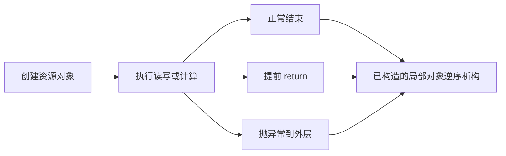

# Day 03 · 生命周期、借用与 RAII

## 1. 本期内容与学习目标

本课沿用 Day 02 的值和引用。预计 2–3 小时。实现三个小实验，观察构造和析构、临时文件关闭和独占所有权转移。你将能指出订单引用可以活到什么时候，并在调试构建里识别一次本地悬空借用。

## 2. 业务背景与原理

订单簿以后会拥有活动挂单。查询时若只借一个订单地址，撤单之后地址仍可能留在调用者手里。把状态复制成快照可以延长数据的可读期。磁盘文件也有类似边界，输出流打开后需要在退出路径上关闭。在 Java 中你可能用 `try-with-resources` 处理文件，本课把这种成对操作放到 C++ 对象的寿命上。

## 3. Java 原始项目的实现分析

`Order` 类的注释约定订单记录只在订单簿内部使用。Naive 版通过价格档和 ID 索引保存对同一订单的引用，删索引不代表 JVM 立即释放对象。`DiskSerializationProcessor.storeData` 使用 try-with-resources 管理输出流和压缩层，从作用域退出时关闭资源。这个规则和 C++ 析构的释放目的相近。 [订单记录约定](https://github.com/exchange-core/exchange-core/blob/2f8548749839e9095c8dc597e4b61521d259fa5d/src/main/java/exchange/core2/core/common/Order.java#L28-L38) · [Naive 的索引恢复](https://github.com/exchange-core/exchange-core/blob/2f8548749839e9095c8dc597e4b61521d259fa5d/src/main/java/exchange/core2/core/orderbook/OrderBookNaiveImpl.java#L69-L81) · [快照写入的资源管理](https://github.com/exchange-core/exchange-core/blob/2f8548749839e9095c8dc597e4b61521d259fa5d/src/main/java/exchange/core2/core/processors/journaling/DiskSerializationProcessor.java#L126-L159)

## 4. 本期 C++ 知识

### 生命周期和存储期

一个局部变量通常具有自动存储期，块退出时销毁。通过 `std::make_unique<T>` 建立的对象具有动态存储期，由 `unique_ptr<T>` 所拥有。`unique_ptr` 本身也可以是局部变量。销毁它时默认删除指向的对象。生命周期和内存放在哪里是两个问题。编译器可以把值放进寄存器，或者消除没有可观察效果的存储。写出局部变量的名字，也无法让它在作用域外继续存活。 [C++ 对象寿命](https://eel.is/c++draft/basic.life)

`T&` 是别名。`const T&` 常用于函数立即读取对象。`T*` 可存地址或 `nullptr`。`&object` 取地址，`*pointer` 取所指对象。裸指针从语法上只提供访问，是否负责释放由接口另行约定。本课用指针观察值，所有权由 `unique_ptr` 独占。不要返回指向局部对象的指针，也不要把指向容器元素的借用保存在比元素活得更久的位置。

### RAII 和异常

RAII 将资源的获取和释放绑到拥有对象的构造、析构。析构函数名为 `~类名`。已经完成构造的局部对象按构造逆序析构。正常退出、提前 `return` 以及异常传播到外层 `catch` 的过程中都可观察到。构造函数若抛出，已构造的成员仍按各自寿命清理。析构通常保持不抛异常。对文件这种有写入失败可能的资源，业务需要在活着时检查 `flush`、`close` 之类的操作，单靠自动关闭无法可靠报告写入错误。

## 5. 架构设计与技术选型

`write_lots` 在函数内用 `ofstream` 拥有文件，写入成功时检查显式关闭结果。失败或异常退出时对象仍负责资源释放。另一个函数用 `unique_ptr<int>` 演示转交所有权。用 `new` 和 `delete` 也能搭起来，调用者必须在每个退出路径遵守配对约定。只有一个所有者时，独占指针同时表达配对关系和转移边界。



## 6. 从零逐步实现

### 6.1 跟踪退出顺序和所有权转移

创建 `tests/lifetime_test.cpp`。测试中的 `Trace` 析构只做固定容量数组写入，用于记录次序。`int (&steps)[2]` 表示借用一个恰有两个元素的数组。`steps_[used_++]` 用自增前的索引写一格。数组由调用者提供，先于两个跟踪对象构造，跟踪对象先销毁。`Exit` 是有作用域的枚举。`throw` 发出异常，`catch (const std::runtime_error&)` 借用异常以处理它。

```cpp
#include <filesystem>
#include <fstream>
#include <iostream>
#include <memory>
#include <stdexcept>
#include <utility>

enum class Exit { normal, early, error };

class Trace {
public:
    Trace(int tag, int (&steps)[2], int& used) : tag_{tag}, steps_{steps}, used_{used} {}
    Trace(const Trace&) = delete;
    Trace& operator=(const Trace&) = delete;

    ~Trace() {
        steps_[used_++] = tag_;
    }

private:
    int tag_;
    int (&steps_)[2];
    int& used_;
};

void leave(Exit mode, int (&steps)[2], int& used) {
    const Trace outer{1, steps, used};
    const Trace inner{2, steps, used};
    if (mode == Exit::early) {
        return;
    }
    if (mode == Exit::error) {
        throw std::runtime_error{"simulated failure"};
    }
}

bool write_lots(const std::filesystem::path& path, int lots) {
    std::ofstream file{path};
    if (!file) {
        return false;
    }
    file << lots << '\n';
    file.close();
    return static_cast<bool>(file);
}

int main(int argc, char* argv[]) {
    if (argc != 2) {
        std::cerr << "expected a build directory test path\n";
        return 1;
    }

    const Exit modes[]{Exit::normal, Exit::early, Exit::error};
    for (const auto mode : modes) {
        int steps[2]{};
        int used = 0;
        bool caught = false;
        try {
            leave(mode, steps, used);
        } catch (const std::runtime_error&) {
            caught = true;
        }
        if (used != 2 || steps[0] != 2 || steps[1] != 1 ||
            caught != (mode == Exit::error)) {
            std::cerr << "FAIL: exit or destruction order\n";
            return 1;
        }
    }

    auto owner = std::make_unique<int>(3);
    const int* view = owner.get();
    auto next_owner = std::move(owner);
    if (owner || !next_owner || next_owner.get() != view || *view != 3) {
        std::cerr << "FAIL: ownership transfer\n";
        return 1;
    }

    const std::filesystem::path path{argv[1]};
    if (!write_lots(path, *next_owner)) {
        std::cerr << "FAIL: writing the test file\n";
        return 1;
    }

    int saved = 0;
    {
        std::ifstream file{path};
        if (!(file >> saved) || saved != 3) {
            std::cerr << "FAIL: reading the closed file\n";
            return 1;
        }
    }
    if (write_lots(path / "child", 4)) {
        std::cerr << "FAIL: opened a child of a regular file\n";
        return 1;
    }

    std::filesystem::remove(path);
    std::cout << "destruction: 2 then 1; file: " << saved << '\n';
    return 0;
}
```

`= delete` 让误复制跟踪对象在编译时失败，否则两个副本可能各写一条析构记录，超过固定数组容量。`std::move` 允许调用 `unique_ptr` 的移动构造函数。移动后 `owner` 为空，`next_owner` 接管同一对象，`view` 的有效期由新拥有者决定。移动语义的值类别和重载规则在 Day 22 展开。

`main` 的 `argc` 是参数数目，`argv` 是参数字符串序列。`argv[0]` 由执行环境提供，`argv[1]` 在 CTest 中传入专用测试路径。`file >> saved` 读取一个整数并返回流，布尔检查反映流是否可继续使用。`static_cast<bool>` 明确使用流的状态转换。`path / "child"` 将一个路径分量接在已有路径后。

### 6.2 注册独立目标

把下段追加到 `CMakeLists.txt`。路径放在构建树里，Debug 和 Release 使用不同构建树时各有自己的测试文件。

```cmake
add_executable(lifetime_tests tests/lifetime_test.cpp)
target_link_libraries(lifetime_tests PRIVATE exchange_core)
add_test(NAME lifetime COMMAND lifetime_tests
         "$<TARGET_FILE_DIR:lifetime_tests>/lifetime_test_output.txt")
```

## 7. 测试、调试与验证

`$<TARGET_FILE_DIR:lifetime_tests>` 是 CMake 的生成器表达式，在生成测试命令时指向目标所在目录。多配置生成器会选对应配置目录。重新构建并运行 `ctest --test-dir build -V -R '^lifetime$'`，预期输出 `destruction: 2 then 1; file: 3`。`-R` 用正则选测试。三条退出路径各检查一次顺序，错误路径还检查是否进入捕获分支。测试读取写入值、验证打开失败路径并清理产物。多配置运行时加 `-C Debug`。

下面是故意触发的独立诊断。保存到临时目录里的 `borrow_bug.cpp`，在支持 ASan 的 Clang/GCC 环境执行。此文件不加入 CMake 工程。

```cpp
#include <iostream>
#include <memory>

int main() {
    auto owner = std::make_unique<int>(42);
    const int* view = owner.get();
    owner.reset();
    std::cout << *view << '\n';
}
```

```bash
c++ -std=c++20 -g -O0 -fsanitize=address borrow_bug.cpp -o borrow_bug
./borrow_bug
```

预期诊断 `heap-use-after-free`。回溯中的访问点是 `*view`，释放点是 `owner.reset()`。修复方法是先读完再释放，或在释放前复制整数。也可重做 Day 02 的草稿实验，在 `original` 仍持有值时才用 `alias`。在未开启检测器的构建里，这类代码可能打印垃圾值或偶然打印 42，任何输出都不能证明它安全。 [Clang AddressSanitizer](https://clang.llvm.org/docs/AddressSanitizer.html)

## 8. Java 与 C++ 实现深度对比

Java 的 GC 让仍有强引用的订单对象可达，资源关闭通过显式契约完成。C++ 的 `unique_ptr` 可以把对象寿命和删除责任固定到一个所有者，普通引用和裸指针无法延长所指对象寿命。两种语言都需要理解复用造成的可见变化。Java 环槽能被后续命令覆盖，C++ 也可以复用同一块有效内存。持久保留结果时，值快照同时解决复用覆盖和失效问题。

## 9. 课后练习

1. **基础。** 在 `leave` 中交换两个标签并更新预期顺序，验收三个退出路径都由新的预期覆盖。
2. **工程。** 加一个按值返回的 `read_lots`，让读取时的打开失败和读取失败都得到空值。用有效整数文件和不存在文件验证。
3. **思考。** 给 `view` 画一条时间线，标出 `move`、`reset` 和 `main` 退出。说明哪一个操作决定它何时失效。

## 10. 总结与下一期

你已经能在作用域边界定位拥有者和借用者。Day 04 将把同样的问题放进容器，看看扩容、重哈希与擦除分别使哪些访问方式失效。

[Day 02](day-02.md) · [课程目录](../00-overview/learning-roadmap.md) · [Day 04](day-04.md)

<details>
<summary>练习参考答案</summary>

1. 内层标签为 1，外层为 2 时，析构观测为 1 再 2，三条路径相同。
2. 在函数内构造 `ifstream`，用 `int value = 0; if (!(file >> value)) return std::nullopt;` 表达失败，再按值返回 `value`。
3. `move` 将所有权交接给新指针，所指对象地址没变。新拥有者的 `reset` 或析构会结束对象寿命，从该点起不能解引用旧观察指针。

</details>
