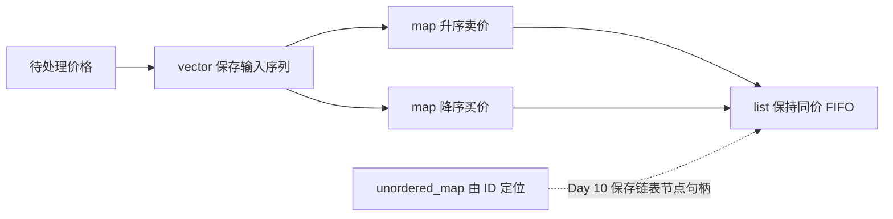

# Day 04 · STL、迭代器和排序规则

## 1. 本期内容与学习目标

本课预计 2–3 小时，要求能区分值与借用，并完成 Day 03。用同一份价格输入试验四种容器，写出买卖两侧的排序规则，再亲手触发 `vector` 扩容和散列表 rehash。这个实验将成为 Day 09 的价格树和 Day 10 的订单索引设计依据。

## 2. 业务背景与原理

买一要取最高买价，卖一要取最低卖价。在 100、101、103 三个价档中，买侧从 103 起，卖侧从 100 起。同价的两笔订单各自有身份，还需要按到达先后读取。一张有序表可以找最优价格，另外的队列保存同价的顺序，ID 查找交给散列表。

| 需求 | 用于本课的容器 | 练习操作 |
| --- | --- | --- |
| 保存输入及遍历 | `vector` | 顺序读价格，扩容后按索引取回 |
| 取最优价和有序档 | `map` | 买价降序、卖价升序 |
| 保存同价到达次序 | `list` | 尾插，删除中间节点 |
| 按 ID 查找 | `unordered_map` | rehash 后按键找回元素 |

## 3. Java 原始项目的实现分析

Naive 簿用正序和逆序的 `TreeMap` 分别保存卖侧与买侧，`LinkedHashMap` 保存档内插入顺序，另有 `LongObjectHashMap<Order>` 作为订单 ID 索引。C++ 标准库可用 `map + list + unordered_map` 分开承担这些工作。每份索引存什么、何时删除，要到 Day 10 和实际节点所有权一起确定。 [买卖价树和索引](https://github.com/exchange-core/exchange-core/blob/2f8548749839e9095c8dc597e4b61521d259fa5d/src/main/java/exchange/core2/core/orderbook/OrderBookNaiveImpl.java#L34-L66) · [档内队列](https://github.com/exchange-core/exchange-core/blob/2f8548749839e9095c8dc597e4b61521d259fa5d/src/main/java/exchange/core2/core/orderbook/OrdersBucketNaive.java#L40-L77)

## 4. 本期 C++ 知识

### 模板、迭代器与范围循环

`std::vector<int>` 的 `int` 是类型参数。容器模板用它生成元素操作，`std::map<int, int, AskOrder>` 还允许指定比较器类型。`begin()` 返回首元素迭代器，`end()` 表示尾后位置，不能解引用。`++it` 前进一步，`*it` 取当前元素，`it->second` 访问键值对中的值。用 `auto` 可省去迭代器完整类型，`const auto&` 绑定只读引用。`for (const auto& [price, lots] : book)` 是范围循环加结构化绑定，`price` 和 `lots` 分别绑定键和值。

### 比较器必须建立严格弱序

`map` 用 `cmp(a,b)` 决定 `a` 是否排在 `b` 之前。约定要求 `cmp(a,a)` 恒假，先后关系可传递，等价关系也可传递。当 `cmp(a,b)` 与 `cmp(b,a)` 都为假，两键视为等价。`<` 和 `>` 可用于这里的整数。`<=` 对相等值为真，违背要求。本课只检验这个错误比较器的输出，避免把它用于容器。 [关联容器要求](https://eel.is/c++draft/associative.reqmts)

`operator()` 让对象可像函数一样调用。`[](int a, int b) { return a <= b; }` 是空捕获 lambda，它生成一个可调用对象。比较器应依据键本身和稳定的规则。如果把盘口价格的相对次序依赖于外部会变的参数，改变该参数后原容器的结构仍按旧规则排列。

### 节点寿命与迭代器失效

`vector` 的元素连续。容量变化需要迁移元素，原迭代器、引用和指针失效。`list` 节点独立，插入不会使其他节点失效，擦除仅影响被删的节点。`unordered_map` 的 rehash 使迭代器失效，对仍存在元素的指针和引用保持有效。三种规则要分开记。 [vector 容量规则](https://eel.is/c++draft/vector.capacity) · [list 修改规则](https://eel.is/c++draft/list.modifiers) · [无序关联容器要求](https://eel.is/c++draft/unord.req)

## 5. 架构设计与技术选型

有序 `vector` 也能维护价格档，连续存储便于遍历，但插入中间要移动元素，先前保存的元素位置可能失效。`map` 按键插入和查找是 `O(log P)`，`begin()` 常数时间，保留现有元素的迭代器和引用。以迭代器删 `list` 节点为常数，按内容找节点要扫描。`unordered_map` 按键查找是平均常数，碰撞导致的最坏成本为线性，扩容也有一次性成本。

本课把输入、价档、FIFO 与 ID 定位分别演示。测试保留的观察对象只在有标准保证的地方使用。`vector` 扩容后直接用整数索引重新访问。同理，订单快照或 ID 可跨多次命令保存，裸迭代器需要限定观察期。



图中虚线是后续订单簿的索引关系。本课的散列表只保存示例价格，借它观察 rehash 前后的引用寿命。

## 6. 从零逐步实现

### 6.1 组织四种容器实验

创建 `tests/containers_test.cpp`。`try_emplace` 只在键不存在时插入。`++asks.at(price)` 取当前价档的引用并增加一手，`at` 遇到缺失键会抛异常，前一行已建立键。`std::next` 返回向前移动一位的迭代器副本，避免修改原迭代器。`reserve` 的入参是元素容量下限。`rehash` 指定最少桶数，还要满足当前负载因子的约束。

```cpp
#include <iostream>
#include <iterator>
#include <list>
#include <map>
#include <unordered_map>
#include <vector>

struct AskOrder {
    bool operator()(int a, int b) const { return a < b; }
};

struct BidOrder {
    bool operator()(int a, int b) const { return a > b; }
};

int main() {
    std::vector<int> prices{101, 103, 100, 101, 100};
    const auto initial_capacity = prices.capacity();
    prices.reserve(initial_capacity + 1);
    if (prices.capacity() <= initial_capacity || prices.at(2) != 100) {
        std::cerr << "FAIL: vector reserve\n";
        return 1;
    }

    std::map<int, int, AskOrder> asks;
    std::map<int, int, BidOrder> bids;
    for (const int price : prices) {
        asks.try_emplace(price, 0);
        bids.try_emplace(price, 0);
        ++asks.at(price);
        ++bids.at(price);
    }

    std::vector<int> ask_prices;
    std::vector<int> bid_prices;
    for (const auto& [price, lots] : asks) {
        ask_prices.push_back(price);
        if (lots <= 0) {
            return 1;
        }
    }
    for (const auto& [price, lots] : bids) {
        bid_prices.push_back(price);
        if (lots <= 0) {
            return 1;
        }
    }
    if (ask_prices != std::vector<int>{100, 101, 103} ||
        bid_prices != std::vector<int>{103, 101, 100} ||
        asks.at(101) != 2 || asks.at(100) != 2 || bids.at(103) != 1) {
        std::cerr << "FAIL: price ordering or aggregation\n";
        return 1;
    }

    std::list<int> fifo{7, 8, 9};
    const auto first = fifo.begin();
    const auto last = std::next(first, 2);
    fifo.erase(std::next(first));
    if (fifo.size() != 2 || *first != 7 || *last != 9) {
        std::cerr << "FAIL: surviving list handles\n";
        return 1;
    }

    std::unordered_map<int, int> by_id{{7, 101}};
    const int* price_view = &by_id.at(7);
    const auto before = by_id.bucket_count();
    by_id.rehash(before + 1);
    if (by_id.bucket_count() <= before || &by_id.at(7) != price_view ||
        *price_view != 101 || by_id.find(8) != by_id.end()) {
        std::cerr << "FAIL: hash lookup or surviving element\n";
        return 1;
    }

    const auto bad = [](int a, int b) { return a <= b; };
    if (!bad(101, 101) || AskOrder{}(101, 101) || BidOrder{}(101, 101)) {
        std::cerr << "FAIL: comparator contract\n";
        return 1;
    }
    std::cout << "asks 100,101,103; bids 103,101,100; fifo 7,9\n";
    return 0;
}
```

读代码时顺着三条借用走一遍。扩容前只保存了容量，没有解引用旧地址。`first` 与 `last` 指向两个未被删的节点，`erase` 后可以读取。`price_view` 是散列表元素的值地址，rehash 后重新按键定位可验证地址没变。若把它换成 rehash 前取得的迭代器，rehash 后必须重新 `find`。

### 6.2 加入构建

把下段追加到 `CMakeLists.txt`。单独的测试程序避免把多个 `main` 放到同一目标。

```cmake
add_executable(container_tests tests/containers_test.cpp)
target_link_libraries(container_tests PRIVATE exchange_core)
add_test(NAME containers COMMAND container_tests)
```

## 7. 测试、调试与验证

执行 `cmake --build build` 和 `ctest --test-dir build -R '^containers$' -V`。多配置时分别加 `--config Debug` 和 `-C Debug`。预期输出 `asks 100,101,103; bids 103,101,100; fifo 7,9`。空输入时两侧 `begin() == end()`，先判断再取最优价。把 `BidOrder` 改成升序，测试应报 `FAIL: price ordering or aggregation`。

用三个操作判断问题在哪。价格错序先查比较器方向。同价总量错先查是否覆写同价键。ID 不存在时用 `find` 与 `end()` 判断，`operator[]` 可能插入缺失元素，让一次读查询改变状态。

## 8. Java 与 C++ 实现深度对比

Java `LinkedHashMap` 同时维护键查找和插入顺序。C++ 组合容器可自由选择节点由谁拥有、ID 索引保存哪个句柄，也需要在删除和失败时维护两份结构。Java 的迭代器常以异常提示并发修改，不能依赖所有容器在错误访问时抛异常。C++ 无效迭代器的使用可能直接落入未定义行为，标准对各容器的失效规则和测试应一起读。

## 9. 课后练习

1. **基础。** 输入换成 `{2,1,2,4,1}`，写出两边顺序及每档量，再改测试验证。
2. **工程。** 将 `fifo` 的 8 删掉后在末尾追加 10，验证 `first` 与 `last` 仍指原来的 7、9，顺序为 7、9、10。
3. **思考。** 设计一个只写十个价档、每秒大量读最优价的微基准。列出比较 `map` 与有序 `vector` 时要固定的两个输入条件。

## 10. 总结与下一期

本课得到一组可运行的容器夹具。Day 05 会把分散的失败判断收拢成可定位的测试，并区分 Debug、Release 和 sanitizer 构建。

[Day 03](day-03.md) · [课程目录](../00-overview/learning-roadmap.md) · [Day 05](day-05.md)

<details>
<summary>练习参考答案</summary>

1. 卖价 `1,2,4`，买价 `4,2,1`，1 和 2 各 2 手，4 为 1 手。
2. `fifo.push_back(10);`，检查 `fifo.back() == 10`，并保留两条现有迭代器断言。
3. 固定写入顺序与价格分布、读写比例与读次数。再分别计入初始化和稳态，避免用一次分配成本推断长期读取性能。

</details>
