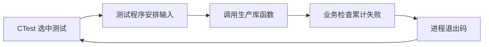

# Day 05 · 组织目标、单元测试和调试

## 1. 本期内容与学习目标

本课预计 2–3 小时。前置是 Day 01 的 CMake/CTest 与 Day 02–04 的值、资源和容器。你将把数量和草稿测试共用的失败计数提取出来，分开 Debug、Release 和 sanitizer 构建，再用调试器定位一次失败。阶段结束后，应能从空构建目录跑出可重现的结果。

## 2. 业务背景与原理

假设一条限价成交后买方本应支付 3060，某次改动让账单变成 3061。测试要能说出哪条场景失败、预期值从哪里来、实际运行的是哪个二进制。订单簿后续会有更多组合条件，最便宜的诊断通常是用手算输入重现第一条差异，再看哪个值首次偏离。

## 3. Java 原始项目的实现分析

`OrdersBucketNaiveTest.shouldRemoveOrders` 先插入一组订单，再按 ID 和用户删除并核对结果。`shouldMatchAllOrders` 构造主动单和档内订单，用数量及事件断言核对。Java 项目通过 Maven 及 JUnit 执行，订单簿和事件适配用例也可独立选择。课程采用同样的 Arrange / Act / Assert 习惯，把目标、可执行程序和业务断言分开。 [撤单测试](https://github.com/exchange-core/exchange-core/blob/2f8548749839e9095c8dc597e4b61521d259fa5d/src/test/java/exchange/core2/core/orderbook/OrdersBucketNaiveTest.java#L82-L116) · [撮合测试](https://github.com/exchange-core/exchange-core/blob/2f8548749839e9095c8dc597e4b61521d259fa5d/src/test/java/exchange/core2/core/orderbook/OrdersBucketNaiveTest.java#L161-L203)

## 4. 本期 C++ 知识

### 测试目标与断言

CTest 启动程序并按退出码记录成功或失败。业务断言仍由程序实现。`assert(condition)` 是来自 `<cassert>` 的宏。定义 `NDEBUG` 时它不会求值条件，常规 Release 构建会定义这个宏。把带副作用的函数调用放进 `assert` 还可能导致 Debug/Release 执行路径不同。本课用普通函数检测业务期望，退出码在两种构建中都有效。`static_assert` 在编译时检查类型等事实，本阶段仍用它检验方向枚举的隐式转换约束。

### 编译配置、调试器和 sanitizer

单配置生成器在配置时通过 `CMAKE_BUILD_TYPE` 决定默认选项，多配置生成器在构建时用 `--config`、测试时用 `-C`。Debug 通常有调试符号且优化较少，变量较容易观察。Release 通常启用较高优化，调试器里可能显示变量已被优化掉。独立构建树可以防止缓存和二进制混用。

ASan 通过编译器插桩及运行库检查多种内存错误。UBSan 覆盖多类未定义行为，例如有符号整数溢出。它们只能观察实际运行到的路径，不能替代订单规则断言。这里用独立构建树并在 Clang 或 GCC 下设置编译和链接参数。 [ASan](https://clang.llvm.org/docs/AddressSanitizer.html) · [UBSan](https://clang.llvm.org/docs/UndefinedBehaviorSanitizer.html)

断点会暂停在指定函数或源码行。`frame variable` 查看当前帧局部值，`bt` 查看是谁调用了当前帧。逐条看业务条件之前，先确认测试运行的是带调试信息的正确二进制。 [LLDB 命令对照](https://lldb.llvm.org/use/map.html)

## 5. 架构设计与技术选型

`TestChecks` 保留失败计数并在第一次失败时也继续收集后续检查。金额测试保留所有原夹具。把判断函数放进测试专用头，可以共享输出格式，生产库的公开接口保持小。也可以引入 GoogleTest 或 Catch2，框架能提供更丰富的参数化与报告。本阶段采用 CTest 和标准库即可验证构建边界，课后仍可尝试框架替换。



## 6. 从零逐步实现

### 6.1 写测试专用头

创建 `tests/test_checks.hpp`。类内定义的方法可被多个测试目标包含。`failures_{}` 使用空花括号把整数初始化为 0。`exit_code` 只读取失败计数，签名使用 `const`。调用者在同一测试函数中拥有 `TestChecks`，消息指针只在调用期间用来打印。

```cpp
#ifndef EXCHANGE_TEST_CHECKS_HPP
#define EXCHANGE_TEST_CHECKS_HPP

#include <iostream>

class TestChecks {
public:
    void require(bool condition, const char* label) {
        if (!condition) {
            std::cerr << "FAIL: " << label << '\n';
            ++failures_;
        }
    }

    int exit_code() const {
        if (failures_ == 0) {
            return 0;
        }
        return 1;
    }

private:
    int failures_{};
};

#endif
```

### 6.2 保留 Day 01 的边界矩阵

用下方版本替换 `tests/notional_test.cpp`。每次调用 `require` 前先准备输入并计算。`normal && *normal == 3060` 的左侧检查存在性，空结果不会解引用。两个越界用例分别穿过两段乘法的边界。若公式改坏，可从失败名称判断该检查落在哪一段。

```cpp
#include "exchange/notional.hpp"
#include "test_checks.hpp"

#include <cstdint>
#include <iostream>
#include <limits>

int main() {
    using exchange::quote_notional;
    TestChecks checks;
    const auto max_amount = std::numeric_limits<std::int64_t>::max();

    const auto normal = quote_notional(3, 102, 10);
    checks.require(normal && *normal == 3060, "ordinary amount");

    const auto zero = quote_notional(0, max_amount, max_amount);
    checks.require(zero && *zero == 0, "zero quantity");

    const auto edge = quote_notional(max_amount, 1, 1);
    checks.require(edge && *edge == max_amount, "maximum amount");

    const auto rounded_bound = quote_notional(max_amount / 2, 2, 1);
    checks.require(rounded_bound && *rounded_bound == max_amount - 1,
                   "integer division bound");

    checks.require(!quote_notional(max_amount, 2, 1), "overflow multiplying by price");
    checks.require(!quote_notional(max_amount, 1, 2), "overflow multiplying by scale");
    checks.require(!quote_notional(-1, 1, 1), "negative quantity");
    checks.require(!quote_notional(0, 0, 1), "zero price even with zero quantity");
    checks.require(!quote_notional(1, 1, -1), "negative scale");
    checks.require(!quote_notional(1, 1, 0), "zero scale");

    if (checks.exit_code() == 0) {
        std::cout << "All notional cases passed\n";
    }
    return checks.exit_code();
}
```

### 6.3 在第二个目标复用检查器

用下方版本替换 `tests/order_draft_test.cpp`。夹具建立失败后提前退出，这个条件保护下方引用和解引用。复制与别名测试分开验证每一步，便于确认是修改未生效还是状态被错误共享。CMake 的目标及源文件名沿用 Day 02。

```cpp
#include "exchange/order_draft.hpp"
#include "test_checks.hpp"

#include <iostream>
#include <type_traits>

int main() {
    using exchange::OrderDraft;
    using exchange::Side;
    static_assert(!std::is_convertible_v<int, Side>);

    TestChecks checks;
    auto original = OrderDraft::create(7, Side::bid, 102, 3);
    checks.require(static_cast<bool>(original), "valid draft");
    if (!original) {
        return checks.exit_code();
    }

    checks.require(original->id() == 7 && original->price() == 102 &&
                   original->side() == Side::bid && original->quantity() == 3,
                   "initial draft fields");

    auto copy = *original;
    auto& alias = *original;
    checks.require(copy.set_quantity(5), "edit copy");
    checks.require(original->quantity() == 3, "original independent of copy");
    checks.require(alias.set_quantity(4), "edit alias");
    checks.require(original->quantity() == 4 && copy.quantity() == 5, "alias sees original");
    checks.require(!alias.set_quantity(0) && alias.quantity() == 4, "failed edit keeps quantity");

    checks.require(!OrderDraft::create(0, Side::bid, 102, 1), "invalid id");
    checks.require(!OrderDraft::create(8, Side::ask, -1, 1), "invalid price");
    checks.require(!OrderDraft::create(8, Side::ask, 102, 0), "invalid quantity");

    if (checks.exit_code() == 0) {
        std::cout << "All draft cases passed\n";
    }
    return checks.exit_code();
}
```

`"test_checks.hpp"` 和两个测试源文件同目录，工具链在本地包含搜索中可找到。生产库仍只公开 `include/`。运行 `cmake --build build --verbose`，查看每个源文件怎样进入自己的目标。头文件改动可导致两个测试重编译，同时一个测试进程的失败计数不会影响另一个。 [CMake add_test](https://cmake.org/cmake/help/v3.20/command/add_test.html)

## 7. 测试、调试与验证

### 三种构建与故障练习

以下命令在 `exchange-lab` 根目录运行。`build-debug` 与 `build-release` 从空目录配置。

```bash
cmake -S . -B build-debug -DCMAKE_BUILD_TYPE=Debug
cmake --build build-debug
ctest --test-dir build-debug --output-on-failure
cmake -S . -B build-release -DCMAKE_BUILD_TYPE=Release
cmake --build build-release
ctest --test-dir build-release --output-on-failure
```

多配置生成器可先 `cmake -S . -B build-multi`，然后分别以 `cmake --build build-multi --config Debug` 和 `ctest --test-dir build-multi -C Debug --output-on-failure` 运行，把两处 `Debug` 换成 `Release` 再做一次。预期两套配置各通过 4 项注册测试，名称为 `quote_notional`、`order_draft`、`lifetime`、`containers`。

把 `normal` 的预期值从 3060 暂改成 3061。分别重建 Debug 和 Release，只运行 `ctest --test-dir build-release -R '^quote_notional$' --output-on-failure` 或对应 Debug 目录。预期退出非零，并出现 `FAIL: ordinary amount`。若只运行 CTest 而未重建，看到的是旧结果。

在 Clang/GCC 环境，用下方配置给全部课程目标加检测器。

```bash
cmake -S . -B build-sanitize -DCMAKE_BUILD_TYPE=Debug \
  -DCMAKE_CXX_FLAGS="-g -fsanitize=address,undefined -fno-omit-frame-pointer -fno-sanitize-recover=undefined"
cmake --build build-sanitize
ctest --test-dir build-sanitize --output-on-failure
```

恢复 3060 后，sanitizer 配置的四项课程测试也应通过。单独将下例保存为临时目录的 `overflow_probe.cpp`，故意执行 `max + 1`，用于辨认 UBSan 输出。

```cpp
#include <cstdint>
#include <iostream>
#include <limits>

int main() {
    volatile std::int64_t highest = std::numeric_limits<std::int64_t>::max();
    std::cout << highest + 1 << '\n';
    return 0;
}
```

```bash
c++ -std=c++20 -g -O0 -fsanitize=undefined -fno-sanitize-recover=undefined \
  overflow_probe.cpp -o overflow_probe
./overflow_probe
```

预期诊断 `signed integer overflow` 且退出非零。这里的 `volatile` 使读取保持为可观察操作，和线程同步无关。课程的受检金额帮助函数会在运算前拦截这个边界。

本阶段的示例从 Day 01 起按顺序提取到临时工程验证。环境为 macOS arm64、Apple Clang 17、CMake 4.3.1。四项 CTest 在 Debug、Release 和 ASan/UBSan 下均通过。故意改错金额预期时，Debug 和 Release 均报告失败。独立诊断示例分别触发 ASan 的释放后访问和 UBSan 的有符号整数溢出报告。

### 在调试器里查看业务值

在 Debug 二进制上运行 `lldb ./build-debug/exchange_tests`，设置 `breakpoint set -n 'TestChecks::require'`，然后输入 `run`、`frame variable condition label`、`bt`。第一条检查的标签为 `ordinary amount`。预期值故意写错时 `condition` 为假。GNU GDB 可用 `gdb ./build-debug/exchange_tests`，再输入 `break TestChecks::require`、`run`、`info args`、`bt`。在 Windows 多配置路径下从 IDE 打开相应的 Debug 测试程序，将断点放到 `require` 第一行。若调试权限不允许启动子进程，可先读带行号的测试输出并在允许的本机环境重试。

## 8. Java 与 C++ 实现深度对比

JUnit 帮 Java 用例组织夹具和断言，Maven 负责构建及选测试。这里 CMake 记录目标依赖，CTest 记录测试进程，`TestChecks` 记录业务失败。编译与链接错误先在构建阶段处理，测试程序只报告运行到的结果。C++ 的内存错误和整数未定义行为可以借助插桩提前显现，后续还需用订单状态的断言捕获正常运行却违背业务规则的问题。

## 9. 课后练习

1. **基础。** 使用 `ctest -N` 列出两个构建树的测试。给其中一个测试加 `-R` 过滤，核对被选择的名字。
2. **工程。** 给 `TestChecks` 增加只读失败计数访问器。让一条临时测试触发两个独立失败，验证输出含两个标签、失败计数为 2、退出码为 1。
3. **思考。** 若 Release 的 `assert(update())` 使状态更新消失，写出一段在两种构建都更新并报告失败的替代写法。

## 10. 总结与下一期

第一阶段验收从两个空构建目录开始。金额、草稿、生命周期与容器四类测试都应可选跑，故意失败能定位到场景。下一阶段从价、量和报价币最小单位着手，将 `OrderDraft` 的演示角色交给正式领域类型。

[Day 04](day-04.md) · [继续阅读 Day 06 · 价格、数量与受检金额](../02-trading-model/day-06.md)

<details>
<summary>练习参考答案</summary>

1. `ctest --test-dir build-debug -N` 列出 4 项。`ctest --test-dir build-debug -R '^order_draft$' -V` 应只跑草稿测试。
2. 添加 `int failures() const { return failures_; }`，连续调用 `checks.require(false, "first");` 和 `checks.require(false, "second");`，调用者输出 `checks.failures()` 并返回 `checks.exit_code()`。
3. 用 `const bool updated = update(); checks.require(updated, "update accepted");`。生产入口可换成显式错误分支，保证副作用和后续判断分别发生。

</details>
