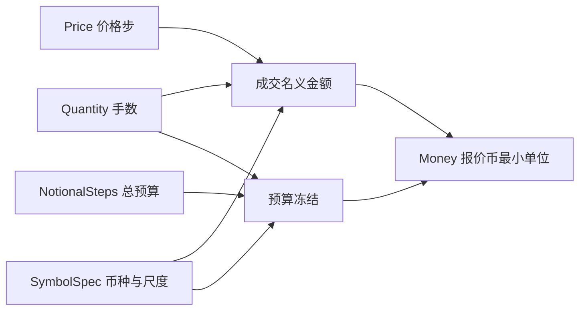

# Day 06 · 价格、数量与受检金额

## 1. 本期内容与学习目标

本课继续使用 Day 01 的受检金额函数、Day 02 的值语义和 Day 05 的测试目标。难度常规，预计 2–3 小时。你将把同为 `int64_t` 的价、量、预算和金额拆成独立类型，在编译时拦住参数互换，并为现货冻结和后续账本准备受检算术。

本课新增 `units.hpp`、`units.cpp` 和对应测试。保留第一阶段草稿和测试。正式命令从下课起使用这里的类型。

## 2. 业务背景与原理

### 同一个 102 可以指什么

品种 X/Y 以 X 为基础资产、Y 为报价资产。每手代表 10 个 X 最小单位，`quote_scale=10` 意味着每「手 × 价格步」代表 10 个 Y 最小单位。一笔 3 手、成交价 102 的交易转移 30 个 X 单位，名义金额为 3060 个 Y 单位。若买单预留价为 105、每手 taker 费为 3 个 Y 单位，冻结应是 `3 × (105 × 10 + 3) = 3159`。

| 量 | 本例 | 单位 |
| --- | ---: | --- |
| 成交价 | 102 | 价格步 |
| 成交量 | 3 | 手 |
| 预算约束示例 | 306 | 手 × 价格步 |
| 基础资产转移量 | 30 | X 的最小单位 |
| 报价资产名义金额 | 3060 | Y 的最小单位 |
| 买方冻结 | 3159 | Y 的最小单位 |

预算 306 表示可以在符合数量要求时花费最多 3060 个 Y 单位，费用另外计算。它无法用来和盘口单价 102 直接比较。账户调整可以用负数表达出金，同一账户的余额仍须在账本边界检查。币种标识和值都要随金额保留，30 个 X 单位与 30 个 Y 单位不能相加。

## 3. Java 原始项目的实现分析

`CoreSymbolSpecification` 给出币种、`baseScaleK`、`quoteScaleK` 和两类每手费用。`calculateAmountAsk` 换算基础资产，`calculateAmountBid` 换算报价资产。普通买单的费用在每手冻结中计入。预算买单采用 `budget × quoteScaleK + size × takerFee`，因为 `budget` 已经含手数维度。Java 在 `RiskEngine.placeExchangeOrder` 根据方向与订单类型选择公式。这些路径里的乘加使用 `long`，C++ 课程将同样的计算拆成有检查的运算。 [品种字段](https://github.com/exchange-core/exchange-core/blob/2f8548749839e9095c8dc597e4b61521d259fa5d/src/main/java/exchange/core2/core/common/CoreSymbolSpecification.java#L30-L49) · [金额公式](https://github.com/exchange-core/exchange-core/blob/2f8548749839e9095c8dc597e4b61521d259fa5d/src/main/java/exchange/core2/core/utils/CoreArithmeticUtils.java#L24-L43) · [现货冻结](https://github.com/exchange-core/exchange-core/blob/2f8548749839e9095c8dc597e4b61521d259fa5d/src/main/java/exchange/core2/core/processors/RiskEngine.java#L430-L503)

## 4. 本期 C++ 知识

### 强类型与显式构造

`using Price = std::int64_t;` 只增加别名，同型实参仍能互换。课程写一个只保存数字的类模板 `Scalar<Tag, Rep>`，然后让每种单位使用不同的 `Tag`。例如 `Scalar<PriceTag>` 和 `Scalar<QuantityTag>` 是不同类型。`struct PriceTag;` 声明标签类型，标签不被存进对象。`Rep` 是真实数值的类型，默认 `int64_t`。`explicit` 禁止从整数隐式构造；用 `Price{102}` 表明调用者选择了单位。花括号还会拒绝部分窄化转换。 [显式构造规则](https://eel.is/c++draft/class.conv.ctor) · [列表初始化规则](https://eel.is/c++draft/dcl.init.list)

`constexpr` 允许在参数和上下文满足条件时进行编译期求值。`friend auto operator<=>(...) = default` 让同一类型按唯一字段生成比较，也生成同类型的相等比较。本阶段只用这些比较核对金额，第三阶段会用价格比较组织盘口。类型本身只保证维度，`Price{-1}` 仍可以表示待检查的输入，价限、数量和符号的领域规则在接收它的函数中验证。这样 `Quantity{0}` 可以表示成交后余量，入站下单则要求大于零。 [默认比较](https://eel.is/c++draft/class.compare.default)

### 有符号运算必须在运算前检查

设最小值为 `lo`，最大值为 `hi`。加正数前比较 `a > hi - b`，加负数前比较 `a < lo - b`。减法独立判断。若先把减数取反，`lo` 在取反这一步就越界。乘法分正负四种情况用安全的除法求界，先排除零因子。

| `a` | `b` | 拒绝条件 |
| --- | --- | --- |
| 正 | 正 | `a > hi / b` |
| 正 | 负 | `b < lo / a` |
| 负 | 正 | `a < lo / b` |
| 负 | 负 | `a < hi / b` |

最后一行也会拒绝 `lo × -1`。比较式不会计算 `lo / -1`。C++ 整数除法向零截断，在这四个方向上配合不等式得到正确边界。可以先用小范围 `lo=-8, hi=7` 手算 `(-4) × (-2)`，此时 `hi / (-2)` 为 -3，-4 小于 -3，因此乘积越界。 [整数除法](https://eel.is/c++draft/expr.mul) · [结果范围](https://eel.is/c++draft/expr.pre#4)

## 5. 架构设计与技术选型

| 选型 | 作用和代价 |
| --- | --- |
| 裸整数加变量命名 | 代码短，参数位置和单位须靠约定，错误可静默进入金额计算 |
| 单位包装加币种标记 | 静态区分价、量、预算，运行时区分币种。序列化、容器键比较和输出各需一个明确边界 |
| 浮点金额 | 易于表达展示用小数，整数最小单位的精确守恒要另行处理 |

课程选第二种。`Money` 是币种和有符号最小单位数。`SymbolSpec` 按值保存配置，函数通过 `const&` 临时读取。`checked_*` 处理表示范围，`add_money` 还处理币种。每个帮助函数运行常数次整数运算，无动态分配。非法输入、币种不合或超界统一返回空值，本阶段由调用处判断上下文，接入引擎时再映射到业务状态。



## 6. 从零逐步实现

### 6.1 写类型和公开函数

在 `include/exchange/units.hpp` 写下类型。ID 和序号使用无符号表示，算术帮助函数和金额使用有符号表示。`template<class Tag, class Rep = std::int64_t>` 中的 `class` 表示类型参数，和 Day 04 使用容器模板时传入的 `int` 同类。无符号 ID 的正值约束在 Day 07 的入站验证应用。解析外部文本时要先验证范围，避免把负数转为很大的无符号 ID。这里只处理程序中明确构造的值。

```cpp
#ifndef EXCHANGE_UNITS_HPP
#define EXCHANGE_UNITS_HPP

#include <compare>
#include <cstdint>
#include <optional>

namespace exchange {

template<class Tag, class Rep = std::int64_t>
class Scalar {
public:
    explicit constexpr Scalar(Rep value) : value_{value} {}
    constexpr Rep value() const { return value_; }

    friend auto operator<=>(const Scalar&, const Scalar&) = default;

private:
    Rep value_;
};

struct PriceTag;
struct QuantityTag;
struct NotionalStepsTag;
struct CurrencyTag;
struct SymbolTag;
struct OrderTag;
struct UserTag;
struct SequenceTag;

using Price = Scalar<PriceTag>;
using Quantity = Scalar<QuantityTag>;
using NotionalSteps = Scalar<NotionalStepsTag>;
using CurrencyId = Scalar<CurrencyTag, std::uint32_t>;
using SymbolId = Scalar<SymbolTag, std::uint32_t>;
using OrderId = Scalar<OrderTag, std::uint64_t>;
using UserId = Scalar<UserTag, std::uint64_t>;
using Seq = Scalar<SequenceTag, std::uint64_t>;

struct Money {
    CurrencyId currency;
    std::int64_t units;
    bool operator==(const Money&) const = default;
};

struct SymbolSpec {
    SymbolId symbol;
    CurrencyId base;
    CurrencyId quote;
    std::int64_t base_scale;
    std::int64_t quote_scale;
    std::int64_t maker_fee_per_lot;
    std::int64_t taker_fee_per_lot;
};

bool valid_symbol(const SymbolSpec& spec);
std::optional<std::int64_t> checked_add(std::int64_t a, std::int64_t b);
std::optional<std::int64_t> checked_subtract(std::int64_t a, std::int64_t b);
std::optional<std::int64_t> checked_multiply(std::int64_t a, std::int64_t b);
std::optional<Money> add_money(Money a, Money b);
std::optional<Money> base_amount(Quantity quantity, const SymbolSpec& spec);
std::optional<Money> quote_notional(Quantity quantity, Price price, const SymbolSpec& spec);
std::optional<Money> bid_hold(Quantity quantity, Price reserve, const SymbolSpec& spec);
std::optional<Money> budget_bid_hold(Quantity quantity, NotionalSteps budget,
                                     const SymbolSpec& spec);

}

#endif
```

### 6.2 实现检查和金额转换

将下段写入 `src/units.cpp`。先实现三个有符号检查函数。`&&` 的短路保证除法只在对应符号分支运行。`make_money` 是本翻译单元使用的帮助函数，未命名命名空间使它不成为库的公开符号。实现普通成交名义金额时，保留 Day 01 的正确计算顺序，按参数类型选择既有裸整数重载。

```cpp
#include "exchange/units.hpp"
#include "exchange/notional.hpp"

#include <limits>

namespace exchange {

namespace {

constexpr auto lo = std::numeric_limits<std::int64_t>::min();
constexpr auto hi = std::numeric_limits<std::int64_t>::max();

std::optional<Money> make_money(CurrencyId currency, std::optional<std::int64_t> units) {
    if (!units) {
        return std::nullopt;
    }
    return Money{currency, *units};
}

}

bool valid_symbol(const SymbolSpec& spec) {
    return spec.symbol.value() != 0 && spec.base.value() != 0 &&
           spec.quote.value() != 0 && spec.base != spec.quote &&
           spec.base_scale > 0 && spec.quote_scale > 0 &&
           spec.maker_fee_per_lot >= 0 &&
           spec.taker_fee_per_lot >= spec.maker_fee_per_lot;
}

std::optional<std::int64_t> checked_add(std::int64_t a, std::int64_t b) {
    if ((b > 0 && a > hi - b) || (b < 0 && a < lo - b)) {
        return std::nullopt;
    }
    return a + b;
}

std::optional<std::int64_t> checked_subtract(std::int64_t a, std::int64_t b) {
    if ((b > 0 && a < lo + b) || (b < 0 && a > hi + b)) {
        return std::nullopt;
    }
    return a - b;
}

std::optional<std::int64_t> checked_multiply(std::int64_t a, std::int64_t b) {
    if ((a > 0 && b > 0 && a > hi / b) ||
        (a > 0 && b < 0 && b < lo / a) ||
        (a < 0 && b > 0 && a < lo / b) ||
        (a < 0 && b < 0 && a < hi / b)) {
        return std::nullopt;
    }
    return a * b;
}

std::optional<Money> add_money(Money a, Money b) {
    if (a.currency != b.currency) {
        return std::nullopt;
    }
    return make_money(a.currency, checked_add(a.units, b.units));
}

std::optional<Money> base_amount(Quantity quantity, const SymbolSpec& spec) {
    if (!valid_symbol(spec) || quantity.value() < 0) {
        return std::nullopt;
    }
    return make_money(spec.base, checked_multiply(quantity.value(), spec.base_scale));
}

std::optional<Money> quote_notional(Quantity quantity, Price price, const SymbolSpec& spec) {
    if (!valid_symbol(spec)) {
        return std::nullopt;
    }
    return make_money(spec.quote, quote_notional(quantity.value(), price.value(), spec.quote_scale));
}

std::optional<Money> bid_hold(Quantity quantity, Price reserve, const SymbolSpec& spec) {
    const auto notional = quote_notional(quantity, reserve, spec);
    if (!notional) {
        return std::nullopt;
    }
    const auto fee = checked_multiply(quantity.value(), spec.taker_fee_per_lot);
    if (!fee) {
        return std::nullopt;
    }
    return add_money(*notional, Money{spec.quote, *fee});
}

std::optional<Money> budget_bid_hold(Quantity quantity, NotionalSteps budget,
                                     const SymbolSpec& spec) {
    if (!valid_symbol(spec) || quantity.value() <= 0 || budget.value() <= 0) {
        return std::nullopt;
    }
    const auto principal = checked_multiply(budget.value(), spec.quote_scale);
    const auto fee = checked_multiply(quantity.value(), spec.taker_fee_per_lot);
    if (!principal || !fee) {
        return std::nullopt;
    }
    return make_money(spec.quote, checked_add(*principal, *fee));
}

}
```

普通冻结先计算全部本金，再计算全部费用，最后受检相加。金额域非负，所以一个子项超界时最终也无法表示。它允许零手用于核对无余量或算术边界。预算冻结面向一条实际委托，要求手数和预算都为正。Java 将预算写进 `cmd.price`，并要求预算买单的 `reserveBidPrice` 等于该值。课程直接从 `NotionalSteps` 计算预算冻结，省去重复输入。`valid_symbol` 检查现货课程采用的币种和费率约束，仍需在每次金额转换检查数值范围。期货规格到 Day 31 再扩展。

### 6.3 接入第一阶段工程

将原 `add_library(exchange_core STATIC src/notional.cpp)` 改成 `add_library(exchange_core STATIC src/notional.cpp src/units.cpp)`。下段加到文件末尾，测试源文件在下一节创建。

```cmake
add_executable(units_tests tests/units_test.cpp)
target_link_libraries(units_tests PRIVATE exchange_core)
add_test(NAME units COMMAND units_tests)
```

## 7. 测试、调试与验证

创建 `tests/units_test.cpp`。本阶段直接使用 Day 05 的 `TestChecks`。两个 `static_assert` 检查不同维度的值无法隐式互换，保留的 Day 01 测试继续运行裸整数接口。

```cpp
#include "exchange/units.hpp"
#include "test_checks.hpp"

#include <limits>
#include <type_traits>

int main() {
    using namespace exchange;
    static_assert(!std::is_convertible_v<Price, Quantity>);
    static_assert(!std::is_convertible_v<NotionalSteps, Price>);
    static_assert(!std::is_convertible_v<int, Price>);

    TestChecks checks;
    const SymbolSpec spec{SymbolId{1}, CurrencyId{10}, CurrencyId{20}, 10, 10, 1, 3};
    const auto base = base_amount(Quantity{3}, spec);
    const auto quote = quote_notional(Quantity{3}, Price{102}, spec);
    const auto hold = bid_hold(Quantity{3}, Price{105}, spec);
    const auto budget = budget_bid_hold(Quantity{3}, NotionalSteps{306}, spec);
    checks.require(base && *base == Money{spec.base, 30}, "base units");
    checks.require(quote && *quote == Money{spec.quote, 3060}, "quote units");
    checks.require(hold && *hold == Money{spec.quote, 3159}, "regular buy hold");
    checks.require(budget && *budget == Money{spec.quote, 3069}, "budget buy hold");
    checks.require(!add_money(Money{spec.base, 1}, Money{spec.quote, 1}), "currency mismatch");
    checks.require(add_money(Money{spec.quote, 12}, Money{spec.quote, -5}) ==
                   Money{spec.quote, 7}, "signed adjustment");

    constexpr auto hi = std::numeric_limits<std::int64_t>::max();
    constexpr auto lo = std::numeric_limits<std::int64_t>::min();
    checks.require(checked_add(hi, 0) == hi && !checked_add(hi, 1), "upper addition edge");
    checks.require(checked_add(lo, 0) == lo && !checked_add(lo, -1), "lower addition edge");
    checks.require(!checked_subtract(lo, 1) && !checked_subtract(hi, -1),
                   "subtraction overflow in both directions");
    checks.require(checked_subtract(lo, lo) == 0 && !checked_subtract(0, lo),
                   "subtraction without negating min");
    checks.require(checked_multiply(hi, 1) == hi && !checked_multiply(hi, 2),
                   "positive multiplication edge");
    checks.require(checked_multiply(lo, 1) == lo && checked_multiply(1, lo) == lo &&
                   !checked_multiply(lo, 2) && !checked_multiply(2, lo),
                   "negative multiplication edge");
    checks.require(checked_multiply(-2, -3) == 6 && !checked_multiply(lo, -1) &&
                   !checked_multiply(-1, lo) && checked_multiply(lo, 0) == 0,
                   "both negative and zero factors");

    auto boundary = spec;
    boundary.quote_scale = 1;
    boundary.taker_fee_per_lot = 1;
    checks.require(quote_notional(Quantity{1}, Price{hi}, boundary) ==
                   Money{spec.quote, hi}, "max quote amount");
    checks.require(bid_hold(Quantity{1}, Price{hi - 1}, boundary) ==
                   Money{spec.quote, hi}, "max buy hold");
    checks.require(!bid_hold(Quantity{1}, Price{hi}, boundary), "fee makes hold overflow");
    checks.require(bid_hold(Quantity{0}, Price{hi}, spec) ==
                   Money{spec.quote, 0}, "zero ordinary hold");
    checks.require(!quote_notional(Quantity{1}, Price{0}, spec) &&
                   !base_amount(Quantity{-1}, spec), "invalid price or quantity");
    checks.require(!budget_bid_hold(Quantity{3}, NotionalSteps{0}, spec),
                   "invalid budget");
    boundary.quote_scale = 0;
    checks.require(!base_amount(Quantity{1}, boundary), "invalid symbol scale");
    return checks.exit_code();
}
```

测试里 `optional == value` 表示有值且内部值相等，空值时为假。`using namespace exchange` 只放在测试函数体内，便于阅读夹具，公开头保持显式命名空间。多配置生成器在下面的构建和测试命令分别加 `--config Debug`、`-C Debug`。

```bash
cmake -S . -B build-debug -DCMAKE_BUILD_TYPE=Debug
cmake --build build-debug
ctest --test-dir build-debug --output-on-failure
```

预期共 5 项 CTest 通过。刻意把 `quote_notional(Quantity{3}, Price{102}, spec)` 的前两个参数互换，编译器应拒绝。若错误来自链接器并提到 `checked_add`，检查 `src/units.cpp` 是否加入了 `exchange_core`。若预算冻结算到 9189，核对是否又把含手数的 306 乘了一次 3。

## 8. Java 与 C++ 实现深度对比

Java 的 `long` 在字段层面区分含义，`cmd.price` 既可承载单价也可承载总预算。这里单位类型在编译时分离，币种随 `Money` 保存。C++ 的整数溢出风险要求先做边界检查。代价是更多输入条件和分支。以后测试高吞吐时，用相同的金额安全契约评估热路径。

## 9. 课后练习

1. **基础。** 把基准成交量改成 4 手，手算基础量与报价金额并加断言。
2. **工程。** 为 `budget_bid_hold` 写一个本金成功、费用也成功、相加溢出的用例。验收是失败返回空值且 UBSan 无诊断。
3. **思考。** 为什么 `Price` 无法和 `Quantity` 混用，而两份 `Money` 仍需做运行期检查？给出一个需要区分的币种场景。

## 10. 总结与下一期

引擎现在有可核对的金额、冻结和币种边界。下课用 `Price`、`Quantity`、`NotionalSteps` 和 ID 类型描述命令及其结果，表达限价 IOC 与预算 FOK 的不同输入。

[Day 05](../01-cpp-foundations/day-05.md) · [课程目录](../00-overview/learning-roadmap.md) · [Day 07](day-07.md)

<details>
<summary>练习参考答案</summary>

1. 基础量 `4 × 10 = 40`，报价金额 `4 × 102 × 10 = 4080`。
2. 用报价尺度 1、taker 费 1、手数 1、预算 `hi`。本金和费用分别是 `hi` 与 1，合计超界。
3. 价格、数量的单位由程序类型固定。币种来自配置和账户数据，同一类型的 `Money{CurrencyId{10}, 1}` 与 `Money{CurrencyId{20}, 1}` 需要在运行期拒绝合并。

</details>
