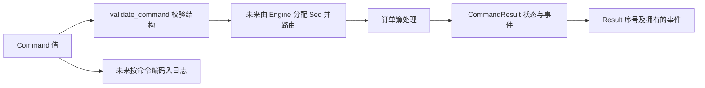

# Day 07 · 命令、事件与序号

## 1. 本期内容与学习目标

本课需要 Day 06 的强类型与 Day 02 的枚举和值对象，预计 2–3 小时。把「用户发来的命令」「引擎处理结果」「簿生成的事件」写成三组类型。验收是一笔手写的 IOC 回执，含两次成交和一次余量拒绝。你可以保留这份结果，在下一条命令到达后仍读到原来的价量。

## 2. 业务背景与原理

ID 表示一笔委托，序号表示引擎执行的一条命令。订单 90 可能先由序号 17 的下单命令建立，之后用序号 18 的撤单命令处理。同一个序号则可以对应多次成交。日志应记录发起操作所需的命令。即使一次操作没有成交，仍可在恢复时按序重新应用。

假设买单 90 限 102、请求 6 手。卖侧两笔订单各在 101 挂 3 手和 2 手，下一档卖价为 103。两笔成交价均为 101，买方每次都还有余量。最后 1 手无法在价限内成交。命令状态是 `processed`，结果包含两条 `Trade` 和一条 `RejectRemainder`。成交中的 `taker_filled` 为假，即使 IOC 随后结束也保持为假。它描述的是数量全成，余量关闭由拒绝事件描述。

本课程用 `LimitPrice` 携带 GTC/IOC 的限价，用 `BudgetLimit` 代表 FOK 的总额约束。预算单方向决定其约束是买入上限还是卖出下限。买侧限价单还可以携带预留价，供以后冻结及改单使用。预算买单的冻结直接从预算推导。

## 3. Java 原始项目的实现分析

Java 的 `OrderCommand` 复用价格、数量、订单号等字段，并在同一个对象上附加结果码、撮合链及行情。`IOrderBook.processCommand` 只将通过前置检查的下单命令交给订单簿，随后返回 `SUCCESS`。`attachRejectEvent` 可在其中添加余量拒绝。成交事件含 maker ID、成交价量及双方完成标记；外层命令提供 taker 信息。内部拒绝事件插到链头，对外适配器先发成交，再发拒绝。课程回执以对外观察顺序保存事件。 [内部命令](https://github.com/exchange-core/exchange-core/blob/2f8548749839e9095c8dc597e4b61521d259fa5d/src/main/java/exchange/core2/core/common/cmd/OrderCommand.java#L29-L77) · [IOrder](https://github.com/exchange-core/exchange-core/blob/2f8548749839e9095c8dc597e4b61521d259fa5d/src/main/java/exchange/core2/core/common/IOrder.java) · [分派条件](https://github.com/exchange-core/exchange-core/blob/2f8548749839e9095c8dc597e4b61521d259fa5d/src/main/java/exchange/core2/core/orderbook/IOrderBook.java#L176-L205) · [事件构建](https://github.com/exchange-core/exchange-core/blob/2f8548749839e9095c8dc597e4b61521d259fa5d/src/main/java/exchange/core2/core/orderbook/OrderBookEventsHelper.java#L44-L119) · [结果发布](https://github.com/exchange-core/exchange-core/blob/2f8548749839e9095c8dc597e4b61521d259fa5d/src/main/java/exchange/core2/core/SimpleEventsProcessor.java#L67-L122)

## 4. 本期 C++ 知识

### 聚合初始化与默认值

`struct OrderKey { SymbolId symbol; OrderId order; };` 是聚合类型，可以按成员顺序用花括号初始化。测试使用 C++20 指定初始化，例如 `OrderKey{.symbol = SymbolId{1}, .order = OrderId{90}}`。指定项仍须按声明顺序排列。字段类型无默认构造时，忘记必要字段会产生编译错误。布尔字段在构造事件时显式赋值，避免误读默认完成状态。 [聚合初始化](https://eel.is/c++draft/dcl.init.aggr)

### variant 保存一个有效分支

`std::variant<Trade, Reduce, RejectRemainder>` 持有其中一个对象，并管理其生命周期。它存下活动分支的标识以及承载值的存储，实际大小和对齐由实现决定。`std::get_if<T>(&event)` 尝试借用指定分支，类型不匹配时给空指针。`std::visit(visitor, event)` 调用适用的分支。用带多个 `operator()` 的访问器明确写出每一种类型，日后加事件类型时，缺少处理分支会在实例化访问代码时暴露。若加能接收任何类型的兜底模板，新增分支可能被意外吞掉。 [variant 语义](https://eel.is/c++draft/variant.general) · [visit 的调用要求](https://eel.is/c++draft/variant.visit)

`const std::variant<...>&` 是对联合值的只读借用。`get_if` 返回的指针也只在分支仍存活时可用。若重赋值切换分支，原分支析构。`Result` 直接拥有事件的 `vector`，返回后仍可读。移动或扩容该向量时，应按 Day 04 规则重新取指针。

## 5. 架构设计与技术选型

单一可变命令结构便于复用固定槽位，但每种命令有哪些必填字段、输出何时有效，都要靠约定。本课程采用小值类型及 `variant`。例如 `CancelOrder` 没有数量字段，`BudgetLimit` 没有挂簿单价。代价是增加命令分派和格式转换，队列中每条变体的存储还要容纳最大分支。先使用单线程值语义，等有基准再评估复用存储。

`RestingOrder` 是供下阶段订单簿持有的记录，包含 `remaining`，保留外部时间戳和实际队列排序用的 `priority_seq`。同价改价会重新入队并更新 `priority_seq`。订单簿内处理的 `CommandResult` 和整条命令的 `Result` 通过组合连接。`Seq` 由 Day 17 的引擎分配，簿在本阶段不负责编号。Day 11 的 L2 快照先用独立返回值，Day 20 再按需要接到 `Result` 的查询载荷。



## 6. 从零逐步实现

### 7.1 定义载荷、事件和活动记录

在 `include/exchange/model.hpp` 写下类型。`Side` 沿用 `order_draft.hpp` 中已经定义的枚举，避免同时包含两份头时重定义。等第一阶段练习无需保留时，可再把枚举迁到独立头。所有 ID 使用 Day 06 的独立类型。`timestamp_ns` 只作为外部元数据携带，课程示例使用非负整数。

```cpp
#ifndef EXCHANGE_MODEL_HPP
#define EXCHANGE_MODEL_HPP

#include "exchange/order_draft.hpp"
#include "exchange/units.hpp"

#include <cstdint>
#include <optional>
#include <string>
#include <variant>
#include <vector>

namespace exchange {

struct OrderKey {
    SymbolId symbol;
    OrderId order;
    bool operator==(const OrderKey&) const = default;
};

enum class LimitPolicy { gtc, ioc };

struct LimitPrice {
    Price price;
    LimitPolicy policy;
    std::optional<Price> reserve_bid_price;
};

struct BudgetLimit {
    NotionalSteps total;
};

using OrderConstraint = std::variant<LimitPrice, BudgetLimit>;

struct PlaceOrder {
    OrderKey key;
    UserId user;
    Side side;
    Quantity quantity;
    OrderConstraint constraint;
    std::int64_t timestamp_ns{};
};

struct CancelOrder {
    OrderKey key;
    UserId user;
};

struct ReduceOrder {
    OrderKey key;
    UserId user;
    Quantity quantity;
};

struct MoveOrder {
    OrderKey key;
    UserId user;
    Price new_price;
};

using Command = std::variant<PlaceOrder, CancelOrder, ReduceOrder, MoveOrder>;

struct RestingOrder {
    OrderKey key;
    UserId user;
    Side side;
    Price price;
    Quantity remaining;
    std::optional<Price> reserve_bid_price;
    Seq priority_seq;
    std::int64_t timestamp_ns{};
    bool operator==(const RestingOrder&) const = default;
};

enum class Status {
    processed, invalid_input, duplicate_order, unknown_symbol,
    unknown_order, insufficient_funds, price_over_reserve
};

enum class RejectReason {
    ioc_remainder, insufficient_liquidity, budget_limit, arithmetic_limit
};

struct Trade {
    OrderKey maker;
    UserId maker_user;
    OrderKey taker;
    UserId taker_user;
    Side taker_side;
    Price price;
    Quantity quantity;
    bool maker_filled;
    bool taker_filled;
    bool operator==(const Trade&) const = default;
};

struct Reduce {
    OrderKey key;
    UserId user;
    Side side;
    Price price;
    Quantity quantity;
    bool removed;
    bool operator==(const Reduce&) const = default;
};

struct RejectRemainder {
    OrderKey key;
    UserId user;
    Quantity quantity;
    RejectReason reason;
    bool operator==(const RejectRemainder&) const = default;
};

using Event = std::variant<Trade, Reduce, RejectRemainder>;

struct CommandResult {
    Status status;
    std::vector<Event> events;
    bool operator==(const CommandResult&) const = default;
};

struct Result {
    Seq seq;
    CommandResult outcome;
};

bool validate_command(const Command& command);
std::string describe_event(const Event& event);
std::string describe_result(const Result& result);

}

#endif
```

### 7.2 分别验证各类命令，再格式化结果

在 `src/model.cpp` 实现两个访问器。校验器只接收命令载荷，判断结构是否合法。对于未显式填写预留价的买侧限价单，后续入口冻结时采用限价作为默认值。卖侧禁止携带买方预留价。所有者、订单是否已挂和资金是否充足需要读取未来的簿和账本。`validate_command` 的返回值表示结构检查结果，不生成成交或更新状态。

```cpp
#include "exchange/model.hpp"

#include <string>

namespace exchange {

namespace {

bool valid_owner(const OrderKey& key, UserId user) {
    return key.symbol.value() > 0 && key.order.value() > 0 && user.value() > 0;
}

struct CheckCommand {
    bool operator()(const PlaceOrder& cmd) const {
        if (!valid_owner(cmd.key, cmd.user) || cmd.quantity.value() <= 0 ||
            (cmd.side != Side::bid && cmd.side != Side::ask) || cmd.timestamp_ns < 0) {
            return false;
        }

        if (const auto* limit = std::get_if<LimitPrice>(&cmd.constraint)) {
            if (limit->price.value() <= 0 ||
                (limit->policy != LimitPolicy::gtc && limit->policy != LimitPolicy::ioc)) {
                return false;
            }
            return !limit->reserve_bid_price ||
                   (cmd.side == Side::bid && *limit->reserve_bid_price >= limit->price);
        }
        const auto* budget = std::get_if<BudgetLimit>(&cmd.constraint);
        return budget && budget->total.value() > 0;
    }

    bool operator()(const CancelOrder& cmd) const {
        return valid_owner(cmd.key, cmd.user);
    }

    bool operator()(const ReduceOrder& cmd) const {
        return valid_owner(cmd.key, cmd.user) && cmd.quantity.value() > 0;
    }

    bool operator()(const MoveOrder& cmd) const {
        return valid_owner(cmd.key, cmd.user) && cmd.new_price.value() > 0;
    }
};

const char* status_name(Status status) {
    switch (status) {
        case Status::processed: return "processed";
        case Status::invalid_input: return "invalid_input";
        case Status::duplicate_order: return "duplicate_order";
        case Status::unknown_symbol: return "unknown_symbol";
        case Status::unknown_order: return "unknown_order";
        case Status::insufficient_funds: return "insufficient_funds";
        case Status::price_over_reserve: return "price_over_reserve";
    }
    return "unknown_status";
}

const char* reason_name(RejectReason reason) {
    switch (reason) {
        case RejectReason::ioc_remainder: return "ioc_remainder";
        case RejectReason::insufficient_liquidity: return "insufficient_liquidity";
        case RejectReason::budget_limit: return "budget_limit";
        case RejectReason::arithmetic_limit: return "arithmetic_limit";
    }
    return "unknown_reason";
}

struct DescribeEvent {
    std::string operator()(const Trade& trade) const {
        return "trade maker=" + std::to_string(trade.maker.order.value()) +
               " taker=" + std::to_string(trade.taker.order.value()) +
               " price=" + std::to_string(trade.price.value()) +
               " qty=" + std::to_string(trade.quantity.value());
    }

    std::string operator()(const Reduce& reduce) const {
        return "reduce order=" + std::to_string(reduce.key.order.value()) +
               " qty=" + std::to_string(reduce.quantity.value());
    }

    std::string operator()(const RejectRemainder& reject) const {
        return "reject order=" + std::to_string(reject.key.order.value()) +
               " qty=" + std::to_string(reject.quantity.value()) +
               " reason=" + reason_name(reject.reason);
    }
};

}

bool validate_command(const Command& command) {
    return std::visit(CheckCommand{}, command);
}

std::string describe_event(const Event& event) {
    return std::visit(DescribeEvent{}, event);
}

std::string describe_result(const Result& result) {
    std::string text = "seq=" + std::to_string(result.seq.value()) +
                       " status=" + status_name(result.outcome.status);
    for (const auto& event : result.outcome.events) {
        text += '\n';
        text += describe_event(event);
    }
    return text;
}

}
```

`switch` 对枚举列出各项，分支直接返回字符串。末尾的返回值处理显式构造的无效枚举值。`describe_result` 的文本用于调试，取事件向量顺序，时间成本随事件数和输出文本长度增长。结构化输出依然保留完整身份与标记，日志课程会单独编码，不从这段文字还原。

### 7.3 加入构建目标

把 `src/model.cpp` 加入 `exchange_core` 的源文件清单。附加测试目标。

```cmake
add_executable(model_tests tests/model_test.cpp)
target_link_libraries(model_tests PRIVATE exchange_core)
add_test(NAME model COMMAND model_tests)
```

## 7. 测试、调试与验证

创建 `tests/model_test.cpp`。手工构造的回执固定了字段和输出契约。将自己的结果格式化代码与独立的预期文本比对。`events.at(1)` 带边界检查。本例由同一函数构造三个元素，索引已知有效。

```cpp
#include "exchange/model.hpp"
#include "test_checks.hpp"

#include <iostream>
#include <type_traits>

int main() {
    using namespace exchange;
    static_assert(!std::is_convertible_v<Seq, OrderId>);

    TestChecks checks;
    const OrderKey taker{.symbol = SymbolId{1}, .order = OrderId{90}};
    const OrderKey a{SymbolId{1}, OrderId{7}};
    const OrderKey b{SymbolId{1}, OrderId{8}};
    const UserId buyer{30};
    const PlaceOrder ioc{taker, buyer, Side::bid, Quantity{6},
                         LimitPrice{Price{102}, LimitPolicy::ioc, Price{105}}, 10};
    checks.require(validate_command(ioc), "valid IOC");
    checks.require(validate_command(CancelOrder{taker, buyer}), "valid cancel");
    checks.require(validate_command(MoveOrder{taker, buyer, Price{101}}), "valid move");
    checks.require(!validate_command(ReduceOrder{taker, buyer, Quantity{0}}),
                   "zero reduce");
    checks.require(!validate_command(CancelOrder{taker, UserId{0}}), "missing owner");

    auto invalid = ioc;
    invalid.constraint = LimitPrice{Price{102}, LimitPolicy::ioc, Price{101}};
    checks.require(!validate_command(invalid), "reserve below bid limit");
    invalid = ioc;
    invalid.side = Side::ask;
    checks.require(!validate_command(invalid), "ask cannot carry bid reserve");
    invalid.constraint = BudgetLimit{NotionalSteps{608}};
    checks.require(validate_command(invalid), "valid budget ask");
    invalid.constraint = BudgetLimit{NotionalSteps{0}};
    checks.require(!validate_command(invalid), "zero budget");

    const Result result{
        Seq{17},
        {Status::processed, {
            Trade{a, UserId{11}, taker, buyer, Side::bid, Price{101}, Quantity{3}, true, false},
            Trade{b, UserId{12}, taker, buyer, Side::bid, Price{101}, Quantity{2}, true, false},
            RejectRemainder{taker, buyer, Quantity{1}, RejectReason::ioc_remainder},
        }},
    };
    const auto* second = std::get_if<Trade>(&result.outcome.events.at(1));
    checks.require(second && second->maker == b && second->maker_filled &&
                   !second->taker_filled, "trade completion flags");
    checks.require(describe_result(result) ==
                   "seq=17 status=processed\n"
                   "trade maker=7 taker=90 price=101 qty=3\n"
                   "trade maker=8 taker=90 price=101 qty=2\n"
                   "reject order=90 qty=1 reason=ioc_remainder", "event order");

    const Event reduced = Reduce{taker, buyer, Side::bid, Price{101}, Quantity{2}, true};
    checks.require(describe_event(reduced) == "reduce order=90 qty=2", "reduce formatting");

    auto independent_copy = result;
    independent_copy.outcome.events.clear();
    checks.require(result.outcome.events.size() == 3, "result owns its events");
    std::cout << describe_result(result) << '\n';
    return checks.exit_code();
}
```

运行 `cmake --build build-debug` 和 `ctest --test-dir build-debug -V -R '^model$'`，多配置分别加 `--config Debug` 和 `-C Debug`。完整测试列表已有 6 项。单独运行本课时，预期首行 `seq=17 status=processed`，随后 maker 7、maker 8、拒绝 1 手。把第二个成交的 `taker_filled` 改为真再重跑，预期报 `FAIL: trade completion flags`。若访问器新增分支后出现长模板错误，先看 `std::visit` 的调用位置，再查访问器对新类型是否有唯一且返回类型一致的重载。

## 8. Java 与 C++ 实现深度对比

Java 复用环槽，在一条命令上原地写结果和事件。外部应用如果长期保存槽对象，必须关注后续复用。C++ `Result` 用值承载事件，复制会复制整个向量，交给下一阶段时可以移动。`variant` 可在类型层面表达命令形状；业务检查仍负责判断同一分支内的取值是否有效。序号不参与订单身份比较，恢复时也可以独立保持序号与命令载荷。

## 9. 课后练习

1. **基础。** 构造一笔撤减完成事件，用 `get_if<Reduce>` 校验 `removed`。用 `get_if<Trade>` 验证分支不匹配返回空指针。
2. **工程。** 给测试增加「普通 GTC 买单省略预留价」和「卖单 GTC 带买方预留价」两个场景，核对结构校验分别通过与失败。
3. **思考。** 如果回执只剩一个 `success` 标记，解释本课的两条成交和 1 手拒绝如何使账户与 UI 对订单状态产生不同理解。

## 10. 总结与下一期

目前命令、活动记录和结果都能独立构造和检查。Day 08 将用这些类型写撮合前后的夹具，提前固定价档、队列顺序及结果不变量。

[Day 06](day-06.md) · [课程目录](../00-overview/learning-roadmap.md) · [Day 08](day-08.md)

<details>
<summary>练习参考答案</summary>

1. 构造 `Event e = Reduce{taker, buyer, Side::bid, Price{101}, Quantity{2}, true};`，对 `e` 分别调用两种 `get_if`。
2. 用 `LimitPrice{Price{102}, LimitPolicy::gtc, std::nullopt}` 验证买方省略的路径。把方向换为卖方并填 `Price{102}`，应拒绝。
3. 单一标记只能说命令是否处理，无法推出支付 505 个未缩放报价单位，也无法判断 IOC 是否全成。成交、余量拒绝与账本状态要各有依据。

</details>
