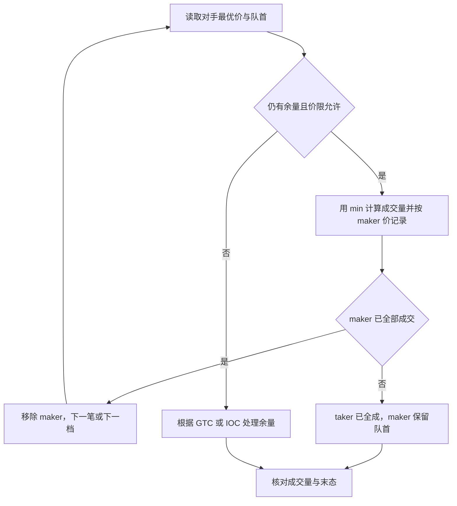

# Day 08 · 从业务例子写出不变量

## 1. 本期内容与学习目标

前置是 Day 04 的容器、Day 05 的测试和 Day 07 的命令、事件及活动记录。预计 2–3 小时。本课先把撮合规则推导成独立的预期，再用代码验证这些夹具在价、量、顺序上自洽。第三阶段将沿用这些输入，第四阶段再把真实撮合输出与预期逐字段对比。

## 2. 业务背景与原理

### 谁先成交，按什么价格成交

Bid 是买单，Ask 是卖单。买一取最高买价，卖一取最低卖价，两者合称 BBO。两侧均有挂单时，可以用卖一减买一计算价差。只有一侧有订单时，另一侧的最优价应表示为空。新买单限价大于等于卖一时具备成交条件。卖单镜像判断。已有订单叫 maker，触发成交的订单叫 taker。成交价取 maker 的挂价，每次成交量为两边当前剩余量的最小值。

从空买侧、三笔卖单开始。A、B、C 是订单简称，对应 ID 7、8、9。初始序号分别为 1、2、3。A 的外部时间戳故意比 B 晚，A 仍先入队，因此优先成交。


| 队列 | 价格 | 手数 | 外部时间戳 | 实际入队序号 |
| ---- | ---: | ---: | ---------: | -----------: |
| A    |  101 |    3 |        300 |            1 |
| B    |  101 |    2 |        200 |            2 |
| C    |  103 |    4 |        250 |            3 |

限价 102 买 4 手时，A 成交 3 手，B 成交 1 手。B 剩 1 手且保留位置。限价 102 买 6 手时，扫过 A、B 共成交 5 手，下一档 103 越过价限。GTC 在买侧挂 1 手于 102，此时价差为 1。IOC 产生 1 手拒绝，买侧为空。预算 FOK 不设单价限，买 6 手需 `101×3 + 101×2 + 103×1 = 608`。预算 608 可全成，607 整笔拒绝。卖侧预算是最低收入，若对手买价为 105、103，且依次可成交 3、1 手，则卖 4 手收入 418。下限 418 可全成，419 拒绝。



FOK 先执行只读试算，确认量足够、总额可表示且约束成立才进入成交。整笔拒绝时，任何档位、订单和队列都保持原状态。

## 3. Java 原始项目的实现分析

Naive 簿通过 `headMap(price, true)` 筛可成交价域，档内 `OrdersBucketNaive.match` 遍历插入顺序并取 `min`。Java 共享测试将结果与预先构造的盘口、事件逐项比对。可从 IOC 余量拒绝、买侧 FOK 预算刚好相等，以及 GTC 部分成交后入簿三个场景入手。改价先摘旧队列再按新价格尝试撮合，剩余量进目标档尾。即使改到原价，路径仍会重新入队。 [Naive 匹配价域](https://github.com/exchange-core/exchange-core/blob/2f8548749839e9095c8dc597e4b61521d259fa5d/src/main/java/exchange/core2/core/orderbook/OrderBookNaiveImpl.java#L203-L246) · [档内撮合](https://github.com/exchange-core/exchange-core/blob/2f8548749839e9095c8dc597e4b61521d259fa5d/src/main/java/exchange/core2/core/orderbook/OrdersBucketNaive.java#L98-L145) · [IOC 与 FOK 测试](https://github.com/exchange-core/exchange-core/blob/2f8548749839e9095c8dc597e4b61521d259fa5d/src/test/java/exchange/core2/core/orderbook/OrderBookBaseTest.java#L486-L547) · [GTC 部分成交测试](https://github.com/exchange-core/exchange-core/blob/2f8548749839e9095c8dc597e4b61521d259fa5d/src/test/java/exchange/core2/core/orderbook/OrderBookBaseTest.java#L648-L665) · [改价路径](https://github.com/exchange-core/exchange-core/blob/2f8548749839e9095c8dc597e4b61521d259fa5d/src/main/java/exchange/core2/core/orderbook/OrderBookNaiveImpl.java#L377-L427)

## 4. 本期 C++ 知识

### 用表驱动测试固定规则

把初始状态、命令、预期事件和预期末态放进同一个案例。循环只负责运行同样的检查，每行的数据有独立的业务解释。这里的测试 oracle 是手算的预期。它负责回答结果应是什么，未来被测的订单簿负责实现过程。直接调用被测实现去生成预期，会让同一个错误同时出现在两边。

`std::min(a, b)` 在实参类型相同且可比较时返回较小值的引用。本课用 `const auto amount = std::min(...)` 拿值，可以安全地越过该表达式结束的位置。若把接收变量写成 `const auto&` 并传入临时值，保留下来的引用可能悬空。 [std::min](https://eel.is/c++draft/alg.min.max)

`for (const auto& fixture : cases)` 避免复制夹具及它内部的向量。若用 `fixture.name.c_str()` 把字符串借给 `TestChecks`，可在同一次调用内使用。测试输出若要持久保存，应先拥有一份字符串。`vector<T>` 的 `==` 按长度和顺序逐元素比较，Day 07 的默认比较使其能用来核对整段活动订单及事件。

## 5. 架构设计与技术选型


| 方式               | 何时用                                                                     |
| ------------------ | -------------------------------------------------------------------------- |
| 手算的顺序化夹具   | 案例少而明确，方便看出第一处规则差异，本课采用                             |
| 逐订单模拟参考模型 | 适合大量随机命令，需独立实现和验证，Day 16 再做                            |
| 只看 L2 聚合快照   | 可验证价量与笔数。同价 FIFO 和用户身份被聚合掉，需要同时比较订单序列和事件 |

每个案例按稳定顺序存活动订单。先列卖侧，价格升序。再列买侧，价格降序。同价按 `priority_seq` 升序。当前记录只存 `remaining`。部分成交后 `remaining` 下降，`priority_seq` 保留。部分减量同样保留顺序。改单后余量重新排队，数量和 ID 沿用，`priority_seq` 改成改单的命令序号。

对每条下单，`请求手数 = 成交手数 + 新挂剩余 + 拒绝手数`。对活动订单，用其既有余量减去本次成交或撤减量核对末态。快照还要满足价格正、剩余量正、同品种 ID 唯一、价序与 FIFO 正确，以及买一低于卖一。用 `checked_add` 汇总手数和预算。在规模为 `N` 的小夹具里，线性查 maker 或末态位置便于读懂。按每笔成交重复查找的验证成本是 `O(N×K)`，只用于测试。

## 6. 从零逐步实现

### 8.1 准备独立夹具

创建 `tests/trading_fixtures.hpp`。下方的 `rest`、`limit`、`budget`、`fill` 只压缩夹具写法，不执行交易规则。`inline` 允许这份头的函数定义被多个测试翻译单元包含。`PlaceFixture` 保存下单的四个观察面，`MoveFixture` 单独保存改价前后的队列。将 `cases` 和 `same_price_move` 留在测试目录，生产代码无需依赖它们。

```cpp
#ifndef EXCHANGE_TRADING_FIXTURES_HPP
#define EXCHANGE_TRADING_FIXTURES_HPP

#include "exchange/model.hpp"

#include <cstdint>
#include <optional>
#include <vector>

namespace trading_fixture {

using namespace exchange;

struct PlaceFixture {
    const char* name;
    Seq seq;
    std::vector<RestingOrder> before;
    PlaceOrder command;
    CommandResult expected;
    std::vector<RestingOrder> after;
    std::int64_t executed_steps;
};

struct MoveFixture {
    Seq seq;
    std::vector<RestingOrder> before;
    MoveOrder command;
    CommandResult expected;
    std::vector<RestingOrder> after;
};

inline OrderKey key(std::uint64_t id) {
    return {SymbolId{1}, OrderId{id}};
}

inline RestingOrder rest(std::uint64_t id, Side side, std::int64_t price,
                         std::int64_t quantity, std::uint64_t seq, std::int64_t timestamp) {
    std::optional<Price> reserve;
    if (side == Side::bid) {
        reserve = Price{price};
    }
    return {key(id), UserId{id}, side, Price{price}, Quantity{quantity},
            reserve, Seq{seq}, timestamp};
}

inline PlaceOrder limit(Side side, std::int64_t price, std::int64_t quantity,
                        LimitPolicy policy) {
    return {key(90), UserId{90}, side, Quantity{quantity},
            LimitPrice{Price{price}, policy, std::nullopt}, 400};
}

inline PlaceOrder budget(Side side, std::int64_t total, std::int64_t quantity) {
    return {key(90), UserId{90}, side, Quantity{quantity},
            BudgetLimit{NotionalSteps{total}}, 400};
}

inline Trade fill(const RestingOrder& maker, const PlaceOrder& taker,
                  std::int64_t quantity, bool maker_filled, bool taker_filled) {
    return {maker.key, maker.user, taker.key, taker.user, taker.side, maker.price,
            Quantity{quantity}, maker_filled, taker_filled};
}

inline std::vector<PlaceFixture> cases() {
    const auto a = rest(7, Side::ask, 101, 3, 1, 300);
    const auto b = rest(8, Side::ask, 101, 2, 2, 200);
    const auto c = rest(9, Side::ask, 103, 4, 3, 250);
    const std::vector<RestingOrder> asks{a, b, c};

    const auto four = limit(Side::bid, 102, 4, LimitPolicy::gtc);
    const auto six = limit(Side::bid, 102, 6, LimitPolicy::gtc);
    const auto ioc = limit(Side::bid, 102, 6, LimitPolicy::ioc);
    const auto buy_fok = budget(Side::bid, 608, 6);
    const auto low_budget = budget(Side::bid, 607, 6);

    const auto x = rest(10, Side::bid, 105, 3, 1, 300);
    const auto y = rest(11, Side::bid, 103, 2, 2, 200);
    const std::vector<RestingOrder> bids{x, y};
    const auto sell_fok = budget(Side::ask, 418, 4);
    const auto high_minimum = budget(Side::ask, 419, 4);

    return {
        {"gtc_fifo", Seq{4}, asks, four,
         {Status::processed, {fill(a, four, 3, true, false), fill(b, four, 1, false, true)}},
         {rest(8, Side::ask, 101, 1, 2, 200), c}, 404},
        {"gtc_rests", Seq{4}, asks, six,
         {Status::processed, {fill(a, six, 3, true, false), fill(b, six, 2, true, false)}},
         {c, rest(90, Side::bid, 102, 1, 4, 400)}, 505},
        {"ioc_remainder", Seq{4}, asks, ioc,
         {Status::processed, {fill(a, ioc, 3, true, false), fill(b, ioc, 2, true, false),
                              RejectRemainder{ioc.key, ioc.user, Quantity{1},
                                              RejectReason::ioc_remainder}}},
         {c}, 505},
        {"buy_fok_exact", Seq{4}, asks, buy_fok,
         {Status::processed, {fill(a, buy_fok, 3, true, false), fill(b, buy_fok, 2, true, false),
                              fill(c, buy_fok, 1, false, true)}},
         {rest(9, Side::ask, 103, 3, 3, 250)}, 608},
        {"buy_fok_short_budget", Seq{4}, asks, low_budget,
         {Status::processed, {RejectRemainder{low_budget.key, low_budget.user, Quantity{6},
                                              RejectReason::budget_limit}}},
         asks, 0},
        {"sell_fok_exact", Seq{3}, bids, sell_fok,
         {Status::processed, {fill(x, sell_fok, 3, true, false), fill(y, sell_fok, 1, false, true)}},
         {rest(11, Side::bid, 103, 1, 2, 200)}, 418},
        {"sell_fok_high_minimum", Seq{3}, bids, high_minimum,
         {Status::processed, {RejectRemainder{high_minimum.key, high_minimum.user, Quantity{4},
                                              RejectReason::budget_limit}}},
         bids, 0},
    };
}

inline MoveFixture same_price_move() {
    const auto a = rest(7, Side::ask, 101, 3, 1, 300);
    const auto b = rest(8, Side::ask, 101, 2, 2, 200);
    return {Seq{3}, {a, b}, {a.key, a.user, Price{101}}, {Status::processed, {}},
            {b, rest(7, Side::ask, 101, 3, 3, 300)}};
}

}

#endif
```

以 `gtc_fifo` 行为例，第二条成交的两种完成标记分别为 `false` 和 `true`。B 作为 maker 还剩一手，taker 此时达到 4 手。`gtc_rests` 和 `ioc_remainder` 的成交事件一样，末态或拒绝事件能区分余量去向。三次成交的 FOK 行用常量 608 校验，不从待实现的预算函数生成。

### 8.2 用独立检查串起初态、事件和末态

在 `tests/trading_rules_test.cpp` 写下检查器。`best` 找一侧首笔，前提是已用 `canonical` 验证有序。`find_order` 返回借用指针，只在其向量存活且没有修改时读取。`check_place` 不生成任何事件。它确认给定的成交沿对手的初始优先序进行，检查两侧完成标记，再检查数量和末态。暂不把它用于任意多品种混合命令。簿的索引和聚合总量属于下一阶段。

```cpp
#include "trading_fixtures.hpp"
#include "test_checks.hpp"

#include <algorithm>
#include <iostream>
#include <unordered_set>
#include <utility>

namespace {

using namespace exchange;
using trading_fixture::PlaceFixture;

const RestingOrder* find_order(const std::vector<RestingOrder>& rows, OrderKey key) {
    const auto it = std::find_if(rows.begin(), rows.end(), [key](const RestingOrder& row) {
        return row.key == key;
    });
    return it == rows.end() ? nullptr : &*it;
}

const RestingOrder* best(const std::vector<RestingOrder>& rows, Side side) {
    const auto it = std::find_if(rows.begin(), rows.end(), [side](const RestingOrder& row) {
        return row.side == side;
    });
    return it == rows.end() ? nullptr : &*it;
}

bool canonical(const std::vector<RestingOrder>& rows, SymbolId symbol) {
    std::unordered_set<std::uint64_t> ids;
    const RestingOrder* prev = nullptr;
    for (const auto& row : rows) {
        if (row.key.symbol != symbol || row.key.order.value() == 0 ||
            row.user.value() == 0 || row.price.value() <= 0 ||
            row.remaining.value() <= 0 || row.priority_seq.value() == 0 ||
            (row.side != Side::ask && row.side != Side::bid) ||
            !ids.insert(row.key.order.value()).second) {
            return false;
        }
        if (prev && prev->side == Side::bid && row.side == Side::ask) {
            return false;
        }
        if (prev && prev->side == row.side) {
            if ((row.side == Side::ask && row.price < prev->price) ||
                (row.side == Side::bid && row.price > prev->price) ||
                (row.price == prev->price && row.priority_seq <= prev->priority_seq)) {
                return false;
            }
        }
        prev = &row;
    }
    const auto* bid = best(rows, Side::bid);
    const auto* ask = best(rows, Side::ask);
    return !bid || !ask || bid->price < ask->price;
}

bool check_place(const PlaceFixture& fixture) {
    const auto& cmd = fixture.command;
    const auto& before = fixture.before;
    const auto& after = fixture.after;
    if (!validate_command(cmd) || fixture.expected.status != Status::processed ||
        !canonical(before, cmd.key.symbol) || !canonical(after, cmd.key.symbol) ||
        find_order(before, cmd.key)) {
        return false;
    }

    const auto* limit = std::get_if<LimitPrice>(&cmd.constraint);
    const auto* budget = std::get_if<BudgetLimit>(&cmd.constraint);
    auto remaining = cmd.quantity.value();
    std::int64_t rejected = 0;
    std::int64_t total = 0;
    auto expected_after = before;

    for (const auto& event : fixture.expected.events) {
        if (const auto* trade = std::get_if<Trade>(&event)) {
            const Side maker_side = cmd.side == Side::bid ? Side::ask : Side::bid;
            const auto* maker = best(expected_after, maker_side);
            if (rejected != 0 || remaining <= 0 || !maker ||
                trade->taker != cmd.key || trade->taker_user != cmd.user ||
                trade->taker_side != cmd.side || trade->maker != maker->key ||
                trade->maker_user != maker->user || trade->price != maker->price) {
                return false;
            }
            if (limit && ((cmd.side == Side::bid && maker->price > limit->price) ||
                          (cmd.side == Side::ask && maker->price < limit->price))) {
                return false;
            }

            const auto amount = trade->quantity.value();
            if (amount != std::min(remaining, maker->remaining.value())) {
                return false;
            }
            remaining -= amount;
            const auto maker_remaining = maker->remaining.value() - amount;
            if (trade->maker_filled != (maker_remaining == 0) ||
                trade->taker_filled != (remaining == 0)) {
                return false;
            }

            const auto product = checked_multiply(amount, maker->price.value());
            if (!product) {
                return false;
            }
            const auto next_total = checked_add(total, *product);
            if (!next_total) {
                return false;
            }
            total = *next_total;

            const auto pos = std::find_if(expected_after.begin(), expected_after.end(),
                [trade](const RestingOrder& row) { return row.key == trade->maker; });
            if (maker_remaining == 0) {
                expected_after.erase(pos);
            } else {
                pos->remaining = Quantity{maker_remaining};
            }
        } else if (const auto* reject = std::get_if<RejectRemainder>(&event)) {
            if (rejected != 0 || remaining <= 0 || reject->key != cmd.key ||
                reject->user != cmd.user || reject->quantity.value() != remaining ||
                (limit && (limit->policy != LimitPolicy::ioc ||
                           reject->reason != RejectReason::ioc_remainder)) ||
                (budget && (remaining != cmd.quantity.value() ||
                            reject->reason == RejectReason::ioc_remainder))) {
                return false;
            }
            rejected = remaining;
            remaining = 0;
        } else {
            return false;
        }
    }

    const auto* resting = find_order(after, cmd.key);
    const auto* opposite = best(expected_after, cmd.side == Side::bid ? Side::ask : Side::bid);
    if (limit && opposite && (remaining > 0 || rejected > 0) &&
        ((cmd.side == Side::bid && opposite->price <= limit->price) ||
         (cmd.side == Side::ask && opposite->price >= limit->price))) {
        return false;
    }
    if (budget && (remaining != 0 || resting ||
        (rejected == 0 && (cmd.side == Side::bid ? total > budget->total.value()
                                               : total < budget->total.value())))) {
        return false;
    }
    if (remaining > 0) {
        if (!resting || !limit || limit->policy != LimitPolicy::gtc ||
            resting->user != cmd.user || resting->side != cmd.side ||
            resting->price != limit->price || resting->remaining != Quantity{remaining} ||
            resting->priority_seq != fixture.seq || resting->timestamp_ns != cmd.timestamp_ns ||
            resting->reserve_bid_price !=
                (cmd.side == Side::bid
                    ? std::optional<Price>{limit->reserve_bid_price.value_or(limit->price)}
                    : std::nullopt)) {
            return false;
        }
    } else if (resting) {
        return false;
    }

    auto after_without_taker = after;
    std::erase_if(after_without_taker, [&cmd](const RestingOrder& row) {
        return row.key == cmd.key;
    });
    return total == fixture.executed_steps && expected_after == after_without_taker;
}

}

int main() {
    using namespace exchange;
    TestChecks checks;
    const auto fixtures = trading_fixture::cases();
    for (const auto& fixture : fixtures) {
        checks.require(check_place(fixture), fixture.name);
    }

    const auto move = trading_fixture::same_price_move();
    checks.require(validate_command(move.command) &&
                   canonical(move.before, move.command.key.symbol) &&
                   canonical(move.after, move.command.key.symbol) &&
                   move.expected.status == Status::processed && move.expected.events.empty() &&
                   move.before.size() == 2 && move.after.size() == 2 &&
                   move.after.at(0) == move.before.at(1), "same-price move preserves other order");
    if (move.before.size() == 2 && move.after.size() == 2) {
        auto moved = move.before.at(0);
        moved.priority_seq = move.seq;
        checks.require(move.after.at(1) == moved, "same-price move joins the tail");
    }

    auto wrong = fixtures.at(0);
    std::swap(wrong.expected.events.at(0), wrong.expected.events.at(1));
    checks.require(!check_place(wrong), "oracle detects wrong FIFO");
    wrong = fixtures.at(2);
    wrong.expected.events.pop_back();
    checks.require(!check_place(wrong), "oracle detects missing IOC rejection");
    wrong = fixtures.at(4);
    wrong.after.erase(wrong.after.begin());
    checks.require(!check_place(wrong), "oracle detects mutation on FOK rejection");

    if (checks.exit_code() == 0) {
        std::cout << fixtures.size() << " place fixtures and 1 move fixture checked\n";
    }
    return checks.exit_code();
}
```

先读 `canonical`，它用 `unordered_set` 确保品种内 ID 不重复，用相邻项检查价格和同价先后。随后读 `check_place` 的事件循环，循环前的 `remaining` 是请求量，每次只用一条实际写在夹具里的事件推进状态。最后将带有可能新挂 taker 的末态拆开核对，检查旧挂单与新挂单各自的变化。

`std::find_if` 返回第一个满足谓词的迭代器，`[key]` 捕获键的副本，`[&cmd]` 借用当前命令。`std::erase_if` 是 C++20 的容器擦除接口，这里仅从末态副本去掉已单独核对的 taker。`?:` 按条件只计算一个分支，本例用它选择对手方向或默认预留价。`std::swap` 交换两个已有事件，用于故意颠倒 FIFO。检查器独立应用给定的成交事件，并用末态核对其效果。它不会重算拒绝预算的原始试算。该行的 607 与 608 的差由手算固定，Day 14 运行实际 FOK 逻辑时要同时核对拒绝原因、事件和无副作用。

### 8.3 注册阶段测试

先检查 `CMakeLists.txt` 中已有的核心库定义。Day 07 的 `validate_command` 实现在 `src/model.cpp`，本课测试会调用它，因此源码列表需要包含该文件。沿用教程的库名 `exchange_core`，现有定义应包含：

```cmake
add_library(exchange_core STATIC
    src/notional.cpp
    src/units.cpp
    src/model.cpp
)
```

如果你使用的库名是 `exchange_lab`，请在已有的 `add_library(exchange_lab ...)` 中加入 `src/model.cpp`，下面的 `target_link_libraries` 也使用 `exchange_lab`。修改已有定义即可，避免为同一个库重复写 `add_library`。

然后把测试目标追加到 `CMakeLists.txt`：

```cmake
add_executable(trading_rules_tests tests/trading_rules_test.cpp)
target_link_libraries(trading_rules_tests PRIVATE exchange_core)
add_test(NAME trading_rules COMMAND trading_rules_tests)
```

如果链接时报 `Undefined symbols` 或 `undefined reference`，并指出找不到 `exchange::validate_command`，先确认 `src/model.cpp` 已加入测试所链接的库。头文件中的声明只告诉编译器函数的签名，链接时还需要从编译后的实现文件找到函数定义。保存 CMake 文件后重新构建。

## 7. 测试、调试与验证

在工程根目录运行。

```bash
cmake --build build-debug
ctest --test-dir build-debug --output-on-failure
ctest --test-dir build-debug -R '^trading_rules$' -V
```

多配置分别加 `--config Debug`、`-C Debug`。最终应有 7 项注册测试，最后一项输出 `7 place fixtures and 1 move fixture checked`。这些用例验证夹具中的事件、数量和末态一致。下一阶段实现订单簿后，用同一份 `before` 初始化簿，把 `command` 交给生产入口，并将其返回值和规范化末态分别与 `expected`、`after` 比对。


| 故意改变                      | 应出现的结果   | 排查顺序                                           |
| ----------------------------- | -------------- | -------------------------------------------------- |
| 把`gtc_fifo` 的 B 提到 A 之前 | FIFO 校验失败  | 先看实际入队序号，再看外部时间戳是否被误当成排序键 |
| 去掉 IOC 拒绝事件             | 数量去向不完整 | 看最后一档是否越过价限，再核对拒绝量               |
| 预算失败夹具中删掉 A          | 末态失败       | 检查预算试算是否对盘口写入                         |
| 同价改单后仍为 A、B           | 改价夹具失败   | 核对是否重建了队列位置和优先序号                   |

阶段验收再用 Day 05 的命令重建 `build-release` 和 `build-sanitize`，三个构建各运行 7 项测试。 已在 macOS arm64、Apple Clang 17、CMake 4.3.1 从 Day 01 的代码开始按顺序重建，三种构建的 7 项 CTest 均通过。手算表中 404、505、608、418 分别是四种成交路径的预期未缩放名义金额。

## 8. Java 与 C++ 实现深度对比

Java 测试通常从内部命令抽取撮合事件，再核对盘口和字段。C++ 夹具使用 `variant` 和拥有数据的向量，方便把预期复制或存进测试表。Java 内部拒绝可位于链头，课程使用对外可观察顺序，差分比较时要先确定使用的是内部链还是适配后的事件。两种语言都应保留逐笔成交顺序。L2 即使完全一致，也不足以验证同价订单的先后。

## 9. 课后练习

1. **基础。** 给初始卖盘增加一笔在 99 的 1 手买单，求初始 BBO 和价差，确保快照仍满足价序。
2. **工程。** 加一个无对手流动性的 IOC 案例，预期零成交、全量拒绝和原簿。验收是 `check_place` 接受，移除拒绝时失败。
3. **思考。** 同价的 A、B 各剩 1 手。如果两者交换位置，说明哪一层测试能发现、哪一层会放过。

## 10. 总结与下一期

第二阶段结束时，你有了可运行的金额边界、命令校验和撮合规则夹具。下一阶段给卖侧和买侧建立实体价格档、FIFO 队列及订单 ID 索引，再用价档数据生成 L2 快照。

[Day 07](day-07.md) · [继续阅读 Day 09 · 买卖价档与 FIFO](../03-order-book/day-09.md)

<details>
<summary>练习参考答案</summary>

1. BBO 为买 99、卖 101，价差 2。新买单放在规范序列的卖侧之后。
2. `before` 与 `after` 都用空向量。限价 IOC 买 2 手，事件只需 `RejectRemainder{cmd.key, cmd.user, Quantity{2}, RejectReason::ioc_remainder}`，总额为 0。
3. 两条订单的价格和余量相同，L2 仍是两笔共两手。比较规范活动序列，或者再发一笔只够成交一手的 taker 并检查 maker ID，可以发现顺序差异。

</details>
