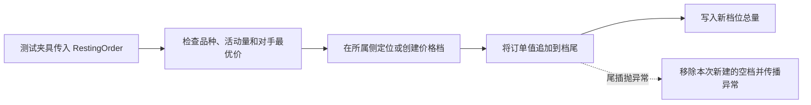

# Day 09 · 买卖价档与 FIFO

## 1. 本期内容与学习目标

本课需要 Day 04 的 `map`、`list` 和比较器，以及 Day 07–08 的 `RestingOrder` 和手算夹具。预计 2–3 小时。创建一个单品种 `OrderBook`，用两棵有序树表示盘口，用链表保存同价挂单。完成后能给簿装入已有活动订单、查询买一卖一，并说明档位总量怎样在插入失败时保持一致。

本课的写入通过测试夹具进入私有方法，输入代表已经决定挂簿的活动订单。Day 12 才将真实下单接到撮合循环，再由撮合循环调用这条入队路径。

## 2. 业务背景与原理

若先后装入卖单 9@103×4、7@101×3、8@101×2，卖一是 101。同一档中 ID 7 先于 8，档位总量为 5。第二笔的外部时间戳可以更早，因为队列的权威是实际入队顺序。再装入买单 10@99×2 和 11@100×1，买一是 100，价差为 1。买卖两侧各有自己的排序方向，便于统一从 `begin()` 读最优。

| 侧 | 最优到最差的档位 | 对应档内顺序 |
| --- | --- | --- |
| 卖 | 101、103 | 101 为 7、8，103 为 9 |
| 买 | 100、99 | 100 为 11，99 为 10 |

夹具只装活动单，买价达到卖一、卖价达到买一的候选值不能直接入队。正常下单以后应先成交，只有剩余部分能进入盘口。空侧用 `std::optional<Price>` 表达，买一或卖一缺失时价差也缺失。

## 3. Java 原始项目的实现分析

Java 的 Naive 簿用两个 `TreeMap` 保存价格，买侧使用逆序比较器。`newOrderPlaceGtc` 撮合后将余量插入 `computeIfAbsent(price, OrdersBucketNaive::new)` 取得的档，档内用保持插入顺序的 `LinkedHashMap`。`put` 增加的量是 `size - filled`，这对应 C++ 的 `remaining`。Java 同时更新 ID 表。本课先稳定价格和队列，再在 Day 10 加入这份索引。 [价格树](https://github.com/exchange-core/exchange-core/blob/2f8548749839e9095c8dc597e4b61521d259fa5d/src/main/java/exchange/core2/core/orderbook/OrderBookNaiveImpl.java#L34-L66) · [GTC 入队](https://github.com/exchange-core/exchange-core/blob/2f8548749839e9095c8dc597e4b61521d259fa5d/src/main/java/exchange/core2/core/orderbook/OrderBookNaiveImpl.java#L104-L141) · [档内数据和总量](https://github.com/exchange-core/exchange-core/blob/2f8548749839e9095c8dc597e4b61521d259fa5d/src/main/java/exchange/core2/core/orderbook/OrdersBucketNaive.java#L40-L68)

## 4. 本期 C++ 知识

### 有序树与同价节点

`std::map<Price, Level, Compare>` 的键控制顺序，值拥有档位。比较器用 `std::less<Price>` 和 `std::greater<Price>`，借用 Day 06 为强类型价格生成的比较。键位于 `pair<const Price, Level>` 的第一项。不能直接改节点的价格键，因为树仍在原位置。改价课会明确拆成摘除、撮合和重新插入。

`try_emplace(key)` 返回「档迭代器，是否新建」二元值。`auto [it, created]` 是结构化绑定。已有价档时它直接给出旧档。新价档的 `Level` 使用成员初始化值，初始总量为 0。`auto& level = it->second` 借用树里的档。对 `list` 尾插会创建新节点，原节点迭代器保持有效。若后面删掉整档，其内部所有链表节点随档销毁。 [map 插入接口](https://eel.is/c++draft/map.modifiers) · [list 插入与擦除](https://eel.is/c++draft/list.modifiers)

### 局部异常安全

创建档和分配链表节点是两次操作。若新档已经创建、随后尾插抛异常，应移除新建的空档。若档本来存在，保留其旧节点与旧总量。总量溢出属于可预期的输入失败，先用 `checked_add` 检查。`catch (...)` 捕获当前异常，补偿已经发生的操作，随后用 `throw;` 原样传播。学会分别指出哪一行首次改变对象、哪些后续行会失败。

## 5. 架构设计与技术选型

| 方案 | 取舍 |
| --- | --- |
| 有序树加每档链表 | 稀疏价档自然映射，最优档可从首迭代器读，后续可保存稳定的链表句柄 |
| 排序向量加每档向量 | 数据紧凑，适合少量静态档位；中间插删会移动元素，句柄管理更复杂 |
| 价格数组加非空位图 | 价格范围已知且很窄时可用；范围扩大时空档占用空间 |

本课选有序树和链表。`OrderBook` 拥有两棵树，每档拥有 FIFO 和缓存总量。价档插入为 `O(log(P+1))`，其中 `P` 是该侧档数。临时的 ID 查重需要扫两侧全部订单，整体为 `O(N+log(P+1))`。链表尾插是常数，取最优价也是常数。空间随档数和订单数线性增长。Day 10 会把线性 ID 查重替换成散列表查询。



## 6. 从零逐步实现

### 9.1 定义单品种订单簿

创建 `include/exchange/order_book.hpp`。`explicit OrderBook(SymbolId)` 使调用者明确品种。`= delete` 拒绝复制和移动，Day 10 的索引将借用这个对象内部的节点。对簿本身采用稳定所有权，往后可用 `unique_ptr<OrderBook>` 在模块间转移拥有权。`friend struct OrderBookTestAccess` 仅让指定测试辅助类型读取私有成员并装入夹具。测试外不需要构造这个辅助类型。

```cpp
#ifndef EXCHANGE_ORDER_BOOK_HPP
#define EXCHANGE_ORDER_BOOK_HPP

#include "exchange/model.hpp"

#include <cstddef>
#include <cstdint>
#include <functional>
#include <list>
#include <map>
#include <optional>

namespace exchange {

struct OrderBookTestAccess;

class OrderBook {
public:
    explicit OrderBook(SymbolId symbol);
    OrderBook(const OrderBook&) = delete;
    OrderBook& operator=(const OrderBook&) = delete;
    OrderBook(OrderBook&&) = delete;
    OrderBook& operator=(OrderBook&&) = delete;

    std::optional<Price> best_bid() const;
    std::optional<Price> best_ask() const;

private:
    friend struct OrderBookTestAccess;

    struct Level {
        std::list<RestingOrder> fifo;
        std::int64_t total_remaining{};
    };

    using AskLevels = std::map<Price, Level, std::less<Price>>;
    using BidLevels = std::map<Price, Level, std::greater<Price>>;

    bool valid_resting(const RestingOrder& order) const;
    bool crosses(const RestingOrder& order) const;
    bool contains_order(OrderId id) const;
    Status add_resting(const RestingOrder& order);

    template<class Levels>
    Status append_to(Levels& levels, const RestingOrder& order);

    SymbolId symbol_;
    AskLevels asks_;
    BidLevels bids_;
};

}

#endif
```

### 9.2 实现档位、价限和入队

将下段写入 `src/order_book.cpp`。`valid_resting` 要求买侧挂单已经拥有实际预留价，且不低于挂价。对于省略预留价的入站买单，Day 12 的下单入口会采用限价补齐。卖侧不持有买方预留价。检查同价入队序号时，只看当前队尾。不同档位各自排序，夹具可以跨价格档装载。模板 `append_to` 的定义放在这个实现文件中，其两次调用也在这里，编译器能看到两种实例所需的定义。

```cpp
#include "exchange/order_book.hpp"

#include <stdexcept>

namespace exchange {

OrderBook::OrderBook(SymbolId symbol) : symbol_{symbol} {
    if (symbol.value() == 0) {
        throw std::invalid_argument{"order book requires a symbol"};
    }
}

std::optional<Price> OrderBook::best_bid() const {
    if (bids_.empty()) {
        return std::nullopt;
    }
    return bids_.begin()->first;
}

std::optional<Price> OrderBook::best_ask() const {
    if (asks_.empty()) {
        return std::nullopt;
    }
    return asks_.begin()->first;
}

bool OrderBook::valid_resting(const RestingOrder& order) const {
    if (order.key.symbol != symbol_ || order.key.order.value() == 0 ||
        order.user.value() == 0 || order.price.value() <= 0 ||
        order.remaining.value() <= 0 || order.priority_seq.value() == 0 ||
        order.timestamp_ns < 0) {
        return false;
    }
    if (order.side == Side::bid) {
        return order.reserve_bid_price && *order.reserve_bid_price >= order.price;
    }
    return order.side == Side::ask && !order.reserve_bid_price;
}

bool OrderBook::crosses(const RestingOrder& order) const {
    if (order.side == Side::bid) {
        const auto ask = best_ask();
        return ask && order.price >= *ask;
    }
    const auto bid = best_bid();
    return bid && order.price <= *bid;
}

bool OrderBook::contains_order(OrderId id) const {
    const auto contains = [id](const auto& levels) {
        for (const auto& [price, level] : levels) {
            for (const auto& order : level.fifo) {
                if (order.key.order == id) {
                    return true;
                }
            }
        }
        return false;
    };
    return contains(asks_) || contains(bids_);
}

template<class Levels>
Status OrderBook::append_to(Levels& levels, const RestingOrder& order) {
    auto [it, created] = levels.try_emplace(order.price);
    auto& level = it->second;
    if (!level.fifo.empty() && level.fifo.back().priority_seq >= order.priority_seq) {
        return Status::invalid_input;
    }

    const auto total = checked_add(level.total_remaining, order.remaining.value());
    if (!total) {
        return Status::invalid_input;
    }

    try {
        level.fifo.push_back(order);
    } catch (...) {
        if (created) {
            levels.erase(it);
        }
        throw;
    }

    level.total_remaining = *total;
    return Status::processed;
}

Status OrderBook::add_resting(const RestingOrder& order) {
    if (!valid_resting(order)) {
        return Status::invalid_input;
    }
    if (contains_order(order.key.order)) {
        return Status::duplicate_order;
    }
    if (crosses(order)) {
        return Status::invalid_input;
    }
    return order.side == Side::ask ? append_to(asks_, order) : append_to(bids_, order);
}

}
```

`contains_order` 内的 `const auto&` lambda 形参让同一段扫描接受两种价格树，返回值是是否找到活动 ID。`append_to` 在尾插前检查优先序与档位总量，成功后只赋值一个整数。若档是新建的，则队列为空且总量为 0，合法活动量加 0 一定可表示。由此可知两个输入失败分支只可能发生在旧档。`add_resting` 返回业务状态，未捕获的分配异常仍可由上层观察。

### 9.3 接入构建

在 `add_library(exchange_core ...)` 的源文件列表加入 `src/order_book.cpp`。附加测试目标。

```cmake
add_executable(order_book_tests tests/order_book_test.cpp)
target_link_libraries(order_book_tests PRIVATE exchange_core)
add_test(NAME order_book COMMAND order_book_tests)
```

## 7. 测试、调试与验证

### 写测试访问器和盘口用例

将下段保存为 `tests/order_book_access.hpp`。测试方法只读出副本。`return {first, last};` 在这里构造向量，依次复制给定迭代器范围。`total` 返回空值表示档不存在。使用比较器相反的两种 map 时，条件表达式的两支分别调用小 lambda，返回同一种值类型。

```cpp
#ifndef EXCHANGE_ORDER_BOOK_ACCESS_HPP
#define EXCHANGE_ORDER_BOOK_ACCESS_HPP

#include "exchange/order_book.hpp"

#include <vector>

namespace exchange {

struct OrderBookTestAccess {
    static Status insert(OrderBook& book, const RestingOrder& order) {
        return book.add_resting(order);
    }

    static std::vector<RestingOrder> queue(const OrderBook& book, Side side, Price price) {
        const auto read = [price](const auto& levels) -> std::vector<RestingOrder> {
            const auto it = levels.find(price);
            if (it == levels.end()) {
                return {};
            }
            return {it->second.fifo.begin(), it->second.fifo.end()};
        };
        return side == Side::ask ? read(book.asks_) : read(book.bids_);
    }

    static std::optional<std::int64_t> total(const OrderBook& book, Side side, Price price) {
        const auto read = [price](const auto& levels) -> std::optional<std::int64_t> {
            const auto it = levels.find(price);
            if (it == levels.end()) {
                return std::nullopt;
            }
            return it->second.total_remaining;
        };
        return side == Side::ask ? read(book.asks_) : read(book.bids_);
    }
};

}

#endif
```

在 `tests/order_book_test.cpp` 使用 Day 08 的夹具。先按不同价格的逆序装卖档，然后再装买盘。额外用一个独立簿验证量的上界。`std::numeric_limits` 给出最大可表示总量。

```cpp
#include "order_book_access.hpp"
#include "test_checks.hpp"
#include "trading_fixtures.hpp"

#include <iostream>
#include <limits>

int main() {
    using namespace exchange;
    using Access = OrderBookTestAccess;
    using trading_fixture::rest;

    TestChecks checks;
    OrderBook book{SymbolId{1}};
    checks.require(!book.best_ask() && !book.best_bid(), "empty book");

    const auto cases = trading_fixture::cases();
    const auto& orders = cases.at(0).before;
    checks.require(Access::insert(book, orders.at(2)) == Status::processed, "insert 103 first");
    checks.require(Access::insert(book, orders.at(0)) == Status::processed, "insert first 101");
    checks.require(Access::insert(book, orders.at(1)) == Status::processed, "append second 101");
    checks.require(book.best_ask() == Price{101} && !book.best_bid(), "ask-only book");
    checks.require(Access::queue(book, Side::ask, Price{101}) ==
                   std::vector<RestingOrder>{orders.at(0), orders.at(1)}, "arrival order at 101");
    checks.require(Access::total(book, Side::ask, Price{101}) == 5, "101 total remaining");

    checks.require(Access::insert(book, rest(10, Side::bid, 99, 2, 4, 500)) ==
                   Status::processed, "insert bid 99");
    checks.require(Access::insert(book, rest(11, Side::bid, 100, 1, 5, 600)) ==
                   Status::processed, "insert bid 100");
    checks.require(book.best_bid() == Price{100} && book.best_ask() == Price{101}, "best prices");
    checks.require(Access::insert(book, rest(7, Side::bid, 99, 1, 6, 700)) ==
                   Status::duplicate_order, "duplicate id on the other side");
    checks.require(Access::insert(book, rest(12, Side::bid, 101, 1, 6, 700)) ==
                   Status::invalid_input, "crossed fixture is rejected");
    checks.require(Access::insert(book, rest(13, Side::ask, 101, 1, 1, 700)) ==
                   Status::invalid_input, "same-price sequence must advance");
    auto other = rest(14, Side::ask, 104, 1, 7, 700);
    other.key.symbol = SymbolId{2};
    checks.require(Access::insert(book, other) == Status::invalid_input, "wrong symbol");
    checks.require(!Access::total(book, Side::ask, Price{104}), "no unexpected level");

    OrderBook large{SymbolId{1}};
    constexpr auto max = std::numeric_limits<std::int64_t>::max();
    checks.require(Access::insert(large, rest(1, Side::ask, 101, max, 1, 100)) ==
                   Status::processed, "max level total");
    checks.require(Access::insert(large, rest(2, Side::ask, 101, 1, 2, 200)) ==
                   Status::invalid_input &&
                   Access::queue(large, Side::ask, Price{101}).size() == 1 &&
                   Access::total(large, Side::ask, Price{101}) == max, "overflow leaves the level unchanged");

    if (checks.exit_code() == 0) {
        std::cout << "best bid 100, best ask 101, FIFO 7 then 8\n";
    }
    return checks.exit_code();
}
```

```bash
cmake -S . -B build-debug -DCMAKE_BUILD_TYPE=Debug
cmake --build build-debug
ctest --test-dir build-debug -R '^order_book$' -V
```

多配置生成器分别加 `--config Debug`、`-C Debug`。预期输出 `best bid 100, best ask 101, FIFO 7 then 8`，全套有 8 项注册测试。若买一变成 99，检查买侧比较器。若 B 被排在 A 前面，检查是否按外部时间戳重新排序。临时改动 `append_to`，将 `push_back` 换成 `push_front`，队列测试应报 `FAIL: arrival order at 101`。

## 8. Java 与 C++ 实现深度对比

Java `LinkedHashMap` 在一份结构中兼顾同价顺序和档内 ID 查找。课程把节点交给 `list`，价格树只负责找档。这使档内顺序自然来自尾插，删除指定订单的成本取决于如何得到节点。Java 引用能继续指向已脱离簿的对象；课程以私有句柄约束访问范围，查询只返回值。选择树和链表是基于可维护性与迭代器要求，性能要到 Day 21 再测。

## 9. 课后练习

1. **基础。** 在当前簿加一笔卖单 104×2，核对卖一仍为 101，104 档总量为 2。
2. **工程。** 增加买侧同价两笔、外部时间戳逆序的夹具。预期节点按实际入队顺序排列，买一不变。
3. **思考。** 如果去掉缓存总量，查询前两档 L2 需要访问什么？比较档位内一笔和十万笔挂单的差别。

## 10. 总结与下一期

你现在可以用价格树找到最优档，用稳定节点保留同价的先后。下一课给每个活动订单建立 ID 到节点的索引，处理删除和索引插入失败。

[Day 08](../02-trading-model/day-08.md) · [课程目录](../00-overview/learning-roadmap.md) · [Day 10](day-10.md)

<details>
<summary>练习参考答案</summary>

1. 通过 `rest(15, Side::ask, 104, 2, 7, 700)` 装入，检查 `best_ask() == Price{101}` 和 104 档聚合值 2。
2. 在 100 的现有买单后装 ID 15、入队序号 7、时间戳 100，断言顺序为 11、15。
3. 去掉缓存后必须逐个读取请求深度内的所有节点。保留缓存时只读两个档位，和档内笔数无关。

</details>
