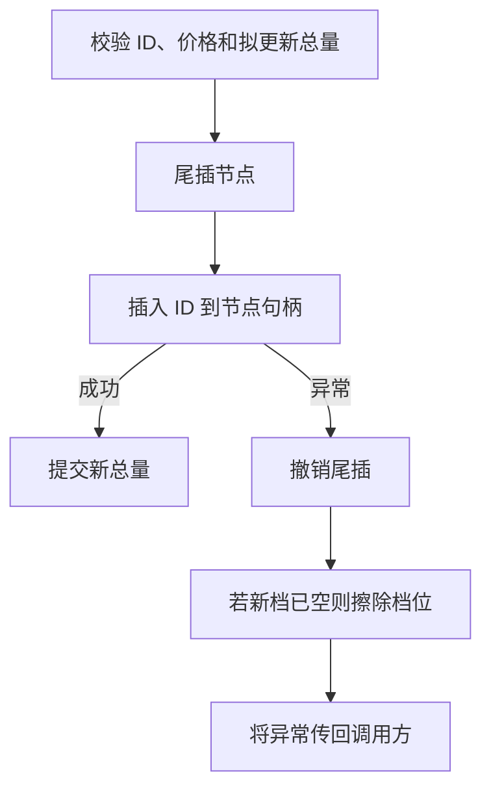

# Day 10 · 订单索引与失效规则

## 1. 本期内容与学习目标

本课需要 Day 09 的价档和 FIFO，以及 Day 04 的 rehash 与迭代器规则。预计 3–4 小时。给活动订单建立 ID 索引，写出按 ID 定位、按所有者删除与空档回收。通过注入一次索引插入失败，验证队列、索引和档位总量一起回到插入前的状态。

今天的删除是订单簿内部原语，测试直接调用。Day 15 才接入正式撤单命令和 `Reduce` 事件。

## 2. 业务背景与原理

撤销 ID 8 时，系统需要找到那一笔活动单、确认所属用户，然后只移除它。若 101 档的队列为 A(3)、B(2)、C(4)，删除 B 后是 A、C，总量由 9 降为 7。删除 A 后 C 成为队首。删除最后一笔时，档和它的价格也从卖侧消失。此时卖一由下一档决定，若整侧为空则没有卖一。

索引是活动订单的访问路径。节点被移除后，ID 可以被后续的新活动单复用。订单查找返回当时的值副本，调用者可以保存它用于观察。撤单等写操作仍要重新按当前簿和所有者检查。

## 3. Java 原始项目的实现分析

`OrderBookNaiveImpl.idMap` 用活动 ID 找订单，`cancelOrder` 在 `idMap` 找到对象后验证 `uid`，从索引及档内移除，空档回收，然后生成剩余量的减量事件。`validateInternalState` 调用各档的 `validate`，后者重新计算档内剩余量总和。Direct 版还检查订单索引和双向链关系。课程把「档总量」和「索引对节点的一一映射」一起验证。 [Naive 撤单](https://github.com/exchange-core/exchange-core/blob/2f8548749839e9095c8dc597e4b61521d259fa5d/src/main/java/exchange/core2/core/orderbook/OrderBookNaiveImpl.java#L289-L321) · [Naive 档校验](https://github.com/exchange-core/exchange-core/blob/2f8548749839e9095c8dc597e4b61521d259fa5d/src/main/java/exchange/core2/core/orderbook/OrdersBucketNaive.java#L162-L173) · [Direct 索引校验](https://github.com/exchange-core/exchange-core/blob/2f8548749839e9095c8dc597e4b61521d259fa5d/src/main/java/exchange/core2/core/orderbook/OrderBookDirectImpl.java#L585-L605)

## 4. 本期 C++ 知识

### 用迭代器借用别处拥有的节点

`OrderLocation` 保存方向、价格和 `std::list<RestingOrder>::iterator`。`Index` 是散列表，值中的链表迭代器指向价格档拥有的订单。对散列表执行 rehash 时，散列表迭代器全部失效。它的值中的链表迭代器仍指向各自存活的链表节点。保存散列表的 `find` 结果只适合在下一次可能 rehash 的操作之前使用。 [无序关联容器的失效规则](https://eel.is/c++draft/unord.req)

`erase(it)` 使被擦除的链表迭代器失效，其他节点仍可用。删除订单先抄出事件将来需要的值和位置，再从散列表删记录，最后从档内删节点。保留一个指向旧节点的引用，删除后再读字段，会落到 Day 03 的悬空借用问题。整簿复制还会产生两个订单容器，默认复制的索引句柄依然指向旧簿，Day 09 已禁用复制和移动。 [链表擦除规则](https://eel.is/c++draft/list.modifiers)

### 两处容器的提交顺序

尾插完成后才能得到节点句柄，而索引的 `try_emplace` 也可能分配内存。先不更新档总量，插入失败时撤销尾插并回收新建的空档。这里两个容器都使用常规标准分配器，回滚只擦除已经建立的节点。测试用一个仅从私有夹具入口传入的函数指针，在真正插索引前抛 `std::bad_alloc`。它触发的是与索引分配异常相同的回滚路径，便于稳定覆盖。

## 5. 架构设计与技术选型

| 索引方案 | 成本和代价 |
| --- | --- |
| `OrderId → 方向 + 价格 + list 迭代器` | 预期常数定位订单，摘节点时另按价格查档。两侧 map 类型不同，使用统一位置结构 |
| `OrderId → 价格树迭代器 + list 迭代器` | 可以省一次价格查找。需区分两种树迭代器类型，恢复与移动的约束也更多 |
| 每次扫描全部活动单 | 代码少，取消和重复检查随挂单数线性增长 |

先采用第一种。定义 `OrderIdHash` 只对 `OrderId.value()` 做散列，保留键的强类型。索引查找平均 `O(1)`，最坏线性。移除时价档查找为 `O(log(P+1))`，链表摘除是常数，空档按迭代器移除。`validate()` 在散列表平均常数查找的条件下遍历 `O(N+P)`，使用固定额外空间。它用于阶段验收和调试。



## 6. 从零逐步实现

### 10.1 更新头文件

用下段替换 `include/exchange/order_book.hpp`。`OrderLocation` 的 `node` 只在簿内部可见。`find_order` 返回 `optional<RestingOrder>`，缺单返回空值。`BeforeIndexInsert` 是指向无参数、无返回值函数的指针，默认空值。测试用它注入异常，实际簿路径省略该参数。

```cpp
#ifndef EXCHANGE_ORDER_BOOK_HPP
#define EXCHANGE_ORDER_BOOK_HPP

#include "exchange/model.hpp"

#include <cstddef>
#include <cstdint>
#include <functional>
#include <list>
#include <map>
#include <optional>
#include <unordered_map>

namespace exchange {

struct OrderBookTestAccess;

class OrderBook {
public:
    explicit OrderBook(SymbolId symbol);
    OrderBook(const OrderBook&) = delete;
    OrderBook& operator=(const OrderBook&) = delete;
    OrderBook(OrderBook&&) = delete;
    OrderBook& operator=(OrderBook&&) = delete;

    std::optional<Price> best_bid() const;
    std::optional<Price> best_ask() const;
    std::optional<RestingOrder> find_order(OrderId id) const;
    bool validate() const;

private:
    friend struct OrderBookTestAccess;

    struct Level {
        std::list<RestingOrder> fifo;
        std::int64_t total_remaining{};
    };

    struct OrderLocation {
        Side side;
        Price price;
        std::list<RestingOrder>::iterator node;
    };

    struct OrderIdHash {
        std::size_t operator()(OrderId id) const noexcept {
            return std::hash<std::uint64_t>{}(id.value());
        }
    };

    using AskLevels = std::map<Price, Level, std::less<Price>>;
    using BidLevels = std::map<Price, Level, std::greater<Price>>;
    using Index = std::unordered_map<OrderId, OrderLocation, OrderIdHash>;
    using BeforeIndexInsert = void (*)();

    bool valid_resting(const RestingOrder& order) const;
    bool crosses(const RestingOrder& order) const;
    Status add_resting(const RestingOrder& order, BeforeIndexInsert before_index = nullptr);
    std::optional<RestingOrder> remove_resting(OrderId id, UserId owner);

    template<class Levels>
    Status append_to(Levels& levels, const RestingOrder& order, BeforeIndexInsert before_index);

    template<class Levels>
    RestingOrder remove_from(Levels& levels, Index::iterator indexed);

    SymbolId symbol_;
    AskLevels asks_;
    BidLevels bids_;
    Index index_;
};

}

#endif
```

`std::hash<std::uint64_t>{}` 构造一个整数散列函数对象。`noexcept` 表明散列调用不抛出，误让异常越过这种函数边界会终止程序。`index_` 声明在树之后，销毁簿时它会先被销毁。这个次序和索引借用关系一致。

### 10.2 替换插入尾段并实现删除

保留 `src/order_book.cpp` 的构造函数、买一卖一、`valid_resting` 和 `crosses`。在文件顶部增加 `#include <iterator>` 和 `#include <memory>`，供 `std::prev` 和 `std::addressof` 使用。删除从 `contains_order` 开始到 `namespace exchange` 最终闭合之间的旧实现。在同一命名空间中粘贴下面的定义，再保留文件末尾用于闭合命名空间的 `}`。

```cpp
Status OrderBook::add_resting(const RestingOrder& order, BeforeIndexInsert before_index) {
    if (!valid_resting(order)) {
        return Status::invalid_input;
    }
    if (index_.contains(order.key.order)) {
        return Status::duplicate_order;
    }
    if (crosses(order)) {
        return Status::invalid_input;
    }
    return order.side == Side::ask ? append_to(asks_, order, before_index)
                                   : append_to(bids_, order, before_index);
}

template<class Levels>
Status OrderBook::append_to(Levels& levels, const RestingOrder& order,
                           BeforeIndexInsert before_index) {
    auto [it, created] = levels.try_emplace(order.price);
    auto& level = it->second;
    if (!level.fifo.empty() && level.fifo.back().priority_seq >= order.priority_seq) {
        return Status::invalid_input;
    }
    const auto total = checked_add(level.total_remaining, order.remaining.value());
    if (!total) {
        return Status::invalid_input;
    }

    try {
        level.fifo.push_back(order);
        try {
            if (before_index) {
                before_index();
            }
            const auto node = std::prev(level.fifo.end());
            const auto inserted =
                index_.try_emplace(order.key.order, OrderLocation{order.side, order.price, node});
            if (!inserted.second) {
                throw std::logic_error{"duplicate order during index insertion"};
            }
        } catch (...) {
            level.fifo.pop_back();
            throw;
        }
    } catch (...) {
        if (created) {
            levels.erase(it);
        }
        throw;
    }

    level.total_remaining = *total;
    return Status::processed;
}

std::optional<RestingOrder> OrderBook::find_order(OrderId id) const {
    const auto it = index_.find(id);
    if (it == index_.end()) {
        return std::nullopt;
    }
    return *it->second.node;
}

std::optional<RestingOrder> OrderBook::remove_resting(OrderId id, UserId owner) {
    const auto it = index_.find(id);
    if (it == index_.end() || it->second.node->user != owner) {
        return std::nullopt;
    }
    return it->second.side == Side::ask ? remove_from(asks_, it)
                                       : remove_from(bids_, it);
}

template<class Levels>
RestingOrder OrderBook::remove_from(Levels& levels, Index::iterator indexed) {
    const auto location = indexed->second;
    const auto level_it = levels.find(location.price);
    if (level_it == levels.end()) {
        throw std::logic_error{"order index points to a missing price level"};
    }

    auto& level = level_it->second;
    const RestingOrder removed = *location.node;
    index_.erase(indexed);
    level.fifo.erase(location.node);
    level.total_remaining -= removed.remaining.value();
    if (level.fifo.empty()) {
        levels.erase(level_it);
    }
    return removed;
}

bool OrderBook::validate() const {
    std::size_t count = 0;
    const auto validate_side = [this, &count](const auto& levels, Side side) {
        for (const auto& [price, level] : levels) {
            if (level.fifo.empty() || level.total_remaining <= 0) {
                return false;
            }
            std::int64_t total = 0;
            Seq previous{0};
            for (const auto& order : level.fifo) {
                if (!valid_resting(order) || order.side != side ||
                    order.price != price || order.priority_seq <= previous) {
                    return false;
                }
                const auto it = index_.find(order.key.order);
                if (it == index_.end() || it->second.side != side ||
                    it->second.price != price ||
                    std::addressof(*it->second.node) != std::addressof(order)) {
                    return false;
                }
                const auto next = checked_add(total, order.remaining.value());
                if (!next) {
                    return false;
                }
                total = *next;
                previous = order.priority_seq;
                ++count;
            }
            if (total != level.total_remaining) {
                return false;
            }
        }
        return true;
    };

    const auto bid = best_bid();
    const auto ask = best_ask();
    return (!bid || !ask || *bid < *ask) &&
           validate_side(asks_, Side::ask) && validate_side(bids_, Side::bid) &&
           count == index_.size();
}
```

内层 `try` 在尾插成功后开始，出错只撤销这一个新节点。外层负责回收本次创建的档。如果尾插本身抛异常，就直接进入外层处理，此时无需 `pop_back`。正常路径里 `try_emplace` 成功后只剩不抛出的整数赋值。由于前置查重和单一写者，`inserted.second` 为假表示内部假设被破坏。

`validate` 用总数覆盖额外的索引记录，用节点地址对照索引定位结果与实际遍历位置。它以索引句柄可解引用为前提。C++ 没有可移植方法让失效的链表迭代器先自查再解引用。防止悬空依靠更新顺序，并用 ASan、可用时的调试迭代器和删除场景做验证。正常路径的总量减法有前置不变量保证，`0 < removed.remaining <= total_remaining`。

## 7. 测试、调试与验证

### 访问器扩展与可复现故障

在 `tests/order_book_access.hpp` 的 `OrderBookTestAccess` 内追加以下方法。`index_bucket_count` 和 `rehash_index` 只用于观察并触发一次真实 rehash。`inject_failure` 在旧档、新档两种情形调用相同的回滚路径。

```cpp
    static std::optional<RestingOrder> remove(OrderBook& book, OrderId id, UserId owner) {
        return book.remove_resting(id, owner);
    }

    static Status inject_failure(OrderBook& book, const RestingOrder& order,
                                 void (*fail)()) {
        return book.add_resting(order, fail);
    }

    static std::size_t index_bucket_count(const OrderBook& book) {
        return book.index_.bucket_count();
    }

    static void rehash_index(OrderBook& book, std::size_t buckets) {
        book.index_.rehash(buckets);
    }
```

创建 `tests/order_index_test.cpp`。保留 Day 09 的原测试。在 101 档先插四单，依次删除中、尾、首及最后一单。成功删除的结果按值复制。以 `std::bad_alloc` 模拟索引分配失败，测试检查旧档、缺失 ID 和新档空位。`try` 只包住故障注入，其他意外异常可以直接使测试失败。

```cpp
#include "order_book_access.hpp"
#include "test_checks.hpp"
#include "trading_fixtures.hpp"

#include <iostream>
#include <new>

int main() {
    using namespace exchange;
    using Access = OrderBookTestAccess;
    using trading_fixture::rest;

    TestChecks checks;
    OrderBook book{SymbolId{1}};
    const auto a = rest(7, Side::ask, 101, 3, 1, 300);
    const auto b = rest(8, Side::ask, 101, 2, 2, 200);
    const auto c = rest(9, Side::ask, 101, 4, 3, 250);
    const auto d = rest(10, Side::ask, 101, 1, 4, 400);

    checks.require(book.validate(), "empty book is valid");
    for (const auto& order : {a, b, c, d}) {
        checks.require(Access::insert(book, order) == Status::processed && book.validate(),
                       "indexed insertion");
    }

    const auto buckets = Access::index_bucket_count(book);
    Access::rehash_index(book, buckets + 1);
    checks.require(Access::index_bucket_count(book) > buckets &&
                   book.find_order(b.key.order) == b && book.validate(),
                   "index rehash keeps list handles valid");

    checks.require(!Access::remove(book, b.key.order, UserId{99}) && book.validate(),
                   "wrong owner cannot remove");
    checks.require(!Access::remove(book, OrderId{999}, UserId{99}) && book.validate(),
                   "unknown order cannot remove");

    const auto fail = [] { throw std::bad_alloc{}; };
    const auto expect_rollback = [&](const RestingOrder& candidate) {
        const auto original = Access::queue(book, Side::ask, Price{101});
        const auto original_total = Access::total(book, Side::ask, Price{101});
        bool thrown = false;
        try {
            Access::inject_failure(book, candidate, fail);
        } catch (const std::bad_alloc&) {
            thrown = true;
        }
        return thrown && book.validate() && !book.find_order(candidate.key.order) &&
               Access::queue(book, Side::ask, Price{101}) == original &&
               Access::total(book, Side::ask, Price{101}) == original_total;
    };
    checks.require(expect_rollback(rest(11, Side::ask, 101, 5, 5, 500)),
                   "failed index insertion rolls back existing level");
    checks.require(expect_rollback(rest(12, Side::ask, 102, 5, 6, 600)) &&
                   !Access::total(book, Side::ask, Price{102}),
                   "failed index insertion erases new empty level");

    const auto saved = book.find_order(b.key.order);
    checks.require(Access::remove(book, b.key.order, b.user) == b && book.validate() &&
                   !book.find_order(b.key.order) &&
                   Access::queue(book, Side::ask, Price{101}) ==
                       std::vector<RestingOrder>{a, c, d} &&
                   Access::total(book, Side::ask, Price{101}) == 8, "remove middle");
    checks.require(Access::remove(book, d.key.order, d.user) == d && book.validate(),
                   "remove tail");
    checks.require(Access::remove(book, a.key.order, a.user) == a && book.validate() &&
                   Access::queue(book, Side::ask, Price{101}) == std::vector<RestingOrder>{c},
                   "remove head");
    checks.require(Access::remove(book, c.key.order, c.user) == c && book.validate() &&
                   !book.best_ask() && !Access::total(book, Side::ask, Price{101}),
                   "remove last and erase level");
    checks.require(saved == b, "lookup owns its value after erase");
    checks.require(Access::insert(book, rest(8, Side::bid, 99, 1, 7, 700)) ==
                   Status::processed && book.validate(), "reuse inactive ID");

    if (checks.exit_code() == 0) {
        std::cout << "index, erase and rollback checked\n";
    }
    return checks.exit_code();
}
```

测试中的 `[&]` 捕获调用时仍存活的局部变量。`fail` 无捕获，所以能隐式转换成相同签名的函数指针。`expect_rollback` 在操作前保留一份队列值，按值核对失败后的结果。

将下段加到 `CMakeLists.txt`，再运行 `cmake --build build-debug` 和 `ctest --test-dir build-debug -R '^order_index$' -V`。多配置分别加 `--config Debug`、`-C Debug`。

```cmake
add_executable(order_index_tests tests/order_index_test.cpp)
target_link_libraries(order_index_tests PRIVATE exchange_core)
add_test(NAME order_index COMMAND order_index_tests)
```

预期 `index, erase and rollback checked`，全套 9 项。临时注释掉 `level.fifo.pop_back();` 后，旧档回滚测试应报 `FAIL: failed index insertion rolls back existing level`。若删除只在 rehash 后出错，核对长期存的是链表迭代器还是散列表迭代器。若删掉唯一订单后仍有最优价，核对空档清理。

## 8. Java 与 C++ 实现深度对比

Java 的 ID 表持有订单引用，删价格档不必立刻销毁仍被引用的对象。C++ 索引只借用链表迭代器，删除节点后对象生命周期立即结束。顺序和异常回滚在 C++ 版能直接写成局部更新步骤。两种语言都需保证缓存总量和 ID 索引与活动簿一致。索引避免对大订单簿线性扫描，实际延迟还要看键分布、分配和缓存访问。

## 9. 课后练习

1. **基础。** 删除 B 后查 A、C、D，验证剩余节点身份与数量。删 B 第二次应得到空值。
2. **工程。** 在买侧 99 插两笔，模拟给同一买档加入第三笔时索引分配失败。验收总量、FIFO 与买一保持旧值。
3. **思考。** 如果在 `push_back` 后先更新总量再插索引，列出异常路径要撤回的全部写入。解释为何本课推迟更新总量。

## 10. 总结与下一期

簿的三个写入面现在可以一起检查。Day 11 只遍历价格档的聚合数据生成 L2，再用可拥有的活动订单副本保留 FIFO，供下一阶段撮合对照。

[Day 09](day-09.md) · [课程目录](../00-overview/learning-roadmap.md) · [Day 11](day-11.md)

<details>
<summary>练习参考答案</summary>

1. 逐一用 `find_order` 比较 A、C、D 的原值，`Access::remove(book, b.key.order, b.user)` 返回空值。
2. 用 `Access::queue(book, Side::bid, Price{99})` 保存旧序列，故障后核对序列、原总量、`best_bid() == Price{99}` 和 `validate()`。
3. 需要撤回新总量、删除新增节点，并在本次创建价格档时删掉空档。延迟写总量可让回滚只处理容器。

</details>
