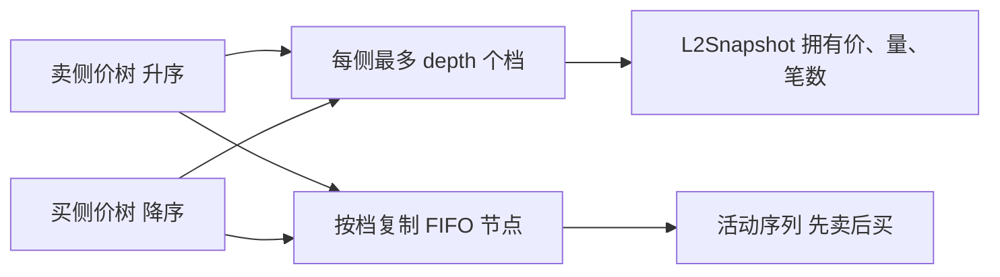

# Day 11 · L2 快照和读边界

## 1. 本期内容与学习目标

本课需要 Day 09 的价档和聚合量、Day 10 的删除与校验。预计 2–3 小时。为 `OrderBook` 添加两种只读输出。`snapshot(depth)` 返回每侧指定深度的价格、量和笔数。`resting_orders()` 按 Day 08 的规范顺序返回活动订单副本，供下一阶段检查撮合前后状态。

两种输出都在订单簿的所有者线程上生成。生成后由调用者独立持有。

## 2. 业务背景与原理

行情屏需要知道卖一 101 有 5 手、2 笔，买一 100 有 1 手、1 笔。它不需要知道 ID 7 与 ID 8 的队列先后。L2 把同价节点投影到一行，深度按每侧分别计数。深度 1 可以同时返回 1 个卖档和 1 个买档。任一侧为空时，该侧给空向量。超大深度只遍历已有档，深度 0 给两份空向量。


| 查询                      | 卖侧价、量、笔数     | 买侧价、量、笔数    |
| ------------------------- | -------------------- | ------------------- |
| 深度 0                    | 空                   | 空                  |
| 深度 1                    | 101，5，2            | 100，1，1           |
| 深度 2                    | 101，5，2；103，4，1 | 100，1，1；99，2，1 |
| 深度 1，撤掉 101 档两笔后 | 103，4，1            | 100，1，1           |

价格档数量与活动订单数量属于不同维度。深度 1 的卖侧 101 仍包含 A 和 B 的总量。如果需要比较谁先成交，应查完整活动序列，而非用 L2 还原 FIFO。

## 3. Java 原始项目的实现分析

`IOrderBook.getL2MarketDataSnapshot` 先按各侧可用档数确定快照大小，再分开填卖和买。Naive 版从各树开头顺序取档，写价格、档总量和订单笔数。Direct 版使用基数树正序和逆序遍历，投影的字段相同。Java 命令把负深度当成全档请求，C++ 核心接口使用无符号 `std::size_t`。从有符号外部参数进入时，应先拒绝负数或明确转换全量语义，再调用核心接口。 [快照入口和深度转换](https://github.com/exchange-core/exchange-core/blob/2f8548749839e9095c8dc597e4b61521d259fa5d/src/main/java/exchange/core2/core/orderbook/IOrderBook.java#L137-L173) · [Java 查询命令](https://github.com/exchange-core/exchange-core/blob/2f8548749839e9095c8dc597e4b61521d259fa5d/src/main/java/exchange/core2/core/orderbook/IOrderBook.java#L200-L205) · [Naive 行情投影](https://github.com/exchange-core/exchange-core/blob/2f8548749839e9095c8dc597e4b61521d259fa5d/src/main/java/exchange/core2/core/orderbook/OrderBookNaiveImpl.java#L452-L497) · [Direct 行情投影](https://github.com/exchange-core/exchange-core/blob/2f8548749839e9095c8dc597e4b61521d259fa5d/src/main/java/exchange/core2/core/orderbook/OrderBookDirectImpl.java#L758-L787)

## 4. 本期 C++ 知识

### const 遍历和值返回

签名末尾的 `const` 约束普通成员访问。通过 `const auto& levels` 遍历时，迭代器观察只读档位，结构化绑定不会复制其中的链表。当前簿只有一个写者。`const` 本身不让跨线程读写同步，也不能让链表引用自动变成长期有效的快照。生成快照需要在受控的读边界执行，跨线程使用时可传递已生成的值。

`vector::reserve(n)` 预留至少 `n` 个元素的容量，`size()` 仍为原值。必须用 `push_back` 或插入范围来增加元素数。预留大小取请求深度与真实档数的最小值，避免因 `std::numeric_limits<std::size_t>::max()` 产生巨大分配。`return output;` 允许编译器省掉局部返回对象的一次构造，未省略时通常移动其容器资源。这里用普通返回语句，不对局部结果额外调用 `std::move`。 [vector 容量规则](https://eel.is/c++draft/vector.capacity) · [拷贝消除规则](https://eel.is/c++draft/class.copy.elision)

## 5. 架构设计与技术选型


| 方案                             | 查询成本与观察期                                                         |
| -------------------------------- | ------------------------------------------------------------------------ |
| 返回拥有数据的 L2 值             | 按请求深度分配并复制价量，结果可在后续命令后读取                         |
| 暴露树或链表视图                 | 可少一次复制，使用者必须遵守所有者与失效边界，容易把内部布局变成外部依赖 |
| 维护一份每次写入都更新的快照缓存 | 常读场景可能受益，更新和一致性成本移到写路径                             |

本课采用第一种。`PriceLevel` 用一条小值同时承载价格、总量和笔数。快照读总量缓存和 `list::size()`，每侧最多访问 `min(depth, P)` 个档，时间和额外空间均随返回档数线性增长。`resting_orders()` 复制全部 `N` 笔，时间 `O(P+N)`，空间 `O(N)`。该接口用于测试、状态规范化和后续重建练习。



## 6. 从零逐步实现

### 11.1 扩展公开值和读取接口

在 `include/exchange/order_book.hpp` 的 include 区加 `#include <vector>`。将下列两个结构插到 `struct OrderBookTestAccess;` 之前，同在 `namespace exchange` 中。`Quantity` 保存档总活动量，`std::size_t` 用于容器计数和深度。字段的默认比较与 Day 07 的事件类型一样，可按顺序比较两侧向量。

```cpp
struct PriceLevel {
    Price price;
    Quantity total_remaining;
    std::size_t order_count;
    bool operator==(const PriceLevel&) const = default;
};

struct L2Snapshot {
    std::vector<PriceLevel> asks;
    std::vector<PriceLevel> bids;
    bool operator==(const L2Snapshot&) const = default;
};
```

将两个成员声明追加到 `OrderBook` 的 `public` 区。

```cpp
    L2Snapshot snapshot(std::size_t depth) const;
    std::vector<RestingOrder> resting_orders() const;
```

### 11.2 从两个价格树生成值

在 `src/order_book.cpp` 的 include 区加 `#include <algorithm>`。把以下定义追加到 `namespace exchange` 的最后一个 `}` 之前。`std::min` 的两项都是容器计数类型。深度为零时，`i < limit` 初次检查就为假，循环不读取首档。`vector::insert` 将链表迭代器范围复制到末尾，已有预留避免这个练习中重复扩容。

```cpp
L2Snapshot OrderBook::snapshot(std::size_t depth) const {
    const auto read_side = [depth](const auto& levels) {
        const auto limit = std::min(depth, levels.size());
        std::vector<PriceLevel> result;
        result.reserve(limit);
        auto it = levels.begin();
        for (std::size_t i = 0; i < limit; ++i, ++it) {
            const auto& [price, level] = *it;
            result.push_back({price, Quantity{level.total_remaining}, level.fifo.size()});
        }
        return result;
    };

    return {read_side(asks_), read_side(bids_)};
}

std::vector<RestingOrder> OrderBook::resting_orders() const {
    std::vector<RestingOrder> result;
    result.reserve(index_.size());
    const auto append = [&result](const auto& levels) {
        for (const auto& [price, level] : levels) {
            result.insert(result.end(), level.fifo.begin(), level.fifo.end());
        }
    };
    append(asks_);
    append(bids_);
    return result;
}
```

`snapshot` 从每侧的首档出发，读取档键、缓存总量和笔数。`resting_orders` 依次复制卖侧、买侧，档内沿链表先后复制。它们都不修改原对象。分配返回向量时即使抛出异常，簿也保持原状态。只保留 `L2Snapshot` 时，调用者可以识别盘口变化。保留 `resting_orders()` 时还可以判断同价队列和用户是否改变。

## 7. 测试、调试与验证

### 用旧快照对照新盘口

创建 `tests/order_book_snapshot_test.cpp`。`const OrderBook& read = book` 让查询从只读入口执行。第一段先测空簿和单边。第二段装入买盘，核对深度和规范序列。最后删除 101 的两单，并验证旧快照仍显示 101 档的 5 手。夹具初始化仍通过 Day 09 的测试访问器。

```cpp
#include "order_book_access.hpp"
#include "test_checks.hpp"
#include "trading_fixtures.hpp"

#include <iostream>
#include <limits>

int main() {
    using namespace exchange;
    using Access = OrderBookTestAccess;
    using trading_fixture::rest;

    TestChecks checks;
    OrderBook book{SymbolId{1}};
    const OrderBook& read = book;
    checks.require(read.snapshot(3) == L2Snapshot{} && read.resting_orders().empty(),
                   "empty snapshot and order view");

    const auto fixtures = trading_fixture::cases();
    const auto& asks = fixtures.at(0).before;
    checks.require(Access::insert(book, asks.at(2)) == Status::processed, "insert worse ask first");
    checks.require(Access::insert(book, asks.at(0)) == Status::processed, "insert first best ask");
    checks.require(Access::insert(book, asks.at(1)) == Status::processed, "insert second best ask");
    checks.require(read.snapshot(1) ==
                   L2Snapshot{{{Price{101}, Quantity{5}, 2}}, {}}, "ask-only snapshot");

    const auto low_bid = rest(10, Side::bid, 99, 2, 4, 500);
    const auto high_bid = rest(11, Side::bid, 100, 1, 5, 600);
    checks.require(Access::insert(book, low_bid) == Status::processed, "insert low bid");
    checks.require(Access::insert(book, high_bid) == Status::processed, "insert high bid");

    const L2Snapshot top{{{Price{101}, Quantity{5}, 2}},
                         {{Price{100}, Quantity{1}, 1}}};
    const L2Snapshot full{{{Price{101}, Quantity{5}, 2}, {Price{103}, Quantity{4}, 1}},
                          {{Price{100}, Quantity{1}, 1}, {Price{99}, Quantity{2}, 1}}};
    const auto old_top = read.snapshot(1);
    const auto old_orders = read.resting_orders();
    checks.require(read.snapshot(0) == L2Snapshot{}, "depth zero");
    checks.require(old_top == top && read.snapshot(1) == old_top, "depth per side and repeat");
    checks.require(read.snapshot(std::numeric_limits<std::size_t>::max()) == full,
                   "depth larger than both sides");
    checks.require(old_orders == std::vector<RestingOrder>{
                       asks.at(0), asks.at(1), asks.at(2), high_bid, low_bid},
                   "canonical order view");

    const auto& a = asks.at(0);
    const auto& b = asks.at(1);
    checks.require(Access::remove(book, a.key.order, a.user) == a && book.validate(),
                   "remove first at best ask");
    checks.require(read.snapshot(1) ==
                   L2Snapshot{{{Price{101}, Quantity{2}, 1}}, top.bids},
                   "one order left at 101");
    checks.require(Access::remove(book, b.key.order, b.user) == b && book.validate(),
                   "remove last at best ask");
    checks.require(read.snapshot(1) ==
                   L2Snapshot{{{Price{103}, Quantity{4}, 1}}, top.bids},
                   "new best ask after level removal");
    checks.require(old_top == top && old_orders.size() == 5 &&
                   old_orders.at(0) == a && read.resting_orders().size() == 3,
                   "previous query values remain readable");

    const auto& c = asks.at(2);
    checks.require(Access::remove(book, c.key.order, c.user) == c &&
                   read.snapshot(1) == L2Snapshot{{}, top.bids} && book.validate(),
                   "bid-only snapshot after clearing asks");
    if (checks.exit_code() == 0) {
        std::cout << "L2 depth and owning order view checked\n";
    }
    return checks.exit_code();
}
```

追加构建目标。

```cmake
add_executable(order_book_snapshot_tests tests/order_book_snapshot_test.cpp)
target_link_libraries(order_book_snapshot_tests PRIVATE exchange_core)
add_test(NAME order_book_snapshot COMMAND order_book_snapshot_tests)
```

```bash
cmake -S exchange-lab -B build-debug -DCMAKE_BUILD_TYPE=Debug
cmake --build build-debug
ctest --test-dir build-debug -R '^order_book_snapshot$' -V
ctest --test-dir build-debug --output-on-failure
```

多配置生成器分别加 `--config Debug` 和 `-C Debug`。预期单项输出 `L2 depth and owning order view checked`，整套 10 项测试通过。将 `read_side` 的深度临时改成总是读完整侧，深度 0、1 的用例会失败。若两笔 101 变成两个 L2 行，检查是否在价档内再次遍历订单。若旧快照与新盘口一起变化，检查返回值是否携带了借用或指针。

阶段验收再用 Day 05 的命令重建 Release 和 ASan/UBSan，三种构建都运行整套 10 项测试。 已从 Day 01 的代码在临时工程中按顺序重建，macOS arm64、Apple Clang 17、CMake 4.3.1 下的三套构建均通过。另分别改坏尾插、索引回滚与深度限制，确认相关用例会失败。

## 8. Java 与 C++ 实现深度对比

Java 用多个按侧排列的数组表示 `L2MarketData`，调用者需要保证同一下标的价格、量和笔数属于同一档。C++ 将这三项装成一条小值，遍历和比较直接。两种表示的布局会影响批量访问和序列化。课程先确保深度语义和所有权，Day 22 再用基准研究结构数组与分列存储。活动订单副本用于更细的验证，单看 L2 无法发现同价 FIFO 颠倒。

## 9. 课后练习

1. **基础。** 对一个卖侧两档、买侧一档的簿请求深度 3，写出两侧数组长度与首档。
2. **工程。** 为不对称深度增加用例。删除 100 的买单，再比较深度 2 下卖侧两档、买侧仅剩 99 的一档。
3. **思考。** 回调准备把行情交给另一线程。画出生成快照、移交所有权、继续写簿的时间线，说明为什么直接借用链表节点会失效。

## 10. 总结与下一期

第三阶段完成后，簿能按价与入队顺序管理节点、通过 ID 定位及摘除，并输出独立的 L2 和活动序列。下一阶段将直接用这些原语实现 GTC 撮合，按 Day 08 的手算夹具核对事件和末态。

[Day 10](day-10.md) · [继续阅读 Day 12 · GTC 限价撮合](../04-matching-engine/day-12.md)

<details>
<summary>练习参考答案</summary>

1. 卖侧返回 2 行，买侧返回 1 行。首档分别是现有最小卖价和最大买价。不存在为满足深度而产生的占位行。
2. 在测试的双侧簿上用 `Access::remove(book, high_bid.key.order, high_bid.user)`，期望 `L2Snapshot{full.asks, {{Price{99}, Quantity{2}, 1}}}`。将该用例放在独立簿中，或先在当前用例最后验证再调整。
3. 所有者线程在命令边界构造 `L2Snapshot`，移动到有所有权的消息，再继续写簿。消费者只接触该消息。若保留链表借用，后续撤单会结束节点寿命，消费与写入还需要额外同步。

</details>
