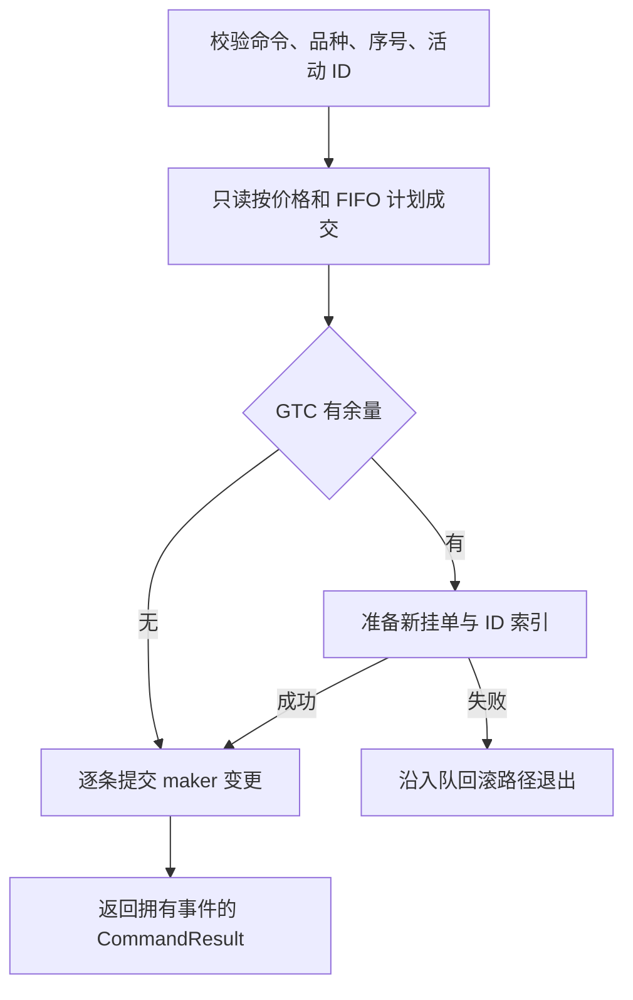

# Day 12 · GTC 限价撮合

## 1. 本期内容与学习目标

本课需要 Day 08 的手算夹具、Day 09–11 的价档、ID 索引与值快照。预计 3–4 小时。你会给 `OrderBook` 加第一条正式下单入口。完成后，GTC 限价单可以即时成交，余量挂簿，返回按 maker 优先顺序排列的成交事件。先用固定序号测试。以后由 Day 17 的 `Engine` 分配序号。

## 2. 业务背景与原理

限价 102 的买单会消费价格不高于 102 的卖单。盘口为 A@101×3、B@101×2、C@103×4 时，买入 4 手依次得到 A 的 3 手和 B 的 1 手，成交价都是 101。买单全成，B 继续排在 101 档首且剩 1 手。若改买 6 手，A、B 都完成，C 的价越过限价。余下 1 手在买侧 102 排队，卖一为 103。

| 检查点 | 吃 A 后 | 再吃 B 后 |
| --- | --- | --- |
| 4 手 taker 剩余 | 1 | 0 |
| 本次成交量 | 3 | 1 |
| 当前 maker 剩余 | 0 | 1 |
| 事件完成标记 maker / taker | 真 / 假 | 假 / 真 |

每次成交量取双方剩余的较小值。每笔 maker 都以正余量进入循环，taker 余量严格下降。退出条件是 taker 用完、对手簿为空或下一档越过限价。

## 3. Java 原始项目的实现分析

Naive 版的 `newOrderPlaceGtc` 先用 `subtreeForMatching` 裁出可成交价格范围，再用 `tryMatchInstantly` 跨档遍历，档内调用 `OrdersBucketNaive.match`。完成的 maker 从档和 ID 表移除，空档随后清理，事件链按实际成交次序追加。源码在尝试成交后才检查重复 GTC ID，课程将活动 ID 的检查移到撮合之前，确保失败命令不会吃到对手挂单。Direct 版使用最优节点和跨档双向链组织同一规则。 [GTC 分支](https://github.com/exchange-core/exchange-core/blob/2f8548749839e9095c8dc597e4b61521d259fa5d/src/main/java/exchange/core2/core/orderbook/OrderBookNaiveImpl.java#L104-L141) · [跨档扫描](https://github.com/exchange-core/exchange-core/blob/2f8548749839e9095c8dc597e4b61521d259fa5d/src/main/java/exchange/core2/core/orderbook/OrderBookNaiveImpl.java#L203-L280) · [档内匹配](https://github.com/exchange-core/exchange-core/blob/2f8548749839e9095c8dc597e4b61521d259fa5d/src/main/java/exchange/core2/core/orderbook/OrdersBucketNaive.java#L98-L145) · [Direct 撮合](https://github.com/exchange-core/exchange-core/blob/2f8548749839e9095c8dc597e4b61521d259fa5d/src/main/java/exchange/core2/core/orderbook/OrderBookDirectImpl.java#L222-L335)

## 4. 本期 C++ 知识

### 模板、循环不变量与失效边界

买卖价格树只差比较器类型。`plan_against<Levels>` 接收一侧的常量引用，模板可同时服务两种树。第一层循环按价格优先，第二层按 FIFO。`std::min` 返回较小实参的引用，这里用 `const auto` 复制整数。每次追加事件前，`remaining` 等于原始请求量减去此前计划成交之和。maker 取自只读节点，追加到事件向量的是独立值。

提交阶段持有 ID 索引的迭代器直到删除或减量。需要删除时，先把 maker 数据保存在事件中，再由 Day 10 的原语擦除索引和节点。遍历只读计划时不会同时擦除价格树。`if (const auto* trade = std::get_if<Trade>(&event))` 将指针的作用域限制在分支，后续 IOC 可在同一向量加入不同类型事件。 [链表擦除规则](https://eel.is/c++draft/list.modifiers) · [variant 分支访问](https://eel.is/c++draft/variant.get)

## 5. 架构设计与技术选型

一种实现是一边扫、一边改簿并向事件向量追加。如果后段分配失败，前几笔已经成交。课程分两步。先只读生成整批 `Trade` 值，随后准备可能分配的新挂单节点，再提交 maker 的数量变化。准备新挂单期间，同一线程可能短暂持有交叉盘口，调用边界没有外部回调或并发读。挂单准备失败沿 Day 10 的回滚路径退出，对手簿还没改变。提交阶段只做查找、整数减法和擦除。内部不变量破坏抛出逻辑错误，由上层按内部故障处理。

若本次触及 `K` 笔 maker，计划成本随访问的档和订单线性增长，额外事件空间 `O(K)`。提交为每笔成交查 ID 和价档，散列预期常数，保守计 `O(K log(P+1))`。GTC 余量入队额外一次价档查找和至多一次散列扩容。Day 24 再比较缓存位置和紧凑节点。



## 6. 从零逐步实现

### 12.1 声明下单入口及内部原语

在 `include/exchange/order_book.hpp` 的 `public` 区加入下段。调用者给每条有效命令传递正的序号。簿会在挂单时检查同价队尾顺序，完整的全局单调性由上层入口保证。

```cpp
    CommandResult place(const PlaceOrder& order, Seq seq);
```

在 `private` 区、`SymbolId symbol_` 之前加入以下声明。`MatchPlan` 只拥有剩余量和事件，订单簿仍拥有活动节点。

```cpp
    struct MatchPlan {
        Quantity remaining;
        std::vector<Event> events;
    };

    MatchPlan plan_match(const PlaceOrder& order, std::optional<Price> limit) const;
    void apply_trades(const std::vector<Event>& events);
    void decrease_resting(Index::iterator indexed, Quantity amount);

    template<class Levels>
    MatchPlan plan_against(const Levels& levels, const PlaceOrder& order,
                           std::optional<Price> limit) const;

    template<class Levels>
    void decrease_in(Levels& levels, Index::iterator indexed, Quantity amount);
```

### 12.2 先计划，再写簿

将这段加到 `src/order_book.cpp` 的 `namespace exchange` 末尾。文件继续使用 Day 11 的 `<algorithm>` 和 Day 10 的 `<stdexcept>`，新增 `<utility>` 以使用 `std::move`。`limit` 为空表示没有单价约束，本课只有 GTC 会到达计划函数，传入的价限始终有值。Day 14 会复用空价限分支。

```cpp
template<class Levels>
OrderBook::MatchPlan OrderBook::plan_against(const Levels& levels, const PlaceOrder& order,
                                            std::optional<Price> limit) const {
    auto remaining = order.quantity.value();
    std::vector<Event> events;
    for (const auto& [price, level] : levels) {
        if (limit && (order.side == Side::bid ? price > *limit : price < *limit)) {
            break;
        }
        for (const auto& maker : level.fifo) {
            const auto amount = std::min(remaining, maker.remaining.value());
            remaining -= amount;
            events.emplace_back(Trade{maker.key, maker.user, order.key, order.user, order.side,
                                      price, Quantity{amount}, amount == maker.remaining.value(),
                                      remaining == 0});
            if (remaining == 0) {
                return {Quantity{0}, std::move(events)};
            }
        }
    }
    return {Quantity{remaining}, std::move(events)};
}

OrderBook::MatchPlan OrderBook::plan_match(const PlaceOrder& order,
                                          std::optional<Price> limit) const {
    return order.side == Side::bid ? plan_against(asks_, order, limit)
                                  : plan_against(bids_, order, limit);
}

template<class Levels>
void OrderBook::decrease_in(Levels& levels, Index::iterator indexed, Quantity amount) {
    const auto location = indexed->second;
    auto& maker = *location.node;
    if (amount == maker.remaining) {
        remove_from(levels, indexed);
        return;
    }
    auto& level = levels.at(location.price);
    maker.remaining = Quantity{maker.remaining.value() - amount.value()};
    level.total_remaining -= amount.value();
}

void OrderBook::decrease_resting(Index::iterator indexed, Quantity amount) {
    if (indexed == index_.end() || amount.value() <= 0 || amount > indexed->second.node->remaining) {
        throw std::logic_error{"invalid resting order reduction"};
    }
    if (indexed->second.side == Side::ask) {
        decrease_in(asks_, indexed, amount);
    } else {
        decrease_in(bids_, indexed, amount);
    }
}

void OrderBook::apply_trades(const std::vector<Event>& events) {
    for (const auto& event : events) {
        if (const auto* trade = std::get_if<Trade>(&event)) {
            decrease_resting(index_.find(trade->maker.order), trade->quantity);
        }
    }
}

CommandResult OrderBook::place(const PlaceOrder& order, Seq seq) {
    if (!validate_command(order) || seq.value() == 0) {
        return {Status::invalid_input, {}};
    }
    if (order.key.symbol != symbol_) {
        return {Status::unknown_symbol, {}};
    }
    if (index_.contains(order.key.order)) {
        return {Status::duplicate_order, {}};
    }

    const auto* limit = std::get_if<LimitPrice>(&order.constraint);
    if (!limit || limit->policy != LimitPolicy::gtc) {
        return {Status::invalid_input, {}};
    }
    auto plan = plan_match(order, limit->price);
    if (plan.remaining.value() > 0) {
        std::optional<Price> reserve;
        if (order.side == Side::bid) {
            reserve = limit->reserve_bid_price.value_or(limit->price);
        }
        const RestingOrder remainder{order.key, order.user, order.side, limit->price,
                                     plan.remaining, reserve, seq, order.timestamp_ns};
        const auto status = order.side == Side::ask ? append_to(asks_, remainder, nullptr)
                                                    : append_to(bids_, remainder, nullptr);
        if (status != Status::processed) {
            return {status, {}};
        }
    }
    apply_trades(plan.events);
    return {Status::processed, std::move(plan.events)};
}
```

`emplace_back(Trade{...})` 追加一个事件变体，由完整成交值构造其中的 `Trade` 分支。向量最终移交给返回对象，局部计划析构时不影响回执。部分成交更新订单与总量，maker 的排队位置不变。全成时调用 `remove_from` 取掉节点和空档。正式下单准备余量时直接调用已验证的 `append_to`，因为当前 maker 还未提交，Day 09 夹具入口的交叉检查不适用于这个中间时刻。

## 7. 测试、调试与验证

创建 `tests/matching_test_support.hpp`。辅助函数从 Day 08 的 `before` 构造单品种簿，然后测试只调用真实下单入口。预期由已有夹具提供。

```cpp
#ifndef EXCHANGE_MATCHING_TEST_SUPPORT_HPP
#define EXCHANGE_MATCHING_TEST_SUPPORT_HPP

#include "order_book_access.hpp"
#include "test_checks.hpp"
#include "trading_fixtures.hpp"

namespace matching_test {

inline void seed(exchange::OrderBook& book, const std::vector<exchange::RestingOrder>& orders,
                 TestChecks& checks) {
    for (const auto& order : orders) {
        checks.require(exchange::OrderBookTestAccess::insert(book, order) ==
                       exchange::Status::processed, "seed book");
    }
}

inline void check_place(const trading_fixture::PlaceFixture& fixture, TestChecks& checks) {
    exchange::OrderBook book{fixture.command.key.symbol};
    seed(book, fixture.before, checks);
    const auto result = book.place(fixture.command, fixture.seq);
    checks.require(result == fixture.expected && book.resting_orders() == fixture.after &&
                   book.validate(), fixture.name);
}

}

#endif
```

创建 `tests/gtc_test.cpp`，覆盖从空簿挂单、完全成交、跨档及重复 ID。

```cpp
#include "matching_test_support.hpp"

#include <limits>

int main() {
    using namespace exchange;
    using namespace trading_fixture;

    TestChecks checks;
    const auto fixtures = cases();
    matching_test::check_place(fixtures.at(0), checks);
    matching_test::check_place(fixtures.at(1), checks);

    OrderBook book{SymbolId{1}};
    auto ask = limit(Side::ask, 103, 4, LimitPolicy::gtc);
    ask.key = key(9);
    ask.user = UserId{9};
    checks.require(book.place(ask, Seq{1}) == CommandResult{Status::processed, {}} &&
                   book.best_ask() == Price{103}, "passive GTC into empty book");

    const auto saved = book.resting_orders();
    auto duplicate = limit(Side::bid, 104, 4, LimitPolicy::gtc);
    duplicate.key = ask.key;
    checks.require(book.place(duplicate, Seq{2}) == CommandResult{Status::duplicate_order, {}} &&
                   book.resting_orders() == saved, "duplicate rejected before matching");

    const auto first = rest(7, Side::ask, 101, 3, 2, 300);
    matching_test::seed(book, {first}, checks);
    const auto sweep = limit(Side::bid, 103, 7, LimitPolicy::gtc);
    checks.require(book.place(sweep, Seq{3}) == CommandResult{Status::processed,
                       {fill(first, sweep, 3, true, false), fill(saved.at(0), sweep, 4, true, true)}} &&
                   book.resting_orders().empty() && book.validate(), "multi-level exact fill");

    OrderBook full_level{SymbolId{1}};
    const auto max = std::numeric_limits<std::int64_t>::max();
    matching_test::seed(full_level, {rest(5, Side::bid, 99, max, 1, 100)}, checks);
    const auto before = full_level.resting_orders();
    checks.require(full_level.place(limit(Side::bid, 99, 1, LimitPolicy::gtc), Seq{2}) ==
                   CommandResult{Status::invalid_input, {}} &&
                   full_level.resting_orders() == before && full_level.validate(),
                   "overflow during remainder preparation");
    return checks.exit_code();
}
```

追加构建目标。

```cmake
add_executable(gtc_tests tests/gtc_test.cpp)
target_link_libraries(gtc_tests PRIVATE exchange_core)
add_test(NAME gtc COMMAND gtc_tests)
```

运行 `cmake --build build-debug` 和 `ctest --test-dir build-debug -R '^gtc$' --output-on-failure`。多配置分别加 `--config Debug` 和 `-C Debug`。全套应有 11 项。若完全成交后空档仍出现在 L2，检查是否复用了 `remove_from`。将计划事件中的 `price` 临时换成买方限价，GTC 夹具应报成交字段不符。

## 8. Java 与 C++ 实现深度对比

Java Naive 在每档匹配时更新 maker，收集完成订单，再处理跨档清理。课程版先构造值事件再提交，容易在单命令内控制分配失败，也为后续账本预检保留接口。代价是暂存事件以及提交时重新定位节点。Java Direct 的连续链更接近顺序扫单，进一步优化应由后续基准决定。

## 9. 课后练习

1. **基础。** 写卖出 GTC 的镜像夹具。买盘 105、103，卖出限 104 时只能吃 105。
2. **工程。** 测试入站买单省略预留价和提供高于限价的预留价两种路径。检查入簿记录的 `reserve_bid_price`。
3. **思考。** 为什么交叉的中间状态不能向回调发布？指出会观察到错误的两种查询。

## 10. 总结与下一期

GTC 已从只读夹具变成可执行入口，价格、FIFO、余量和结果通过测试锁定。下课沿用同一计划与提交过程，只改变 IOC 余量的去向。

[Day 11](../03-order-book/day-11.md) · [课程目录](../00-overview/learning-roadmap.md) · [Day 13](day-13.md)

<details>
<summary>练习参考答案</summary>

1. 105 档优先，价格 105。103 档越界，若余量仍存在则在卖侧 104 排队。
2. 无对手簿时用 `find_order` 检查。省略时应等于限价，显式提供时保持输入值。
3. 若买侧余量已加入、对手未扣，BBO 可能交叉。L2 也会同时计入计划要删除的 maker 与新挂余量。

</details>
