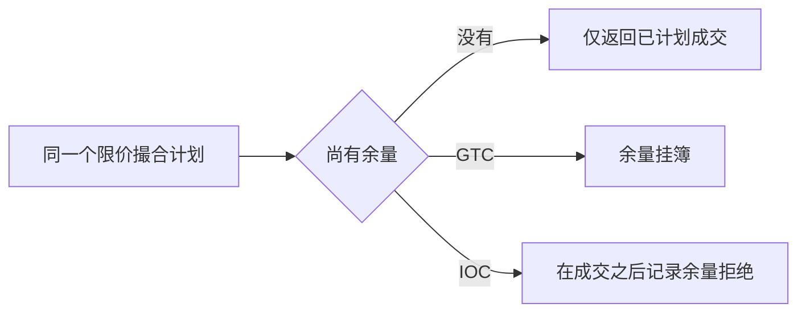

# Day 13 · 带价限 IOC 与余量拒绝

## 1. 本期内容与学习目标

本课沿用 Day 12 的 `plan_match` 和 `apply_trades`，预计 1–2 小时。给 `LimitPolicy::ioc` 接上真实执行路径，区分「请求已处理」「全部成交」「余量终止」三个状态。验收关注事件顺序及 IOC 永远不挂簿。

## 2. 业务背景与原理

沿用 A@101×3、B@101×2、C@103×4。限 102 买 6 手时只有 5 手满足价限。相同命令若为 GTC，会把最后 1 手放在买侧 102。IOC 则发一条余量拒绝事件。若全部成交，只有成交事件。若价限内没流动性，只有一条全量拒绝。三种情况的合法请求都可返回 `processed`。

| 场景 | 成交 | 拒绝 | 新挂量 |
| --- | ---: | ---: | ---: |
| 空簿、买 6 手 | 0 | 6 | 0 |
| 上述盘口，限 102 买 6 手 | 5 | 1 | 0 |
| 上述盘口，限 102 买 5 手 | 5 | 0 | 0 |

IOC 在本课程与 Java 源码中都有单价约束。无法把一个独立市价单的规则直接套在带价限 IOC 上。

## 3. Java 原始项目的实现分析

`newOrderMatchIoc` 调用普通价限匹配后，根据 `cmd.size - filledSize` 决定是否挂 `REJECT`。`OrderBookEventsHelper.attachRejectEvent` 把拒绝插在内部链头，`SimpleEventsProcessor.sendTradeEvent` 对外先发送逐笔成交组成的聚合事件，再发拒绝。课程事件向量采用对外顺序。 [IOC 分支](https://github.com/exchange-core/exchange-core/blob/2f8548749839e9095c8dc597e4b61521d259fa5d/src/main/java/exchange/core2/core/orderbook/OrderBookNaiveImpl.java#L143-L153) · [内部事件](https://github.com/exchange-core/exchange-core/blob/2f8548749839e9095c8dc597e4b61521d259fa5d/src/main/java/exchange/core2/core/orderbook/OrderBookEventsHelper.java#L94-L119) · [对外事件](https://github.com/exchange-core/exchange-core/blob/2f8548749839e9095c8dc597e4b61521d259fa5d/src/main/java/exchange/core2/core/SimpleEventsProcessor.java#L67-L123)

## 4. 本期 C++ 知识

### 分支访问与值的有效期

`std::get_if<Trade>(&event)` 得到的借用只适合在当前事件仍存活时读取。若持有 `plan.events` 中元素的地址再 `emplace_back`，扩容可能让地址失效。这里先生成完整事件，之后只读遍历并提交。`else if` 把余量选择约束成互斥路径。IOC 拒绝没有 maker，保存在独立的 `RejectRemainder` 分支。

`apply_trades` 已用 `get_if` 过滤非成交分支。每个写入由 `Trade` 的数量驱动，余量拒绝只影响回执。Day 19 才根据该事件释放未消费的冻结。 [variant 分支访问](https://eel.is/c++draft/variant.get) · [vector 容量规则](https://eel.is/c++draft/vector.capacity)

## 5. 架构设计与技术选型

可以给 IOC 复制一套价限循环，也可以共用扫描与提交，把区别收敛到余量出口。本课采用共用路径。两个限价类型都在 `LimitPrice` 中验证，交易计划不需要知道 GTC/IOC。拒绝值在改簿前追加，事件分配失败时盘口仍是原值。`K` 笔成交的路径多保存至多一条拒绝，时间与空间量级沿用 Day 12。



## 6. 从零逐步实现

在 `src/order_book.cpp` 的 `OrderBook::place` 中，把从 `const auto* limit =` 开始的部分替换成下段，保留前面的结构、品种和 ID 校验。新分支只把拒绝附到结果，`apply_trades` 在最后一次调用。FOK_BUDGET 暂时仍经空指针检查拒绝。

```cpp
    const auto* limit = std::get_if<LimitPrice>(&order.constraint);
    if (!limit) {
        return {Status::invalid_input, {}};
    }
    auto plan = plan_match(order, limit->price);
    if (plan.remaining.value() > 0 && limit->policy == LimitPolicy::ioc) {
        plan.events.emplace_back(RejectRemainder{
            order.key, order.user, plan.remaining, RejectReason::ioc_remainder});
    } else if (plan.remaining.value() > 0) {
        std::optional<Price> reserve;
        if (order.side == Side::bid) {
            reserve = limit->reserve_bid_price.value_or(limit->price);
        }
        const RestingOrder remainder{order.key, order.user, order.side, limit->price,
                                     plan.remaining, reserve, seq, order.timestamp_ns};
        const auto status = order.side == Side::ask ? append_to(asks_, remainder, nullptr)
                                                    : append_to(bids_, remainder, nullptr);
        if (status != Status::processed) {
            return {status, {}};
        }
    }
    apply_trades(plan.events);
    return {Status::processed, std::move(plan.events)};
```

替换范围截止在原返回语句，函数末尾的 `}` 保留。`validate_command` 已验证 `LimitPolicy` 的两个有效取值，因此最后一支有余量就代表 GTC。空簿下无成交，`apply_trades` 跳过唯一的拒绝事件，返回 `processed`。

## 7. 测试、调试与验证

创建 `tests/ioc_test.cpp`。共享测试辅助器对照 Day 08 的逐事件手算值。这里额外固定空簿和恰好吃满两种边界。

```cpp
#include "matching_test_support.hpp"

int main() {
    using namespace exchange;
    using namespace trading_fixture;

    TestChecks checks;
    const auto fixtures = cases();
    matching_test::check_place(fixtures.at(2), checks);

    OrderBook empty{SymbolId{1}};
    const auto six = limit(Side::bid, 102, 6, LimitPolicy::ioc);
    checks.require(empty.place(six, Seq{1}) == CommandResult{Status::processed,
                       {RejectRemainder{six.key, six.user, Quantity{6}, RejectReason::ioc_remainder}}} &&
                   empty.resting_orders().empty() && empty.validate(), "empty IOC");

    OrderBook exact{SymbolId{1}};
    const auto& initial = fixtures.at(2).before;
    matching_test::seed(exact, initial, checks);
    const auto five = limit(Side::bid, 102, 5, LimitPolicy::ioc);
    checks.require(exact.place(five, Seq{4}) == CommandResult{Status::processed,
                       {fill(initial.at(0), five, 3, true, false),
                        fill(initial.at(1), five, 2, true, true)}} &&
                   exact.resting_orders() == std::vector<RestingOrder>{initial.at(2)} &&
                   exact.validate(), "full IOC without rejection");
    return checks.exit_code();
}
```

```cmake
add_executable(ioc_tests tests/ioc_test.cpp)
target_link_libraries(ioc_tests PRIVATE exchange_core)
add_test(NAME ioc COMMAND ioc_tests)
```

运行 `cmake --build build-debug` 后执行 `ctest --test-dir build-debug -R '^(gtc|ioc)$' --output-on-failure`，预期两项通过，整套 12 项。多配置加 `--config Debug`、`-C Debug`。临时把拒绝放在向量开头，`ioc_remainder` 应失败。若空簿出现活动买单，检查 IOC 分支是否落入 GTC 入队。

## 8. Java 与 C++ 实现深度对比

Java 由内部链连接不同事件，再由适配器按对外顺序发布。课程采用拥有值的连续向量，直接让测试比对成交在前和拒绝在末。C++ 额外的变体标识避免把拒绝当作成交读取。处理状态与成交量的含义在两种实现里都要分开解释。

## 9. 课后练习

1. **基础。** 把限价改成 100、数量仍为 6，写出事件与末态。
2. **工程。** 增加卖侧 IOC 的限价镜像，检查只能扫到满足卖价下限的买档。
3. **思考。** 如果 API 只回传 `processed`，客户端能否确定实际买了多少？需要哪些字段？

## 10. 总结与下一期

IOC 已复用 GTC 的价限计划。Day 14 用只读总额试算新增预算 FOK，先判定整笔可行性再修改盘口。

[Day 12](day-12.md) · [课程目录](../00-overview/learning-roadmap.md) · [Day 14](day-14.md)

<details>
<summary>练习参考答案</summary>

1. 仅有拒绝 6 手，原三个卖单保持原值。
2. 卖出限 104，买盘为 105×2、103×2。卖 3 手时成交 2 手于 105，拒绝 1 手。
3. 需要成交事件的手数或成交汇总，以及余量拒绝。`processed` 只说明命令已被执行。

</details>
