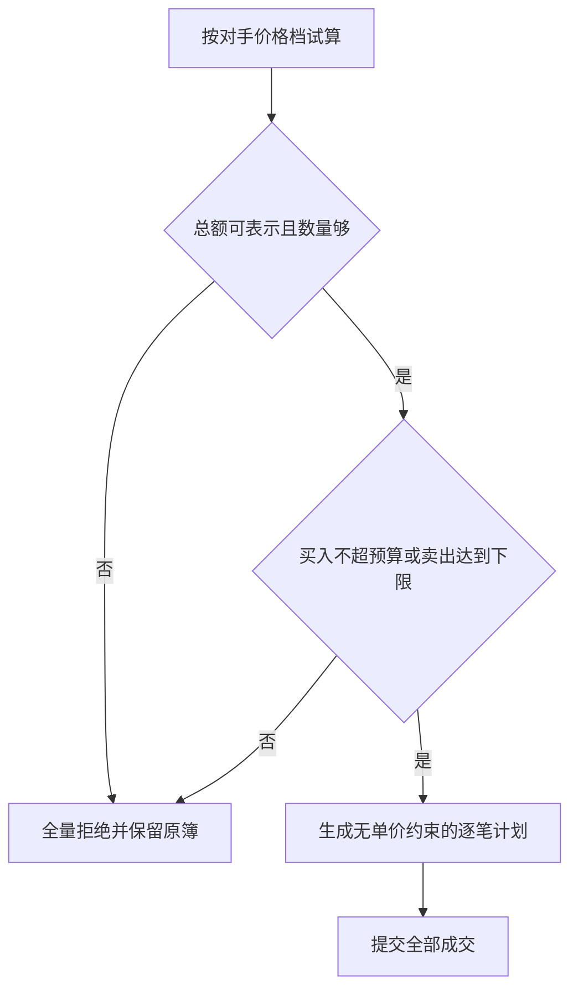

# Day 14 · FOK_BUDGET 的两遍执行

## 1. 本期内容与学习目标

本课需要受检乘加、价档总量和 GTC/IOC 计划函数。预计 2–3 小时。实现 `FOK_BUDGET`，用一遍按档只读试算决定能否整笔成交，再生成并提交逐笔事件。

## 2. 业务背景与原理

A、B 在 101 共 5 手，C 在 103 有 4 手。买 6 手的最优可执行总额为 `5×101+1×103=608`。预算 608 接受，607 拒绝，预算再大也不会让请求的 6 手增加。卖方预算是最低可接受收入，买侧 105×3、103×2 时卖 4 手可得 418，要求 419 时拒绝。若总盘口不足请求量，即使金额约束很宽，也必须整笔拒绝。

| 检查 | 买 | 卖 |
| --- | --- | --- |
| 流动性 | 能全部成交 | 能全部成交 |
| 总额 | `actual <= budget` | `actual >= minimum` |
| 失败结果 | 全量拒绝，原簿保持 | 全量拒绝，原簿保持 |

这里计算的是「价格步 × 手数」，费用和币种尺度在风险模块另算。

## 3. Java 原始项目的实现分析

Naive 用 `Optional<Long>` 试算总额，Direct 用 `Long.MAX_VALUE` 表示缺量。Direct 的实际扫单在卖预算单上采用 0 作为价格下限；在正数且未溢出的输入域中，买单已通过总额上限时，每一笔成交价也在该总额以内。课程的预算单直接给成交计划传空的单价约束。最大合法总额不会被误识别成缺量。 [Naive 预算逻辑](https://github.com/exchange-core/exchange-core/blob/2f8548749839e9095c8dc597e4b61521d259fa5d/src/main/java/exchange/core2/core/orderbook/OrderBookNaiveImpl.java#L155-L201) · [Direct 预算和限价](https://github.com/exchange-core/exchange-core/blob/2f8548749839e9095c8dc597e4b61521d259fa5d/src/main/java/exchange/core2/core/orderbook/OrderBookDirectImpl.java#L173-L242)

## 4. 本期 C++ 知识

### 显式结果类型和聚合试算

`variant<NotionalSteps, RejectReason>` 把有效总额与失败原因分开。有效值可以等于 64 位上界。将空值设成上界哨兵会丢失这个合法输入。每档以 `min(remaining, level.total_remaining)` 计入计划量，然后用 Day 06 的 `checked_multiply` 和 `checked_add` 试算。若较早的价档已使算术超界，立即报告 `arithmetic_limit`，无需继续探测更远的流动性。这个优先顺序会影响两个失败条件同时存在时的诊断。

单写者使试算和提交看到同一份挂单。若未来让其他线程在中间修改簿，需要重新设计版本检查或持有锁，不能把现有两步直接拆到不同所有者。

## 5. 架构设计与技术选型

可以把第一遍改为逐笔计划并顺便求和，写法短，但失败单也会分配逐笔事件。课程先用档位聚合量试算。扫过 `B` 个档的成本为 `O(B)`，需要常数额外空间。成功后第二遍按 Day 12 的规则生成 `K` 条 maker 事件，拒绝时只构造一条。全部拒绝与结果状态同 IOC 一样分别表达。



## 6. 从零逐步实现

在 `include/exchange/order_book.hpp` 私有区、`SymbolId symbol_` 前加入下段。`BudgetTrial` 只用于内部计算。

```cpp
    using BudgetTrial = std::variant<NotionalSteps, RejectReason>;

    template<class Levels>
    BudgetTrial trial_budget(const Levels& levels, Quantity quantity) const;

    CommandResult place_budget(const PlaceOrder& order, BudgetLimit budget);
```

在 `src/order_book.cpp` 中，将以下定义放入 `namespace exchange`，置于 `OrderBook::place` 前。

```cpp
template<class Levels>
OrderBook::BudgetTrial OrderBook::trial_budget(const Levels& levels, Quantity quantity) const {
    auto remaining = quantity.value();
    std::int64_t total = 0;
    for (const auto& [price, level] : levels) {
        const auto amount = std::min(remaining, level.total_remaining);
        const auto line = checked_multiply(amount, price.value());
        if (!line) {
            return RejectReason::arithmetic_limit;
        }
        const auto next = checked_add(total, *line);
        if (!next) {
            return RejectReason::arithmetic_limit;
        }
        total = *next;
        remaining -= amount;
        if (remaining == 0) {
            return NotionalSteps{total};
        }
    }
    return RejectReason::insufficient_liquidity;
}

CommandResult OrderBook::place_budget(const PlaceOrder& order, BudgetLimit budget) {
    const auto reject = [&order](RejectReason reason) -> CommandResult {
        return {Status::processed, {
            RejectRemainder{order.key, order.user, order.quantity, reason}}};
    };
    const auto trial = order.side == Side::bid ? trial_budget(asks_, order.quantity)
                                               : trial_budget(bids_, order.quantity);
    if (const auto* failure = std::get_if<RejectReason>(&trial)) {
        return reject(*failure);
    }
    const auto total = std::get<NotionalSteps>(trial);
    if (order.side == Side::bid ? total > budget.total : total < budget.total) {
        return reject(RejectReason::budget_limit);
    }

    auto plan = plan_match(order, std::nullopt);
    if (plan.remaining.value() != 0) {
        throw std::logic_error{"budget trial disagrees with price levels"};
    }
    apply_trades(plan.events);
    return {Status::processed, std::move(plan.events)};
}
```

在 `place` 中，将原先读取 `limit` 并用 `if (!limit)` 拒绝的四行换成下段，其余限价逻辑保留。两个分支都是小值，正常调用的约束已由结构校验判定有效。`std::get<T>` 在类型不符时抛 `bad_variant_access`，这里取 `LimitPrice` 前已排除另一分支。

```cpp
    if (const auto* budget = std::get_if<BudgetLimit>(&order.constraint)) {
        return place_budget(order, *budget);
    }
    const auto* limit = &std::get<LimitPrice>(order.constraint);
```

若试算成功，`plan_match` 仍验证逐笔计划能填满请求。该一致性检查针对簿的总量缓存和 FIFO 是否一致。计划结果只在检查通过后提交。

## 7. 测试、调试与验证

创建 `tests/budget_test.cpp`。固定用例以 Day 08 的买卖预算夹具核对完整输出。附加缺量、乘法超界、累计超界和最大合法总额。

```cpp
#include "matching_test_support.hpp"

#include <limits>

int main() {
    using namespace exchange;
    using namespace trading_fixture;

    TestChecks checks;
    const auto fixtures = cases();
    for (std::size_t i = 3; i < fixtures.size(); ++i) {
        matching_test::check_place(fixtures.at(i), checks);
    }

    const auto max = std::numeric_limits<std::int64_t>::max();
    const auto check_reject = [&](const std::vector<RestingOrder>& before, PlaceOrder order,
                                  RejectReason reason, const char* label) {
        OrderBook book{SymbolId{1}};
        matching_test::seed(book, before, checks);
        const CommandResult expected{Status::processed, {
            RejectRemainder{order.key, order.user, order.quantity, reason}}};
        checks.require(book.place(order, Seq{3}) == expected &&
                       book.resting_orders() == before && book.validate(), label);
    };
    check_reject({rest(1, Side::ask, 101, 1, 1, 0)},
                 budget(Side::bid, 500, 2), RejectReason::insufficient_liquidity, "no full fill");
    check_reject({rest(1, Side::ask, max, 2, 1, 0)},
                 budget(Side::bid, max, 2), RejectReason::arithmetic_limit, "product overflow");
    check_reject({rest(1, Side::ask, max - 1, 1, 1, 0), rest(2, Side::ask, max, 1, 2, 0)},
                 budget(Side::bid, max, 2), RejectReason::arithmetic_limit, "sum overflow");

    OrderBook edge{SymbolId{1}};
    const auto maker = rest(1, Side::ask, max, 1, 1, 0);
    matching_test::seed(edge, {maker}, checks);
    const auto order = budget(Side::bid, max, 1);
    checks.require(edge.place(order, Seq{2}) ==
                   CommandResult{Status::processed, {fill(maker, order, 1, true, true)}} &&
                   edge.resting_orders().empty() && edge.validate(), "maximum legal budget");
    return checks.exit_code();
}
```

```cmake
add_executable(budget_tests tests/budget_test.cpp)
target_link_libraries(budget_tests PRIVATE exchange_core)
add_test(NAME budget COMMAND budget_tests)
```

构建后用 `ctest --test-dir build-debug -R '^budget$' --output-on-failure`，预期整套 13 项。多配置命令沿用 Day 13。若 608 边界错误，查买方比较是否使用严格大于。若卖方 419 仍成交，查买卖是否误用同一不等号。若失败后订单数量改变，检查预算试算是否读取了 `const` 价格树。

## 8. Java 与 C++ 实现深度对比

Java 的两版实现都先从档位聚合量推算预算。课程保留这份数据结构优势，同时用不同类型区分失败与金额。C++ 有符号溢出必须在算术前判断。最大合法值用例将「可表示」和「流动性够」分别验证。

## 9. 课后练习

1. **基础。** 把 608 案例改成买 7 手，手算新的临界预算。
2. **工程。** 添加卖方预算单在空买盘上的案例，检查全量和缺量原因。
3. **思考。** 对手某档包含一万笔小单，整笔失败时试算要扫描多少次？若去掉档总量会怎样？

## 10. 总结与下一期

订单簿现已支持参考源码实际处理的三种新单。Day 15 将用同一个撮合计划实现改价，并接入撤单和减量。

[Day 13](day-13.md) · [课程目录](../00-overview/learning-roadmap.md) · [Day 15](day-15.md)

<details>
<summary>练习参考答案</summary>

1. `5×101+2×103=711`。710 拒绝，711 接受。
2. 空簿中传 `budget(Side::ask, 1, 2)`，预期拒绝 2 手，原簿为空。
3. 使用聚合量访问该档一次。逐笔试算可能读取到一万笔节点才知道整单能否成交。

</details>
