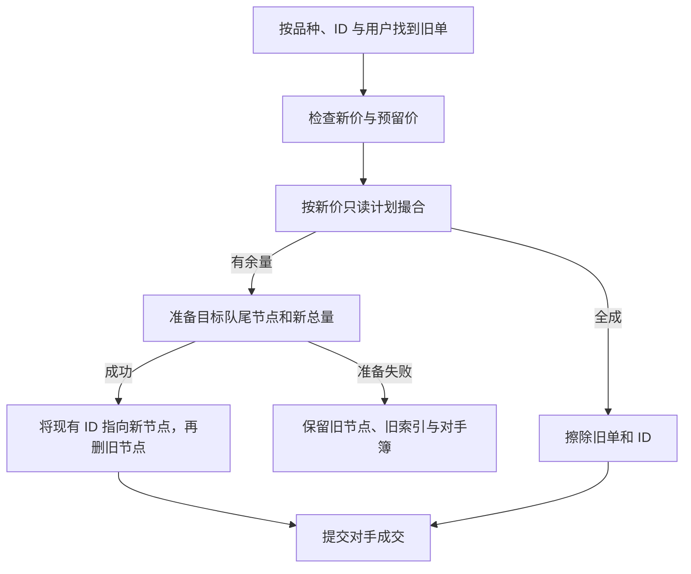

# Day 15 · 撤单、减量与改价

## 1. 本期内容与学习目标

本课需要 Day 10 的位置索引、Day 12 的只读撮合计划和 Day 14 的值事件。预计 3–4 小时。实现 `cancel`、`reduce` 和 `move`。用同一个扣减原语处理全部或部分移除，用下单的价限计划处理改价后变成 taker 的订单。重点检查越权、超预留价、同价改价以及挂单准备失败。

## 2. 业务背景与原理

| 操作 | 数量变化 | 排队变化 | 结果事件 |
| --- | --- | --- | --- |
| 撤单 | 移除全部剩余量 | 离簿 | 一条 `Reduce`，`removed=true` |
| 部分减量 | 扣请求量与剩余量的较小值 | 留在原位置 | 一条 `Reduce`，尚有余量时 `removed=false` |
| 改价 | 只用旧单剩余量参与新一轮成交 | 余量在目标价档末尾，包含同价改价 | 按成交顺序产生 `Trade` |

A、B 在 101，A 先入队。A 减 1 手后仍排在 B 前。把 A 改到原价 101，则 B 到队首。现货买单若用 105 作预留价，可以从 99 提到 105，尝试 106 应失败。撤销已成交 2 手、尚有 3 手的订单，应报告撤掉 3 手。累计成交历史由事件保留。

## 3. Java 原始项目的实现分析

Java Naive 的 `cancelOrder` 和 `reduceOrder` 先找活动 ID，再验证 `uid`。超量减量会被夹到剩余量。`moveOrder` 先检查现货买单预留价，摘旧节点、按新价尝试成交、把余量插到新档队尾。Direct 版也遵循该顺序，以链节点和档尾管理队列。教程先准备改价后的计划及可能的新节点，再提交旧节点与成交。 [Naive 撤减改](https://github.com/exchange-core/exchange-core/blob/2f8548749839e9095c8dc597e4b61521d259fa5d/src/main/java/exchange/core2/core/orderbook/OrderBookNaiveImpl.java#L289-L427) · [Direct 撤减改](https://github.com/exchange-core/exchange-core/blob/2f8548749839e9095c8dc597e4b61521d259fa5d/src/main/java/exchange/core2/core/orderbook/OrderBookDirectImpl.java#L339-L442)

## 4. 本期 C++ 知识

### 用值保留被擦除节点的信息

`find_order` 返回副本。撤单和减量都可先从索引取得只读上下文，构造事件，再按该位置扣减。`std::optional<Quantity>` 在共用方法里表示是否指定减量，空值表示撤掉剩余全部。即使调用者只想撤掉当前 3 手，也要在方法内按当前订单重新查找。

### 改价提交时的节点寿命

新节点的值包含新价、剩余量和新的优先序号。旧节点继续活到新节点尾插成功。保存的 `Index::iterator` 在这里不会因价格树或链表插入失效，索引没有插新键。成功后更新既有位置，擦掉旧节点。若目标就是原档，先从基数扣掉旧量，再加新量，避免「新旧节点同时占用」导致的假溢出。若新档尾插失败，回收空档，旧节点和索引仍可用。 [关联容器失效规则](https://eel.is/c++draft/associative.reqmts) · [链表修改规则](https://eel.is/c++draft/list.modifiers)

## 5. 架构设计与技术选型

先摘旧节点再撮合容易理解，恢复失败后还要保证旧单回到精确位置。课程选择先计划，再准备新节点。完全成交时没有新节点，直接擦除旧单。部分成交时准备余量后，提交对手变更。阶段采用单写者，外部只在提交完成后读取。成本为价档查找、常数次节点操作及 Day 12 计划/提交成本，改价不导致 ID 表扩容。



## 6. 从零逐步实现

### 15.1 声明撤减改和共用原语

在 `OrderBook` 的公开区加入下列接口。撤减不改排队位置，改价需要当前命令序号。调用方继续负责全局递增序号。

```cpp
    CommandResult cancel(const CancelOrder& command);
    CommandResult reduce(const ReduceOrder& command);
    CommandResult move(const MoveOrder& command, Seq seq);
```

在私有区、`SymbolId symbol_` 前添加以下声明。

```cpp
    CommandResult reduce_owned(OrderKey key, UserId user, std::optional<Quantity> requested);

    template<class Levels>
    Status replace_resting(Levels& levels, Index::iterator indexed, const RestingOrder& order);
```

### 15.2 先构造事件，再扣减

在 `src/order_book.cpp` 的命名空间结束前追加这段。`validate_command` 覆盖非正减量和结构无效，未知 ID 与所有者不符共享 `unknown_order`，以便调用端使用统一失败路径。

```cpp
CommandResult OrderBook::reduce_owned(OrderKey key, UserId user,
                                       std::optional<Quantity> requested) {
    if (key.symbol != symbol_) {
        return {Status::unknown_symbol, {}};
    }
    const auto indexed = index_.find(key.order);
    if (indexed == index_.end() || indexed->second.node->user != user) {
        return {Status::unknown_order, {}};
    }
    const auto& order = *indexed->second.node;
    const auto amount = std::min(requested.value_or(order.remaining), order.remaining);
    CommandResult result{Status::processed, {
        Reduce{key, user, order.side, order.price, amount, amount == order.remaining}}};
    decrease_resting(indexed, amount);
    return result;
}

CommandResult OrderBook::cancel(const CancelOrder& command) {
    if (!validate_command(command)) {
        return {Status::invalid_input, {}};
    }
    return reduce_owned(command.key, command.user, std::nullopt);
}

CommandResult OrderBook::reduce(const ReduceOrder& command) {
    if (!validate_command(command)) {
        return {Status::invalid_input, {}};
    }
    return reduce_owned(command.key, command.user, command.quantity);
}
```

`result` 按值保存所有事件字段。`decrease_resting` 可能销毁 `order` 指向的节点，因此它之后不再使用该引用。买卖两侧的总量都由 Day 12 的扣减路径更新。

### 15.3 改价重排并提交

在同一文件接着追加以下定义。`replace_resting` 仅接收同侧、同 ID、带正余量的替换订单。`move` 已通过序号、预留价、订单归属及输入校验。

```cpp
template<class Levels>
Status OrderBook::replace_resting(Levels& levels, Index::iterator indexed,
                                   const RestingOrder& order) {
    const auto old_location = indexed->second;
    const auto old_level = levels.find(old_location.price);
    const auto old_quantity = old_location.node->remaining.value();
    auto [target, created] = levels.try_emplace(order.price);
    auto& level = target->second;
    const bool same_level = target == old_level;
    const auto base = level.total_remaining - (same_level ? old_quantity : 0);
    const auto total = checked_add(base, order.remaining.value());
    if ((!level.fifo.empty() && level.fifo.back().priority_seq >= order.priority_seq) ||
        !total) {
        return Status::invalid_input;
    }

    try {
        level.fifo.push_back(order);
    } catch (...) {
        if (created) {
            levels.erase(target);
        }
        throw;
    }

    indexed->second = OrderLocation{order.side, order.price, std::prev(level.fifo.end())};
    old_level->second.fifo.erase(old_location.node);
    level.total_remaining = *total;
    if (!same_level) {
        old_level->second.total_remaining -= old_quantity;
        if (old_level->second.fifo.empty()) {
            levels.erase(old_level);
        }
    }
    return Status::processed;
}

CommandResult OrderBook::move(const MoveOrder& command, Seq seq) {
    if (!validate_command(command) || seq.value() == 0) {
        return {Status::invalid_input, {}};
    }
    if (command.key.symbol != symbol_) {
        return {Status::unknown_symbol, {}};
    }
    const auto indexed = index_.find(command.key.order);
    if (indexed == index_.end() || indexed->second.node->user != command.user) {
        return {Status::unknown_order, {}};
    }

    auto moved = *indexed->second.node;
    if (seq <= moved.priority_seq) {
        return {Status::invalid_input, {}};
    }
    if (moved.reserve_bid_price && command.new_price > *moved.reserve_bid_price) {
        return {Status::price_over_reserve, {}};
    }
    moved.price = command.new_price;
    moved.priority_seq = seq;
    const PlaceOrder taker{moved.key, moved.user, moved.side, moved.remaining,
                          LimitPrice{moved.price, LimitPolicy::gtc, moved.reserve_bid_price},
                          moved.timestamp_ns};
    auto plan = plan_match(taker, moved.price);
    if (plan.remaining.value() == 0) {
        decrease_resting(indexed, moved.remaining);
    } else {
        moved.remaining = plan.remaining;
        const auto status = moved.side == Side::ask ? replace_resting(asks_, indexed, moved)
                                                    : replace_resting(bids_, indexed, moved);
        if (status != Status::processed) {
            return {status, {}};
        }
    }
    apply_trades(plan.events);
    return {Status::processed, std::move(plan.events)};
}
```

`old_level` 的迭代器在 `try_emplace` 后仍有效。`same_level` 时只写一次最终总量。目标档原本不存在时，基数为零、队列为空，前置条件保证两项输入检查通过。原始时间戳保留，改价后的排队使用新序号。

## 7. 测试、调试与验证

创建 `tests/order_lifecycle_test.cpp`。先验证 Day 08 的同价改价夹具，再测部分减量、超量、超预留价、改价成 taker 与撤掉部分成交余量。

```cpp
#include "matching_test_support.hpp"

#include <limits>

int main() {
    using namespace exchange;
    using namespace trading_fixture;

    TestChecks checks;
    const auto fixture = same_price_move();
    OrderBook same{SymbolId{1}};
    matching_test::seed(same, fixture.before, checks);
    checks.require(same.move(fixture.command, fixture.seq) == fixture.expected &&
                   same.resting_orders() == fixture.after && same.validate(), "same-price tail");

    const auto a = fixture.before.at(0);
    OrderBook book{SymbolId{1}};
    matching_test::seed(book, fixture.before, checks);
    const auto initial = book.resting_orders();
    checks.require(book.reduce({a.key, a.user, Quantity{0}}) ==
                   CommandResult{Status::invalid_input, {}} &&
                   book.cancel({a.key, UserId{99}}) == CommandResult{Status::unknown_order, {}} &&
                   book.resting_orders() == initial, "invalid size and wrong owner");
    checks.require(book.reduce({a.key, a.user, Quantity{1}}) ==
                   CommandResult{Status::processed, {
                       Reduce{a.key, a.user, a.side, a.price, Quantity{1}, false}}} &&
                   book.resting_orders().front().key == a.key && book.validate(),
                   "partial reduce keeps priority");
    checks.require(book.reduce({a.key, a.user, Quantity{99}}) ==
                   CommandResult{Status::processed, {
                       Reduce{a.key, a.user, a.side, a.price, Quantity{2}, true}}} &&
                   !book.find_order(a.key.order) && book.validate(), "excess reduce clips");

    OrderBook marketable{SymbolId{1}};
    const auto ask = rest(1, Side::ask, 103, 2, 1, 10);
    auto bid = rest(2, Side::bid, 99, 5, 2, 20);
    bid.reserve_bid_price = Price{105};
    matching_test::seed(marketable, {ask, bid}, checks);
    const auto before = marketable.resting_orders();
    checks.require(marketable.move({bid.key, bid.user, Price{106}}, Seq{3}) ==
                   CommandResult{Status::price_over_reserve, {}} &&
                   marketable.resting_orders() == before, "reserve bound before matching");
    checks.require(marketable.move({bid.key, bid.user, Price{104}}, Seq{3}) ==
                   CommandResult{Status::processed, {
                       Trade{ask.key, ask.user, bid.key, bid.user, Side::bid,
                             Price{103}, Quantity{2}, true, false}}} &&
                   marketable.best_bid() == Price{104} && !marketable.best_ask() &&
                   marketable.validate(), "move crosses and rests");
    checks.require(marketable.cancel({bid.key, bid.user}) ==
                   CommandResult{Status::processed, {
                       Reduce{bid.key, bid.user, Side::bid, Price{104}, Quantity{3}, true}}} &&
                   marketable.resting_orders().empty() && marketable.validate(),
                   "cancel remaining after partial fill");

    OrderBook fully_matched{SymbolId{1}};
    auto small_bid = bid;
    small_bid.remaining = Quantity{2};
    matching_test::seed(fully_matched, {ask, small_bid}, checks);
    checks.require(fully_matched.move({small_bid.key, small_bid.user, Price{103}}, Seq{3}) ==
                   CommandResult{Status::processed, {
                       Trade{ask.key, ask.user, small_bid.key, small_bid.user, Side::bid,
                             Price{103}, Quantity{2}, true, true}}} &&
                   fully_matched.resting_orders().empty() &&
                   !fully_matched.find_order(ask.key.order) &&
                   !fully_matched.find_order(small_bid.key.order) && fully_matched.validate(),
                   "fully matched move clears both ids");

    OrderBook overflow{SymbolId{1}};
    const auto max = std::numeric_limits<std::int64_t>::max();
    matching_test::seed(overflow, {rest(1, Side::ask, 102, max, 1, 10),
                                  rest(2, Side::ask, 103, 1, 2, 20)}, checks);
    const auto saved = overflow.resting_orders();
    checks.require(overflow.move({key(2), UserId{2}, Price{102}}, Seq{3}) ==
                   CommandResult{Status::invalid_input, {}} &&
                   overflow.resting_orders() == saved && overflow.validate(), "move overflow keeps old node");
    checks.require(overflow.move({key(1), UserId{1}, Price{102}}, Seq{3}) ==
                   CommandResult{Status::processed, {}} &&
                   overflow.validate(), "same-level max total can requeue");
    return checks.exit_code();
}
```

```cmake
add_executable(order_lifecycle_tests tests/order_lifecycle_test.cpp)
target_link_libraries(order_lifecycle_tests PRIVATE exchange_core)
add_test(NAME order_lifecycle COMMAND order_lifecycle_tests)
```

运行 `cmake --build build-debug` 和 `ctest --test-dir build-debug -R '^order_lifecycle$' --output-on-failure`。全套应有 14 项。多配置命令同前。若同价改价仍保留原位置，检查是否真正尾插后擦除旧节点。若最大总量在同价改价时失败，检查基数是否先扣除旧节点。

## 8. Java 与 C++ 实现深度对比

Java 用同一个内部命令补写旧订单方向，再挂事件链。课程输出用 `Reduce` 和 `Trade` 值直接保留方向。部分减量保持位置，两边规则一致。C++ 版准备新节点期间能保留旧索引，从而用更简单的局部回滚保护原盘口。

## 9. 课后练习

1. **基础。** 给簿发两次相同撤单。验证第一条有减量事件，第二条无事件且为 `unknown_order`。
2. **工程。** 给改价后完全成交的测试加一个远端卖档 105×2。核对参与成交的活动 ID 都被清理，远端卖档的挂单保持原值。
3. **思考。** 为什么原时间戳应保留，新排序却要用新序号？指出各自的使用者。

## 10. 总结与下一期

单簿的订单生命周期已完整接入。Day 16 将运行混合序列，用另一种数据结构验证每一步的事件、FIFO 和 L2。

[Day 14](day-14.md) · [课程目录](../00-overview/learning-roadmap.md) · [Day 16](day-16.md)

<details>
<summary>练习参考答案</summary>

1. 撤单后 `find_order` 为空，第二次没有可扣量，返回 `{Status::unknown_order, {}}`。
2. 将远端卖单与原两笔一同装入，改至 103 时成交 2 手于 103。只剩远端卖档，活动序列应等于仅包含该卖单的向量。
3. 时间戳用于外部追溯原请求。优先序号说明新节点实际进入当前价格队列的时间顺序。

</details>
