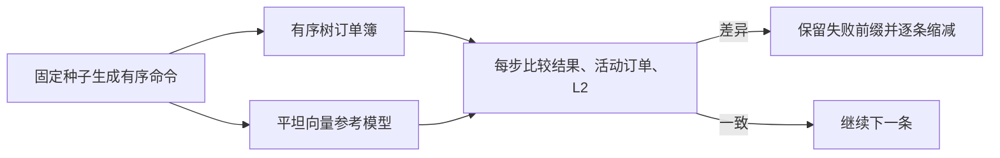

# Day 16 · 参考模型、差分与可缩减用例

## 1. 本期内容与学习目标

本课以 Day 12–15 的全部命令为前置，预计 3–4 小时。写一个只用于测试的慢速参考模型，和真实订单簿执行同一段命令，逐步比较状态码、事件、活动订单及 L2。失败时打印种子、首个差异及可重放的缩减序列。

## 2. 业务背景与原理

一条测试可以证明 A 先于 B 被吃掉，但真实故障常出现在更长的组合里。例如 A 部分减量、B 改到同价、C 以旧 ID 重新挂单，然后一条 IOC 吃掉队首。如果只比较最后盘口，两笔订单可能都已离簿，错误成交顺序也随之消失。逐命令比较可以保留故障出现的第一刻。

本课在受控数值域内生成价格 98–104、数量 0–6、有限 ID 与用户，覆盖重复、越权、无效量等情况。整数边界仍由 Day 06、12、14、15 的固定用例覆盖。随机域够小，参考模型可以直接用安全范围内的普通整数运算，避免共享生产代码的受检算术。

## 3. Java 原始项目的实现分析

`OrderBookBaseTest.multipleCommandsKeepInternalStateTest` 给订单簿执行生成命令并调用内部校验。`IOrderBook.stateHash` 对按序流出的买卖订单及规格取哈希，便于比较两种簿的状态。哈希有可能碰撞，也不能定位第一条异常事件。课程保留结构校验，并按字段对照一份独立模型。 [多命令状态测试](https://github.com/exchange-core/exchange-core/blob/2f8548749839e9095c8dc597e4b61521d259fa5d/src/test/java/exchange/core2/core/orderbook/OrderBookBaseTest.java#L796-L832) · [状态哈希](https://github.com/exchange-core/exchange-core/blob/2f8548749839e9095c8dc597e4b61521d259fa5d/src/main/java/exchange/core2/core/orderbook/IOrderBook.java#L114-L135)

## 4. 本期 C++ 知识

### 随机数和可复现输入

`std::mt19937` 按固定种子初始化，用 `rng()` 推进引擎。这里用取模把输出缩到小范围，便于让固定种子的命令生成顺序可重放。取模有轻微分布偏差，练习只需要覆盖，不用于估算市场频率。将每次取值放到独立语句，避免把会推进随机源的多次调用写在求值顺序不明确的函数实参里。 [Mersenne Twister 引擎规范](https://eel.is/c++draft/rand.eng.mers)

### 差分测试、属性和缩减

每步比较事件向量，比较规范化订单向量，再比较 L2，并单独调用 `book.validate()`。参考模型用 `std::sort` 按价格与入队序号排序。真实簿的状态来自两侧有序树，两条路径若都错成同一种结果仍可能漏检，所以保留手算夹具。

失败时以原始序号保存输入。先截到首次出错的前缀，再逐条尝试删除命令。如果重放仍产生同类差异，接受删减并从头再试。结果是对这项删除策略局部最小的案例。按 `enum class Difference` 分类有助于避免把事件差异缩成另一种问题，但仍可能在同一类别内保留另一条触发路径。 [排序算法约束](https://eel.is/c++draft/alg.sorting)

## 5. 架构设计与技术选型

参考模型使用平坦向量，每次寻找优先 maker 都扫描订单，删除可以移动后续元素。真实订单簿通过价格树和 ID 表访问节点。两者共享 DTO 与事件定义，参考模型自己判断合法性、构造事件、计算 L2。用多次全扫换取实现独立性，模型时间约随本步成交笔数与簿大小的乘积增长。测试规模控制在少量活动 ID 内。



## 6. 从零逐步实现

### 16.1 写受限数值域内的参考模型

创建 `tests/reference_book.hpp`。本练习的输入域由下一节的生成器限定，所有命令属于品种 1，ID 与用户为正，枚举取合法值，预算小且价量有界。参考模型覆盖该域内的业务失败。越界场景通过固定用例单独验证。

```cpp
#ifndef EXCHANGE_REFERENCE_BOOK_HPP
#define EXCHANGE_REFERENCE_BOOK_HPP

#include "exchange/order_book.hpp"

#include <algorithm>
#include <cstddef>
#include <optional>
#include <vector>

namespace matching_test {

using namespace exchange;

class ReferenceBook {
public:
    CommandResult execute(const Command& command, Seq seq) {
        if (const auto* place = std::get_if<PlaceOrder>(&command)) {
            if (place->quantity.value() <= 0) {
                return {Status::invalid_input, {}};
            }
            if (locate(place->key) != orders_.size()) {
                return {Status::duplicate_order, {}};
            }
            return submit(*place, seq);
        }
        if (const auto* cancel = std::get_if<CancelOrder>(&command)) {
            return reduce(cancel->key, cancel->user, std::nullopt);
        }
        if (const auto* request = std::get_if<ReduceOrder>(&command)) {
            if (request->quantity.value() <= 0) {
                return {Status::invalid_input, {}};
            }
            return reduce(request->key, request->user, request->quantity);
        }
        const auto& move = std::get<MoveOrder>(command);
        const auto pos = locate(move.key);
        if (pos == orders_.size() || orders_[pos].user != move.user) {
            return {Status::unknown_order, {}};
        }
        const auto old = orders_[pos];
        if (old.reserve_bid_price && move.new_price > *old.reserve_bid_price) {
            return {Status::price_over_reserve, {}};
        }
        erase(pos);
        return submit(PlaceOrder{old.key, old.user, old.side, old.remaining,
                                LimitPrice{move.new_price, LimitPolicy::gtc, old.reserve_bid_price},
                                old.timestamp_ns}, seq);
    }

    std::vector<RestingOrder> canonical() const {
        auto copy = orders_;
        std::sort(copy.begin(), copy.end(), [](const RestingOrder& a, const RestingOrder& b) {
            if (a.side != b.side) {
                return a.side == Side::ask;
            }
            return before(a, b);
        });
        return copy;
    }

    L2Snapshot snapshot(std::size_t depth) const {
        L2Snapshot data;
        for (const auto& order : canonical()) {
            auto& side = order.side == Side::ask ? data.asks : data.bids;
            if (!side.empty() && side.back().price == order.price) {
                auto& level = side.back();
                level.total_remaining = Quantity{
                    level.total_remaining.value() + order.remaining.value()};
                ++level.order_count;
            } else if (side.size() < depth) {
                side.push_back({order.price, order.remaining, 1});
            }
        }
        return data;
    }

private:
    static bool before(const RestingOrder& a, const RestingOrder& b) {
        if (a.price == b.price) {
            return a.priority_seq < b.priority_seq;
        }
        return a.side == Side::ask ? a.price < b.price : a.price > b.price;
    }

    std::size_t locate(OrderKey key) const {
        for (std::size_t i = 0; i < orders_.size(); ++i) {
            if (orders_[i].key == key) {
                return i;
            }
        }
        return orders_.size();
    }

    void erase(std::size_t pos) {
        orders_.erase(orders_.begin() + static_cast<std::ptrdiff_t>(pos));
    }

    CommandResult reduce(OrderKey key, UserId user, std::optional<Quantity> requested) {
        const auto pos = locate(key);
        if (pos == orders_.size() || orders_[pos].user != user) {
            return {Status::unknown_order, {}};
        }
        const auto old = orders_[pos];
        const auto cut = std::min(requested.value_or(old.remaining), old.remaining);
        const bool removed = cut == old.remaining;
        if (removed) {
            erase(pos);
        } else {
            orders_[pos].remaining = Quantity{old.remaining.value() - cut.value()};
        }
        return {Status::processed, {Reduce{key, user, old.side, old.price, cut, removed}}};
    }

    std::size_t best_for(const std::vector<RestingOrder>& rows, Side taker) const {
        auto best = rows.size();
        for (std::size_t i = 0; i < rows.size(); ++i) {
            if (rows[i].side != taker && (best == rows.size() || before(rows[i], rows[best]))) {
                best = i;
            }
        }
        return best;
    }

    CommandResult submit(const PlaceOrder& order, Seq seq) {
        auto next = orders_;
        auto quantity = order.quantity.value();
        std::int64_t total = 0;
        CommandResult result{Status::processed, {}};
        const auto* limit = std::get_if<LimitPrice>(&order.constraint);
        while (quantity > 0) {
            const auto pos = best_for(next, order.side);
            if (pos == next.size()) {
                break;
            }
            const auto maker = next[pos];
            if (limit && (order.side == Side::bid ? maker.price > limit->price
                                                 : maker.price < limit->price)) {
                break;
            }
            const auto size = std::min(quantity, maker.remaining.value());
            quantity -= size;
            total += size * maker.price.value();
            const bool maker_done = size == maker.remaining.value();
            result.events.emplace_back(Trade{maker.key, maker.user, order.key, order.user,
                                             order.side, maker.price, Quantity{size},
                                             maker_done, quantity == 0});
            if (maker_done) {
                next.erase(next.begin() + static_cast<std::ptrdiff_t>(pos));
            } else {
                next[pos].remaining = Quantity{maker.remaining.value() - size};
            }
        }

        if (const auto* budget = std::get_if<BudgetLimit>(&order.constraint)) {
            const bool outside = order.side == Side::bid ? total > budget->total.value()
                                                        : total < budget->total.value();
            if (quantity > 0 || outside) {
                return {Status::processed, {RejectRemainder{
                    order.key, order.user, order.quantity,
                    quantity > 0 ? RejectReason::insufficient_liquidity : RejectReason::budget_limit}}};
            }
        } else if (quantity > 0 && limit->policy == LimitPolicy::gtc) {
            std::optional<Price> reserve;
            if (order.side == Side::bid) {
                reserve = limit->reserve_bid_price.value_or(limit->price);
            }
            next.push_back({order.key, order.user, order.side, limit->price, Quantity{quantity},
                            reserve, seq, order.timestamp_ns});
        } else if (quantity > 0) {
            result.events.emplace_back(RejectRemainder{
                order.key, order.user, Quantity{quantity}, RejectReason::ioc_remainder});
        }

        orders_.swap(next);
        return result;
    }

    std::vector<RestingOrder> orders_;
};

}

#endif
```

`best_for` 在每轮从平坦向量选当前最优，不访问生产簿的索引。`static_cast<std::ptrdiff_t>(pos)` 把小范围数组下标转为迭代器偏移类型。预算失败时，局部 `next` 被丢弃，原向量仍保留。该模型先逐笔试算再决定是否采用结果，和生产实现先看档聚合再生成逐笔事件的组织方式不同。

### 16.2 生成、重放和缩减

创建 `tests/book_differential_test.cpp`。先写生成与差异比较。`Input` 保留序号，即使缩减时删除某条也保留其他命令原有顺序。`execute_book` 的分派只调用公开入口。差异比较在每次执行后发生，返回首个错误的下标和类别。

```cpp
#include "reference_book.hpp"
#include "test_checks.hpp"

#include <algorithm>
#include <cstdint>
#include <iostream>
#include <random>
#include <string>
#include <utility>

namespace {

using namespace exchange;

struct Input {
    Seq seq;
    Command command;
};

enum class Difference { result, orders, l2, invariant };

struct Failure {
    std::size_t offset;
    Difference kind;
    std::string details;
};

std::vector<Input> generate(std::uint32_t seed, std::size_t size) {
    std::mt19937 rng{seed};
    std::vector<Input> commands;
    commands.reserve(size);
    for (std::size_t i = 0; i < size; ++i) {
        const Seq seq{static_cast<std::uint64_t>(i) + 1};
        const OrderKey key{SymbolId{1}, OrderId{1 + rng() % 24}};
        const auto mode = rng() % 6;
        const auto direction = rng() % 2;
        const Side side = direction == 0 ? Side::bid : Side::ask;
        const auto price_value = static_cast<std::int64_t>(98 + rng() % 7);
        const Price price{price_value};
        const Quantity quantity{static_cast<std::int64_t>(rng() % 7)};
        const auto budget_value = static_cast<std::int64_t>(90 + rng() % 541);
        const auto timestamp = static_cast<std::int64_t>(rng() % 100);
        const auto user_selector = rng() % 4;
        const UserId owner{user_selector == 0 ? 99 : 1 + key.order.value() % 3};
        const UserId author{1 + key.order.value() % 3};
        switch (mode) {
            case 0:
                commands.push_back({seq, PlaceOrder{key, author, side, quantity,
                    LimitPrice{price, LimitPolicy::gtc, std::nullopt}, timestamp}});
                break;
            case 1:
                commands.push_back({seq, PlaceOrder{key, author, side, quantity,
                    LimitPrice{price, LimitPolicy::ioc, std::nullopt}, timestamp}});
                break;
            case 2:
                commands.push_back({seq, PlaceOrder{key, author, side, quantity,
                    BudgetLimit{NotionalSteps{budget_value}}, timestamp}});
                break;
            case 3: commands.push_back({seq, CancelOrder{key, owner}}); break;
            case 4: commands.push_back({seq, ReduceOrder{key, owner, quantity}}); break;
            case 5: commands.push_back({seq, MoveOrder{key, owner, price}}); break;
        }
    }
    return commands;
}

CommandResult execute_book(OrderBook& book, const Input& input) {
    if (const auto* place = std::get_if<PlaceOrder>(&input.command)) {
        return book.place(*place, input.seq);
    }
    if (const auto* cancel = std::get_if<CancelOrder>(&input.command)) {
        return book.cancel(*cancel);
    }
    if (const auto* reduce = std::get_if<ReduceOrder>(&input.command)) {
        return book.reduce(*reduce);
    }
    return book.move(std::get<MoveOrder>(input.command), input.seq);
}

std::string describe_row(const RestingOrder& row) {
    const auto reserve = row.reserve_bid_price
        ? std::to_string(row.reserve_bid_price->value()) : "-";
    return "id=" + std::to_string(row.key.order.value()) +
           " user=" + std::to_string(row.user.value()) +
           " side=" + (row.side == Side::bid ? "bid" : "ask") +
           " price=" + std::to_string(row.price.value()) +
           " qty=" + std::to_string(row.remaining.value()) +
           " priority=" + std::to_string(row.priority_seq.value()) +
           " reserve=" + reserve + " ts=" + std::to_string(row.timestamp_ns);
}

std::optional<Failure> compare(const std::vector<Input>& inputs) {
    OrderBook actual{SymbolId{1}};
    matching_test::ReferenceBook expected;
    for (std::size_t i = 0; i < inputs.size(); ++i) {
        const auto& input = inputs[i];
        const auto lhs = execute_book(actual, input);
        const auto rhs = expected.execute(input.command, input.seq);
        if (lhs != rhs) {
            const auto [a, b] = std::mismatch(lhs.events.begin(), lhs.events.end(),
                                              rhs.events.begin(), rhs.events.end());
            const auto label = [](const Event& event) {
                auto text = describe_event(event);
                if (const auto* trade = std::get_if<Trade>(&event)) {
                    text += " maker_user=" + std::to_string(trade->maker_user.value()) +
                            " taker_user=" + std::to_string(trade->taker_user.value()) +
                            " side=" + (trade->taker_side == Side::bid ? "bid" : "ask") +
                            " maker_filled=" + std::to_string(trade->maker_filled) +
                            " taker_filled=" + std::to_string(trade->taker_filled);
                } else if (const auto* cut = std::get_if<Reduce>(&event)) {
                    text += " user=" + std::to_string(cut->user.value()) +
                            " side=" + (cut->side == Side::bid ? "bid" : "ask") +
                            " price=" + std::to_string(cut->price.value()) +
                            " removed=" + std::to_string(cut->removed);
                } else {
                    text += " user=" + std::to_string(std::get<RejectRemainder>(event).user.value());
                }
                return text;
            };
            const auto first_actual = a == lhs.events.end() ? "end" : label(*a);
            const auto first_expected = b == rhs.events.end() ? "end" : label(*b);
            return Failure{i, Difference::result,
                "actual " + describe_result({input.seq, lhs}) +
                "\nexpected " + describe_result({input.seq, rhs}) +
                "\nfirst differing events\nactual " + first_actual +
                "\nexpected " + first_expected};
        }

        const auto left = actual.resting_orders();
        const auto right = expected.canonical();
        const auto [a, b] = std::mismatch(left.begin(), left.end(), right.begin(), right.end());
        if (a != left.end() || b != right.end()) {
            const auto first_actual = a == left.end() ? "end" : describe_row(*a);
            const auto first_expected = b == right.end() ? "end" : describe_row(*b);
            return Failure{i, Difference::orders,
                "actual " + first_actual + "\nexpected " + first_expected};
        }

        const auto l2 = actual.snapshot(3);
        const auto reference_l2 = expected.snapshot(3);
        if (l2 != reference_l2) {
            const auto explain = [](const auto& levels) {
                std::string text;
                for (const auto& level : levels) {
                    text += " " + std::to_string(level.price.value()) + "/" +
                            std::to_string(level.total_remaining.value()) + "/" +
                            std::to_string(level.order_count);
                }
                return text;
            };
            return Failure{i, Difference::l2,
                "actual asks" + explain(l2.asks) + " bids" + explain(l2.bids) +
                "\nexpected asks" + explain(reference_l2.asks) +
                " bids" + explain(reference_l2.bids)};
        }
        if (!actual.validate()) {
            return Failure{i, Difference::invariant, "book invariant failed"};
        }
    }
    return std::nullopt;
}
```

在同一文件继续追加。`compare` 每次重放都从空簿开始，避免上次运行的状态污染。`std::mismatch` 的四迭代器重载会在任一范围结束时停下。缩减时保存原命令种子、原始位置和缩减后的序号。输出文本含此生成域内的所有业务载荷，品种固定为 1，限价买单预留价均省略。

```cpp
std::vector<Input> minimize(std::vector<Input> inputs, const Failure& first) {
    inputs.erase(inputs.begin() + static_cast<std::ptrdiff_t>(first.offset + 1), inputs.end());
    for (std::size_t i = 0; i < inputs.size();) {
        auto candidate = inputs;
        candidate.erase(candidate.begin() + static_cast<std::ptrdiff_t>(i));
        const auto failure = compare(candidate);
        if (failure && failure->kind == first.kind) {
            inputs = std::move(candidate);
            i = 0;
        } else {
            ++i;
        }
    }
    return inputs;
}

void print_input(const Input& input) {
    std::cout << "seq=" << input.seq.value() << ' ';
    const auto describe = [](OrderKey key, UserId user) {
        std::cout << "id=" << key.order.value() << " user=" << user.value();
    };
    if (const auto* place = std::get_if<PlaceOrder>(&input.command)) {
        std::cout << "place ";
        describe(place->key, place->user);
        std::cout << " side=" << (place->side == Side::bid ? "bid" : "ask")
                  << " qty=" << place->quantity.value() << " ts=" << place->timestamp_ns;
        if (const auto* limit = std::get_if<LimitPrice>(&place->constraint)) {
            std::cout << " limit=" << limit->price.value()
                      << " policy=" << (limit->policy == LimitPolicy::gtc ? "gtc" : "ioc");
        } else {
            std::cout << " budget=" << std::get<BudgetLimit>(place->constraint).total.value();
        }
    } else if (const auto* cancel = std::get_if<CancelOrder>(&input.command)) {
        std::cout << "cancel ";
        describe(cancel->key, cancel->user);
    } else if (const auto* reduce = std::get_if<ReduceOrder>(&input.command)) {
        std::cout << "reduce ";
        describe(reduce->key, reduce->user);
        std::cout << " qty=" << reduce->quantity.value();
    } else {
        const auto& move = std::get<MoveOrder>(input.command);
        std::cout << "move ";
        describe(move.key, move.user);
        std::cout << " price=" << move.new_price.value();
    }
    std::cout << '\n';
}

}

int main() {
    constexpr std::size_t steps = 1200;
    for (const std::uint32_t seed : {7u, 31u, 2026u}) {
        auto inputs = generate(seed, steps);
        const auto failure = compare(inputs);
        if (failure) {
            std::cerr << "seed=" << seed << " command index=" << failure->offset
                      << " seq=" << inputs.at(failure->offset).seq.value()
                      << '\n' << failure->details << '\n';
            const auto reduced = minimize(std::move(inputs), *failure);
            std::cout << "reduced sequence: " << reduced.size() << " commands\n";
            for (const auto& input : reduced) {
                print_input(input);
            }
            return 1;
        }
    }
    std::cout << "3600 commands checked against the reference book\n";
    return 0;
}
```

缩减器可能多次重放长序列，只在失败时运行。`describe_result` 的文本面向调试，可能省略某些字段。若实际和预期的文字相同但结构比较失败，从两个 `CommandResult` 中检查具体的完成标记、币种无关的身份字段和事件分支。

## 7. 测试、调试与验证

追加测试目标并运行。

```cmake
add_executable(book_differential_tests tests/book_differential_test.cpp)
target_link_libraries(book_differential_tests PRIVATE exchange_core)
add_test(NAME book_differential COMMAND book_differential_tests)
```

```bash
cmake --build build-debug
ctest --test-dir build-debug -R '^book_differential$' -V
ctest --test-dir build-debug --output-on-failure
```

全套 15 项，差分输出 `3600 commands checked against the reference book`。然后故意破坏生产簿中的 maker 选择。将 `plan_against` 内的档内循环暂时改成从 `level.fifo.rbegin()` 到 `rend()`，每步用 `const auto& maker = *it;`。固定夹具或差分会报错。用 `ctest --test-dir build-debug -R '^book_differential$' --output-on-failure` 单独观察首个差异和缩减序列。恢复后按 Day 05 重建 Debug、Release 和 ASan/UBSan。 本次从 Day 01 的 Markdown 代码开始，按课应用新增和替换片段，在 macOS arm64、Apple Clang 17、CMake 4.3.1 下完成验证。三种构建各通过 15 项 CTest，差分测试在每种构建中均运行 3600 条命令。

本次故障演练用种子 7，在序号 78 首次发现成交事件不同。缩减后只剩三条命令。原序号保留，便于回查初始输出。

| 序号 | 指令 | 手算结果 |
| ---: | --- | --- |
| 39 | ID 1 买入 101×3，GTC | 进入 101 买档 |
| 43 | ID 16 买入 101×3，GTC | 在 ID 1 后排队 |
| 78 | ID 18 卖出 5 手，限 100，IOC | 先和 ID 1 成交 3 手，再和 ID 16 成交 2 手，价格都是 101 |

故意逆序后，首个 maker 变成 ID 16。这个反例把问题定位在同价 FIFO，和预算及不同价档的遍历无关。

若只在 `l2` 比较失败，先检查两侧档数、缓存总量与价序。若 `result` 不同但末态可能相同，看事件中的 maker 顺序与完成标记。若 `invariant` 失败，回查 Day 10 的节点与索引更新路径。

## 8. Java 与 C++ 实现深度对比

Java 共享测试覆盖多种订单簿实现，规范排序后的哈希适合快速筛查。C++ 这里逐字段比较两种数据结构，能定位第一个错误命令，也要为输出和测试模型付出运行成本。固定种子让生成输入可以复现，独立夹具仍提供价格和数量的外部依据。

## 9. 课后练习

1. **基础。** 把种子 31 换成你选的一个整数，验证两次运行产生相同的命令内容。
2. **工程。** 给生成器加一个明确的「先挂两笔同价，再扫一手」前缀。验收是一次 FIFO 破坏始终在前缀内被发现。
3. **思考。** 两个模型都把 maker 成交价写成 taker 限价时，哪一层测试能发现？为什么？

## 10. 总结与下一期

第四阶段收尾后，单品种簿具备 GTC、IOC、FOK_BUDGET、撤单、减量和改价，并能按同一命令序列和独立模型核对。Day 17 将从簿的公开接口出发，加入多品种路由和命令提交边界。

[Day 15](day-15.md) · [继续阅读 Day 17 · 多品种同步引擎与提交边界](../05-engine-architecture/day-17.md)

<details>
<summary>练习参考答案</summary>

1. 调用 `generate` 两次并对每条用 `print_input` 输出。序号和字段应逐行一致。
2. 前缀写两条卖单 101×1，再写买入 101×1。给后续生成的命令序号整体加 3。预期 maker 为第一条卖单。
3. Day 08 的手算固定夹具独立给出成交价。例如 102 的买入限价应在 101 成交，即使两个模型犯同一错误也会暴露。

</details>
