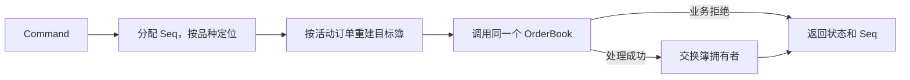

# Day 17 · 多品种同步引擎与提交边界

## 1. 本期内容与学习目标

本课需要 Day 12–16 的下单、撤减改和差分测试，预计 3–4 小时。把调用者从「选一张簿再执行」切换到统一的 `Engine::execute`。引擎为命令分配序号，根据品种路由，并先在临时簿执行。日后账本也将在同一提交边界准备。

## 2. 业务背景与原理

同一个订单号 7 可以出现在两个品种，键是 `(symbol, orderId)`。取消品种 1 的订单 7，品种 2 的 7 仍可交易。执行序号与订单号分开。注册、合法下单、业务拒绝都占一个序号，调用方可据此定位回执。在这版同步引擎里，从 `execute` 返回时可以读取本条命令提交后的状态。发生基础设施异常时允许序号空洞。

## 3. Java 原始项目的实现分析

Java 的 `ExchangeApi` 把命令转换为内部槽位。`MatchingEngineRouter` 按品种决定处理分片，再从自己的品种簿映射取 `IOrderBook`。`IOrderBook.processCommand` 按类型分派下单和撤改。教程把路由、分派和结果封装装进一个同步对象，品种维度仍与订单 ID 分开。 [API 转换](https://github.com/exchange-core/exchange-core/blob/2f8548749839e9095c8dc597e4b61521d259fa5d/src/main/java/exchange/core2/core/ExchangeApi.java#L427-L465) · [路由](https://github.com/exchange-core/exchange-core/blob/2f8548749839e9095c8dc597e4b61521d259fa5d/src/main/java/exchange/core2/core/processors/MatchingEngineRouter.java#L171-L183) · [品种分片和查簿](https://github.com/exchange-core/exchange-core/blob/2f8548749839e9095c8dc597e4b61521d259fa5d/src/main/java/exchange/core2/core/processors/MatchingEngineRouter.java#L233-L268) · [命令分派](https://github.com/exchange-core/exchange-core/blob/2f8548749839e9095c8dc597e4b61521d259fa5d/src/main/java/exchange/core2/core/orderbook/IOrderBook.java#L176-L205)

## 4. 本期 C++ 知识

`std::unique_ptr<OrderBook>` 拥有簿，`*ptr` 用来借用，`ptr.swap(other)` 交换两个拥有者。交换无需复制簿及其内部节点。销毁原簿时索引、价档和节点仍按各自所有权释放。C++ 的基本异常保证要求失败后对象仍有效，强保证要求失败前后的业务状态相同。本课的账本和簿将采用暂存状态加交换。分配和校验放在前半段，交换后的步骤保持不抛出。 [unique_ptr 修饰操作](https://eel.is/c++draft/unique.ptr.single.modifiers)

`std::visit` 取出命令的实际类型。`if constexpr` 在编译期选择分支，只有选中的分支实例化。`std::is_same_v<T, U>` 比较类型。本课的四种订单命令共享路由和暂存，只有实际调用的簿方法不同。

## 5. 架构设计与技术选型

可以直接调用正式簿的单命令准备和提交，也可以先重建受影响的单簿再运行。这里选择暂存一张簿，Day 18–19 可在试算或结算失败时一起放弃两份暂存对象。每条命令重建整张目标簿，时间约为 `O(N log(P+1))` 加本次撮合，空间 `O(N+P)`。这份成本会进入 Day 21 的基准。价格时间优先继续由 Day 12–16 的簿负责。引擎不会重写撮合规则。



## 6. 从零逐步实现

### 17.1 扩展模型与重建接口

在 `model.hpp` 的 `using Command = ...` 前加入 `RegisterSymbol`，用下段替换原别名。在 `Status` 末尾追加 `symbol_exists`，在 `src/model.cpp` 的 `status_name` 中补同名文本。给 `CheckCommand` 加一个 `bool operator()(const RegisterSymbol& cmd) const { return valid_symbol(cmd.spec); }`。

```cpp
struct RegisterSymbol {
    SymbolSpec spec;
};

using Command = std::variant<PlaceOrder, CancelOrder, ReduceOrder, MoveOrder, RegisterSymbol>;
```

在 `order_book.hpp` 增加 `#include <memory>`，将静态函数放到公开区。它从规范化状态重建索引和 FIFO。输入必须先按 Day 11 的顺序导出，特别是同价 FIFO。发现非法、交叉或重复记录时抛异常，局部对象随即销毁。

```cpp
    static std::unique_ptr<OrderBook> from_resting(
        SymbolId symbol, const std::vector<RestingOrder>& orders);
```

在 `src/order_book.cpp` 的 `namespace exchange` 内追加定义。

```cpp
std::unique_ptr<OrderBook> OrderBook::from_resting(
    SymbolId symbol, const std::vector<RestingOrder>& orders) {
    auto staged = std::make_unique<OrderBook>(symbol);
    for (const auto& order : orders) {
        if (staged->add_resting(order) != Status::processed) {
            throw std::invalid_argument{"invalid resting state"};
        }
    }
    if (!staged->validate()) {
        throw std::logic_error{"rebuilt order book is inconsistent"};
    }
    return staged;
}
```

### 17.2 写目录和统一入口

创建 `include/exchange/engine.hpp`。`Market` 同时拥有品种规格与簿。`SymbolCatalog` 用有序映射按品种访问，后续报告可直接按稳定品种顺序遍历。`friend class Engine` 把可变状态留在引擎内部。`book_orders` 是观察用值快照，空 optional 表示品种缺失，有值但向量为空表示簿为空。

```cpp
#ifndef EXCHANGE_ENGINE_HPP
#define EXCHANGE_ENGINE_HPP

#include "exchange/order_book.hpp"

#include <map>

namespace exchange {

class SymbolCatalog {
private:
    friend class Engine;
    struct Market {
        SymbolSpec spec;
        std::unique_ptr<OrderBook> book;
    };

    Status add(const SymbolSpec& spec);
    std::map<SymbolId, Market> markets_;
};

class Engine {
public:
    Result execute(const Command& command);
    std::optional<std::vector<RestingOrder>> book_orders(SymbolId symbol) const;

private:
    CommandResult dispatch(const RegisterSymbol& command, Seq seq);

    template<class T>
    CommandResult dispatch(const T& command, Seq seq);

    SymbolCatalog catalog_;
    std::uint64_t last_seq_{};
};

}

#endif
```

创建 `src/engine.cpp`。`std::make_unique` 构造拥有者，`auto& market` 借用已有品种。注册成功时只插一条目录记录，失败不替换已有规格。`execute` 每次先分配序号，再运行命令。

```cpp
#include "exchange/engine.hpp"

#include <limits>
#include <stdexcept>
#include <type_traits>

namespace exchange {

Status SymbolCatalog::add(const SymbolSpec& spec) {
    if (!valid_symbol(spec)) {
        return Status::invalid_input;
    }
    if (markets_.contains(spec.symbol)) {
        return Status::symbol_exists;
    }
    markets_.try_emplace(spec.symbol, Market{spec, std::make_unique<OrderBook>(spec.symbol)});
    return Status::processed;
}

CommandResult Engine::dispatch(const RegisterSymbol& command, Seq) {
    return {catalog_.add(command.spec), {}};
}

template<class T>
CommandResult Engine::dispatch(const T& command, Seq seq) {
    if (!validate_command(command)) {
        return {Status::invalid_input, {}};
    }
    const auto found = catalog_.markets_.find(command.key.symbol);
    if (found == catalog_.markets_.end()) {
        return {Status::unknown_symbol, {}};
    }

    auto& market = found->second;
    auto staged = OrderBook::from_resting(market.spec.symbol, market.book->resting_orders());
    auto result = [&] {
        if constexpr (std::is_same_v<T, PlaceOrder>) {
            return staged->place(command, seq);
        } else if constexpr (std::is_same_v<T, CancelOrder>) {
            return staged->cancel(command);
        } else if constexpr (std::is_same_v<T, ReduceOrder>) {
            return staged->reduce(command);
        } else {
            static_assert(std::is_same_v<T, MoveOrder>);
            return staged->move(command, seq);
        }
    }();

    if (result.status == Status::processed) {
        market.book.swap(staged);
    }
    return result;
}

Result Engine::execute(const Command& command) {
    if (last_seq_ == std::numeric_limits<std::uint64_t>::max()) {
        throw std::overflow_error{"command sequence exhausted"};
    }
    const Seq seq{++last_seq_};
    return {seq, std::visit([&](const auto& input) { return dispatch(input, seq); }, command)};
}

std::optional<std::vector<RestingOrder>> Engine::book_orders(SymbolId symbol) const {
    const auto found = catalog_.markets_.find(symbol);
    if (found == catalog_.markets_.end()) {
        return std::nullopt;
    }
    return found->second.book->resting_orders();
}

}
```

下一步只扩展 `dispatch` 的暂存阶段。`Engine` 不交出内部指针，因此调用者无法保存被替换的旧簿。

## 7. 测试、调试与验证

创建 `tests/engine_test.cpp`。使用两品种同 ID 验证路由和回执，并验证重建失败不接触原簿。

```cpp
#include "exchange/engine.hpp"
#include "test_checks.hpp"

#include <stdexcept>

int main() {
    using namespace exchange;
    TestChecks checks;
    Engine engine;
    const SymbolSpec a{SymbolId{1}, CurrencyId{10}, CurrencyId{20}, 10, 2, 1, 3};
    auto b = a;
    b.symbol = SymbolId{2};
    checks.require(engine.execute(RegisterSymbol{a}).outcome.status == Status::processed &&
                   engine.execute(RegisterSymbol{b}).outcome.status == Status::processed, "two markets");

    const auto order = [](SymbolId symbol) {
        return PlaceOrder{{symbol, OrderId{7}}, UserId{10}, Side::bid, Quantity{1},
                          LimitPrice{Price{100}, LimitPolicy::gtc, std::nullopt}, 0};
    };
    const auto first = engine.execute(order(a.symbol));
    const auto second = engine.execute(order(b.symbol));
    checks.require(first.seq == Seq{3} && second.seq == Seq{4} &&
                   first.outcome.status == Status::processed &&
                   second.outcome.status == Status::processed, "sequence and same id");

    const auto missing = engine.execute(order(SymbolId{3}));
    checks.require(missing.seq == Seq{5} && missing.outcome.status == Status::unknown_symbol,
                   "missing market has a sequence");

    const auto saved = engine.book_orders(b.symbol);
    const auto cut = engine.execute(CancelOrder{{a.symbol, OrderId{7}}, UserId{10}});
    checks.require(cut.outcome.status == Status::processed && cut.outcome.events.size() == 1 &&
                   engine.book_orders(a.symbol) == std::vector<RestingOrder>{} &&
                   engine.book_orders(b.symbol) == saved, "cancel in one market only");

    bool refused = false;
    if (saved && !saved->empty()) {
        auto bad = *saved;
        bad.push_back(bad.front());
        try {
            OrderBook::from_resting(b.symbol, bad);
        } catch (const std::invalid_argument&) {
            refused = true;
        }
    }
    checks.require(refused && engine.book_orders(b.symbol) == saved, "bad staging leaves live book intact");
    return checks.exit_code();
}
```

把 `src/engine.cpp` 加进 `exchange_core` 源列表。追加目标后运行 `cmake --build build-debug`，再用 `ctest --test-dir build-debug -R '^engine$' --output-on-failure`。全套应有 16 项。多配置分别传 `--config Debug` 和 `-C Debug`。若同号订单错误冲突，检查索引是否被放在整个引擎而非品种簿。

```cmake
add_executable(engine_tests tests/engine_test.cpp)
target_link_libraries(engine_tests PRIVATE exchange_core)
add_test(NAME engine COMMAND engine_tests)
```

## 8. Java 与 C++ 实现深度对比

Java 复用内部命令槽并以分片序列协调多个处理器。同步 C++ 版通过单一调用者和一条序号线把边界先定清。`unique_ptr` 交换只改变所有者，不移动节点。重建每条命令的目标簿有额外成本，后续可以在验证过结算契约后把准备优化成局部变更。

## 9. 课后练习

1. **基础。** 同一个品种注册两次，比较第二次状态和序号。
2. **工程。** 重建一个同时包含买卖两侧的簿，比较 `resting_orders`、L2 与 `validate`。
3. **思考。** 为什么不能用自动复制的 `OrderBook` 代替重建？

## 10. 总结与下一期

引擎可以用统一序号管理多张订单簿。下课在准备阶段加入账户和冻结，逐步建立两份业务状态的提交边界。

[Day 16](../04-matching-engine/day-16.md) · [课程目录](../00-overview/learning-roadmap.md) · [Day 18](day-18.md)

<details>
<summary>练习参考答案</summary>

1. 第二次状态为 `symbol_exists`，仍得到递增序号。
2. 使用 Day 11 的双侧样例，调用 `from_resting` 后对比规范向量和深度 2。
3. 自动复制节点容器会产生新节点，旧索引里的迭代器仍指向原簿。重建时索引指向新节点。

</details>
