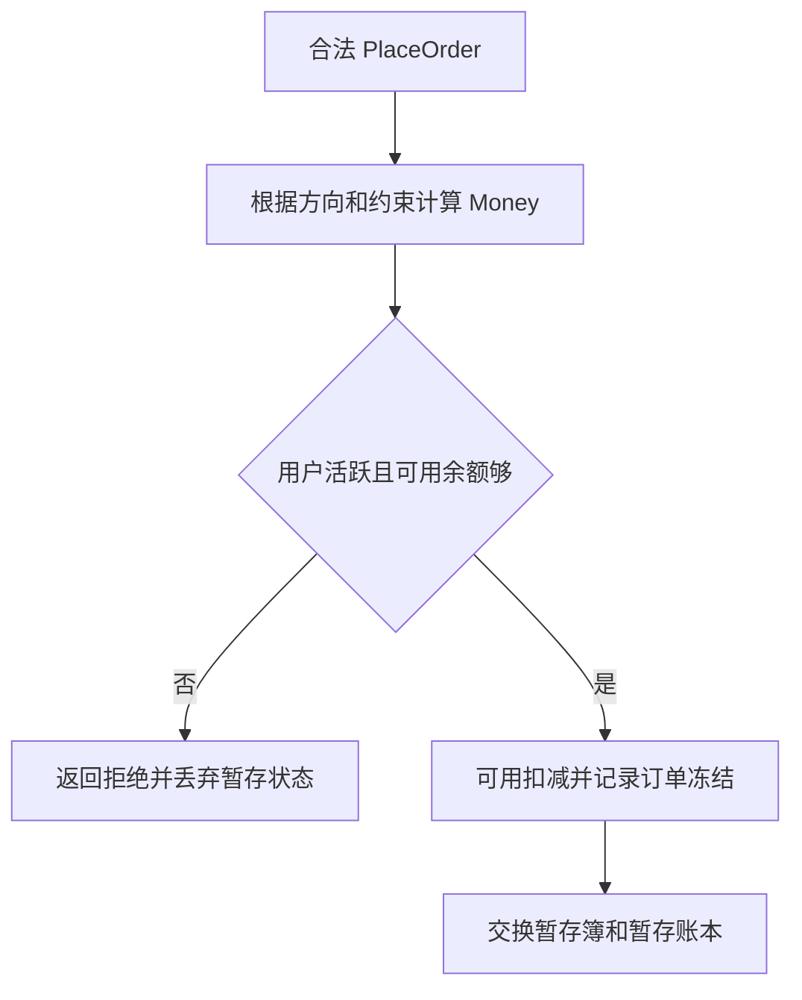

# Day 18 · 账户、资金流水与预冻结

## 1. 本期内容与学习目标

本课在 Day 17 的暂存命令上加入账户，预计 3–4 小时。你会实现开户、入出金、暂停、恢复和现货冻结。验收观察的是可用余额、每单冻结额及资金流水号。已有的撮合可以在暂存簿试跑，涉及成交或释放冻结的命令等 Day 19 接入结算后提交。

## 2. 业务背景与原理

用户有 500 个报价币单位，以预留价 105 买 2 手，报价尺度 2，每手 taker 费 3。冻结 `2×(105×2+3)=426` 后，可用余额为 74。账户出金只能动用 74。若下一笔冻结还要 426，应拒绝并保持两份状态。卖单只冻结基础资产。预算买单按总额及请求手数预留手续费。

资金流水号以用户为范围，要求正值且严格前进。当前流水号重发返回重复，较早的号返回过期，失败的申请不推进。暂停仅在可用余额全零且无冻结时允许。每笔活动单必须有正冻结，故无冻结即可推出没有该用户的活动单。暂停仍保留流水号，以免恢复后重放旧入金。

## 3. Java 原始项目的实现分析

`UserProfileService.balanceAdjustment` 用 `adjustmentsCounter` 区分重复和旧流水，并检查出金后余额。Java 暂停可能删除空用户记录；后续结算可建立暂停记录，恢复分支可补空用户。课程保留已注册账户、状态与流水号。`RiskEngine.placeExchangeOrder` 按方向选币种，按预留价或预算计算买方扣款。 [资金调整](https://github.com/exchange-core/exchange-core/blob/2f8548749839e9095c8dc597e4b61521d259fa5d/src/main/java/exchange/core2/core/processors/UserProfileService.java#L77-L107) · [暂停和恢复](https://github.com/exchange-core/exchange-core/blob/2f8548749839e9095c8dc597e4b61521d259fa5d/src/main/java/exchange/core2/core/processors/UserProfileService.java#L125-L174) · [现货预扣](https://github.com/exchange-core/exchange-core/blob/2f8548749839e9095c8dc597e4b61521d259fa5d/src/main/java/exchange/core2/core/processors/RiskEngine.java#L430-L503)

## 4. 本期 C++ 知识

`std::map::try_emplace` 可建立此前缺失的币种槽。`map::at` 在键缺失时抛异常，因此业务读使用 `find` 表示缺失，写入前用 `try_emplace` 准备键。账本冻结按 `pair<SymbolId, OrderId>` 排序，标准 pair 比较按第一项、第二项依次决定顺序。账户余额和净入金均使用 `checked_add`。总净入金限定为非负且可表示，限制了后续报告的汇总范围。

簿与账本各自拥有状态。在暂存账本上遇到错误，外层可以丢弃副本。`Ledger::swap` 的两个标准映射交换用于提交。教学版在准备阶段复制整个账本，写入成本随总账户和冻结数增长；后续可将账本变化收窄成分录事务。

## 5. 架构设计与技术选型

可以只在余额表减一个数，再从簿的活动量反算冻结，或者为每个订单显式保存冻结。课程选第二种。IOC、FOK 和改价的结算需要知道当前命令持有多少以及最后应剩多少。显式记录可让报告分开审计账户与簿。冻结用独立函数计算，试算阶段不访问账户。调用方在提交前先完成所有可失败的状态准备。



## 6. 从零逐步实现

### 18.1 扩展账户命令及状态码

在 `model.hpp` 的 `Command` 别名前新增账户类型，并更新别名。在 `Status` 末尾增加 `unknown_user`、`user_exists`、`user_suspended`、`account_not_empty`、`duplicate_funding`、`stale_funding` 和 `settlement_required`。将这些状态逐项加入 `status_name`。本章的 `settlement_required` 用于暂时阻止需要结算的变更，Day 19 移除。

```cpp
struct AddUser { UserId user; };
struct AdjustBalance { UserId user; Money amount; std::uint64_t funding_id; };
struct SuspendUser { UserId user; };
struct ResumeUser { UserId user; };

using Command = std::variant<PlaceOrder, CancelOrder, ReduceOrder, MoveOrder, RegisterSymbol,
                             AddUser, AdjustBalance, SuspendUser, ResumeUser>;
```

在 `CheckCommand` 中为四种账户命令加重载。四者都检查用户 ID 大于零；资金调整还检查币种、流水号为正且金额非零。账本会再做同样的入口校验，因为它也可单独测试。

```cpp
    bool operator()(const AddUser& cmd) const { return cmd.user.value() > 0; }
    bool operator()(const AdjustBalance& cmd) const {
        return cmd.user.value() > 0 && cmd.amount.currency.value() > 0 &&
               cmd.funding_id > 0 && cmd.amount.units != 0;
    }
    bool operator()(const SuspendUser& cmd) const { return cmd.user.value() > 0; }
    bool operator()(const ResumeUser& cmd) const { return cmd.user.value() > 0; }
```

### 18.2 写账本公开边界

创建 `include/exchange/ledger.hpp`。`Account` 拥有可用余额与最后一次成功流水号。`Hold` 拥有冻结的币种、金额及用户。冻结键按品种和订单排序。`available` 以空值区分不存在的用户，有用户但无该币种余额时返回 0。`held` 返回冻结的副本。

```cpp
#ifndef EXCHANGE_LEDGER_HPP
#define EXCHANGE_LEDGER_HPP

#include "exchange/model.hpp"

#include <map>
#include <utility>

namespace exchange {

std::optional<Money> required_hold(const PlaceOrder& order, const SymbolSpec& spec);

class Ledger {
public:
    Status add_user(UserId user);
    Status adjust(const AdjustBalance& command);
    Status suspend(UserId user);
    Status resume(UserId user);
    Status freeze(const PlaceOrder& order, const SymbolSpec& spec);

    std::optional<Money> available(UserId user, CurrencyId currency) const;
    std::optional<Money> held(OrderKey key) const;
    void swap(Ledger& other) noexcept;

private:
    struct Account {
        std::map<CurrencyId, std::int64_t> balances;
        std::uint64_t last_funding{};
        bool suspended{};
    };

    struct Hold {
        UserId user;
        Money money;
    };

    using HoldKey = std::pair<SymbolId, OrderId>;

    std::map<UserId, Account> accounts_;
    std::map<HoldKey, Hold> holds_;
    std::map<CurrencyId, std::int64_t> net_deposits_;
};

}

#endif
```

### 18.3 实现入出金、暂停和冻结

创建 `src/ledger.cpp`。买侧默认预留价为限价。卖侧限价至少要能覆盖一手 taker 费，换算时也检查表示范围。预算卖单按基础资产冻结，实际每笔成交是否覆盖对应费用在 Day 19 检查。`adjust` 先算账户余额和全局该币种净入金，再准备映射节点，最后写入两个结果和流水号。第二次分配失败时回收本次新增的账户余额节点。

```cpp
#include "exchange/ledger.hpp"

#include <algorithm>

namespace exchange {

namespace {

template<class Map, class Key>
std::int64_t value_or_zero(const Map& map, Key key) {
    const auto it = map.find(key);
    return it == map.end() ? 0 : it->second;
}

}

std::optional<Money> required_hold(const PlaceOrder& order, const SymbolSpec& spec) {
    if (!validate_command(order) || order.key.symbol != spec.symbol) {
        return std::nullopt;
    }
    if (order.side == Side::ask) {
        if (const auto* limit = std::get_if<LimitPrice>(&order.constraint)) {
            const auto per_lot = quote_notional(Quantity{1}, limit->price, spec);
            if (!per_lot || per_lot->units < spec.taker_fee_per_lot) {
                return std::nullopt;
            }
        }
        return base_amount(order.quantity, spec);
    }
    if (const auto* limit = std::get_if<LimitPrice>(&order.constraint)) {
        return bid_hold(order.quantity, limit->reserve_bid_price.value_or(limit->price), spec);
    }
    return budget_bid_hold(order.quantity, std::get<BudgetLimit>(order.constraint).total, spec);
}

Status Ledger::add_user(UserId user) {
    if (user.value() == 0) {
        return Status::invalid_input;
    }
    return accounts_.try_emplace(user).second ? Status::processed : Status::user_exists;
}

Status Ledger::adjust(const AdjustBalance& cmd) {
    if (!validate_command(cmd)) {
        return Status::invalid_input;
    }
    const auto found = accounts_.find(cmd.user);
    if (found == accounts_.end()) {
        return Status::unknown_user;
    }
    auto& account = found->second;
    if (account.suspended) {
        return Status::user_suspended;
    }
    if (cmd.funding_id == account.last_funding) {
        return Status::duplicate_funding;
    }
    if (cmd.funding_id < account.last_funding) {
        return Status::stale_funding;
    }

    const auto next = checked_add(value_or_zero(account.balances, cmd.amount.currency),
                                  cmd.amount.units);
    const auto net = checked_add(value_or_zero(net_deposits_, cmd.amount.currency), cmd.amount.units);
    if (!next || !net) {
        return Status::invalid_input;
    }
    if (*next < 0) {
        return Status::insufficient_funds;
    }
    if (*net < 0) {
        return Status::invalid_input;
    }

    auto [balance, created] = account.balances.try_emplace(cmd.amount.currency, 0);
    try {
        auto [deposit, inserted] = net_deposits_.try_emplace(cmd.amount.currency, 0);
        deposit->second = *net;
    } catch (...) {
        if (created) {
            account.balances.erase(balance);
        }
        throw;
    }
    balance->second = *next;
    account.last_funding = cmd.funding_id;
    return Status::processed;
}

Status Ledger::suspend(UserId user) {
    const auto it = accounts_.find(user);
    if (it == accounts_.end()) {
        return Status::unknown_user;
    }
    if (it->second.suspended) {
        return Status::user_suspended;
    }
    const auto nonzero = std::any_of(it->second.balances.begin(), it->second.balances.end(),
                                    [](const auto& row) { return row.second != 0; });
    const auto reserved = std::any_of(holds_.begin(), holds_.end(),
                                      [user](const auto& row) { return row.second.user == user; });
    if (nonzero || reserved) {
        return Status::account_not_empty;
    }
    it->second.suspended = true;
    return Status::processed;
}

Status Ledger::resume(UserId user) {
    const auto it = accounts_.find(user);
    if (it == accounts_.end()) {
        return Status::unknown_user;
    }
    if (!it->second.suspended) {
        return Status::invalid_input;
    }
    it->second.suspended = false;
    return Status::processed;
}

Status Ledger::freeze(const PlaceOrder& order, const SymbolSpec& spec) {
    const auto account = accounts_.find(order.user);
    if (account == accounts_.end()) {
        return Status::unknown_user;
    }
    if (account->second.suspended) {
        return Status::user_suspended;
    }
    const HoldKey key{order.key.symbol, order.key.order};
    if (holds_.contains(key)) {
        return Status::duplicate_order;
    }
    const auto money = required_hold(order, spec);
    if (!money || money->units <= 0) {
        return Status::invalid_input;
    }
    const auto balance = account->second.balances.find(money->currency);
    if (balance == account->second.balances.end() || balance->second < money->units) {
        return Status::insufficient_funds;
    }
    holds_.try_emplace(key, Hold{order.user, *money});
    balance->second -= money->units;
    return Status::processed;
}

std::optional<Money> Ledger::available(UserId user, CurrencyId currency) const {
    const auto it = accounts_.find(user);
    if (it == accounts_.end()) {
        return std::nullopt;
    }
    return Money{currency, value_or_zero(it->second.balances, currency)};
}

std::optional<Money> Ledger::held(OrderKey key) const {
    const auto it = holds_.find({key.symbol, key.order});
    if (it == holds_.end()) {
        return std::nullopt;
    }
    return it->second.money;
}

void Ledger::swap(Ledger& other) noexcept {
    accounts_.swap(other.accounts_);
    holds_.swap(other.holds_);
    net_deposits_.swap(other.net_deposits_);
}

}
```

`freeze` 插入冻结记录后只做安全减法。买单限价和预留价的检查复用 Day 07。账本冻结不单独公开到引擎外部；`Engine` 在准备阶段调用它。

### 18.4 接入 Day 17 的提交边界

在 `engine.hpp` 引入 `"exchange/ledger.hpp"`，在 `catalog_` 后声明 `Ledger ledger_;`。在 `public` 加 `const Ledger& ledger() const { return ledger_; }` 作为同线程测试读入口。私有区加下列账户分派声明，在 `src/engine.cpp` 中加下列定义。`dispatch` 的这些重载只改账本。资金调整方法内部已分配完所有必要节点后才提交。

```cpp
    CommandResult dispatch(const AddUser& command, Seq seq);
    CommandResult dispatch(const AdjustBalance& command, Seq seq);
    CommandResult dispatch(const SuspendUser& command, Seq seq);
    CommandResult dispatch(const ResumeUser& command, Seq seq);
```

```cpp
CommandResult Engine::dispatch(const AddUser& command, Seq) {
    return {validate_command(command) ? ledger_.add_user(command.user) : Status::invalid_input, {}};
}

CommandResult Engine::dispatch(const AdjustBalance& command, Seq) {
    return {ledger_.adjust(command), {}};
}

CommandResult Engine::dispatch(const SuspendUser& command, Seq) {
    return {validate_command(command) ? ledger_.suspend(command.user) : Status::invalid_input, {}};
}

CommandResult Engine::dispatch(const ResumeUser& command, Seq) {
    return {validate_command(command) ? ledger_.resume(command.user) : Status::invalid_input, {}};
}
```

在订单分派模板中，将 Day 17 从 `if (result.status == Status::processed)` 到 `return result;` 替换如下。暂存簿先运行，以便发现活动 ID 冲突和非法命令。风险未通过时丢弃暂存簿；未处理的结算事件也不会泄露给调用方。Day 19 会把新单冻结移到暂存撮合之前。

```cpp
    if (result.status != Status::processed) {
        return result;
    }
    if constexpr (std::is_same_v<T, PlaceOrder>) {
        if (!result.events.empty()) {
            return {Status::settlement_required, {}};
        }
        auto staged_ledger = ledger_;
        const auto status = staged_ledger.freeze(command, market.spec);
        if (status != Status::processed) {
            return {status, {}};
        }
        market.book.swap(staged);
        ledger_.swap(staged_ledger);
        return result;
    }
    return {Status::settlement_required, {}};
```

## 7. 测试、调试与验证

在 `tests/engine_test.cpp` 注册两个品种后，创建 `UserId{10}`，再入金报价币 1000、流水号 1，两条命令均断言 `processed`。将后续三个回执的预期序号由 3、4、5 改为 5、6、7。此时取消品种 1 的订单应返回 `settlement_required`、无事件、两个市场状态均未改变。Day 19 可恢复成功撤单的断言。

创建 `tests/ledger_test.cpp`。金额按本课首例手算。这里同时断言失败后簿与账户保持原样。

```cpp
#include "exchange/engine.hpp"
#include "test_checks.hpp"

int main() {
    using namespace exchange;
    TestChecks checks;
    Engine engine;
    const SymbolSpec spec{SymbolId{1}, CurrencyId{10}, CurrencyId{20}, 10, 2, 1, 3};
    const UserId buyer{1};
    const UserId seller{2};
    const auto status = [&](Command cmd) { return engine.execute(cmd).outcome.status; };
    checks.require(status(RegisterSymbol{spec}) == Status::processed &&
                   status(AddUser{buyer}) == Status::processed &&
                   status(AddUser{seller}) == Status::processed, "setup");
    checks.require(status(AdjustBalance{buyer, {spec.quote, 500}, 2}) == Status::processed &&
                   status(AdjustBalance{buyer, {spec.quote, 500}, 2}) == Status::duplicate_funding &&
                   status(AdjustBalance{buyer, {spec.quote, 500}, 1}) == Status::stale_funding,
                   "funding applied once");
    const PlaceOrder order{{spec.symbol, OrderId{7}}, buyer, Side::bid, Quantity{2},
                           LimitPrice{Price{100}, LimitPolicy::gtc, Price{105}}, 0};
    checks.require(status(order) == Status::processed &&
                   engine.ledger().available(buyer, spec.quote) == Money{spec.quote, 74} &&
                   engine.ledger().held(order.key) == Money{spec.quote, 426}, "freeze bid");
    const auto before = engine.book_orders(spec.symbol);
    auto other = order;
    other.key.order = OrderId{8};
    checks.require(status(order) == Status::duplicate_order &&
                   status(other) == Status::insufficient_funds &&
                   status(AdjustBalance{buyer, {spec.quote, -75}, 3}) == Status::insufficient_funds &&
                   engine.book_orders(spec.symbol) == before, "failed operations do not commit");
    checks.require(status(AdjustBalance{buyer, {spec.quote, -74}, 3}) == Status::processed &&
                   status(SuspendUser{buyer}) == Status::account_not_empty, "frozen funds prevent suspension");
    checks.require(status(SuspendUser{seller}) == Status::processed, "suspend empty user");
    const PlaceOrder ask{{spec.symbol, OrderId{9}}, seller, Side::ask, Quantity{1},
                         LimitPrice{Price{110}, LimitPolicy::gtc, std::nullopt}, 0};
    checks.require(status(ask) == Status::user_suspended &&
                   status(ResumeUser{seller}) == Status::processed &&
                   status(AdjustBalance{seller, {spec.base, 10}, 1}) == Status::processed &&
                   status(ask) == Status::processed &&
                   engine.ledger().held(ask.key) == Money{spec.base, 10}, "resume then freeze ask");
    return checks.exit_code();
}
```

把 `src/ledger.cpp` 加入 `exchange_core`，追加目标后运行 `cmake --build build-debug` 与 `ctest --test-dir build-debug --output-on-failure`。全套应有 17 项。多配置构建分别加 `--config Debug`、`-C Debug`。若余额变为 500 或 148，检查是否真正提交了暂存账本、是否使用 105 的预留价，以及重复资金命令是否绕过流水检查。

```cmake
add_executable(ledger_tests tests/ledger_test.cpp)
target_link_libraries(ledger_tests PRIVATE exchange_core)
add_test(NAME ledger COMMAND ledger_tests)
```

## 8. Java 与 C++ 实现深度对比

Java 现货预风控直接试扣账户余额，失败则恢复。C++ 教学版把冻结保留为独立记录，便于后续核对每单资金及报告。课程暂停保留账户和流水号，账户存储会多一点，但旧资金命令在暂停前后用同一规则判定。

## 9. 课后练习

1. **基础。** 手算预留价 100、费率不变时的冻结和可用余额。
2. **工程。** 写一个先入金、出清、暂停再恢复的夹具，重放旧流水时余额应仍为零。
3. **思考。** 买方在品种 1 和品种 2 都用订单号 7 时，冻结键需要哪两项？

## 10. 总结与下一期

资金冻结已经和挂簿一起提交。下一课把成交价、maker/taker 费用和撤减量转成账本变化，开放暂时阻止的命令。

[Day 17](day-17.md) · [课程目录](../00-overview/learning-roadmap.md) · [Day 19](day-19.md)

<details>
<summary>练习参考答案</summary>

1. `2×(100×2+3)=406`，剩余 94。
2. 入金编号 1、出金编号 2，恢复后重放 1 得到 `stale_funding`。
3. 品种 ID 与订单 ID。用户是冻结记录的数据，用来核对归属。

</details>
