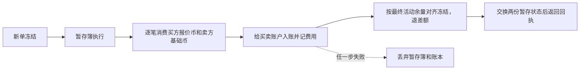

# Day 19 · 成交结算、费用与守恒

## 1. 本期内容与学习目标

本课需要 Day 12–15 的全部事件与 Day 18 的冻结模型，预计 4–5 小时。把逐笔成交、撤减和余量拒绝转换为资产转移。提交前同时核对新簿与新账本，让被拒命令无法改变任何一侧。完成后会从手算的 426 单位冻结推导出卖方入账、买方退款和手续费。

## 2. 业务背景与原理

品种的基础尺度 10，报价尺度 2，每手 maker 费 1、taker 费 3。卖方在 100 排 2 手，买方以预留价 105 买 2 手。实际成交价是 maker 的 100。

| 项目 | 报价币最小单位 | 基础币最小单位 |
| --- | ---: | ---: |
| 买方事前冻结 | 426 | 0 |
| 买方实际支付 | 406 | 取得 20 |
| 卖方入账 | 398 | 消耗冻结 20 |
| 手续费账户入账 | 8 | 0 |
| 买方退回可用 | 20 | 0 |

`426 = 398 + 8 + 20`。若买方是 maker，则买方实际费用用 maker 费。该挂单最初仍用 taker 费计算预留，成交后可释放价差和费差。部分成交的活动买单继续按预留价与 taker 费留足其剩余手数。

每种币独立核对 `可用合计 + 冻结合计 + 费用 = 净入金`。买卖双方即使是同一用户，仍消费各自订单的冻结，再按币种给同一账户入账。课程允许自成交，手续费仍计算。

## 3. Java 原始项目的实现分析

Java R2 在 `handlerRiskRelease` 消费撮合事件。现货买卖分支分别按角色转移资产并记费用。撤减或拒绝释放资金，预算买单退款由总预算与实际支出确定。课程使用逐单冻结余额，先扣实际成交费用，再按最终活动余量重新计算应留额度，多余的统一退回。 [R2 事件入口](https://github.com/exchange-core/exchange-core/blob/2f8548749839e9095c8dc597e4b61521d259fa5d/src/main/java/exchange/core2/core/processors/RiskEngine.java#L558-L621) · [撤减与拒绝](https://github.com/exchange-core/exchange-core/blob/2f8548749839e9095c8dc597e4b61521d259fa5d/src/main/java/exchange/core2/core/processors/RiskEngine.java#L661-L684) · [卖方 taker](https://github.com/exchange-core/exchange-core/blob/2f8548749839e9095c8dc597e4b61521d259fa5d/src/main/java/exchange/core2/core/processors/RiskEngine.java#L687-L735) · [买方 taker](https://github.com/exchange-core/exchange-core/blob/2f8548749839e9095c8dc597e4b61521d259fa5d/src/main/java/exchange/core2/core/processors/RiskEngine.java#L738-L790)

## 4. 本期 C++ 知识

`Trade` 按值拥有身份、方向、价量。先从 taker 方向确定买卖订单与账户，再确定角色费率。`checked_add`、`checked_subtract`、`checked_multiply` 各负责一个单位一致的运算。拒绝量与减量使用已有事件，而冻结核对使用最终簿。这样避免对普通买单和预算买单分别写三套退款公式。

`apply_spot` 的变更只作用于引擎为本命令准备的账本副本。它可以在一半分录已写入时发现失败，返回失败后副本整体销毁。`friend class Engine` 使该边界不会被其他调用者误用。对账户余额写入用 `try_emplace`，它可能分配，仍在提交前。`std::set` 保存受影响订单键，自动去重，避免对同一 taker 连续退款。

## 5. 架构设计与技术选型

可选择生成独立分录并一次性写入，或直接在隔离账本上试算。当前课程选择隔离账本，成本包括复制和多次映射查找，适合验证规则。提交的两个交换放在相邻位置，任何回调都必须在它们之后。风控优先检查新单能否冻结。改价若是卖单，检查新价每手报价额是否覆盖 taker 费。预算卖单无法提前从总额推断每一笔成交是否覆盖费用，逐笔结算会检查，失败放弃本命令。



## 6. 从零逐步实现

### 19.1 在账本写出结算原语

从 `model.hpp` 和 `status_name` 移除 `settlement_required`，改加 `settlement_failed`。在 `ledger.hpp` 前向声明 `class OrderBook;`，在 `Ledger` 私有区增加下列声明。在 `net_deposits_` 后加 `std::map<CurrencyId, std::int64_t> fees_;`，并在 `Ledger::swap` 增加 `fees_.swap(other.fees_);`。公开区增加 `Money fees(CurrencyId currency) const;` 供测试查询。

```cpp
    friend class Engine;

    bool consume(OrderKey key, UserId user, Money amount);
    bool credit(UserId user, Money amount);
    bool apply_trade(const Trade& trade, const SymbolSpec& spec);
    bool align_hold(OrderKey key, const OrderBook& book, const SymbolSpec& spec);
    bool apply_spot(OrderKey primary, const std::vector<Event>& events,
                    const OrderBook& book, const SymbolSpec& spec);
```

在 `ledger.cpp` 顶部加 `#include "exchange/order_book.hpp"` 和 `#include <set>`。在命名空间末尾追加实现。`consume` 只扣有归属的冻结，`credit` 只增加可用余额。`apply_trade` 同时准备两方费率与总额，消费冻结、入账并累计费用。费用计入报价资产。

```cpp
Money Ledger::fees(CurrencyId currency) const {
    return {currency, value_or_zero(fees_, currency)};
}

bool Ledger::consume(OrderKey key, UserId user, Money amount) {
    const auto it = holds_.find({key.symbol, key.order});
    if (it == holds_.end() || it->second.user != user ||
        it->second.money.currency != amount.currency ||
        amount.units < 0 || amount.units > it->second.money.units) {
        return false;
    }
    it->second.money.units -= amount.units;
    return true;
}

bool Ledger::credit(UserId user, Money amount) {
    const auto it = accounts_.find(user);
    if (it == accounts_.end() || amount.units < 0) {
        return false;
    }
    auto& balances = it->second.balances;
    const auto next = checked_add(value_or_zero(balances, amount.currency), amount.units);
    if (!next) {
        return false;
    }
    balances.try_emplace(amount.currency, 0).first->second = *next;
    return true;
}

bool Ledger::apply_trade(const Trade& trade, const SymbolSpec& spec) {
    const bool buy_takes = trade.taker_side == Side::bid;
    const auto buy_key = buy_takes ? trade.taker : trade.maker;
    const auto sell_key = buy_takes ? trade.maker : trade.taker;
    const auto buyer = buy_takes ? trade.taker_user : trade.maker_user;
    const auto seller = buy_takes ? trade.maker_user : trade.taker_user;
    const auto buy_fee_rate = buy_takes ? spec.taker_fee_per_lot : spec.maker_fee_per_lot;
    const auto sell_fee_rate = buy_takes ? spec.maker_fee_per_lot : spec.taker_fee_per_lot;
    const auto base = base_amount(trade.quantity, spec);
    const auto quote = quote_notional(trade.quantity, trade.price, spec);
    const auto buy_fee = checked_multiply(trade.quantity.value(), buy_fee_rate);
    const auto sell_fee = checked_multiply(trade.quantity.value(), sell_fee_rate);
    if (!base || !quote || !buy_fee || !sell_fee || quote->units < *sell_fee) {
        return false;
    }

    const auto buy_paid = checked_add(quote->units, *buy_fee);
    const auto sell_received = checked_subtract(quote->units, *sell_fee);
    const auto fees_paid = checked_add(*buy_fee, *sell_fee);
    if (!buy_paid || !sell_received || !fees_paid) {
        return false;
    }
    const auto fees_after = checked_add(value_or_zero(fees_, spec.quote), *fees_paid);
    if (!fees_after || !consume(buy_key, buyer, {spec.quote, *buy_paid}) ||
        !consume(sell_key, seller, *base) || !credit(buyer, *base) ||
        !credit(seller, {spec.quote, *sell_received})) {
        return false;
    }
    fees_.try_emplace(spec.quote, 0).first->second = *fees_after;
    return true;
}

bool Ledger::align_hold(OrderKey key, const OrderBook& book, const SymbolSpec& spec) {
    const auto hold = holds_.find({key.symbol, key.order});
    if (hold == holds_.end()) {
        return false;
    }

    std::int64_t keep = 0;
    const auto order = book.find_order(key.order);
    if (order) {
        if (order->user != hold->second.user ||
            (order->side == Side::bid && !order->reserve_bid_price)) {
            return false;
        }
        const auto required = order->side == Side::bid
            ? bid_hold(order->remaining, *order->reserve_bid_price, spec)
            : base_amount(order->remaining, spec);
        if (!required || required->currency != hold->second.money.currency ||
            required->units > hold->second.money.units) {
            return false;
        }
        keep = required->units;
    }

    const auto refund = hold->second.money.units - keep;
    if (refund > 0 && !credit(hold->second.user, {hold->second.money.currency, refund})) {
        return false;
    }
    if (keep == 0) {
        holds_.erase(hold);
    } else {
        hold->second.money.units = keep;
    }
    return true;
}

bool Ledger::apply_spot(OrderKey primary, const std::vector<Event>& events,
                        const OrderBook& book, const SymbolSpec& spec) {
    std::set<HoldKey> touched{{primary.symbol, primary.order}};
    for (const auto& event : events) {
        if (const auto* trade = std::get_if<Trade>(&event)) {
            if (!apply_trade(*trade, spec)) {
                return false;
            }
            touched.emplace(trade->maker.symbol, trade->maker.order);
        }
    }
    for (const auto& [symbol, id] : touched) {
        if (!align_hold({symbol, id}, book, spec)) {
            return false;
        }
    }
    return true;
}
```

`align_hold` 对有活动余量的订单保留正确冻结，对离簿订单退回所有未消费金额。`Reduce` 和 `RejectRemainder` 不扣成交资金，主订单已在 `touched`，因此同一退款路径会覆盖撤单、减量、IOC 余量和 FOK 全量拒绝。冻结只以本条命令内的暂存状态为准。

## 7. 测试、调试与验证

创建 `tests/settlement_test.cpp`。但先接上引擎。将 `Engine::dispatch(const T&, Seq)` 从 `auto& market = found->second;` 开始到函数结束前替换为下段。文件补 `#include <utility>`。新单先查活动 ID，再试冻结。改价保留 Day 15 的预留价检查，卖单价格若连每手 taker 费都覆盖不了，先让 `staged->move` 返回正常的所有者等校验结果，只有它处理成功后才做额外检查，最后提交。

```cpp
    auto& market = found->second;
    auto staged_ledger = ledger_;
    if constexpr (std::is_same_v<T, PlaceOrder>) {
        if (market.book->find_order(command.key.order)) {
            return {Status::duplicate_order, {}};
        }
        const auto frozen = staged_ledger.freeze(command, market.spec);
        if (frozen != Status::processed) {
            return {frozen, {}};
        }
    }

    auto staged = OrderBook::from_resting(market.spec.symbol, market.book->resting_orders());
    auto result = [&] {
        if constexpr (std::is_same_v<T, PlaceOrder>) {
            return staged->place(command, seq);
        } else if constexpr (std::is_same_v<T, CancelOrder>) {
            return staged->cancel(command);
        } else if constexpr (std::is_same_v<T, ReduceOrder>) {
            return staged->reduce(command);
        } else {
            static_assert(std::is_same_v<T, MoveOrder>);
            return staged->move(command, seq);
        }
    }();
    if (result.status != Status::processed) {
        return result;
    }
    if constexpr (std::is_same_v<T, MoveOrder>) {
        const auto original = market.book->find_order(command.key.order);
        if (original && original->side == Side::ask) {
            const auto per_lot = quote_notional(Quantity{1}, command.new_price, market.spec);
            if (!per_lot || per_lot->units < market.spec.taker_fee_per_lot) {
                return {Status::invalid_input, {}};
            }
        }
    }
    if (!staged_ledger.apply_spot(command.key, result.events, *staged, market.spec)) {
        return {Status::settlement_failed, {}};
    }
    market.book.swap(staged);
    ledger_.swap(staged_ledger);
    return result;
```

恢复 Day 17 取消成功的三行断言，保留 Day 18 账户设置和更新后的序号。接着把以下内容写入 `tests/settlement_test.cpp`。每个独立场景都创建新引擎，防止前一用例余额影响下一用例。

```cpp
#include "exchange/engine.hpp"
#include "test_checks.hpp"

#include <limits>

using namespace exchange;

namespace {

const SymbolSpec spec{SymbolId{1}, CurrencyId{10}, CurrencyId{20}, 10, 2, 1, 3};
const UserId buyer{1};
const UserId seller{2};

Status status(Engine& engine, Command command) {
    return engine.execute(command).outcome.status;
}

void fund(Engine& engine, TestChecks& checks, const SymbolSpec& market = spec) {
    checks.require(status(engine, RegisterSymbol{market}) == Status::processed &&
                   status(engine, AddUser{buyer}) == Status::processed &&
                   status(engine, AddUser{seller}) == Status::processed &&
                   status(engine, AdjustBalance{buyer, {market.quote, 1000}, 1}) == Status::processed &&
                   status(engine, AdjustBalance{seller, {market.base, 50}, 1}) == Status::processed,
                   "fund buyer and seller");
}

PlaceOrder make(std::uint64_t id, UserId user, Side side, std::int64_t quantity,
                OrderConstraint constraint) {
    return {{spec.symbol, OrderId{id}}, user, side, Quantity{quantity}, constraint, 0};
}

}

int main() {
    TestChecks checks;
    const auto ask = make(7, seller, Side::ask, 2, LimitPrice{Price{100}, LimitPolicy::gtc, {}});
    const auto bid = make(8, buyer, Side::bid, 2, LimitPrice{Price{105}, LimitPolicy::gtc, {}});
    Engine buy_takes;
    fund(buy_takes, checks);
    checks.require(status(buy_takes, ask) == Status::processed &&
                   status(buy_takes, bid) == Status::processed &&
                   buy_takes.ledger().available(buyer, spec.base) == Money{spec.base, 20} &&
                   buy_takes.ledger().available(buyer, spec.quote) == Money{spec.quote, 594} &&
                   buy_takes.ledger().available(seller, spec.quote) == Money{spec.quote, 398} &&
                   buy_takes.ledger().fees(spec.quote) == Money{spec.quote, 8} &&
                   !buy_takes.ledger().held(bid.key), "426 equals 398 plus 20 plus 8");

    Engine sell_takes;
    fund(sell_takes, checks);
    auto passive = bid;
    passive.quantity = Quantity{3};
    passive.constraint = LimitPrice{Price{100}, LimitPolicy::gtc, Price{105}};
    checks.require(status(sell_takes, passive) == Status::processed &&
                   status(sell_takes, ask) == Status::processed &&
                   sell_takes.ledger().available(buyer, spec.quote) == Money{spec.quote, 385} &&
                   sell_takes.ledger().available(seller, spec.quote) == Money{spec.quote, 394} &&
                   sell_takes.ledger().held(bid.key) == Money{spec.quote, 213},
                   "maker fee and price improvement refund");
    checks.require(status(sell_takes, CancelOrder{bid.key, buyer}) == Status::processed &&
                   sell_takes.ledger().available(buyer, spec.quote) == Money{spec.quote, 598} &&
                   !sell_takes.ledger().held(bid.key), "cancel refunds remaining hold");

    Engine ioc;
    fund(ioc, checks);
    const auto three = make(8, buyer, Side::bid, 3, LimitPrice{Price{105}, LimitPolicy::ioc, {}});
    checks.require(status(ioc, ask) == Status::processed, "seed IOC");
    const auto partial = ioc.execute(three);
    checks.require(partial.outcome.events.size() == 2 &&
                   ioc.ledger().available(buyer, spec.quote) == Money{spec.quote, 594} &&
                   !ioc.ledger().held(three.key), "IOC refunds tail");

    Engine fok;
    fund(fok, checks);
    checks.require(status(fok, ask) == Status::processed, "seed FOK");
    auto budget = make(8, buyer, Side::bid, 2, BudgetLimit{NotionalSteps{199}});
    checks.require(status(fok, budget) == Status::processed &&
                   fok.ledger().available(buyer, spec.quote) == Money{spec.quote, 1000} &&
                   !fok.ledger().held(budget.key), "failed FOK refunds all");
    budget.constraint = BudgetLimit{NotionalSteps{210}};
    checks.require(status(fok, budget) == Status::processed &&
                   fok.ledger().available(buyer, spec.quote) == Money{spec.quote, 594},
                   "successful FOK refunds unused budget");

    Engine amend;
    fund(amend, checks);
    auto deeper = bid;
    deeper.quantity = Quantity{4};
    deeper.constraint = LimitPrice{Price{99}, LimitPolicy::gtc, Price{105}};
    checks.require(status(amend, ask) == Status::processed &&
                   status(amend, deeper) == Status::processed &&
                   status(amend, MoveOrder{bid.key, buyer, Price{100}}) == Status::processed &&
                   amend.ledger().held(bid.key) == Money{spec.quote, 426}, "partial move keeps reserve");
    checks.require(status(amend, ReduceOrder{bid.key, buyer, Quantity{1}}) == Status::processed &&
                   amend.ledger().held(bid.key) == Money{spec.quote, 213} &&
                   amend.ledger().available(buyer, spec.quote) == Money{spec.quote, 381},
                   "reduce refunds one lot");

    Engine same_user;
    fund(same_user, checks);
    auto own_ask = ask;
    own_ask.user = buyer;
    checks.require(status(same_user, AdjustBalance{buyer, {spec.base, 20}, 2}) == Status::processed &&
                   status(same_user, own_ask) == Status::processed &&
                   status(same_user, bid) == Status::processed &&
                   same_user.ledger().available(buyer, spec.base) == Money{spec.base, 20} &&
                   same_user.ledger().available(buyer, spec.quote) == Money{spec.quote, 992} &&
                   same_user.ledger().fees(spec.quote) == Money{spec.quote, 8}, "same account both roles");

    const auto max = std::numeric_limits<std::int64_t>::max();
    auto huge = bid;
    huge.constraint = LimitPrice{Price{max}, LimitPolicy::gtc, {}};
    const auto saved = amend.book_orders(spec.symbol);
    huge.key.order = OrderId{99};
    checks.require(status(amend, huge) == Status::invalid_input &&
                   amend.book_orders(spec.symbol) == saved &&
                   amend.ledger().available(buyer, spec.quote) == Money{spec.quote, 381},
                   "overflow before committing");

    Engine rejected;
    auto cheap = spec;
    cheap.quote_scale = 1;
    cheap.maker_fee_per_lot = 0;
    fund(rejected, checks, cheap);
    const auto low_bid = make(9, buyer, Side::bid, 1, LimitPrice{Price{1}, LimitPolicy::gtc, {}});
    const auto high_bid = make(11, buyer, Side::bid, 1, LimitPrice{Price{4}, LimitPolicy::gtc, {}});
    checks.require(status(rejected, low_bid) == Status::processed &&
                   status(rejected, high_bid) == Status::processed, "seed two bid levels");
    const auto original = rejected.book_orders(spec.symbol);
    const auto sell_budget = make(10, seller, Side::ask, 2, BudgetLimit{NotionalSteps{5}});
    const auto failed = rejected.execute(sell_budget);
    checks.require(failed.outcome == CommandResult{Status::settlement_failed, {}} &&
                   rejected.book_orders(spec.symbol) == original &&
                   rejected.ledger().available(seller, spec.base) == Money{spec.base, 50} &&
                   rejected.ledger().available(seller, spec.quote) == Money{spec.quote, 0} &&
                   rejected.ledger().available(buyer, spec.base) == Money{spec.base, 0} &&
                   rejected.ledger().available(buyer, spec.quote) == Money{spec.quote, 989} &&
                   rejected.ledger().fees(spec.quote) == Money{spec.quote, 0} &&
                   rejected.ledger().held(low_bid.key) == Money{spec.quote, 4} &&
                   rejected.ledger().held(high_bid.key) == Money{spec.quote, 7} &&
                   !rejected.ledger().held(sell_budget.key), "second trade refusal rolls back both");
    return checks.exit_code();
}
```

注册测试，运行 `cmake --build build-debug` 和 `ctest --test-dir build-debug --output-on-failure`，预期 18 项。多配置沿用 Day 18。若买方 maker 少退钱，核对它冻结时使用 taker 费而成交使用 maker 费。若卖单预算接受却无法结算，检查是否某笔成交报价低于费用。末例先以 4 成交一手，暂存账本已记入费用和收款。第二笔以 1 成交时卖方收入不足以支付费率，整条命令回退，两档和两笔买方冻结都保持原值。

```cmake
add_executable(settlement_tests tests/settlement_test.cpp)
target_link_libraries(settlement_tests PRIVATE exchange_core)
add_test(NAME settlement COMMAND settlement_tests)
```

## 8. Java 与 C++ 实现深度对比

Java 的 R2 可聚合同一方的多笔成交后再入账，课程以冻结余额和单笔成交驱动，便于一步步手算。课程的所有事件只在两份状态成功交换后返回。显式冻结让账本可以独立汇总待释放资金，也增加了与活动订单数量对齐的责任。

## 9. 课后练习

1. **基础。** 解释买方 maker 用例里的 385、394、213 和 8 如何守恒。
2. **工程。** 在卖方预算失败夹具中，把第二档从 1 提到 3，最低收入仍为 5。写出成功后的报价币余额和费用。
3. **思考。** 一条 GTC 买单部分成交后挂簿，为什么不能退回所有未花掉的余额？

## 10. 总结与下一期

现货买卖、费用和冻结可随簿一同提交。Day 20 将把这些值汇总成单用户报告与币种守恒报告，并交付可跟做的双品种演示。

[Day 18](day-18.md) · [课程目录](../00-overview/learning-roadmap.md) · [Day 20](day-20.md)

<details>
<summary>练习参考答案</summary>

1. 买方已付 402，剩余冻结 213，因此可用 385。卖方实收 394，费用 8，合计 `385+213+394+8=1000`。
2. 成交价为 4、3，卖方净收入为 1，买方作为 maker 实付 7，报价可用为 993，费用账户有 6。两笔挂单及其冻结都应清除。
3. 后续 maker 成交仍要能支付预留价与费率要求。只退目前冻结与剩余目标冻结的差。

</details>
