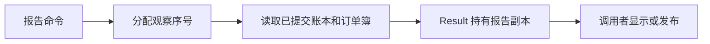

# Day 20 · 结果发布、报告和集成夹具

## 1. 本期内容与学习目标

本课需要 Day 19 的现货结算和 Day 11 的值快照，预计 3–4 小时。加入批量初始化、按序号观察的单用户和币种报告，以及可复现的状态指纹。最后让演示程序跑一遍登记、入金、成交、撤余量与查询，用两品种测试核对跨模块行为。

## 2. 业务背景与原理

买方以 105 买 3 手，实际与 100 的两手卖单成交。报价币初始入金 1000，成交花 406，余下 1 手还需冻结 213，可用为 381。卖方收到 398，交易所费用为 8。账户报告应显示买方持有的挂单与冻结，币种报告应得到 `381+398+213+8=1000`。撤掉余量后，冻结变为 0，买方可用变为 594。

报告取当前已提交状态并携带本条查询的序号。旧报告保留在调用者手里，撤单之后仍能显示先前的冻结额。教学引擎的回调在 `execute` 返回后由调用者触发。外部回调抛异常时，命令已经提交，不能据此重试一笔已成交订单。

## 3. Java 原始项目的实现分析

Java 的单用户报告合并风险分片账户和撮合分片活动单。总余额查询聚合账户、锁定金额、费用、调整和其他风险数据。状态哈希报告把多个子模块的摘要合并。批量账户和品种用二进制帧传递；`SimpleEventsProcessor` 对外发送结果和事件。课程用结构化批量命令、独立值报告和显式发布边界，保留查询意图。 [单用户报告](https://github.com/exchange-core/exchange-core/blob/2f8548749839e9095c8dc597e4b61521d259fa5d/src/main/java/exchange/core2/core/common/api/reports/SingleUserReportQuery.java#L58-L106) · [币种余额报告](https://github.com/exchange-core/exchange-core/blob/2f8548749839e9095c8dc597e4b61521d259fa5d/src/main/java/exchange/core2/core/common/api/reports/TotalCurrencyBalanceReportQuery.java#L51-L113) · [状态哈希报告](https://github.com/exchange-core/exchange-core/blob/2f8548749839e9095c8dc597e4b61521d259fa5d/src/main/java/exchange/core2/core/common/api/reports/StateHashReportQuery.java#L49-L117) · [批量帧](https://github.com/exchange-core/exchange-core/blob/2f8548749839e9095c8dc597e4b61521d259fa5d/src/main/java/exchange/core2/core/processors/BinaryCommandsProcessor.java#L95-L147) · [事件发布](https://github.com/exchange-core/exchange-core/blob/2f8548749839e9095c8dc597e4b61521d259fa5d/src/main/java/exchange/core2/core/SimpleEventsProcessor.java#L23-L35)

## 4. 本期 C++ 知识

`std::monostate` 表示回执没有查询载荷。`Report` 是一个 `variant`，调用者可用 `get_if` 检查载荷。报告内的向量拥有值，`report.accounts` 等数据不会引用账本节点。已排序的 `map` 让按币种、用户、品种和订单键输出稳定。盘口按卖、买及各档 FIFO 的规范顺序输出。

64 位指纹按 FNV-1a 的字节处理方式对规范字段混合。`uint64_t` 的乘法按模 $2^{64}$ 运算，回绕是算法的一部分。哈希只用于快速对比，碰撞时仍要比较规范值。指纹覆盖品种规格、活动订单、账户、冻结、费用、净入金及资金流水。查询和失败命令消耗的序号不计入业务状态指纹。 [FNV-1a 运算](https://www.rfc-editor.org/rfc/rfc9923.html#section-2) · [C++ 无符号整数运算](https://eel.is/c++draft/basic.fundamental)

## 5. 架构设计与技术选型

可以把每个查询交给不同模块直接读取，或让所有查询走同步引擎的一个序号边界。课程使用后者。报告直接读取账本字段。当前单用户报告逐市场复制活动订单序列再过滤，成本随全市场活动量增长。初始化批次先验证所有条目，再用暂存状态提交。批量注册品种示例重建目录以提供和账本一致的强保证，成本随现有目录和簿大小增长。生产热路径可改为预分配的新目录节点或局部事务。



## 6. 从零逐步实现

### 20.1 定义批量命令与报告载荷

在 `model.hpp` 的 `Command` 别名前加以下类型，并扩展别名。`QueryTotals` 和 `QueryFingerprint` 没有参数。`QueryUser` 通过用户 ID 指定范围。

```cpp
struct RegisterSymbols { std::vector<SymbolSpec> specs; };
struct AddUsers { std::vector<UserId> users; };
struct QueryUser { UserId user; };
struct QueryTotals {};
struct QueryFingerprint {};

using Command = std::variant<PlaceOrder, CancelOrder, ReduceOrder, MoveOrder, RegisterSymbol,
                             AddUser, AdjustBalance, SuspendUser, ResumeUser,
                             RegisterSymbols, AddUsers, QueryUser, QueryTotals, QueryFingerprint>;
```

在 `CheckCommand` 增加重载。批量形状校验只拒绝空输入，重复项或无效成员由暂存目录与账本拒绝。引擎仍须在调用空批次时使用这里的校验。

```cpp
    bool operator()(const RegisterSymbols& cmd) const { return !cmd.specs.empty(); }
    bool operator()(const AddUsers& cmd) const { return !cmd.users.empty(); }
    bool operator()(const QueryUser& cmd) const { return cmd.user.value() > 0; }
    bool operator()(const QueryTotals&) const { return true; }
    bool operator()(const QueryFingerprint&) const { return true; }
```

在 `model.hpp` 中用下段替换 `Result` 的定义。旧代码仍可通过 `{seq, outcome}` 初始化，报告会使用默认的 `monostate`。

```cpp
struct FrozenOrder {
    OrderKey key;
    Money amount;
    bool operator==(const FrozenOrder&) const = default;
};

struct UserReport {
    UserId user;
    bool suspended;
    std::uint64_t last_funding;
    std::vector<Money> available;
    std::vector<FrozenOrder> frozen;
    std::vector<RestingOrder> orders;
};

struct CurrencyTotals {
    CurrencyId currency;
    std::int64_t available{};
    std::int64_t frozen{};
    std::int64_t fees{};
    std::int64_t net_deposits{};
    bool conserved() const;
};

struct TotalsReport {
    std::vector<CurrencyTotals> currencies;
};

struct StateFingerprint {
    std::uint64_t value;
};

using Report = std::variant<std::monostate, UserReport, TotalsReport, StateFingerprint>;

struct Result {
    Seq seq;
    CommandResult outcome;
    Report report{};
};
```

### 20.2 从账本提取可审计值

在 `Ledger` 公开区加下列方法。`append_canonical` 输出有标签和分隔符的规范数字文本，用于本课程的指纹实验。零余额槽和账户状态属于当前内部表示的一部分。Day 28–29 的日志与快照会定义显式编码，不依赖这份文本。

```cpp
    std::optional<UserReport> user_report(UserId user) const;
    TotalsReport totals() const;
    void append_canonical(std::string& out) const;
```

在 `ledger.cpp` 的 `namespace exchange` 末尾追加实现，并添加 `#include <stdexcept>`。`accumulate` 遇到内部总额越界会报告逻辑错误。日常命令已限制每币种净入金在可表示范围内，且所有分项非负。`try_emplace` 只创建缺少的币种行。

```cpp
bool CurrencyTotals::conserved() const {
    const auto reserved = checked_add(available, frozen);
    if (!reserved) {
        return false;
    }
    const auto total = checked_add(*reserved, fees);
    return total && *total == net_deposits;
}

std::optional<UserReport> Ledger::user_report(UserId user) const {
    const auto it = accounts_.find(user);
    if (it == accounts_.end()) {
        return std::nullopt;
    }
    UserReport report{user, it->second.suspended, it->second.last_funding, {}, {}, {}};
    for (const auto& [currency, units] : it->second.balances) {
        report.available.push_back({currency, units});
    }
    for (const auto& [key, hold] : holds_) {
        if (hold.user == user) {
            report.frozen.push_back({{key.first, key.second}, hold.money});
        }
    }
    return report;
}

TotalsReport Ledger::totals() const {
    std::map<CurrencyId, CurrencyTotals> rows;
    const auto row = [&rows](CurrencyId currency) -> CurrencyTotals& {
        return rows.try_emplace(currency, CurrencyTotals{currency}).first->second;
    };
    const auto accumulate = [](std::int64_t& field, std::int64_t amount) {
        const auto next = checked_add(field, amount);
        if (!next) {
            throw std::logic_error{"ledger report total out of range"};
        }
        field = *next;
    };

    for (const auto& account : accounts_) {
        for (const auto& [currency, units] : account.second.balances) {
            accumulate(row(currency).available, units);
        }
    }
    for (const auto& entry : holds_) {
        const auto& amount = entry.second.money;
        accumulate(row(amount.currency).frozen, amount.units);
    }
    for (const auto& [currency, units] : fees_) {
        row(currency).fees = units;
    }
    for (const auto& [currency, units] : net_deposits_) {
        row(currency).net_deposits = units;
    }

    TotalsReport report;
    report.currencies.reserve(rows.size());
    for (const auto& entry : rows) {
        report.currencies.push_back(entry.second);
    }
    return report;
}

void Ledger::append_canonical(std::string& out) const {
    const auto number = [&out](auto value) {
        out += std::to_string(value);
        out += ',';
    };
    for (const auto& [id, account] : accounts_) {
        out += "user:";
        number(id.value());
        number(account.last_funding);
        number(account.suspended);
        for (const auto& [currency, units] : account.balances) {
            out += "available:";
            number(currency.value());
            number(units);
        }
    }
    for (const auto& [key, hold] : holds_) {
        out += "frozen:";
        number(key.first.value());
        number(key.second.value());
        number(hold.user.value());
        number(hold.money.currency.value());
        number(hold.money.units);
    }
    for (const auto& [currency, units] : fees_) {
        out += "fees:";
        number(currency.value());
        number(units);
    }
    for (const auto& [currency, units] : net_deposits_) {
        out += "net:";
        number(currency.value());
        number(units);
    }
}
```

### 20.3 在引擎完成查询与批量提交

在 `Engine` 私有区加下面的声明和函数模板。`answer` 通用分支封装写命令回执，查询通过具体重载返回报告。`execute` 中保留序号分配，最后一行改为 `return std::visit([&](const auto& input) { return answer(input, seq); }, command);`。

```cpp
    CommandResult dispatch(const RegisterSymbols& command, Seq seq);
    CommandResult dispatch(const AddUsers& command, Seq seq);

    Result answer(const QueryUser& command, Seq seq);
    Result answer(const QueryTotals& command, Seq seq);
    Result answer(const QueryFingerprint& command, Seq seq);

    template<class T>
    Result answer(const T& command, Seq seq) {
        return {seq, dispatch(command, seq)};
    }
```

查询方法体只读取业务状态。三个具体重载和通用模板都在非 const 的 `Engine` 上调用，具体重载优先。

在 `src/engine.cpp` 命名空间结尾前追加实现。批量品种注册先重建目录，再插入所有新规格。重建过程中出错会释放本地目录。`RegisterSymbols` 成功前不交换。单用户报告按品种稳定顺序合并活动订单。

```cpp
CommandResult Engine::dispatch(const RegisterSymbols& command, Seq) {
    if (!validate_command(command)) {
        return {Status::invalid_input, {}};
    }
    SymbolCatalog staged;
    for (const auto& [id, market] : catalog_.markets_) {
        staged.markets_.try_emplace(id, SymbolCatalog::Market{
            market.spec, OrderBook::from_resting(id, market.book->resting_orders())});
    }
    for (const auto& spec : command.specs) {
        const auto status = staged.add(spec);
        if (status != Status::processed) {
            return {status, {}};
        }
    }
    catalog_.markets_.swap(staged.markets_);
    return {Status::processed, {}};
}

CommandResult Engine::dispatch(const AddUsers& command, Seq) {
    if (!validate_command(command)) {
        return {Status::invalid_input, {}};
    }
    auto staged = ledger_;
    for (const auto user : command.users) {
        const auto status = staged.add_user(user);
        if (status != Status::processed) {
            return {status, {}};
        }
    }
    ledger_.swap(staged);
    return {Status::processed, {}};
}

Result Engine::answer(const QueryUser& command, Seq seq) {
    if (!validate_command(command)) {
        return {seq, {Status::invalid_input, {}}};
    }
    auto report = ledger_.user_report(command.user);
    if (!report) {
        return {seq, {Status::unknown_user, {}}};
    }
    for (const auto& entry : catalog_.markets_) {
        for (const auto& order : entry.second.book->resting_orders()) {
            if (order.user == command.user) {
                report->orders.push_back(order);
            }
        }
    }
    return {seq, {Status::processed, {}}, std::move(*report)};
}

Result Engine::answer(const QueryTotals&, Seq seq) {
    return {seq, {Status::processed, {}}, ledger_.totals()};
}

Result Engine::answer(const QueryFingerprint&, Seq seq) {
    std::string canonical;
    ledger_.append_canonical(canonical);
    const auto number = [&canonical](auto value) {
        canonical += std::to_string(value);
        canonical += ',';
    };
    for (const auto& [id, market] : catalog_.markets_) {
        const auto& spec = market.spec;
        canonical += "symbol:";
        number(id.value());
        number(spec.base.value());
        number(spec.quote.value());
        number(spec.base_scale);
        number(spec.quote_scale);
        number(spec.maker_fee_per_lot);
        number(spec.taker_fee_per_lot);
        for (const auto& order : market.book->resting_orders()) {
            canonical += "order:";
            number(order.key.order.value());
            number(order.user.value());
            number(order.side == Side::bid);
            number(order.price.value());
            number(order.remaining.value());
            number(order.reserve_bid_price.has_value());
            number(order.reserve_bid_price ? order.reserve_bid_price->value() : 0);
            number(order.priority_seq.value());
            number(order.timestamp_ns);
        }
    }

    std::uint64_t hash = 14695981039346656037ULL;
    for (const char ch : canonical) {
        hash ^= static_cast<unsigned char>(ch);
        hash *= 1099511628211ULL;
    }
    return {seq, {Status::processed, {}}, StateFingerprint{hash}};
}
```

指纹忽略查询序号本身，但包含活动挂单的 `priority_seq`，该字段影响同价顺序。输入的业务序号如果改变，指纹可以随之改变。

## 7. 测试、调试与验证

### 验收两品种、守恒与发布边界

创建 `tests/spot_integration_test.cpp`。把同号订单挂到第二品种，撤第一品种的余量时保留第二品种。报告检查按币种汇总，并保留撤单前的回执。故意让外部发布函数抛异常，再通过查询证明撤单已提交。

```cpp
#include "exchange/engine.hpp"
#include "test_checks.hpp"

#include <algorithm>
#include <stdexcept>

int main() {
    using namespace exchange;
    TestChecks checks;
    Engine engine;
    const SymbolSpec a{SymbolId{1}, CurrencyId{10}, CurrencyId{20}, 10, 2, 1, 3};
    auto b = a;
    b.symbol = SymbolId{2};
    const UserId buyer{1};
    const UserId seller{2};
    const auto status = [&](Command cmd) { return engine.execute(cmd).outcome.status; };
    checks.require(status(RegisterSymbols{{a, b}}) == Status::processed &&
                   status(AddUsers{{buyer, seller}}) == Status::processed, "batch initialization");
    auto c = a;
    c.symbol = SymbolId{3};
    checks.require(status(RegisterSymbols{{c, b}}) == Status::symbol_exists &&
                   !engine.book_orders(c.symbol), "atomic symbol batch");
    checks.require(status(AddUsers{{UserId{3}, buyer}}) == Status::user_exists &&
                   !engine.ledger().available(UserId{3}, a.quote), "atomic user batch");
    checks.require(status(AdjustBalance{buyer, {a.quote, 1000}, 1}) == Status::processed &&
                   status(AdjustBalance{seller, {a.base, 50}, 1}) == Status::processed, "fund");

    const PlaceOrder ask{{a.symbol, OrderId{7}}, seller, Side::ask, Quantity{2},
                         LimitPrice{Price{100}, LimitPolicy::gtc, {}}, 0};
    const PlaceOrder bid{{a.symbol, OrderId{8}}, buyer, Side::bid, Quantity{3},
                         LimitPrice{Price{105}, LimitPolicy::gtc, {}}, 0};
    auto other = bid;
    other.key.symbol = b.symbol;
    other.quantity = Quantity{1};
    other.constraint = LimitPrice{Price{80}, LimitPolicy::gtc, {}};

    checks.require(status(ask) == Status::processed && status(bid) == Status::processed &&
                   status(other) == Status::processed, "two markets with shared order id");
    const auto old = engine.execute(QueryUser{buyer});
    const auto* view = std::get_if<UserReport>(&old.report);
    checks.require(view && view->orders.size() == 2 && view->frozen ==
                   std::vector<FrozenOrder>{{bid.key, {a.quote, 213}},
                                            {other.key, {a.quote, 163}}},
                   "report aligns holds and active orders");
    const auto first = std::get<StateFingerprint>(engine.execute(QueryFingerprint{}).report).value;
    const auto second = std::get<StateFingerprint>(engine.execute(QueryFingerprint{}).report).value;
    checks.require(first == second, "read does not change fingerprint");

    const auto cancelled = engine.execute(CancelOrder{bid.key, buyer});
    const auto publish = [](const Result&) { throw std::runtime_error{"subscriber error"}; };
    bool caught = false;
    try {
        publish(cancelled);
    } catch (const std::runtime_error&) {
        caught = true;
    }
    const auto current = engine.execute(QueryUser{buyer});
    const auto* now = std::get_if<UserReport>(&current.report);
    checks.require(caught && cancelled.outcome.status == Status::processed &&
                   old.seq < cancelled.seq && cancelled.seq < current.seq &&
                   view && view->frozen.size() == 2 && now &&
                   now->frozen == std::vector<FrozenOrder>{{other.key, {a.quote, 163}}} &&
                   now->orders.size() == 1 && now->orders.front().key == other.key,
                   "callback failure leaves committed cancel and old report");
    checks.require(std::get<StateFingerprint>(engine.execute(QueryFingerprint{}).report).value !=
                   first, "write changes fingerprint");

    const auto totals = engine.execute(QueryTotals{});
    const auto& rows = std::get<TotalsReport>(totals.report).currencies;
    checks.require(rows.size() == 2 &&
                   std::all_of(rows.begin(), rows.end(),
                               [](const auto& row) { return row.conserved(); }),
                   "conservation for both currencies");
    if (rows.size() == 2) {
        const auto& quote = rows.at(1);
        checks.require(quote.currency == a.quote && quote.available == 829 &&
                       quote.frozen == 163 && quote.fees == 8 && quote.net_deposits == 1000,
                       "quote conservation details");
    }
    return checks.exit_code();
}
```

### 跑一遍可观察的命令序列

创建 `app/spot_demo.cpp`。这个最小演示使用结构化命令，避免把输入解析混入结算课。`show` 在执行返回后打印回执。

```cpp
#include "exchange/engine.hpp"

#include <iostream>

int main() {
    using namespace exchange;
    Engine engine;
    const SymbolSpec spec{SymbolId{1}, CurrencyId{10}, CurrencyId{20}, 10, 2, 1, 3};
    const UserId buyer{1};
    const UserId seller{2};
    const OrderKey bid{spec.symbol, OrderId{8}};
    const auto show = [&](const Command& command) {
        const auto result = engine.execute(command);
        std::cout << describe_result(result) << '\n';
        return result.outcome.status == Status::processed;
    };

    if (!show(RegisterSymbols{{spec}}) || !show(AddUsers{{buyer, seller}}) ||
        !show(AdjustBalance{buyer, {spec.quote, 1000}, 1}) ||
        !show(AdjustBalance{seller, {spec.base, 20}, 1}) ||
        !show(PlaceOrder{{spec.symbol, OrderId{7}}, seller, Side::ask, Quantity{2},
                         LimitPrice{Price{100}, LimitPolicy::gtc, {}}, 0}) ||
        !show(PlaceOrder{bid, buyer, Side::bid, Quantity{3},
                         LimitPrice{Price{105}, LimitPolicy::gtc, {}}, 0}) ||
        !show(CancelOrder{bid, buyer})) {
        return 1;
    }

    const auto report = engine.execute(QueryTotals{});
    std::cout << "report seq=" << report.seq.value() << '\n';
    for (const auto& row : std::get<TotalsReport>(report.report).currencies) {
        std::cout << "currency=" << row.currency.value() << " available=" << row.available
                  << " frozen=" << row.frozen << " fees=" << row.fees
                  << " net=" << row.net_deposits << '\n';
        if (!row.conserved()) {
            return 1;
        }
    }
    return 0;
}
```

追加目标后运行 `cmake --build build-debug`、`ctest --test-dir build-debug --output-on-failure` 和 `./build-debug/spot_demo`。多配置版本用 `--config Debug`、`-C Debug`，演示程序在对应配置子目录下。预期 19 项测试。演示在序号 6 产生 `trade maker=7 taker=8 price=100 qty=2`，序号 7 释放余量，序号 8 报告报价币 `available=992 frozen=0 fees=8 net=1000`。若总额少 8，检查是否将手续费单列。若查询后指纹改变，检查是否把当前查询序号混入了指纹。

本阶段从 Day 01 的 Markdown 示例按课重建。在 macOS arm64、Apple Clang 17、CMake 4.3.1 下，Debug、Release 和 ASan/UBSan 各通过 19 项 CTest，现货演示输出与上面的手算结果一致。

```cmake
add_executable(spot_integration_tests tests/spot_integration_test.cpp)
target_link_libraries(spot_integration_tests PRIVATE exchange_core)
add_test(NAME spot_integration COMMAND spot_integration_tests)

add_executable(spot_demo app/spot_demo.cpp)
target_link_libraries(spot_demo PRIVATE exchange_core)
```

## 8. Java 与 C++ 实现深度对比

Java 跨风险与撮合分片归并报告，课程当前在单所有者上读取同一个已提交切点。Java 的结果适配器把内部结构变成业务回调，课程的 `Result` 已拥有回执和报告，消费者可以在提交后独立处理。展示、异常回调和持久化会分别考虑交付边界，查询指纹也只作为状态比较工具。

## 9. 课后练习

1. **基础。** 查询一个不存在的用户，检查 `unknown_user`、有效序号和空报告。
2. **工程。** 在集成用例最后撤掉第二品种的订单，验证报价币可用合计 992、冻结 0、费用 8。
3. **思考。** 为什么成功撤单后外部发布失败不能直接重发原请求来恢复通知？

## 10. 总结与下一期

第五阶段完成了多品种现货端到端。买卖和费用能按币种核对，旧回执可以跨后续命令保存。Day 21 将用这套同步入口和固定负载建立性能基线，量化簿和账本暂存的成本。

[Day 19](day-19.md) · [继续阅读 Day 21 · 为吞吐和尾延迟建立基线](../06-performance/day-21.md)

<details>
<summary>练习参考答案</summary>

1. `execute(QueryUser{UserId{999}})` 得到 `Status::unknown_user`，`std::holds_alternative<std::monostate>(result.report)` 为真。
2. 撤掉 `other.key`，查询 `QueryTotals`。原可用 829 加回 163，得到 992，净入金仍是 1000。
3. 撤单已提交，重复命令会遇到已不存在的活动单。通知应重用已保存的回执和原序号，或通过查询重新对账。

</details>
