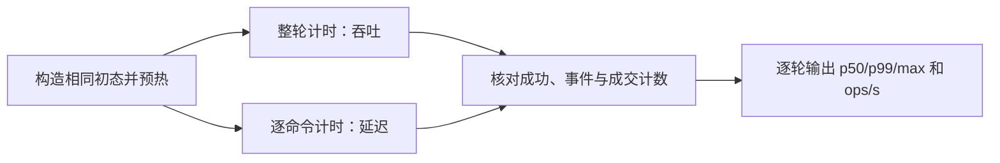

# Day 21 · 为吞吐和尾延迟建立基线

## 1. 本期内容与学习目标

本课以 Day 20 的同步现货引擎和 Day 05 的 Release 构建为前置，预计 2–3 小时。写一个可复现的基准程序，分别测挂单、撤单、跨档成交和混合命令。计时边界是 `Engine::execute`，因此包含路由、暂存、风控、撮合和结算。下课再用小实验隔离具体成本。

## 2. 业务背景与原理

每秒执行多少条命令由整批时间决定。尾延迟关心单条命令的慢样本。假设 99 条各花 10 微秒，一条花 3 毫秒，单次停顿就能拉高平均耗时，还可能在在线队列中拖慢其后的多条命令。按 nearest-rank 定义，100 个样本的 p99 是排序后第 99 个，最慢的一条还需要看最大值。报告同时保留事件和成交笔数，防止把一个因拒绝而更快的工作负载误当作优化。

## 3. Java 原始项目的实现分析

Java 的吞吐测试预填状态后批量提交并等待处理完成。延迟用例设置计划发送时间，结果回调读取 `System.nanoTime()` 并记录 HdrHistogram。Java 链路包括 Disruptor 和线程交接，本课的 C++ 基线是同步调用。两个测量的端点和负载均应分别记录。 [吞吐用例](https://github.com/exchange-core/exchange-core/blob/2f8548749839e9095c8dc597e4b61521d259fa5d/src/test/java/exchange/core2/tests/util/ThroughputTestsModule.java) · [计划发送与回调计时](https://github.com/exchange-core/exchange-core/blob/2f8548749839e9095c8dc597e4b61521d259fa5d/src/test/java/exchange/core2/tests/util/LatencyTestsModule.java#L74-L128) · [原项目测试配置](https://github.com/exchange-core/exchange-core/blob/2f8548749839e9095c8dc597e4b61521d259fa5d/README.md#L259-L263)

## 4. 本期 C++ 知识

`std::chrono::steady_clock` 的时间点单调，适合测区间。两个时间点相减得到 duration。`duration_cast<nanoseconds>` 按纳秒表示区间，`duration<double>` 默认以秒表示。时钟读数的精度和读取成本由平台决定。逐条测延迟会增加两次时钟调用，因此吞吐与延迟用独立回合，输入一致，延迟回合预分配样本向量。 [steady_clock 规范](https://eel.is/c++draft/time.clock.steady)

这里采用闭环负载，每条命令完成才发下一条。服务变慢时，新请求也随之变少，这会遗漏真实定速到达下的等待时间，称为 coordinated omission。若要测排队尾延迟，需要从独立计划到达时间计到完成，并记录背压或丢弃。 [HdrHistogram 的测量说明](https://github.com/HdrHistogram/HdrHistogram)

## 5. 架构设计与技术选型

| 模式 | 每轮预填 | 计时区的动作 |
| --- | --- | --- |
| place | 开户、入金 | 顺序追加不成交买单 |
| cancel | 开户、入金、挂同价买单 | 逐笔撤销 |
| sweep | 每组在 100、101 各预填一手卖单 | 限 101 买两手，消费两个价档 |
| mix | 开户、入金 | 挂单、减量、改价、撤单；价格用固定种子生成 |

每轮新建引擎，避免上轮留下状态。预热使用相同路径，结果不参与统计。计时区只累计事件数、成交数和成功数，打印、排序与初始化在区间外。`sweep` 的预填在两个价档中各有多笔，因此不能重复对同一簿测出每次都跨档。代码为每条扫单准备一张独立的两档簿。相应启动和内存成本另记，表内时间只测执行。该布局会影响热缓存，应在比较两版本时保持一致。



## 6. 从零逐步实现

创建 `bench/engine_bench.cpp`。命令列表拥有值，`Prepared` 同时保存执行所需的引擎。扫单模式按条定位不同引擎，其他模式复用唯一引擎。固定每轮 120 个工作单元，混合模式每单元四条命令。

```cpp
#include "exchange/engine.hpp"

#include <algorithm>
#include <chrono>
#include <cstdint>
#include <iostream>
#include <memory>
#include <random>
#include <stdexcept>
#include <string_view>
#include <vector>

namespace {

using namespace exchange;
using Clock = std::chrono::steady_clock;

constexpr std::size_t units = 120;
constexpr std::uint32_t seed = 2026;
const SymbolSpec spec{SymbolId{1}, CurrencyId{10}, CurrencyId{20}, 1, 1, 1, 2};
const UserId buyer{1};
const UserId seller{2};

OrderKey key(std::uint64_t id) { return {spec.symbol, OrderId{id}}; }

PlaceOrder order(std::uint64_t id, Side side, std::int64_t price, std::int64_t qty) {
    const auto user = side == Side::bid ? buyer : seller;
    const auto reserve = side == Side::bid ? std::optional<Price>{Price{120}} : std::nullopt;
    return {key(id), user, side, Quantity{qty},
            LimitPrice{Price{price}, LimitPolicy::gtc, reserve}, 0};
}

void submit(Engine& engine, const Command& command) {
    if (engine.execute(command).outcome.status != Status::processed) {
        throw std::runtime_error{"benchmark setup rejected"};
    }
}

std::unique_ptr<Engine> make_engine() {
    auto engine = std::make_unique<Engine>();
    submit(*engine, RegisterSymbol{spec});
    submit(*engine, AddUsers{{buyer, seller}});
    submit(*engine, AdjustBalance{buyer, {spec.quote, 100'000'000}, 1});
    submit(*engine, AdjustBalance{seller, {spec.base, 100'000}, 1});
    return engine;
}

struct Prepared {
    std::vector<std::unique_ptr<Engine>> engines;
    std::vector<Command> commands;
    std::size_t expected_events{};
    std::size_t expected_trades{};
};

Prepared prepare(std::string_view mode) {
    Prepared run;
    run.engines.reserve(mode == "sweep" ? units : 1);
    run.commands.reserve(mode == "mix" ? 4 * units : units);
    if (mode != "sweep") {
        run.engines.push_back(make_engine());
    }
    std::mt19937 rng{seed};
    for (std::size_t i = 0; i < units; ++i) {
        const auto id = static_cast<std::uint64_t>(i) + 10;
        if (mode == "place") {
            run.commands.emplace_back(order(id, Side::bid, 90, 1));
        } else if (mode == "cancel") {
            submit(*run.engines.front(), order(id, Side::bid, 90, 1));
            run.commands.emplace_back(CancelOrder{key(id), buyer});
            ++run.expected_events;
        } else if (mode == "sweep") {
            auto engine = make_engine();
            submit(*engine, order(1, Side::ask, 100, 1));
            submit(*engine, order(2, Side::ask, 101, 1));
            run.engines.push_back(std::move(engine));
            run.commands.emplace_back(order(3, Side::bid, 101, 2));
            run.expected_events += 2;
            run.expected_trades += 2;
        } else {
            const auto price = static_cast<std::int64_t>(90 + rng() % 5);
            run.commands.emplace_back(order(id, Side::bid, price, 3));
            run.commands.emplace_back(ReduceOrder{key(id), buyer, Quantity{1}});
            run.commands.emplace_back(MoveOrder{key(id), buyer, Price{price + 1}});
            run.commands.emplace_back(CancelOrder{key(id), buyer});
            run.expected_events += 2;
        }
    }
    return run;
}

struct Counts {
    std::size_t processed{};
    std::size_t events{};
    std::size_t trades{};
};

void collect(Counts& counts, const Result& result) {
    counts.processed += result.outcome.status == Status::processed;
    counts.events += result.outcome.events.size();
    for (const auto& event : result.outcome.events) {
        counts.trades += std::holds_alternative<Trade>(event);
    }
}

void verify(const Prepared& prepared, const Counts& counts) {
    if (counts.processed != prepared.commands.size() ||
        counts.events != prepared.expected_events || counts.trades != prepared.expected_trades) {
        throw std::runtime_error{"benchmark workload changed"};
    }
}

Engine& engine_at(Prepared& prepared, std::size_t index) {
    return *prepared.engines[prepared.engines.size() == 1 ? 0 : index];
}

void round(std::string_view mode, int trial, bool print) {
    auto throughput = prepare(mode);
    auto latency = prepare(mode);
    std::vector<std::int64_t> samples;
    samples.reserve(latency.commands.size());

    Counts fast;
    const auto begin = Clock::now();
    for (std::size_t i = 0; i < throughput.commands.size(); ++i) {
        collect(fast, engine_at(throughput, i).execute(throughput.commands[i]));
    }
    const double elapsed = std::chrono::duration<double>(Clock::now() - begin).count();
    verify(throughput, fast);

    Counts timed;
    for (std::size_t i = 0; i < latency.commands.size(); ++i) {
        auto& engine = engine_at(latency, i);
        const auto& command = latency.commands[i];
        const auto start = Clock::now();
        const auto result = engine.execute(command);
        const auto elapsed_ns =
            std::chrono::duration_cast<std::chrono::nanoseconds>(Clock::now() - start).count();
        samples.push_back(elapsed_ns);
        collect(timed, result);
    }
    verify(latency, timed);
    if (print) {
        std::sort(samples.begin(), samples.end());
        const auto rank = [&samples](std::size_t percentile) {
            return samples[(samples.size() * percentile + 99) / 100 - 1];
        };
        std::cout << "mode=" << mode << " round=" << trial << " seed=" << seed
                  << " ops=" << fast.processed << " events=" << fast.events
                  << " trades=" << fast.trades << " seconds=" << elapsed
                  << " ops_per_s=" << static_cast<double>(fast.processed) / elapsed
                  << " p50_ns=" << rank(50) << " p99_ns=" << rank(99)
                  << " max_ns=" << samples.back() << '\n';
    }
}

}

int main(int argc, char** argv) {
    const std::string_view mode = argc == 2 ? argv[1] : "mix";
    if (argc > 2 || (mode != "place" && mode != "cancel" && mode != "sweep" && mode != "mix")) {
        std::cerr << "usage: engine_bench [place|cancel|sweep|mix]\n";
        return 2;
    }
    round(mode, 0, false);
    for (int i = 1; i <= 3; ++i) {
        round(mode, i, true);
    }
}
```

把以下目标追加到 `CMakeLists.txt`。smoke 用例核对负载可执行及计数，耗时不会决定是否通过。

```cmake
add_executable(engine_bench bench/engine_bench.cpp)
target_link_libraries(engine_bench PRIVATE exchange_core)
add_test(NAME engine_bench_smoke COMMAND engine_bench mix)
```

## 7. 测试、调试与验证

```bash
cmake -S . -B build-release -DCMAKE_BUILD_TYPE=Release
cmake --build build-release
ctest --test-dir build-release -R '^engine_bench_smoke$' --output-on-failure
for mode in place cancel sweep mix; do
  ./build-release/engine_bench "$mode"
done
```

多配置生成器在构建和测试时使用 Release，二进制在对应配置目录。每模式应输出三行。place 为 `120/0/0`，cancel 为 `120/120/0`，sweep 为 `120/240/240`，mix 为 `480/240/0`，顺序是命令、事件、成交。若输出被拒，检查预留价和预填资金。`mix` 只混合挂单、减量、改价、撤单，成交次数为零，跨档成交由 `sweep` 单独覆盖。若数值为零或各轮变化很大，加大样本、比较多轮并记录负载。单次调用的 ns 样本包含计时开销，特别短的路径要先估测空读时钟的成本。

保存实测时记录系统、CPU、编译器、CMake 构建配置、模式、规模与全部三行。吞吐区间包含轻量的结果计数，延迟区间截至 `execute` 返回，两个数不能直接互为倒数。

## 8. Java 与 C++ 实现深度对比

Java 用计划到达时间到回调的延迟衡量流水线。这里可分别观察同步执行和整批吞吐，适合先比较 C++ 两种簿。Java 的热点编译受 JIT 预热影响，C++ 也受缓存、频率和分配器预热影响。比较时固定输入和计时边界。

## 9. 课后练习

1. **基础。** 手算 20、22、25、70、95 ns 五个样本的 p50 和 p99。
2. **工程。** 将混合模式加一条查询并更新预期命令计数，事件数不变。
3. **思考。** 停顿 100 ms 时，闭环客户端与每 1 ms 到达一单的系统分别产生多少等待样本？

## 10. 总结与下一期

下一课用独立的事件搬运和订单扫描实验，把复制、分配和数据布局的影响从整个引擎的耗时中拆开。

[Day 20](../05-engine-architecture/day-20.md) · [课程目录](../00-overview/learning-roadmap.md) · [Day 22](day-22.md)

<details>
<summary>练习参考答案</summary>

1. nearest-rank 的 p50 取第 3 个，即 25，p99 取第 5 个，即 95。
2. 加 `QueryTotals{}` 后，每单元五条命令，120 个单元共 600 条。
3. 闭环中停顿期间通常只看到一条在途请求。定速到达还会有约一百条请求在停顿期间到达，并产生各自的排队时间。

</details>
