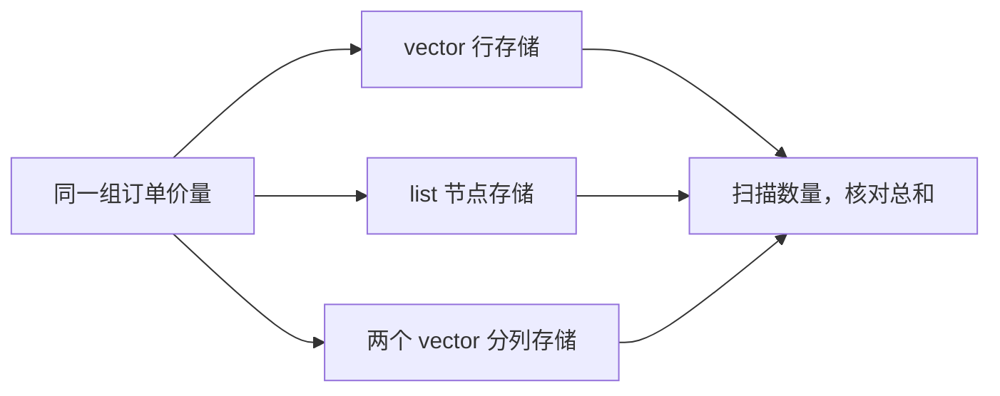

# Day 22 · 移动语义、布局与缓存局部性

## 1. 本期内容与学习目标

本课需要 RAII、值事件和 Day 21 的计时基础，预计 2–3 小时。先用计数器观察结果按值返回、复制和移动，再测同一批价量数据在连续节点、链表和分列存储中的扫描。目标是把「对象传递成本」和「数据访问成本」分开看。

## 2. 业务背景与原理

一条跨档订单产生多笔成交，`Result` 拥有整个事件向量。把回执送入下一阶段可能复制全部元素，也可能交接已有向量的存储。另一个热点是查价或累计挂单量。若一条循环只读数量，未访问的订单 ID 和时间戳仍可能占用同一缓存行。单看结构体大小无法判断所有分配，也无法说明 CPU 实际读取了多少字节。

## 3. Java 原始项目的实现分析

Direct 簿用 `DirectOrder` 同时存订单值、相邻节点与所属档位。插入和移除在节点上更新链，订单对象通过池复用。Java 的 `OrderCommand` 则在环槽中原地填写命令与结果。课程先验证 C++ 值移动和数据布局的局部效果，再决定哪里值得改。 [Direct 节点字段](https://github.com/exchange-core/exchange-core/blob/2f8548749839e9095c8dc597e4b61521d259fa5d/src/main/java/exchange/core2/core/orderbook/OrderBookDirectImpl.java#L803-L851) · [Direct 插入](https://github.com/exchange-core/exchange-core/blob/2f8548749839e9095c8dc597e4b61521d259fa5d/src/main/java/exchange/core2/core/orderbook/OrderBookDirectImpl.java#L485-L559) · [环槽转换](https://github.com/exchange-core/exchange-core/blob/2f8548749839e9095c8dc597e4b61521d259fa5d/src/main/java/exchange/core2/core/ExchangeApi.java#L427-L440)

## 4. 本期 C++ 知识

### 值类别、移动和拷贝消除

有名字的局部变量表达式是左值。`std::move(x)` 把表达式转换成允许绑定右值引用的形式，资源是否转移由被调用的构造函数决定。`Packet(Packet&& other) noexcept` 接受可移交资源的对象，本课把其中向量移动到新对象。`other` 虽然声明为右值引用，用名字访问它时仍是左值，所以移动其成员需要再次写 `std::move`。移动后的标准容器可析构、赋新值，内容一般只可依赖有效但未指定的状态。 [move 的定义](https://eel.is/c++draft/forward)

`return Packet{...};` 在 C++17 起直接构造返回值。返回具名局部变量时可以发生 NRVO，未消除时通常尝试隐式移动。不要为强迫优化把 `return local;` 写成 `return std::move(local);`，它会破坏 NRVO 的形式条件。对有拷贝的元素类型，向量重新分配时常用移动是否 `noexcept` 来决定搬运方式，以满足异常保证。 [拷贝消除](https://eel.is/c++draft/class.copy.elision) · [vector 扩容保证](https://eel.is/c++draft/vector.capacity)

### 对齐、填充与局部性

`sizeof(T)` 含对象内填充。`alignof(T)` 给出对齐要求。二者都不包含容器在外部获得的内存。AoS 每个元素保存完整订单字段，SoA 将字段分别放入连续数组。读完整记录时 AoS 访问自然，单列聚合时 SoA 减少无关字段的占用。链表节点必须沿链接访问，缓存与分配器行为需要实测。

## 5. 架构设计与技术选型

实验使用同一批整数数据。`pmr` 容器从 `memory_resource` 请求内存，自定义资源转发到默认资源并记录调用次数、请求字节数。计数反映容器向资源申请的空间，不含分配器元数据和物理驻留量。每种表示预热一次，计时多轮。分配计数在计时前完成。为使每轮有独立输入，在计时前改第一笔数量，三种布局用同样的变化核对校验值。



## 6. 从零逐步实现

创建 `bench/layout_probe.cpp`。`CountingResource` 重载 PMR 资源的三个虚函数，`override` 让编译器核对签名。`do_is_equal` 用对象身份判断资源相等。本课资源实例的寿命先于容器开始、后于容器结束。`Packet` 内的计数器为类级共享值，实验只在单线程执行。

```cpp
#include <chrono>
#include <cmath>
#include <cstddef>
#include <cstdint>
#include <iostream>
#include <list>
#include <memory_resource>
#include <stdexcept>
#include <utility>
#include <vector>

namespace {

using Clock = std::chrono::steady_clock;

class CountingResource final : public std::pmr::memory_resource {
public:
    std::size_t calls{};
    std::size_t bytes{};

private:
    void* do_allocate(std::size_t size, std::size_t align) override {
        auto* ptr = std::pmr::new_delete_resource()->allocate(size, align);
        ++calls;
        bytes += size;
        return ptr;
    }
    void do_deallocate(void* ptr, std::size_t size, std::size_t align) override {
        std::pmr::new_delete_resource()->deallocate(ptr, size, align);
    }
    bool do_is_equal(const std::pmr::memory_resource& other) const noexcept override {
        return this == &other;
    }
};

struct Packet {
    static inline int copies{};
    static inline int moves{};
    std::vector<int> events;

    explicit Packet(std::size_t count) : events(count, 7) {}
    Packet(const Packet& other) : events(other.events) { ++copies; }
    Packet(Packet&& other) noexcept : events(std::move(other.events)) { ++moves; }
};

Packet make_packet() { return Packet{64}; }

struct Row {
    std::uint64_t id;
    std::int64_t price;
    std::int64_t quantity;
    std::int64_t timestamp;
};

struct Columns {
    std::pmr::vector<std::uint64_t> ids;
    std::pmr::vector<std::int64_t> prices;
    std::pmr::vector<std::int64_t> quantities;
    std::pmr::vector<std::int64_t> timestamps;

    explicit Columns(std::pmr::memory_resource* resource)
        : ids(resource), prices(resource), quantities(resource), timestamps(resource) {}

    void reserve(std::size_t count) {
        ids.reserve(count);
        prices.reserve(count);
        quantities.reserve(count);
        timestamps.reserve(count);
    }

    void add(Row row) {
        ids.push_back(row.id);
        prices.push_back(row.price);
        quantities.push_back(row.quantity);
        timestamps.push_back(row.timestamp);
    }
};

template<class Rows>
std::int64_t sum_rows(const Rows& rows) {
    std::int64_t sum = 0;
    for (const auto& row : rows) {
        sum += row.quantity;
    }
    return sum;
}

template<class Scan, class Update>
void measure(const char* name, const CountingResource& resource, Scan scan, Update update,
             std::int64_t expected) {
    if (scan() != expected) {
        throw std::logic_error{"warmup checksum differs"};
    }
    double sum = 0;
    double squares = 0;
    constexpr int repeats = 12;
    for (int i = 0; i < repeats; ++i) {
        update(2 + i);
        const auto start = Clock::now();
        const auto observed = scan();
        const auto stop = Clock::now();
        if (observed != expected + 1 + i) {
            throw std::logic_error{"scan checksum differs"};
        }
        const double ns = std::chrono::duration<double, std::nano>(stop - start).count();
        sum += ns;
        squares += ns * ns;
    }
    const auto mean = sum / repeats;
    const auto variance = std::fmax(0.0, squares / repeats - mean * mean);
    std::cout << name << " allocations=" << resource.calls << " bytes=" << resource.bytes
              << " mean_ns=" << mean << " variance_ns2=" << variance
              << " base_checksum=" << expected << '\n';
}

}

int main() {
    auto original = make_packet();
    auto copy = original;
    auto moved = std::move(original);
    if (copy.events != moved.events || Packet::copies != 1 || Packet::moves != 1) {
        return 1;
    }
    original.events.assign(1, 9);
    std::cout << "copies=" << Packet::copies << " moves=" << Packet::moves
              << " sizeof_row=" << sizeof(Row) << " alignof_row=" << alignof(Row) << '\n';

    CountingResource contiguous_memory;
    CountingResource linked_memory;
    CountingResource column_memory;
    std::pmr::vector<Row> contiguous{&contiguous_memory};
    std::pmr::list<Row> linked{&linked_memory};
    Columns columns{&column_memory};
    constexpr std::size_t count = 65'536;
    contiguous.reserve(count);
    columns.reserve(count);
    std::int64_t expected = 0;
    for (std::size_t i = 0; i < count; ++i) {
        const Row row{static_cast<std::uint64_t>(i), 100,
                      static_cast<std::int64_t>(1 + i % 7), 0};
        contiguous.push_back(row);
        linked.push_back(row);
        columns.add(row);
        expected += row.quantity;
    }
    measure("aos", contiguous_memory, [&] { return sum_rows(contiguous); },
            [&](std::int64_t value) { contiguous.front().quantity = value; }, expected);
    measure("list", linked_memory, [&] { return sum_rows(linked); },
            [&](std::int64_t value) { linked.front().quantity = value; }, expected);
    measure("soa", column_memory, [&] {
        std::int64_t sum = 0;
        for (const auto quantity : columns.quantities) {
            sum += quantity;
        }
        return sum;
    }, [&](std::int64_t value) { columns.quantities.front() = value; }, expected);
}
```

把以下目标追加到 `CMakeLists.txt`。

```cmake
add_executable(layout_probe bench/layout_probe.cpp)
target_link_libraries(layout_probe PRIVATE exchange_core)
add_test(NAME layout_probe_smoke COMMAND layout_probe)
```

## 7. 测试、调试与验证

运行 `cmake --build build-release`、`ctest --test-dir build-release -R '^layout_probe_smoke$' -V`。预期复制 1、移动 1，三个 base_checksum 均为 262139。打印计数受标准库实现影响，报告时同时记录 `sizeof_row` 和各资源请求数。方差用 `E[x²] - E[x]²` 计算，负的舍入误差夹到零。这里报告的是本组 12 个样本的总体方差。运行多次或轮换测量顺序观察变化。若时间量级低于平台计时粒度，改用较大样本。若优化器把整次扫描移出计时区，检查生成汇编，或用独立编译单元和运行期变更的输入校验。当前探针适合比较机制，不能从一次结果推出生产加速比。

本机的一组记录来自 Apple M3、macOS 26.0.1、Apple Clang 17 的 Release 构建。`Row` 大小 32 字节、对齐 8 字节，三个初始校验值相同。分列构造仍保存全部四列，计时只访问数量列。

| 布局 | 分配请求数 | 请求字节 | 12 次平均（ns） | 方差（ns²） |
| --- | ---: | ---: | ---: | ---: |
| aos | 1 | 2,097,152 | 22,635 | 4.23e+04 |
| list | 65,536 | 3,145,728 | 87,865 | 9.46e+05 |
| soa | 4 | 2,097,152 | 5,490 | 3.21e+03 |

## 8. Java 与 C++ 实现深度对比

Java 的对象池减少重复分配，内存布局取决于 JVM 与对象表示。C++ 移动语义可以交接向量存储，对节点布局的影响则需另测。课程以 PMR 计数定位分配请求和大小，再用固定数据量的扫描判断访问方式带来的差别。

## 9. 课后练习

1. **基础。** 再复制 `moved` 一次，修改检查并观察计数变化。
2. **工程。** 增加需要读价格和数量的扫描。让 AoS 与 SoA 计算同样校验值，记录各 12 个样本。
3. **思考。** 为什么 `sizeof(std::vector<Row>)` 不会随着 65,536 条数据改变？

## 10. 总结与下一期

Day 23 继续处理节点身份，把逐节点分配改成预分配槽位，并用代数防止旧句柄访问复用后的新订单。

[Day 21](day-21.md) · [课程目录](../00-overview/learning-roadmap.md) · [Day 23](day-23.md)

<details>
<summary>练习参考答案</summary>

1. 拷贝变成 2，移动仍为 1。
2. 累加 `price × quantity`，三种表示的初始校验值为 26213900，逐轮按修改量校验；SoA 按相同下标读取两列。
3. 向量对象保存管理外部存储的状态。元素由其分配器另外取得空间。

</details>
