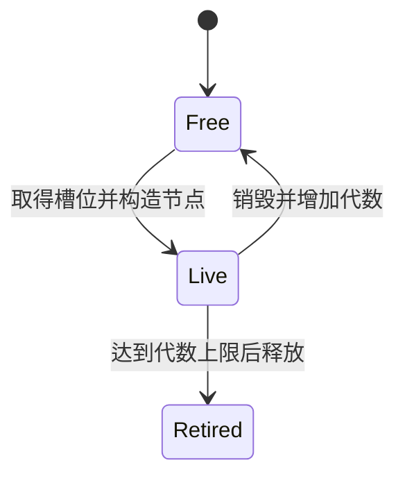

# Day 23 · 对象池、侵入链与句柄寿命

## 1. 本期内容与学习目标

本课需要 Day 03 的对象寿命、Day 10 的节点句柄和 Day 22 的分配实验，预计 3 小时。实现预分配的订单节点池和使用池节点的双向队列。稳定句柄由槽下标和代数共同组成。复用槽位时旧句柄必须失效，池满则由调用方处理。

## 2. 业务背景与原理

101 档有 A、B、C 三笔。撤 B 后可复用它的槽位，但旧索引或测试观察者仍可能拿着 B 的槽号。单用下标会把新订单 D 误当成 B。把「第 5 槽，第 17 代」作为身份，释放后代数变成 18，旧句柄就无法访问 D。FIFO 链可在订单槽内保存前后句柄，按 ID 定位后摘除中间节点无需扫描。

## 3. Java 原始项目的实现分析

Direct 版的 `DirectOrder` 存前后节点和所属档，`removeOrder` 重连邻居并更新最优指针和档尾，`insertOrder` 把新订单接入档位。在成交和撤改路径中，节点可归还 `ObjectsPool`。课程池用显式代数校验表达槽位复用的寿命边界，队列先只管理同一价档。 [Direct 节点](https://github.com/exchange-core/exchange-core/blob/2f8548749839e9095c8dc597e4b61521d259fa5d/src/main/java/exchange/core2/core/orderbook/OrderBookDirectImpl.java#L803-L851) · [摘除及重连](https://github.com/exchange-core/exchange-core/blob/2f8548749839e9095c8dc597e4b61521d259fa5d/src/main/java/exchange/core2/core/orderbook/OrderBookDirectImpl.java#L446-L483) · [入队](https://github.com/exchange-core/exchange-core/blob/2f8548749839e9095c8dc597e4b61521d259fa5d/src/main/java/exchange/core2/core/orderbook/OrderBookDirectImpl.java#L485-L559)

## 4. 本期 C++ 知识

`std::optional<Node>` 的有值状态表示槽内对象存活。`emplace` 在槽内构造，`reset` 销毁。`vector<Slot>` 一次按容量构造，后续不扩容。`free_next` 将空槽连成自由链，分配时取链首，释放时将该槽放回。池的 `get` 先比较范围和代数，再检查存活。借来的指针只在相应对象未释放时可用。句柄可以跨操作保存并重新校验。句柄仅在所属池有效，跨池交换需另外携带所有者身份。

代数上限到达后永久退役该槽，避免回绕后旧句柄重获有效性。队列由 `head`、`tail` 和 `size` 描述，节点的 `prev/next` 是侵入链。每个节点只属于一个队列，`owner` 用来拦住同一池的跨队列删除。队列不可复制或移动，析构时逐个释放；池必须活过引用它的全部队列。

## 5. 架构设计与技术选型

| 方案 | 适用条件 |
| --- | --- |
| 标准链表 + `std::pmr::unsynchronized_pool_resource` | 换分配策略即可尝试降低分配请求。节点仍是链表节点，原迭代器失效规则不变 |
| 显式槽位 + 代数 | 需要控制容量、节点布局和句柄。必须自己维护空闲链、存活检查、队列与归属 |
| 单纯使用裸地址自由链 | 索引简单，但地址复用需要额外身份机制以拒绝旧引用 |

本课采用显式池。构造时间和空间与容量线性相关。取得槽、读句柄和队列尾插/摘除都为常数。析构单个队列随其活跃节点数增长。`OrderNodePool` 只知道存储，`PoolQueue` 才维护档内邻居。 [PMR 池资源规范](https://eel.is/c++draft/mem.res.pool)



## 6. 从零逐步实现

创建 `include/exchange/order_node_pool.hpp`。这里给槽位保留 `std::size_t` 最大值作为下标哨兵；合法代数最大值由构造参数控制，默认使用类型上界，测试可用更小上界验证退役。`PoolQueue::erase` 先验证节点归属，再重连并释放。队列只把头尾访问和内部邻居观察暴露给后续存储适配层。

```cpp
#ifndef EXCHANGE_ORDER_NODE_POOL_HPP
#define EXCHANGE_ORDER_NODE_POOL_HPP

#include "exchange/model.hpp"

#include <cstddef>
#include <cstdint>
#include <limits>
#include <optional>
#include <stdexcept>
#include <vector>

namespace exchange {

struct NodeHandle {
    static constexpr auto none = std::numeric_limits<std::size_t>::max();
    std::size_t slot{none};
    std::uint64_t generation{};
    bool operator==(const NodeHandle&) const = default;
};

class PoolQueue;

class OrderNodePool {
public:
    struct Node {
        RestingOrder order;
        NodeHandle prev;
        NodeHandle next;
        const PoolQueue* owner{};
    };

    explicit OrderNodePool(
        std::size_t capacity,
        std::uint64_t generation_limit = std::numeric_limits<std::uint64_t>::max())
        : slots_(capacity), free_(capacity == 0 ? NodeHandle::none : 0),
          generation_limit_(generation_limit) {
        if (generation_limit == 0) {
            throw std::invalid_argument{"generation limit must be positive"};
        }
        for (std::size_t i = 0; i + 1 < slots_.size(); ++i) {
            slots_[i].free_next = i + 1;
        }
    }

    OrderNodePool(const OrderNodePool&) = delete;
    OrderNodePool& operator=(const OrderNodePool&) = delete;

    bool has_room() const { return free_ != NodeHandle::none; }

    std::optional<NodeHandle> acquire(const RestingOrder& order) {
        if (!has_room()) {
            return std::nullopt;
        }
        const auto pos = free_;
        auto& slot = slots_[pos];
        slot.node.emplace(Node{order, {}, {}, nullptr});
        free_ = slot.free_next;
        return NodeHandle{pos, slot.generation};
    }

    Node* get(NodeHandle handle) {
        if (handle.slot >= slots_.size()) {
            return nullptr;
        }
        auto& slot = slots_[handle.slot];
        return slot.generation == handle.generation && slot.node ? &*slot.node : nullptr;
    }

    bool release(NodeHandle handle) {
        auto* node = get(handle);
        if (!node || node->owner) {
            return false;
        }
        auto& slot = slots_[handle.slot];
        slot.node.reset();
        if (slot.generation < generation_limit_) {
            ++slot.generation;
            slot.free_next = free_;
            free_ = handle.slot;
        }
        return true;
    }

private:
    struct Slot {
        std::optional<Node> node;
        std::size_t free_next{NodeHandle::none};
        std::uint64_t generation{1};
    };

    std::vector<Slot> slots_;
    std::size_t free_;
    std::uint64_t generation_limit_;
};

class PoolQueue {
public:
    explicit PoolQueue(OrderNodePool& pool) : pool_(pool) {}
    PoolQueue(const PoolQueue&) = delete;
    PoolQueue& operator=(const PoolQueue&) = delete;

    ~PoolQueue() {
        while (!empty()) {
            erase(head_);
        }
    }

    bool empty() const { return size_ == 0; }
    std::size_t size() const { return size_; }
    NodeHandle head() const { return head_; }
    NodeHandle tail() const { return tail_; }

    OrderNodePool::Node* get(NodeHandle handle) const {
        auto* node = pool_.get(handle);
        return node && node->owner == this ? node : nullptr;
    }

    std::optional<NodeHandle> push_back(const RestingOrder& order) {
        const auto acquired = pool_.acquire(order);
        if (!acquired) {
            return std::nullopt;
        }
        auto* node = pool_.get(*acquired);
        node->owner = this;
        node->prev = tail_;
        if (auto* tail = get(tail_)) {
            tail->next = *acquired;
        } else {
            head_ = *acquired;
        }
        tail_ = *acquired;
        ++size_;
        return acquired;
    }

    bool erase(NodeHandle handle) {
        auto* node = get(handle);
        if (!node) {
            return false;
        }
        const auto prev = node->prev;
        const auto next = node->next;
        if (auto* left = get(prev)) {
            left->next = next;
        } else {
            head_ = next;
        }
        if (auto* right = get(next)) {
            right->prev = prev;
        } else {
            tail_ = prev;
        }
        --size_;
        node->owner = nullptr;
        return pool_.release(handle);
    }

private:
    OrderNodePool& pool_;
    NodeHandle head_;
    NodeHandle tail_;
    std::size_t size_{};
};

}

#endif
```

`Slot::node.emplace` 成功后才推进自由链。节点在队列中时 `release` 拒绝直接释放，调用者必须先摘链。访问邻居只在 handle 属于该队列且仍有效时通过。释放旧节点时已经保存相邻句柄；之后不再读旧节点。`erase` 的常数次操作以链和归属始终一致为前提。

## 7. 测试、调试与验证

创建 `tests/order_node_pool_test.cpp`。使用容量 3 的池及两个队列，测试邻居重连、跨队列拒绝、容量和代数退役。只有句柄构造成功时才解引用。

```cpp
#include "exchange/order_node_pool.hpp"
#include "test_checks.hpp"
#include "trading_fixtures.hpp"

int main() {
    using namespace exchange;
    using trading_fixture::rest;
    TestChecks checks;
    OrderNodePool pool{3};
    PoolQueue fifo{pool};
    PoolQueue other{pool};
    const auto a = fifo.push_back(rest(1, Side::ask, 100, 1, 1, 0));
    const auto b = fifo.push_back(rest(2, Side::ask, 100, 1, 2, 0));
    const auto c = fifo.push_back(rest(3, Side::ask, 100, 1, 3, 0));
    if (!a || !b || !c) {
        return 1;
    }
    checks.require(!fifo.push_back(rest(4, Side::ask, 100, 1, 4, 0)) &&
                   fifo.head() == *a && fifo.tail() == *c, "full pool keeps queue");
    checks.require(!other.erase(*b) && !pool.release(*b), "owner check");
    checks.require(fifo.erase(*b) && !fifo.erase(*b) && !pool.get(*b) &&
                   fifo.get(*a)->next == *c && fifo.get(*c)->prev == *a, "unlink middle");
    const auto d = other.push_back(rest(4, Side::ask, 101, 1, 4, 0));
    checks.require(d && d->slot == b->slot && d->generation != b->generation &&
                   !pool.get(*b), "recycled slot rejects stale handle");
    checks.require(fifo.erase(*a) && fifo.head() == *c &&
                   fifo.erase(*c) && fifo.empty() && fifo.tail() == NodeHandle{}, "erase head and tail");

    OrderNodePool tiny{1, 2};
    const auto sample = rest(5, Side::ask, 100, 1, 1, 0);
    const auto first = tiny.acquire(sample);
    checks.require(first && tiny.release(*first), "first release");
    const auto last = tiny.acquire(sample);
    checks.require(last && last->generation == 2 && tiny.release(*last) &&
                   !tiny.acquire(sample) && !tiny.get(*last), "generation retires slot");
    return checks.exit_code();
}
```

```cmake
add_executable(order_node_pool_tests tests/order_node_pool_test.cpp)
target_link_libraries(order_node_pool_tests PRIVATE exchange_core)
add_test(NAME order_node_pool COMMAND order_node_pool_tests)
```

运行 `cmake --build build-debug` 和 `ctest --test-dir build-debug -R '^order_node_pool$' --output-on-failure`。再用 Day 05 的 ASan/UBSan 构建运行相同用例。若旧句柄可读，查代数是否在释放后递增。若删除头或尾后新队首错位，检查是否用空句柄初始化缺失邻居。

## 8. Java 与 C++ 实现深度对比

Java 对象池可以复用对象实例，热点代码依靠正确的节点归还顺序。C++ 显式控制槽内对象的构造与析构，并用代数表达每次占用的身份。这个模型保留部分运行期检查，代价包括额外句柄字段和固定容量内存。下课用同一撮合算法验证布局变化后的实际成本。

## 9. 课后练习

1. **基础。** 构造容量为 0 的池，验证首次取得就返回空。
2. **工程。** 用同一个池创建两个队列，先销毁其中一个，再用另一个填满已释放容量。
3. **思考。** 为什么一个旧句柄仍可以用于诊断，却不能从旧借用指针读取代数？

## 10. 总结与下一期

节点池和侵入队列已在独立测试中可运行。Day 24 会让订单簿的每个价格档选择链表或池队列，由同一套订单规则驱动两种布局。

[Day 22](day-22.md) · [课程目录](../00-overview/learning-roadmap.md) · [Day 24](day-24.md)

<details>
<summary>练习参考答案</summary>

1. `has_room()` 为假，`acquire` 为空。
2. 用内层作用域控制第一个队列，退出后按剩余容量尾插第二个队列。
3. 句柄是独立的值，池可检查当前槽。旧指针所指对象的寿命已经结束，访问它的成员本身就不安全。

</details>
