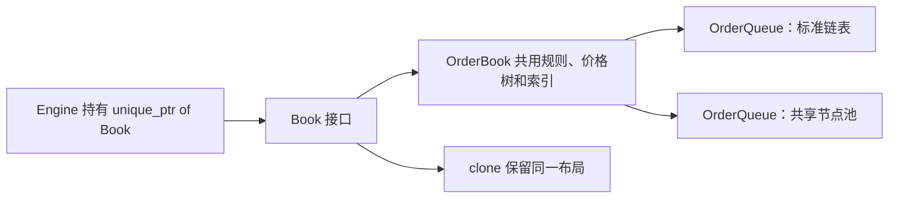

# Day 24 · 替代订单簿及策略接口

## 1. 本期内容与学习目标

前置是 Day 16 的差分测试、Day 21 的基准和 Day 23 的节点池，预计 4–5 小时。给引擎一个可在运行期选择的 `Book` 接口。两种簿共享价格树、ID 索引和撮合规则，只替换每档队列的存储。实验记录池满和构造成本，再比较同一工作负载。

## 2. 业务背景与原理

一笔 GTC 若需要新挂余量，活动订单容量已满就要拒绝整条命令。已有订单的撤销、纯成交与 IOC 仍可处理。如果 GTC 在计划中既会成交又需要挂余量，而准备阶段活动容量已满，本课程也会拒绝整条命令。它不会先吃掉 maker 来腾槽。改单需要先准备新节点，再移除旧节点，因此池额外保留一个内部准备槽。这个槽不增加对外活动容量。计划和提交边界仍沿用 Day 12、15 和 Day 19。两种布局只在指定池容量内要求完全同义，池满有明确的业务状态。

## 3. Java 原始项目的实现分析

`IOrderBook.OrderBookFactory` 允许选择 Naive 或 Direct。Direct 用 `LongAdaptiveRadixTreeMap` 管理价档和订单索引，并把节点组织成每侧一条有序双向链，缓存最优订单和各档末尾。基数树按键的位段寻找分支，节点形式可随分支数变化。课程保留 `std::map`，每档由池队列缓存头尾，最优档从价树首项取得。这样可以单独观察节点存储变化。 [Java 簿工厂](https://github.com/exchange-core/exchange-core/blob/2f8548749839e9095c8dc597e4b61521d259fa5d/src/main/java/exchange/core2/core/orderbook/IOrderBook.java#L212-L232) · [Direct 树和最优指针](https://github.com/exchange-core/exchange-core/blob/2f8548749839e9095c8dc597e4b61521d259fa5d/src/main/java/exchange/core2/core/orderbook/OrderBookDirectImpl.java#L46-L79) · [Direct 定位和扫单](https://github.com/exchange-core/exchange-core/blob/2f8548749839e9095c8dc597e4b61521d259fa5d/src/main/java/exchange/core2/core/orderbook/OrderBookDirectImpl.java#L222-L317)

## 4. 本期 C++ 知识

### 运行期接口和析构

`virtual ... = 0` 定义纯虚方法，派生类负责实现。`virtual ~Book() = default` 允许 `unique_ptr<Book>` 销毁实际的派生对象。常见实现通过虚表进行分派，其代价需在目标编译器上测。两种队列也可用模板策略静态实例化，每种类型在编译期确定，代价是改动原簿类型和显式实例化边界。本课选择一个外部运行期接口，内部在队列边界通过 `variant` 选择存储。 [C++ 虚析构语义](https://eel.is/c++draft/class.dtor)

### 索引句柄与遍历借用

已有索引改为保存 `OrderQueue::Handle`。它绑定所属队列，并保存链表迭代器或池句柄。遍历用单独的只读迭代器。队列和价档地址在 `std::map` 节点存活期间稳定，簿仍禁用复制与移动。池成员放在两个价树之前，使价树析构时池还活着。每次暂存重建用新池，旧句柄不会被复制过去。

## 5. 架构设计与技术选型

默认链表版本保留原规则。池版让所有价档共用一块固定容量存储。已有两侧最优价通过价树 `begin()` 常数时间获得，档头可由池队列直接读取。两版索引持有的都是局部句柄，删除仍先清索引。`Book::clone` 通过规范序列重建同一策略，供引擎在暂存阶段调用。单簿命令保留原复杂度，池取得/归还槽位为常数，池构造及空间随配置容量增长。当前引擎每条命令会重新构造目标簿和池，因此池容量会影响端到端耗时，即使实际挂单很少。



## 6. 从零逐步实现

### 24.1 写价档队列适配

创建 `include/exchange/order_queue.hpp`。使用单独的 `Handle` 和只读 `Cursor`。`Handle` 的 `operator*` 和 `operator->` 用于索引访问，要求节点仍活着。`Cursor` 只在遍历期间读取当前档。链表尾插返回成功，池尾插可能容量耗尽。`erase` 按正确存储分派。队列不暴露给引擎。

```cpp
#ifndef EXCHANGE_ORDER_QUEUE_HPP
#define EXCHANGE_ORDER_QUEUE_HPP

#include "exchange/order_node_pool.hpp"

#include <iterator>
#include <list>
#include <variant>

namespace exchange {

class OrderQueue {
    using List = std::list<RestingOrder>;

public:
    class Handle {
    public:
        RestingOrder& operator*() const {
            if (const auto* iter = std::get_if<List::iterator>(&value_)) {
                return **iter;
            }
            auto* node = std::get<PoolQueue>(owner_->data_).get(std::get<NodeHandle>(value_));
            if (!node) {
                throw std::logic_error{"stale order handle"};
            }
            return node->order;
        }
        RestingOrder* operator->() const { return &**this; }

    private:
        friend class OrderQueue;
        using Position = std::variant<List::iterator, NodeHandle>;
        Handle(OrderQueue* owner, Position value) : owner_(owner), value_(value) {}
        OrderQueue* owner_;
        Position value_;
    };

    class Cursor {
    public:
        const RestingOrder& operator*() const {
            if (const auto* iter = std::get_if<List::const_iterator>(&value_)) {
                return **iter;
            }
            return pool_node().order;
        }

        Cursor& operator++() {
            if (auto* iter = std::get_if<List::const_iterator>(&value_)) {
                ++*iter;
            } else {
                value_ = pool_node().next;
            }
            return *this;
        }

        bool operator==(const Cursor&) const = default;

    private:
        friend class OrderQueue;
        using Position = std::variant<List::const_iterator, NodeHandle>;
        Cursor(const OrderQueue* owner, Position value) : owner_(owner), value_(value) {}

        const OrderNodePool::Node& pool_node() const {
            const auto* node = std::get<PoolQueue>(owner_->data_).get(std::get<NodeHandle>(value_));
            if (!node) {
                throw std::logic_error{"stale queue cursor"};
            }
            return *node;
        }

        const OrderQueue* owner_;
        Position value_;
    };

    explicit OrderQueue(OrderNodePool* pool) {
        if (pool) {
            data_.emplace<PoolQueue>(*pool);
        }
    }

    std::size_t size() const {
        if (const auto* list = std::get_if<List>(&data_)) {
            return list->size();
        }
        return std::get<PoolQueue>(data_).size();
    }
    bool empty() const { return size() == 0; }

    const RestingOrder& back() const {
        if (const auto* list = std::get_if<List>(&data_)) {
            return list->back();
        }
        const auto& queue = std::get<PoolQueue>(data_);
        return queue.get(queue.tail())->order;
    }

    bool push_back(const RestingOrder& order) {
        if (auto* list = std::get_if<List>(&data_)) {
            list->push_back(order);
            return true;
        }
        return std::get<PoolQueue>(data_).push_back(order).has_value();
    }

    Handle last() {
        if (auto* list = std::get_if<List>(&data_)) {
            return {this, std::prev(list->end())};
        }
        return {this, std::get<PoolQueue>(data_).tail()};
    }

    void erase(Handle handle) {
        if (handle.owner_ != this) {
            throw std::logic_error{"wrong order queue"};
        }
        if (auto* list = std::get_if<List>(&data_)) {
            list->erase(std::get<List::iterator>(handle.value_));
        } else if (!std::get<PoolQueue>(data_).erase(std::get<NodeHandle>(handle.value_))) {
            throw std::logic_error{"could not erase order handle"};
        }
    }

    void pop_back() { erase(last()); }

    Cursor begin() const {
        if (const auto* list = std::get_if<List>(&data_)) {
            return {this, list->begin()};
        }
        return {this, std::get<PoolQueue>(data_).head()};
    }

    Cursor end() const {
        if (const auto* list = std::get_if<List>(&data_)) {
            return {this, list->end()};
        }
        return {this, NodeHandle{}};
    }

private:
    std::variant<List, PoolQueue> data_;
};

}

#endif
```

`Cursor` 只提供范围循环所需的解引用、递增和相等比较。后面的代码用范围循环复制，不把它当作具备完整 traits 的标准迭代器。池分支的结束游标用空句柄。`PoolQueue` 的不可移动性会使含它的 variant 也不可移动，价档通过 `map::try_emplace` 直接在节点内构造。
### 24.2 接入现有订单簿

按以下顺序编辑后再构建。先在 `model.hpp` 的 `Status` 增加 `capacity_exhausted`，在 `model.cpp` 的 `status_name` 补同名文本。在 `order_book.hpp` 引入 `"exchange/order_queue.hpp"`。在 `class OrderBook` 前加入接口和工厂声明。

```cpp
enum class BookKind { list, pooled };

class Book {
public:
    virtual ~Book() = default;
    virtual std::unique_ptr<Book> clone() const = 0;
    virtual CommandResult place(const PlaceOrder&, Seq) = 0;
    virtual CommandResult cancel(const CancelOrder&) = 0;
    virtual CommandResult reduce(const ReduceOrder&) = 0;
    virtual CommandResult move(const MoveOrder&, Seq) = 0;
    virtual std::optional<RestingOrder> find_order(OrderId) const = 0;
    virtual std::vector<RestingOrder> resting_orders() const = 0;
    virtual L2Snapshot snapshot(std::size_t depth) const = 0;
    virtual bool validate() const = 0;
};

std::unique_ptr<Book> make_book(BookKind kind, SymbolId symbol, std::size_t capacity);
```

将类头改为 `class OrderBook final : public Book`。用下列两行替换构造声明并增加克隆。七个同名公开方法（place、cancel、reduce、move、find_order、resting_orders、snapshot）和 `validate` 的声明末尾加 `override`。保留测试访问器、买一卖一以及 Day 17 的静态 `from_resting`。后者继续为既有测试重建默认链表簿。

```cpp
    explicit OrderBook(SymbolId symbol, BookKind kind = BookKind::list, std::size_t capacity = 4096);
    std::unique_ptr<Book> clone() const override;
```

把 `Level` 改为下段。把 `OrderLocation` 的 `node` 类型替换成 `OrderQueue::Handle`。在 `SymbolId symbol_;` 后、两棵价树之前加三个成员。

```cpp
    struct Level {
        explicit Level(OrderNodePool* pool) : fifo(pool) {}
        OrderQueue fifo;
        std::int64_t total_remaining{};
    };
```

```cpp
    BookKind kind_;
    std::size_t capacity_;
    std::unique_ptr<OrderNodePool> pool_;
```

在 `order_book.cpp` 加 `#include <limits>`。用下段替换旧构造函数，并紧接着加入克隆和工厂定义。`capacity + 1` 只在池版使用。`clone` 仍从规范顺序构造独立的价格树、索引和节点。

```cpp
OrderBook::OrderBook(SymbolId symbol, BookKind kind, std::size_t capacity)
    : symbol_{symbol}, kind_{kind}, capacity_{capacity} {
    if (symbol.value() == 0) {
        throw std::invalid_argument{"order book requires a symbol"};
    }
    if (kind_ == BookKind::pooled) {
        if (capacity_ == std::numeric_limits<std::size_t>::max()) {
            throw std::invalid_argument{"pool capacity too large"};
        }
        pool_ = std::make_unique<OrderNodePool>(capacity_ + 1);
    }
}

std::unique_ptr<Book> OrderBook::clone() const {
    auto copy = std::make_unique<OrderBook>(symbol_, kind_, capacity_);
    for (const auto& order : resting_orders()) {
        if (copy->add_resting(order) != Status::processed) {
            throw std::logic_error{"could not clone order book"};
        }
    }
    if (!copy->validate()) {
        throw std::logic_error{"cloned order book is inconsistent"};
    }
    return copy;
}

std::unique_ptr<Book> make_book(BookKind kind, SymbolId symbol, std::size_t capacity) {
    return std::make_unique<OrderBook>(symbol, kind, capacity);
}
```

接着改 `append_to` 和 `replace_resting`。两处 `levels.try_emplace(order.price)` 都传第二个参数 `pool_.get()`，它是 `Level` 的构造实参。两处 `std::prev(level.fifo.end())` 都换成 `level.fifo.last()`。在 `append_to` 的第一行加以下检查。

```cpp
    if (pool_ && index_.size() >= capacity_) {
        return Status::capacity_exhausted;
    }
```

把两处 `level.fifo.push_back(order);` 分别换成下段。`append_to` 用 `it` 代表价档，`replace_resting` 将下段的 `it` 改为 `target`。池分配失败没有写入任何节点，移除可能新建的空档即可。`replace_resting` 不检查对外活动容量，因为它复用既有 ID 并可使用准备槽。

```cpp
        if (!level.fifo.push_back(order)) {
            if (created) {
                levels.erase(it);
            }
            return Status::capacity_exhausted;
        }
```

在 `OrderBook::resting_orders` 中，把 `result.insert(result.end(), level.fifo.begin(), level.fifo.end());` 换成下方范围循环。在 `tests/order_book_access.hpp` 的 `queue` 方法里也用这种循环，把原来 `return {it->second.fifo.begin(), it->second.fifo.end()};` 换成「建立 `std::vector<RestingOrder> result`，遍历 `it->second.fifo` 追加，返回结果」。

```cpp
            for (const auto& order : level.fifo) {
                result.push_back(order);
            }
```

### 24.3 让引擎选工厂，账本依赖读接口

在 `engine.hpp` 将 `SymbolCatalog::Market::book` 类型换成 `std::unique_ptr<Book>`。将 `SymbolCatalog::add` 的声明和定义签名加上 `BookKind kind, std::size_t capacity` 两个参数。创建市场时用 `make_book(kind, spec.symbol, capacity)`。在 `Engine` 公开区加入构造函数，私有区在 `last_seq_` 后加入两个成员。

```cpp
    explicit Engine(BookKind kind = BookKind::list, std::size_t capacity = 4096)
        : book_kind_(kind), pool_capacity_(capacity) {}
```

```cpp
    BookKind book_kind_;
    std::size_t pool_capacity_;
```

更新 `engine.cpp` 中两处调用目录 `add` 的地方，单品种用 `catalog_.add(command.spec, book_kind_, pool_capacity_)`，批量用 `staged.add(spec, book_kind_, pool_capacity_)`。下单准备时原来的 `OrderBook::from_resting(...)` 换成 `market.book->clone()`，批量注册时复制旧市场也换成 `market.book->clone()`。在 `ledger.hpp` 把 `class OrderBook;` 换成 `class Book;`，并把 `ledger.hpp` 和 `ledger.cpp` 内所有 `const OrderBook& book` 参数换成 `const Book& book`。账本只查询订单值。

### 24.4 让差分工具覆盖两个策略

在 `tests/book_differential_test.cpp` 中，把 `execute_book` 的第一参改为 `Book&`。在 `compare` 增加参数 `BookKind kind`，把 `OrderBook actual{SymbolId{1}};` 改成 `auto actual = make_book(kind, SymbolId{1}, 64);`，调用 `execute_book(*actual, input)`，三个 `actual.` 换成 `actual->`。在 `minimize` 增加 `BookKind kind` 参数，用 `compare(candidate, kind)`。用下段替换 `main`。两种策略都对同一独立参考模型比较，包含状态、事件、顺序和 L2。

```cpp
int main() {
    constexpr std::size_t steps = 1200;
    for (const auto kind : {BookKind::list, BookKind::pooled}) {
        const char* name = kind == BookKind::list ? "list" : "pooled";
        for (const std::uint32_t seed : {7u, 31u, 2026u}) {
            auto inputs = generate(seed, steps);
            const auto failure = compare(inputs, kind);
            if (failure) {
                std::cerr << "book=" << name << " seed=" << seed
                          << " command index=" << failure->offset
                          << " seq=" << inputs.at(failure->offset).seq.value()
                          << '\n' << failure->details << '\n';
                const auto reduced = minimize(std::move(inputs), *failure, kind);
                std::cout << "reduced sequence: " << reduced.size() << " commands\n";
                for (const auto& input : reduced) {
                    print_input(input);
                }
                return 1;
            }
        }
        std::cout << "book=" << name << " 3600 commands checked against the reference book\n";
    }
}
```

## 7. 测试、调试与验证

### 测试池满、改价准备槽和完整结算

在 `tests/spot_integration_test.cpp` 中，将原来的 `int main()` 改成 `int check_spot(exchange::BookKind kind)`，在其中将 `Engine engine;` 改为 `Engine engine{kind, 64};`。文件末尾追加 `int main() { return check_spot(exchange::BookKind::list) | check_spot(exchange::BookKind::pooled); }`。按位或让两个函数都执行，任意非零结果都令测试失败。

创建 `tests/pooled_book_test.cpp`，用低容量固定复现「满簿可改价、可 IOC、拒绝需要新挂的订单」。另测已经计划成交的命令在池满时整笔拒绝，以及引擎中的暂存冻结随容量拒绝一起放弃。

```cpp
#include "exchange/engine.hpp"
#include "matching_test_support.hpp"

int main() {
    using namespace exchange;
    using namespace trading_fixture;
    TestChecks checks;

    auto book = make_book(BookKind::pooled, SymbolId{1}, 2);
    auto ask = limit(Side::ask, 100, 1, LimitPolicy::gtc);
    ask.key = key(1);
    auto other = ask;
    other.key = key(2);
    other.constraint = LimitPrice{Price{102}, LimitPolicy::gtc, {}};
    checks.require(book->place(ask, Seq{1}).status == Status::processed &&
                   book->place(other, Seq{2}).status == Status::processed, "fill pool");
    const auto before = book->resting_orders();
    const auto buy = limit(Side::bid, 101, 2, LimitPolicy::gtc);
    checks.require(book->place(buy, Seq{3}) ==
                   CommandResult{Status::capacity_exhausted, {}} &&
                   book->resting_orders() == before && book->validate(), "capacity refusal is atomic");
    checks.require(book->move({other.key, other.user, Price{103}}, Seq{4}).status ==
                   Status::processed && book->validate(), "move uses preparation slot");
    auto cloned = book->clone();
    checks.require(cloned->place(buy, Seq{5}).status == Status::capacity_exhausted &&
                   cloned->resting_orders() == book->resting_orders(), "clone preserves pool capacity");
    auto ioc = buy;
    ioc.constraint = LimitPrice{Price{101}, LimitPolicy::ioc, {}};
    const auto filled = cloned->place(ioc, Seq{6});
    checks.require(filled.status == Status::processed && filled.events.size() == 2 &&
                   cloned->resting_orders().size() == 1 && cloned->validate() &&
                   book->resting_orders().size() == 2, "IOC needs no slot and clone is independent");

    Engine engine{BookKind::pooled, 1};
    const SymbolSpec spec{SymbolId{1}, CurrencyId{10}, CurrencyId{20}, 1, 1, 0, 0};
    const UserId buyer{1};
    auto bid = limit(Side::bid, 99, 1, LimitPolicy::gtc);
    bid.user = buyer;
    const auto status = [&](const Command& command) {
        return engine.execute(command).outcome.status;
    };
    checks.require(status(RegisterSymbol{spec}) == Status::processed &&
                   status(AddUser{buyer}) == Status::processed &&
                   status(AdjustBalance{buyer, {spec.quote, 500}, 1}) == Status::processed &&
                   status(bid) == Status::processed, "fund and fill engine book");
    const auto original = engine.book_orders(spec.symbol);
    auto extra = bid;
    extra.key = key(3);
    checks.require(status(extra) == Status::capacity_exhausted &&
                   engine.book_orders(spec.symbol) == original &&
                   engine.ledger().available(buyer, spec.quote) == Money{spec.quote, 401} &&
                   engine.ledger().held(bid.key) == Money{spec.quote, 99} &&
                   !engine.ledger().held(extra.key), "capacity refusal also discards staged hold");
    return checks.exit_code();
}
```

```cmake
add_executable(pooled_book_tests tests/pooled_book_test.cpp)
target_link_libraries(pooled_book_tests PRIVATE exchange_core)
add_test(NAME pooled_book COMMAND pooled_book_tests)
```

### 用相同负载比较两种存储

修改 `bench/engine_bench.cpp`。给 `make_engine`、`prepare`、`round` 分别追加 `BookKind kind` 参数，并传给它们的所有调用。构造引擎用 `std::make_unique<Engine>(kind, 256)`。在 `round` 开头计时两次 `prepare`，取耗时为 `setup_seconds`，在输出中增加 `book=list/pooled`、`setup_seconds` 和 `pool_capacity=256`。原吞吐和延迟仍从准备完毕后计时。用下方替换 `main`。

```cpp
int main(int argc, char** argv) {
    const std::string_view mode = argc >= 2 ? argv[1] : "mix";
    const std::string_view layout = argc == 3 ? argv[2] : "list";
    if (argc > 3 || (mode != "place" && mode != "cancel" && mode != "sweep" && mode != "mix") ||
        (layout != "list" && layout != "pooled")) {
        std::cerr << "usage: engine_bench [place|cancel|sweep|mix] [list|pooled]\n";
        return 2;
    }
    const auto kind = layout == "list" ? BookKind::list : BookKind::pooled;
    round(mode, 0, false, kind);
    for (int i = 1; i <= 3; ++i) {
        round(mode, i, true, kind);
    }
}
```

用 `cmake --build build-release` 后执行 `ctest --test-dir build-release --output-on-failure`。整套 23 项。以下脚本输出 24 行，逐模式、逐存储各三轮，核对命令和事件计数后再比较耗时。

```bash
for mode in place cancel sweep mix; do
  for layout in list pooled; do
    ./build-release/engine_bench "$mode" "$layout"
  done
done
```

若池版空簿就报容量错误，先查构造工厂和有效槽数。若满簿改单失败，检查 `replace_resting` 是否误用了新订单容量判断。若基准对不同存储返回不同事件计数，先读差分输出。准备时间含两套引擎和相同预填，执行时间还含每命令重建目标簿。要单独估算池成本，可在后续实验同时记录构造调用次数、池槽位数和暂存对象寿命。因此两项都有池初始化成本。用 Day 22 的资源计数来解释局部布局，避免把小样本的端到端耗时当成普遍规律。

### 本次测量

Apple M3，macOS 26.0.1，Apple Clang 17，CMake 4.3.1，Release 默认参数 `-O3 -DNDEBUG`。种子 2026，池容量 256，预热一轮后记录三轮。两种布局的三组计数逐模式一致，吞吐与延迟按前述独立回合采样。下表保留三轮原始计数和指标，显示值按列四舍五入。

| 模式 | 布局 | 命令 / 事件 / 成交 | 三轮 ops/s | 三轮 p50（ns） | 三轮 p99（ns） | 三轮准备（ms） |
| --- | --- | --- | --- | --- | --- | --- |
| place | list | 120 / 0 / 0 | 139853 / 136325 / 140866 | 7041 / 7375 / 6875 | 13333 / 20875 / 13208 | 0.004 / 0.004 / 0.004 |
| place | pooled | 120 / 0 / 0 | 123600 / 122590 / 123277 | 8042 / 8083 / 8125 | 14417 / 14417 / 14375 | 0.006 / 0.006 / 0.006 |
| cancel | list | 120 / 120 / 0 | 139738 / 139901 / 140515 | 7208 / 7083 / 7041 | 14000 / 14083 / 13958 | 1.730 / 1.733 / 1.749 |
| cancel | pooled | 120 / 120 / 0 | 127779 / 127841 / 126504 | 7708 / 7708 / 7708 | 14541 / 14375 / 15333 | 1.902 / 1.899 / 1.938 |
| sweep | list | 120 / 240 / 240 | 904234 / 930839 / 926641 | 1042 / 1042 / 1042 | 1208 / 1167 / 1125 | 0.317 / 0.312 / 0.311 |
| sweep | pooled | 120 / 240 / 240 | 392424 / 388979 / 315409 | 2666 / 2417 / 2583 | 3375 / 2750 / 5667 | 1.147 / 1.186 / 1.260 |
| mix | list | 480 / 240 / 0 | 1940700 / 1819330 / 1954530 | 500 / 541 / 500 | 625 / 708 / 584 | 0.006 / 0.006 / 0.006 |
| mix | pooled | 480 / 240 / 0 | 650186 / 663059 / 571798 | 1542 / 1541 / 1500 | 1750 / 1709 / 1709 | 0.008 / 0.008 / 0.007 |

本次四种模式的三轮吞吐中位数都以链表布局较高。尤其是扫单和混合模式，活动单很少但每次克隆仍初始化整个池。结果符合这个开销模型，但本实验没有拆分克隆、队列分派和匹配各自的时间。不同轮次的 p99 也有波动。保留原始轮次有助于避免用一次尖峰判定优化。

从 Day 01 的 Markdown 片段顺序重建后，Debug、Release 和 ASan/UBSan 各通过 23 项 CTest。两种布局分别与参考模型比对 3600 条命令，并运行同一双品种现货集成用例。

## 8. Java 与 C++ 实现深度对比

Java 的 Direct 同时改变档索引、订单链和池化，目标是热点扫单与分配优化。课程在保持撮合代码相同的条件下比较节点布局。池能减少每条链表节点的单独申请，但固定容量和重复重建也可能抬高成本。虚接口、每档变体分派和内存布局的贡献需进一步隔离。

## 9. 课后练习

1. **基础。** 将池容量设为 0，用空簿 GTC 和空簿 IOC 验证结果。
2. **工程。** 把 `Engine` 的两品种用例都改用池布局，第二品种保留同一订单号，验证取消第一品种时第二品种的冻结仍在。
3. **思考。** 同样 120 条挂单，池容量由 256 提至 4096 时，指出端到端哪项成本会改变。

## 10. 总结与下一期

本阶段已有两种可替换的订单节点存储和可复现的测量。Day 25 将保留订单簿单写者，把线程边界放在有界队列，先验证关闭和背压。

[Day 23](day-23.md) · [继续阅读 Day 25 · 线程、锁和有界阻塞队列](../07-concurrency/day-25.md)

<details>
<summary>练习参考答案</summary>

1. 有余量的 GTC 返回 `capacity_exhausted`。IOC 返回 `processed` 加全量拒绝，簿仍为空。
2. 使用 `Engine{BookKind::pooled, 64}`，沿用 Day 20 的两个 `OrderKey`，对照旧报告和撤单后的报告。
3. 新簿与每次克隆都会初始化更多空槽。准备时间、短命令耗时和内存占用可能上升，实际差异用相同输入多轮测量。

</details>
