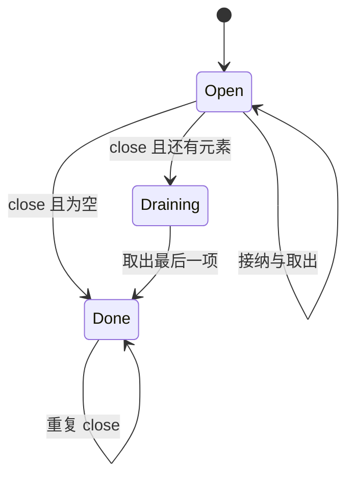

# Day 25 · 线程、锁和有界阻塞队列

## 1. 本期内容与学习目标

本课预计 2–3 小时，需要 Day 03 的 RAII 和 Day 22 的移动语义。实现一个有界多生产者队列。生产者尝试入队，满载立即得到结果。消费者等待到有元素或关闭，关闭后排空已接纳的元素。Day 27 用它交接命令和回执承诺。

## 2. 业务背景与原理

假设队列容量为 1，工作线程正在执行命令 A，B 已在队列等待。此时 C 到达，得到满载错误。容量统计的是等待元素，A 已由消费者拥有。若此时开始关停，队列拒绝 D，消费者仍要执行 B。否则客户端可能一直等待已经接纳的请求。

| 队列状态 | `try_push` | `pop` |
| --- | --- | --- |
| 开启且空 | 接纳 | 等待 |
| 开启且满 | 返回 `full` | 取最早元素 |
| 关闭且有元素 | 返回 `closed` | 取最早元素 |
| 关闭且空 | 返回 `closed` | 返回空值 |

## 3. Java 原始项目的实现分析

Java 基础配置选阻塞等待，低延迟和吞吐配置使用忙等。Disruptor 的环槽、序号和阶段屏障负责生产与消费交接。当前 C++ 课只需要一个进程内入口和一个工作线程。用 mutex 和条件变量实现等待，能先独立验证接纳及关闭规则。 [Java 性能配置](https://github.com/exchange-core/exchange-core/blob/2f8548749839e9095c8dc597e4b61521d259fa5d/src/main/java/exchange/core2/core/common/config/PerformanceConfiguration.java#L117-L161) · [Disruptor 装配](https://github.com/exchange-core/exchange-core/blob/2f8548749839e9095c8dc597e4b61521d259fa5d/src/main/java/exchange/core2/core/ExchangeCore.java#L84-L101)

## 4. 本期 C++ 知识

`std::mutex` 保护队列和关闭标记。`std::lock_guard` 在作用域结束释放锁。`std::unique_lock` 允许条件变量等待时临时释放锁，醒来后重新拿锁。谓词在持锁时检查，既防伪唤醒，也防通知早于等待导致挂起。调用 `notify_one` 时数据已经写好，消费者仍须通过互斥锁观察。关闭用 `notify_all` 让等待者重新检查状态。 [条件变量规范](https://eel.is/c++draft/thread.condition.condvar)

`std::jthread` 离开作用域时会请求停止并 join；本课 `pop` 没有订阅停止令牌，必须显式关闭队列，让工作线程退出等待。测试用 `std::latch` 在指定位置会合，避免用固定睡眠判断哪个线程先执行。 [jthread 生命周期](https://eel.is/c++draft/thread.jthread.class)

## 5. 架构设计与技术选型

选择固定容量 `vector<optional<T>>` 加循环下标，构造时分配，运行时不扩容。使用 `deque` 也容易写，但追加节点可能分配。本实现要求 `T` 可无异常移动构造，确保取出时不留下移到一半的值。队列内的入队、出队为常数时间，初始化空间随容量线性增长。`try_push(T&&)` 只在接纳成功时才移动调用者的对象。



## 6. 从零逐步实现

创建 `include/exchange/bounded_queue.hpp`。`tail_` 是下一写位置，`head_` 是下一读位置。`size_` 用于区分两者相等时的空和满。锁保护所有可变成员。出队可以直接返回一个 `optional<T>`，并在解锁前清除旧槽。

```cpp
#ifndef EXCHANGE_BOUNDED_QUEUE_HPP
#define EXCHANGE_BOUNDED_QUEUE_HPP

#include <condition_variable>
#include <cstddef>
#include <mutex>
#include <optional>
#include <stdexcept>
#include <type_traits>
#include <utility>
#include <vector>

namespace exchange {

enum class PushStatus { accepted, full, closed };

template<class T>
class BoundedQueue {
    static_assert(std::is_nothrow_move_constructible_v<T>);
public:
    explicit BoundedQueue(std::size_t capacity) : slots_(capacity) {
        if (capacity == 0) {
            throw std::invalid_argument{"queue capacity must be positive"};
        }
    }

    PushStatus try_push(T&& item) {
        {
            const std::lock_guard lock(mutex_);
            if (closed_) {
                return PushStatus::closed;
            }
            if (size_ == slots_.size()) {
                return PushStatus::full;
            }
            slots_[tail_].emplace(std::move(item));
            tail_ = next(tail_);
            ++size_;
        }
        ready_.notify_one();
        return PushStatus::accepted;
    }

    std::optional<T> pop() {
        std::unique_lock lock(mutex_);
        ready_.wait(lock, [this] { return closed_ || size_ != 0; });
        if (size_ == 0) {
            return std::nullopt;
        }
        auto result = std::move(slots_[head_]);
        slots_[head_].reset();
        head_ = next(head_);
        --size_;
        return result;
    }

    void close() {
        {
            const std::lock_guard lock(mutex_);
            closed_ = true;
        }
        ready_.notify_all();
    }

private:
    std::size_t next(std::size_t pos) const {
        return pos + 1 == slots_.size() ? 0 : pos + 1;
    }

    std::vector<std::optional<T>> slots_;
    std::size_t head_{};
    std::size_t tail_{};
    std::size_t size_{};
    bool closed_{};
    std::mutex mutex_;
    std::condition_variable ready_;
};

}

#endif
```

队列本身应由调用者持有到所有生产者和消费者结束。闭锁标记与入队在同一个临界区，因而关停与提交竞争时，可根据谁先取得锁判断该元素是否被接纳。

## 7. 测试、调试与验证

创建 `tests/bounded_queue_test.cpp`。第一段把容量边界固定在单线程。第二段用两个生产者和一个消费者，并用闩锁启动竞争。第三段验证关闭时消费者能退出，无论关闭发生在它调用等待之前或之后。CTest 的超时用于发现测试本身卡住。

```cpp
#include "exchange/bounded_queue.hpp"
#include "test_checks.hpp"

#include <array>
#include <latch>
#include <memory>
#include <thread>
#include <vector>

int main() {
    using namespace exchange;
    TestChecks checks;
    BoundedQueue<std::unique_ptr<int>> one{1};
    auto first = std::make_unique<int>(7);
    auto second = std::make_unique<int>(8);
    checks.require(one.try_push(std::move(first)) == PushStatus::accepted && !first,
                   "accepted transfers ownership");
    checks.require(one.try_push(std::move(second)) == PushStatus::full && second,
                   "full does not consume input");
    one.close();
    one.close();
    checks.require(one.try_push(std::move(second)) == PushStatus::closed && second,
                   "closed wins over full");
    const auto value = one.pop();
    checks.require(value && **value == 7 && !one.pop(), "drain before end");

    BoundedQueue<int> queue{2};
    std::latch start{3};
    std::vector<int> received;
    std::jthread reader{[&] {
        start.arrive_and_wait();
        while (auto item = queue.pop()) {
            received.push_back(*item);
        }
    }};
    const auto produce = [&](int base) {
        start.arrive_and_wait();
        for (int i = 0; i < 100; ++i) {
            int value = base + i;
            while (queue.try_push(std::move(value)) == PushStatus::full) {
                std::this_thread::yield();
            }
        }
    };
    std::jthread left{produce, 0};
    std::jthread right{produce, 100};
    left.join();
    right.join();
    queue.close();
    reader.join();

    std::array<int, 2> next{0, 100};
    bool ordered = true;
    for (const auto item : received) {
        const auto source = item < 100 ? 0 : 1;
        ordered = ordered && item == next.at(source)++;
    }
    checks.require(ordered && received.size() == 200 && next == std::array{100, 200},
                   "two producers preserve each sender order");

    BoundedQueue<int> idle{1};
    std::latch entered{1};
    bool ended = false;
    std::jthread waiting{[&] {
        entered.count_down();
        ended = !idle.pop();
    }};
    entered.wait();
    idle.close();
    waiting.join();
    checks.require(ended, "close wakes or preempts empty wait");
    return checks.exit_code();
}
```

在 `CMakeLists.txt` 追加。之后运行 `cmake --build build-debug` 与 `ctest --test-dir build-debug -R '^bounded_queue$' --output-on-failure`。多配置生成器仍需加 Debug 参数。整体此时 24 项。

```cmake
find_package(Threads REQUIRED)
add_executable(bounded_queue_tests tests/bounded_queue_test.cpp)
target_link_libraries(bounded_queue_tests PRIVATE exchange_core Threads::Threads)
add_test(NAME bounded_queue COMMAND bounded_queue_tests)
set_tests_properties(bounded_queue PROPERTIES TIMEOUT 15)
```

测试中的读线程独占 `received`，主线程在 join 后访问。若关停卡住，检查 `close` 通知和谓词是否同时处理空队列。若满载后输入变空，检查是否在容量判定前就移动了它。

## 8. Java 与 C++ 实现深度对比

Java Disruptor 允许多阶段并发读取同一个环槽，由消费进度决定何时复用。此处 mutex 队列将拥有值一次移交给消费者。它的锁可能产生竞争，代码可先用测试明确背压和生命周期。Day 26 在单生产者条件下单独研究原子槽交接。

## 9. 课后练习

1. **基础。** 改成容量 2，填满、取出一个，再加入第三个值，检查环回后的顺序。
2. **工程。** 启动多个空等待者后关闭队列，join 后检查全部返回空值。
3. **思考。** 若持锁执行一条耗时撮合，提交者的等待发生在哪里？

## 10. 总结与下一期

有界入口的接纳和关闭已独立验证。下一课用 acquire/release 证明 SPSC 环槽何时能读、何时可覆盖。

[Day 24](../06-performance/day-24.md) · [课程目录](../00-overview/learning-roadmap.md) · [Day 26](day-26.md)

<details>
<summary>练习参考答案</summary>

1. 顺序仍按接纳先后，第三个元素在第二个之后取到。
2. 为每个线程保存独立的结果槽，全部 join 后读取，`notify_all` 唤醒全部等待者。
3. 提交者在获取队列 mutex 时阻塞，无法及时得到满载结果。因此工作执行在出队释放锁之后。

</details>
