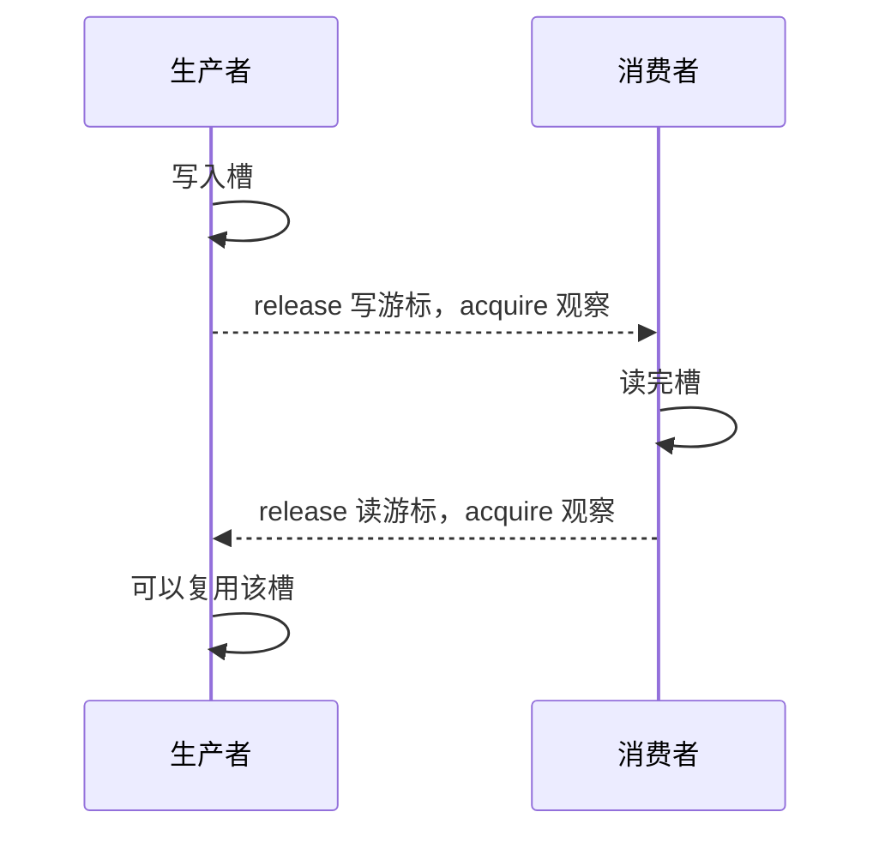

# Day 26 · C++ 内存模型与 SPSC 实验

## 1. 本期内容与学习目标

本课预计 2–3 小时，需要 Day 25 的线程、互斥和背压。用一个固定容量环展示没有 mutex 的槽交接。实验契约是恰好一名生产者、一名消费者。Day 27 的多生产者入口仍使用 Day 25 队列。

## 2. 业务背景与原理

生产者写好订单后才发布写游标。消费者看到新游标后读槽，读完才发布读游标。若生产者先公布写游标，消费者会看到半写入的订单。若消费者先发布读游标，生产者可能覆盖它正在读取的槽。两个方向都必须建立可见性。

## 3. Java 原始项目的实现分析

`GroupingProcessor` 在可读序号范围内处理事件。`TwoStepMasterProcessor` 发布进度并在组边界触发风险释放，slave 只处理屏障允许的范围。Java 的序号交接还要考虑多生产者、多个消费者和阶段屏障。课程使用两条单写者游标演示可见性。 [分组游标](https://github.com/exchange-core/exchange-core/blob/2f8548749839e9095c8dc597e4b61521d259fa5d/src/main/java/exchange/core2/core/processors/GroupingProcessor.java#L132-L171) · [master 发布](https://github.com/exchange-core/exchange-core/blob/2f8548749839e9095c8dc597e4b61521d259fa5d/src/main/java/exchange/core2/core/processors/TwoStepMasterProcessor.java#L98-L162) · [slave 消费](https://github.com/exchange-core/exchange-core/blob/2f8548749839e9095c8dc597e4b61521d259fa5d/src/main/java/exchange/core2/core/processors/TwoStepSlaveProcessor.java#L87-L105)

## 4. 本期 C++ 知识

`happens-before` 表达内存操作的可见顺序。生产者先写槽，再 release-store 写游标。消费者 acquire-load 读到对应发布后，才可读取该槽。消费者读完发布读游标，生产者 acquire-load 后才可复写。各自读取仅由自己写的游标可用 relaxed。`volatile` 无法建立这两条同步关系。 [C++ 原子顺序](https://eel.is/c++draft/atomics.order)

用无符号 `uint64_t` 递增计数器。`write - read` 按模 $2^{64}$ 计算在途量，容量保持远小于模数。下标取位掩码，容量为 2 的幂，计数回绕时下标仍正确。`alignas(64)` 演示分开热点游标，具体缓存行大小依平台而异，原子类型是否真正 lock-free 可查 `is_lock_free()`。

## 5. 架构设计与技术选型

采用 SPSC 限制后，头和尾各自只有一个写者。`try_push` 和 `try_pop` 仅尝试一次，满空交给调用者等待或退避。与 Day 25 的阻塞队列相比，忙等可能占用 CPU。它适用于能够保证拓扑的实验。若增加生产者，写槽及发布需要另外仲裁。



## 6. 从零逐步实现

创建 `include/exchange/spsc_ring.hpp`。用小整数负载先验证模型。`initial` 用来让测试从上界附近开始，两端初始相等仍为空。`static_assert` 要求容量为正且为 2 的幂。

```cpp
#ifndef EXCHANGE_SPSC_RING_HPP
#define EXCHANGE_SPSC_RING_HPP

#include <array>
#include <atomic>
#include <cstddef>
#include <cstdint>
#include <optional>

namespace exchange {

template<std::size_t Capacity>
class SpscRing {
    static_assert(Capacity > 0 && (Capacity & (Capacity - 1)) == 0);
    static_assert(Capacity < (std::uint64_t{1} << 63));
public:
    explicit SpscRing(std::uint64_t initial = 0) : read_(initial), write_(initial) {}

    bool try_push(std::uint64_t value) {
        const auto write = write_.load(std::memory_order_relaxed);
        const auto read = read_.load(std::memory_order_acquire);
        if (write - read == Capacity) {
            return false;
        }
        slots_[write & (Capacity - 1)] = value;
        write_.store(write + 1, std::memory_order_release);
        return true;
    }

    std::optional<std::uint64_t> try_pop() {
        const auto read = read_.load(std::memory_order_relaxed);
        const auto write = write_.load(std::memory_order_acquire);
        if (read == write) {
            return std::nullopt;
        }
        const auto value = slots_[read & (Capacity - 1)];
        read_.store(read + 1, std::memory_order_release);
        return value;
    }

private:
    std::array<std::uint64_t, Capacity> slots_{};
    alignas(64) std::atomic<std::uint64_t> read_;
    alignas(64) std::atomic<std::uint64_t> write_;
};

}

#endif
```

槽数组是普通内存。它的访问依赖两个方向上的交接，不能把槽读写与游标发布调换。消费者返回的是值副本，之后生产者可自由复写槽。

## 7. 测试、调试与验证

创建 `tests/spsc_test.cpp`。先测容量 1 和回绕，再以两线程传输 50,000 个连续值。主线程在 join 后读取结果标记。

```cpp
#include "exchange/spsc_ring.hpp"
#include "test_checks.hpp"

#include <limits>
#include <thread>

int main() {
    using exchange::SpscRing;
    TestChecks checks;
    SpscRing<1> one{std::numeric_limits<std::uint64_t>::max()};
    checks.require(!one.try_pop() && one.try_push(9) && !one.try_push(10) &&
                   one.try_pop() == 9 && !one.try_pop() &&
                   one.try_push(10) && one.try_pop() == 10, "capacity one and counter wrap");

    SpscRing<8> ring{std::numeric_limits<std::uint64_t>::max() - 4};
    constexpr std::uint64_t count = 50'000;
    bool ordered = true;
    std::jthread writer{[&] {
        for (std::uint64_t i = 0; i < count; ++i) {
            while (!ring.try_push(i)) {
                std::this_thread::yield();
            }
        }
    }};
    std::jthread reader{[&] {
        for (std::uint64_t i = 0; i < count; ++i) {
            auto next = ring.try_pop();
            while (!next) {
                std::this_thread::yield();
                next = ring.try_pop();
            }
            ordered = ordered && *next == i;
        }
    }};
    writer.join();
    reader.join();
    checks.require(ordered && !ring.try_pop(), "no loss, duplicate or reorder");
    return checks.exit_code();
}
```

```cmake
add_executable(spsc_tests tests/spsc_test.cpp)
target_link_libraries(spsc_tests PRIVATE exchange_core Threads::Threads)
add_test(NAME spsc COMMAND spsc_tests)
set_tests_properties(spsc PROPERTIES TIMEOUT 15)
```

运行 `cmake --build build-debug` 和 `ctest --test-dir build-debug -R '^spsc$' --output-on-failure`。完整构建已有 25 项。支持 TSan 的 Clang/GCC 可另外用下段，和 ASan 使用不同构建目录。一次通过只能覆盖实际调度；把两个方向的发布关系画出来，才能说明实现为何可用。

```bash
cmake -S . -B build-tsan -DCMAKE_BUILD_TYPE=Debug -DCMAKE_CXX_FLAGS="-g -fsanitize=thread"
cmake --build build-tsan --target spsc_tests
ctest --test-dir build-tsan -R '^spsc$' --output-on-failure
```

## 8. Java 与 C++ 实现深度对比

Java 的 volatile 序号与 Disruptor 屏障为复杂阶段提供顺序。C++ 实验直接暴露 acquire/release 及两个单写者条件。等待策略、容量和游标布局需要分开测，单次吞吐变化无法说明所有贡献。

## 9. 课后练习

1. **基础。** 从 `UINT64_MAX-1` 写入三个元素，标出容量 4 下的三个槽。
2. **工程。** 增加容量 2 的回绕用例，交替填满、消费一个、再写一个。
3. **思考。** 为什么增加第二个生产者时，只把 `write_.store` 改为原子加法还不够？

## 10. 总结与下一期

接下来把生产环境教学入口接到 mutex 队列和 future。SPSC 继续作为内存模型实验。

[Day 25](day-25.md) · [课程目录](../00-overview/learning-roadmap.md) · [Day 27](day-27.md)

<details>
<summary>练习参考答案</summary>

1. 依次为 2、3、0。
2. 游标推进后，消费者仍须读先接纳的旧元素，再读新元素。
3. 两个写者可能先读取同一个旧游标并写同一槽。即使分别取号，也还需处理连续发布、满队列竞争及槽复用。

</details>
