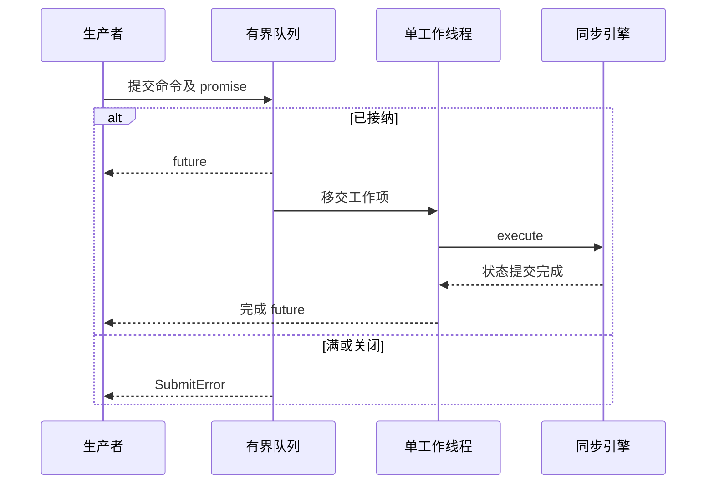

# Day 27 · 异步入口、结果与关停

## 1. 本期内容与学习目标

需要 Day 20 的同步引擎和 Day 25 的队列，预计 3–4 小时。实现 `AsyncEngine`，多个生产者提交命令，唯一工作线程运行同步入口。把接纳失败和业务拒绝分别返回，验证关停会完成已经接纳的 future。

## 2. 业务背景与原理

满队列、已关闭都发生在接纳之前，提交者立即获得 `SubmitError`。接纳成功时返回 `future<Result>`。例如下单资金不足，命令仍已进入工作线程，返回带引擎序号的业务拒绝。`get()` 若遇到工作项异常则重新抛出。教学默认策略将异常隔离到当前工作项，后续项仍由同一处理器判断；接入 Day 28 的日志后，持久化引擎自身会锁住故障状态并让后续命令也失败。

## 3. Java 原始项目的实现分析

Java `ExchangeApi` 按环序号关联 promise，结果阶段取出并完成，关停向环发布信号再等待处理。撮合按品种分片，风险按用户分片，跨用户成交需要前置冻结、撮合、结算进度的协调。本课把这些业务处理留在一个工作线程，future 在同步引擎完成提交后交付。 [Java promise 关联](https://github.com/exchange-core/exchange-core/blob/2f8548749839e9095c8dc597e4b61521d259fa5d/src/main/java/exchange/core2/core/ExchangeApi.java#L58-L73) · [发布及结果](https://github.com/exchange-core/exchange-core/blob/2f8548749839e9095c8dc597e4b61521d259fa5d/src/main/java/exchange/core2/core/ExchangeCore.java#L165-L211) · [关停](https://github.com/exchange-core/exchange-core/blob/2f8548749839e9095c8dc597e4b61521d259fa5d/src/main/java/exchange/core2/core/ExchangeCore.java#L248-L269)

## 4. 本期 C++ 知识

`std::promise<T>` 与 `future<T>` 共享一个状态。promise 是只可移动的所有者，`set_value` 或 `set_exception` 只能成功一次。`get_future` 只能取一次 future，`future::get` 消费该对象。工作项同时拥有命令和 promise，出队后在锁外运行。引用传入的临时对象不能跨线程保存。 [promise 规范](https://eel.is/c++draft/futures.promise)

并发调用 `close` 时，先关闭队列，再用独立 mutex 序列化 join。工作线程无需获取这把锁。自定义测试处理器只能在工作线程内部执行，不得从处理器调用本实例的 `close` 或等待同一队列中的其他任务。

## 5. 架构设计与技术选型

也可以让每品种在单独线程运行，但用户可在多个品种共享资金，跨分片结算需要更明确的协议。先验证队列与单写者，将并发限制在接入层。`AsyncEngine` 支持注入同步处理函数，用于确定性测试和后续持久化组合。默认构造路径在函数对象中拥有一个同步 `Engine`。队列空间与等待容量成正比，future 自身有共享状态开销。



## 6. 从零逐步实现

创建 `include/exchange/async_engine.hpp`。`Processor` 可以保存普通可复制的函数对象。默认 lambda 以值捕获 `shared_ptr<Engine>`，符合 `std::function` 的复制要求；构造后调用者没有该指针，业务状态仍只在工作线程访问。`worker_` 放在最后，线程启动时其他成员已构造。析构先关停和 join，再销毁队列、处理器及同步引擎。

```cpp
#ifndef EXCHANGE_ASYNC_ENGINE_HPP
#define EXCHANGE_ASYNC_ENGINE_HPP

#include "exchange/bounded_queue.hpp"
#include "exchange/engine.hpp"

#include <exception>
#include <functional>
#include <future>
#include <memory>
#include <mutex>
#include <thread>
#include <utility>
#include <variant>

namespace exchange {

enum class SubmitError { full, closed };
using Submission = std::variant<std::future<Result>, SubmitError>;

class AsyncEngine {
public:
    using Processor = std::function<Result(const Command&)>;

    explicit AsyncEngine(std::size_t capacity, BookKind kind = BookKind::list,
                         std::size_t pool_capacity = 4096)
        : AsyncEngine(capacity, [engine = std::make_shared<Engine>(kind, pool_capacity)]
                                (const Command& command) { return engine->execute(command); }) {}

    AsyncEngine(std::size_t capacity, Processor processor)
        : processor_(std::move(processor)), queue_(capacity),
          worker_([this] { consume(); }) {}

    ~AsyncEngine() { close(); }

    Submission submit(Command command) {
        Work item{std::move(command), {}};
        auto answer = item.promise.get_future();
        const auto status = queue_.try_push(std::move(item));
        if (status == PushStatus::accepted) {
            return answer;
        }
        return status == PushStatus::full ? SubmitError::full : SubmitError::closed;
    }

    void close() {
        queue_.close();
        const std::lock_guard lock(join_mutex_);
        if (worker_.joinable()) {
            worker_.join();
        }
    }

private:
    struct Work {
        Command command;
        std::promise<Result> promise;
    };

    void consume() {
        while (auto item = queue_.pop()) {
            try {
                item->promise.set_value(processor_(item->command));
            } catch (...) {
                item->promise.set_exception(std::current_exception());
            }
        }
    }

    Processor processor_;
    BoundedQueue<Work> queue_;
    std::mutex join_mutex_;
    std::jthread worker_;
};

}

#endif
```

工作函数抛异常时，promise 仍属于消费者且尚未被完成。测试中的异常路径验证该 future 被唤醒。`submit` 可在构造共享状态时遇到分配异常，此时还未接纳。调用者需要持有 `AsyncEngine` 到所有并发成员调用结束。

## 7. 测试、调试与验证

创建 `tests/async_engine_test.cpp`。第一组用闩锁让首条命令停在工作线程，再制造确定的满载。第二组用两个生产者提交不同用户，按回执序号排序，用同步引擎重放并比较指纹。第三组在提交与关停并行时检查所有已接纳 future 可完成。

```cpp
#include "exchange/async_engine.hpp"
#include "test_checks.hpp"

#include <algorithm>
#include <array>
#include <latch>
#include <stdexcept>
#include <vector>

int main() {
    using namespace exchange;
    TestChecks checks;
    std::latch running{1};
    std::latch finish{1};
    int steps = 0;
    AsyncEngine held{1, [&](const Command&) -> Result {
        if (++steps == 1) {
            running.count_down();
            finish.wait();
            throw std::runtime_error{"injected work error"};
        }
        return {Seq{static_cast<std::uint64_t>(steps)}, {Status::processed, {}}};
    }};
    auto first = held.submit(QueryTotals{});
    running.wait();
    auto second = held.submit(QueryTotals{});
    const auto full = held.submit(QueryTotals{});
    const auto* error = std::get_if<SubmitError>(&full);
    checks.require(error && *error == SubmitError::full, "deterministic backpressure");
    finish.count_down();
    std::jthread closer{[&] { held.close(); }};
    held.close();
    closer.join();
    auto after = held.submit(QueryTotals{});
    const auto* closed = std::get_if<SubmitError>(&after);
    checks.require(closed && *closed == SubmitError::closed, "closed rejects submission");
    bool threw = false;
    try {
        std::get<std::future<Result>>(first).get();
    } catch (const std::runtime_error&) {
        threw = true;
    }
    checks.require(threw && std::get<std::future<Result>>(second).get().seq == Seq{2},
                   "exception delivered and accepted tail drained");

    AsyncEngine engine{64};
    struct Seen { AddUser command; std::future<Result> result; };
    std::array<std::vector<Seen>, 2> records;
    std::latch go{2};
    const auto send = [&](std::size_t lane) {
        go.arrive_and_wait();
        for (std::uint64_t i = 1; i <= 20; ++i) {
            const AddUser cmd{UserId{lane * 20 + i}};
            auto reply = engine.submit(cmd);
            records[lane].push_back({cmd, std::move(std::get<std::future<Result>>(reply))});
        }
    };
    std::jthread left{send, 0};
    std::jthread right{send, 1};
    left.join();
    right.join();
    auto fp = engine.submit(QueryFingerprint{});
    engine.close();

    std::vector<std::pair<Seq, AddUser>> replay;
    for (auto& lane : records) {
        for (auto& seen : lane) {
            const auto result = seen.result.get();
            checks.require(result.outcome.status == Status::processed, "accepted user command");
            replay.emplace_back(result.seq, seen.command);
        }
    }
    std::sort(replay.begin(), replay.end(), [](const auto& a, const auto& b) {
        return a.first < b.first;
    });
    Engine sync;
    for (const auto& [seq, cmd] : replay) {
        checks.require(sync.execute(cmd).seq == seq, "replay sequence");
    }
    const auto actual = std::get<std::future<Result>>(fp).get();
    checks.require(replay.size() == 40 && actual.seq == Seq{41} &&
                   std::get<StateFingerprint>(actual.report).value ==
                   std::get<StateFingerprint>(sync.execute(QueryFingerprint{}).report).value,
                   "two producers replay to the same state");

    AsyncEngine racing{8};
    std::latch race{2};
    std::array<Submission, 6> replies;
    std::jthread producer{[&] {
        race.arrive_and_wait();
        for (std::size_t i = 0; i < replies.size(); ++i) {
            replies[i] = racing.submit(AddUser{UserId{i + 1}});
        }
    }};
    race.arrive_and_wait();
    racing.close();
    producer.join();
    for (auto& reply : replies) {
        if (auto* future = std::get_if<std::future<Result>>(&reply)) {
            checks.require(future->get().outcome.status == Status::processed, "race accepted work");
        } else {
            checks.require(std::get<SubmitError>(reply) == SubmitError::closed, "race closed work");
        }
    }
    return checks.exit_code();
}
```

```cmake
add_executable(async_engine_tests tests/async_engine_test.cpp)
target_link_libraries(async_engine_tests PRIVATE exchange_core Threads::Threads)
add_test(NAME async_engine COMMAND async_engine_tests)
set_tests_properties(async_engine PROPERTIES TIMEOUT 20)
```

构建后执行 `ctest --test-dir build-debug -R '^async_engine$' --output-on-failure`，全套应有 26 项。若 close 后有 future 卡住，先检查队列是否排空，再检查每个已取出的 promise 是否完成。测试故意延后读取 future，确认消费者完成后仍可保存回执。

## 8. Java 与 C++ 实现深度对比

Java 结果阶段用序号查表关联请求，课程把 promise 随命令移动，减少一处共享表。已有同步状态边界使事件和账户在同一条命令内可观察。异步化影响接纳、等待和关闭的时刻，交易业务契约沿用同步入口。

## 9. 课后练习

1. **基础。** 给已知未知用户的请求取 future，检查业务结果仍有序号。
2. **工程。** 保存同一运行中三个已完成但尚未读取的 future，再倒序取值，核对各自序号。
3. **思考。** 为什么不应在工作线程回调里等待另一个提交给同实例的任务？

## 10. 总结与下一期

并发入口已能提供背压和可等待的结果。Day 28 给同步引擎外加命令日志和失败锁定，异步入口可以通过处理器复用它。

[Day 26](day-26.md) · [课程目录](../00-overview/learning-roadmap.md) · [Day 28](day-28.md)

<details>
<summary>练习参考答案</summary>

1. 给无账户用户提交资金调整，接纳时收到 future，完成时为 `unknown_user`。
2. future 获取顺序只影响调用者读取，不改变执行序号。
3. 同一个消费者被等待阻塞，队列内后续任务不能开始，形成自等待。

</details>
