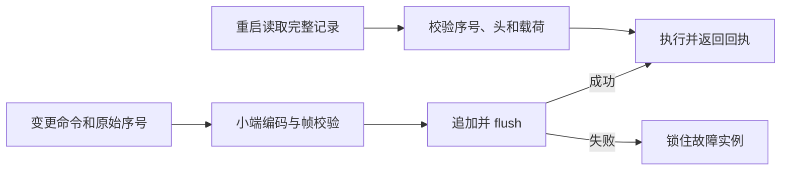

# Day 28 · 可重放命令日志

## 1. 本期内容与学习目标

本课预计 4–5 小时，需要值命令、序号和 RAII。为同步引擎实现可重放命令日志。日志记录变更命令，包括业务拒绝。查询消耗序号但不写日志，重放允许这些空洞。先核对编码、损坏边界和写入失败，再接快照。

## 2. 业务背景与原理

若序号 11 为下单，12 为查询，13 为撤单，日志只需记录 11、13。重放后下一个序号是 14。若写完 13 后、返回结果前进程退出，重启可能重放 13，客户端只能通过结果或当前状态确定发生了什么。这里的确认以 `ostream::flush` 成功且内存状态执行完成为界。断电持久性还需要平台同步调用。

## 3. Java 原始项目的实现分析

Java 命令类型带 `isMutate`，日志阶段跳过只读命令，按批次或缓冲阈值写文件，恢复用 API 重放。课程按条写、显式版本和校验，并让同步入口使用记录的原序号。 [命令类型](https://github.com/exchange-core/exchange-core/blob/2f8548749839e9095c8dc597e4b61521d259fa5d/src/main/java/exchange/core2/core/common/cmd/OrderCommandType.java#L24-L52) · [写入筛选](https://github.com/exchange-core/exchange-core/blob/2f8548749839e9095c8dc597e4b61521d259fa5d/src/main/java/exchange/core2/core/processors/journaling/DiskSerializationProcessor.java#L239-L270) · [分区重放](https://github.com/exchange-core/exchange-core/blob/2f8548749839e9095c8dc597e4b61521d259fa5d/src/main/java/exchange/core2/core/processors/journaling/DiskSerializationProcessor.java#L407-L445)

## 4. 本期 C++ 知识

`std::byte` 表达原始字节，`std::to_integer` 将它转换成无符号值。字段逐字节编码为小端，避免对象对齐、大小、填充和宿主字节序进入格式。有符号值先转换成无符号位表示，C++20 的整型转换按目标位宽取同余值，可恢复负的出金量。解码每次先核对剩余长度，批次成员数也限制。读取时区分边界 EOF、最后帧截断、完整帧损坏。校验和只用于检测损坏。 [整型转换](https://eel.is/c++draft/conv.integral)

## 5. 架构设计与技术选型

帧布局为 `magic:4 + version:1 + payload_length:4 + seq:8 + payload + checksum:4`。头和载荷都在校验范围内。未知版本、非法长度、非递增序号、完整帧校验失败立即停止。仅末尾缺字节可作为有效前缀结束。本课的文件接口使用二进制模式。教学示例把文件字节读入内存后解析，单帧载荷最大 1 MiB，读取整个文件限制 64 MiB。超过该规模时需要日志轮转或流式解析。



## 6. 从零逐步实现

### 28.1 字节工具和公开接口

创建 `include/exchange/persistence.hpp`。`Bytes` 拥有缓冲，`Reader` 借用一个只读 `span`，调用者要保留原向量。以下工具也给 Day 29 的快照使用。

```cpp
#ifndef EXCHANGE_PERSISTENCE_HPP
#define EXCHANGE_PERSISTENCE_HPP

#include "exchange/engine.hpp"

#include <cstddef>
#include <cstdint>
#include <functional>
#include <iosfwd>
#include <span>
#include <stdexcept>
#include <vector>

namespace exchange {

using Bytes = std::vector<std::byte>;

namespace wire {

inline constexpr std::size_t max_payload = 1'048'576;
inline constexpr std::uint32_t max_batch = 4096;

struct Writer {
    Bytes data;
    void u(std::uint64_t value, unsigned width = 8) {
        for (unsigned i = 0; i < width; ++i) {
            data.push_back(static_cast<std::byte>((value >> (8 * i)) & 0xff));
        }
    }
    void i(std::int64_t value) { u(static_cast<std::uint64_t>(value)); }
};

struct Reader {
    std::span<const std::byte> data;
    std::size_t pos{};

    std::size_t left() const { return data.size() - pos; }
    std::span<const std::byte> take(std::size_t size) {
        if (size > left()) {
            throw std::runtime_error{"truncated field"};
        }
        const auto value = data.subspan(pos, size);
        pos += size;
        return value;
    }
    std::uint64_t u(unsigned width = 8) {
        std::uint64_t result = 0;
        unsigned shift = 0;
        for (const auto value : take(width)) {
            result |= std::to_integer<std::uint64_t>(value) << shift;
            shift += 8;
        }
        return result;
    }
    std::int64_t i() { return static_cast<std::int64_t>(u()); }
    bool flag() {
        const auto value = u(1);
        if (value > 1) {
            throw std::runtime_error{"invalid flag"};
        }
        return value != 0;
    }
    void end() const {
        if (left() != 0) {
            throw std::runtime_error{"unexpected trailing bytes"};
        }
    }
};

std::uint32_t checksum(std::span<const std::byte> bytes);
void write_spec(Writer& out, const SymbolSpec& spec);
SymbolSpec read_spec(Reader& in);

}

struct LogRecord { Seq seq; Command command; };
struct LogScan {
    std::vector<LogRecord> records;
    std::size_t valid_bytes{};
    bool truncated_tail{};
};

bool is_mutating(const Command& command);
Bytes encode_record(Seq seq, const Command& command);
LogScan scan_log(std::span<const std::byte> bytes);
Bytes read_binary(std::istream& stream);
void write_binary(std::ostream& stream, std::span<const std::byte> bytes);
std::vector<Result> replay_log(Engine& engine, const LogScan& log);

class JournaledEngine {
public:
    using Append = std::function<void(std::span<const std::byte>)>;

    explicit JournaledEngine(Append append, BookKind kind = BookKind::list,
                             std::size_t capacity = 4096);
    Result execute(const Command& command);
    bool failed() const { return failed_; }
    const Engine& state() const { return engine_; }

private:
    Engine engine_;
    Append append_;
    bool failed_{};
};

}

#endif
```

`Writer::u` 的 `width` 是字节数，课程调用点只用 1、4 或 8。序号 1 编成 `01 00 00 00 00 00 00 00`。`Reader::take` 先验证长度，再返回底层字节的视图，`pos` 只向前推进。`Reader::end` 则保证每条变体完整消耗了载荷。

### 28.2 编码全部现有变更命令

创建 `src/persistence.cpp`。类型编号是文件契约，不能直接写 `variant::index()`。序号、用户和订单号用 8 字节，品种和币种用 4 字节。每个带多个字段的构造都用列表初始化，读取顺序与写入一致。批量命令保留原输入顺序。方向和限价策略保留原枚举数值，业务非法的枚举值在重放时仍由原校验拒绝。窄化为一个字节可能把非法值 256 截成合法值 0。

```cpp
#include "exchange/persistence.hpp"

#include <istream>
#include <limits>
#include <ostream>
#include <type_traits>
#include <utility>

namespace exchange {
namespace wire {

std::uint32_t checksum(std::span<const std::byte> bytes) {
    std::uint32_t hash = 2166136261u;
    for (const auto value : bytes) {
        hash = (hash ^ std::to_integer<std::uint32_t>(value)) * 16777619u;
    }
    return hash;
}

void write_spec(Writer& out, const SymbolSpec& spec) {
    out.u(spec.symbol.value(), 4);
    out.u(spec.base.value(), 4);
    out.u(spec.quote.value(), 4);
    out.i(spec.base_scale);
    out.i(spec.quote_scale);
    out.i(spec.maker_fee_per_lot);
    out.i(spec.taker_fee_per_lot);
}

SymbolSpec read_spec(Reader& in) {
    return {SymbolId{static_cast<std::uint32_t>(in.u(4))},
            CurrencyId{static_cast<std::uint32_t>(in.u(4))},
            CurrencyId{static_cast<std::uint32_t>(in.u(4))},
            in.i(), in.i(), in.i(), in.i()};
}

}

namespace {

using wire::Reader;
using wire::Writer;
constexpr std::uint32_t log_magic = 0x31474f4c;
constexpr std::uint8_t log_version = 1;
constexpr std::size_t log_header = 17;

void owner(Writer& out, OrderKey key, UserId user) {
    out.u(key.symbol.value(), 4);
    out.u(key.order.value());
    out.u(user.value());
}

OrderKey read_key(Reader& in) {
    return {SymbolId{static_cast<std::uint32_t>(in.u(4))}, OrderId{in.u()}};
}

std::uint32_t read_count(Reader& in) {
    const auto count = in.u(4);
    if (count > wire::max_batch) {
        throw std::runtime_error{"batch too large"};
    }
    return static_cast<std::uint32_t>(count);
}

void write_count(Writer& out, std::size_t count) {
    if (count > wire::max_batch) {
        throw std::length_error{"batch too large"};
    }
    out.u(count, 4);
}

template<class T>
inline constexpr bool is_query = std::is_same_v<T, QueryUser> ||
    std::is_same_v<T, QueryTotals> || std::is_same_v<T, QueryFingerprint>;

void encode_command(Writer& out, const Command& command) {
    std::visit([&](const auto& cmd) {
        using T = std::decay_t<decltype(cmd)>;
        if constexpr (std::is_same_v<T, PlaceOrder>) {
            out.u(1, 1);
            owner(out, cmd.key, cmd.user);
            out.i(static_cast<std::int64_t>(cmd.side));
            out.i(cmd.quantity.value());
            out.i(cmd.timestamp_ns);
            if (const auto* limit = std::get_if<LimitPrice>(&cmd.constraint)) {
                out.u(1, 1);
                out.i(limit->price.value());
                out.i(static_cast<std::int64_t>(limit->policy));
                out.u(limit->reserve_bid_price.has_value(), 1);
                if (limit->reserve_bid_price) {
                    out.i(limit->reserve_bid_price->value());
                }
            } else {
                out.u(2, 1);
                out.i(std::get<BudgetLimit>(cmd.constraint).total.value());
            }
        } else if constexpr (std::is_same_v<T, CancelOrder>) {
            out.u(2, 1); owner(out, cmd.key, cmd.user);
        } else if constexpr (std::is_same_v<T, ReduceOrder>) {
            out.u(3, 1); owner(out, cmd.key, cmd.user); out.i(cmd.quantity.value());
        } else if constexpr (std::is_same_v<T, MoveOrder>) {
            out.u(4, 1); owner(out, cmd.key, cmd.user); out.i(cmd.new_price.value());
        } else if constexpr (std::is_same_v<T, RegisterSymbol>) {
            out.u(5, 1); wire::write_spec(out, cmd.spec);
        } else if constexpr (std::is_same_v<T, AddUser>) {
            out.u(6, 1); out.u(cmd.user.value());
        } else if constexpr (std::is_same_v<T, AdjustBalance>) {
            out.u(7, 1); out.u(cmd.user.value());
            out.u(cmd.amount.currency.value(), 4); out.i(cmd.amount.units); out.u(cmd.funding_id);
        } else if constexpr (std::is_same_v<T, SuspendUser>) {
            out.u(8, 1); out.u(cmd.user.value());
        } else if constexpr (std::is_same_v<T, ResumeUser>) {
            out.u(9, 1); out.u(cmd.user.value());
        } else if constexpr (std::is_same_v<T, RegisterSymbols>) {
            out.u(10, 1); write_count(out, cmd.specs.size());
            for (const auto& spec : cmd.specs) { wire::write_spec(out, spec); }
        } else if constexpr (std::is_same_v<T, AddUsers>) {
            out.u(11, 1); write_count(out, cmd.users.size());
            for (const auto user : cmd.users) { out.u(user.value()); }
        } else {
            static_assert(is_query<T>);
            throw std::invalid_argument{"read command cannot enter the journal"};
        }
    }, command);
}

template<class Enum>
Enum read_enum(Reader& in) {
    using Value = std::underlying_type_t<Enum>;
    const auto value = in.i();
    if (!std::in_range<Value>(value)) {
        throw std::runtime_error{"enum outside underlying type"};
    }
    return static_cast<Enum>(static_cast<Value>(value));
}

OrderConstraint read_constraint(Reader& in) {
    const auto type = in.u(1);
    if (type == 1) {
        const Price price{in.i()};
        const auto policy = read_enum<LimitPolicy>(in);
        std::optional<Price> reserve;
        if (in.flag()) {
            reserve = Price{in.i()};
        }
        return LimitPrice{price, policy, reserve};
    }
    if (type == 2) {
        return BudgetLimit{NotionalSteps{in.i()}};
    }
    throw std::runtime_error{"unknown constraint tag"};
}

Command decode_command(Reader& in) {
    switch (in.u(1)) {
        case 1: {
            const auto key = read_key(in);
            const UserId user{in.u()};
            const auto side = read_enum<Side>(in);
            const Quantity quantity{in.i()};
            const auto time = in.i();
            return PlaceOrder{key, user, side, quantity, read_constraint(in), time};
        }
        case 2: return CancelOrder{read_key(in), UserId{in.u()}};
        case 3: return ReduceOrder{read_key(in), UserId{in.u()}, Quantity{in.i()}};
        case 4: return MoveOrder{read_key(in), UserId{in.u()}, Price{in.i()}};
        case 5: return RegisterSymbol{wire::read_spec(in)};
        case 6: return AddUser{UserId{in.u()}};
        case 7: return AdjustBalance{UserId{in.u()},
                    {CurrencyId{static_cast<std::uint32_t>(in.u(4))}, in.i()}, in.u()};
        case 8: return SuspendUser{UserId{in.u()}};
        case 9: return ResumeUser{UserId{in.u()}};
        case 10: {
            RegisterSymbols batch;
            const auto count = read_count(in);
            for (std::uint32_t i = 0; i < count; ++i) {
                batch.specs.push_back(wire::read_spec(in));
            }
            return batch;
        }
        case 11: {
            AddUsers batch;
            const auto count = read_count(in);
            for (std::uint32_t i = 0; i < count; ++i) {
                batch.users.push_back(UserId{in.u()});
            }
            return batch;
        }
        default: throw std::runtime_error{"unknown command tag"};
    }
}

}

bool is_mutating(const Command& command) {
    return std::visit([](const auto& cmd) {
        return !is_query<std::decay_t<decltype(cmd)>>;
    }, command);
}

Bytes encode_record(Seq seq, const Command& command) {
    if (seq.value() == 0) {
        throw std::invalid_argument{"invalid log sequence"};
    }
    Writer payload;
    encode_command(payload, command);
    if (payload.data.size() > wire::max_payload) {
        throw std::length_error{"log payload too large"};
    }
    Writer out;
    out.u(log_magic, 4);
    out.u(log_version, 1);
    out.u(payload.data.size(), 4);
    out.u(seq.value());
    out.data.insert(out.data.end(), payload.data.begin(), payload.data.end());
    out.u(wire::checksum(out.data), 4);
    return std::move(out.data);
}

LogScan scan_log(std::span<const std::byte> bytes) {
    Reader in{bytes};
    LogScan result;
    Seq previous{0};
    while (in.left() != 0) {
        const auto start = in.pos;
        if (in.left() < log_header) {
            result.truncated_tail = true;
            break;
        }
        if (in.u(4) != log_magic || in.u(1) != log_version) {
            throw std::runtime_error{"unsupported log header"};
        }
        const auto length = static_cast<std::size_t>(in.u(4));
        const Seq seq{in.u()};
        if (length == 0 || length > wire::max_payload || seq <= previous) {
            throw std::runtime_error{"invalid log length or sequence"};
        }
        if (in.left() < length + 4) {
            result.truncated_tail = true;
            break;
        }
        Reader payload{in.take(length)};
        const auto covered = bytes.subspan(start, in.pos - start);
        if (in.u(4) != wire::checksum(covered)) {
            throw std::runtime_error{"log checksum mismatch"};
        }
        auto command = decode_command(payload);
        payload.end();
        result.records.push_back({seq, std::move(command)});
        previous = seq;
        result.valid_bytes = in.pos;
    }
    return result;
}

Bytes read_binary(std::istream& stream) {
    Bytes bytes;
    char value = 0;
    while (stream.get(value)) {
        if (bytes.size() == 64u * 1024u * 1024u) {
            throw std::length_error{"binary input is too large"};
        }
        bytes.push_back(static_cast<std::byte>(static_cast<unsigned char>(value)));
    }
    if (stream.bad() || !stream.eof()) {
        throw std::runtime_error{"could not read binary stream"};
    }
    return bytes;
}

void write_binary(std::ostream& stream, std::span<const std::byte> bytes) {
    if (bytes.size() > static_cast<std::uintmax_t>(std::numeric_limits<std::streamsize>::max())) {
        throw std::length_error{"binary output is too large"};
    }
    stream.write(reinterpret_cast<const char*>(bytes.data()),
                 static_cast<std::streamsize>(bytes.size()));
    stream.flush();
    if (!stream) {
        throw std::runtime_error{"journal write or flush failed"};
    }
}

std::vector<Result> replay_log(Engine& engine, const LogScan& log) {
    std::vector<Result> results;
    const auto checkpoint = engine.last_sequence();
    for (const auto& record : log.records) {
        if (record.seq > checkpoint) {
            results.push_back(engine.execute_at(record.command, record.seq));
        }
    }
    return results;
}

JournaledEngine::JournaledEngine(Append append, BookKind kind, std::size_t capacity)
    : engine_(kind, capacity), append_(std::move(append)) {}

Result JournaledEngine::execute(const Command& command) {
    if (failed_) {
        throw std::runtime_error{"journaled engine requires recovery"};
    }
    const auto next = engine_.next_sequence();
    if (is_mutating(command)) {
        const auto bytes = encode_record(next, command);
        try {
            append_(bytes);
        } catch (...) {
            failed_ = true;
            throw;
        }
    }
    try {
        return engine_.execute_at(command, next);
    } catch (...) {
        failed_ = true;
        throw;
    }
}

}
```

读帧时先读取固定长度头部，知道剩余多少字节才检查校验。这里必须信任头部提供的分帧边界，若损坏的合法长度恰好越过文件末尾，也会归为尾部截断。实验限于本地单写者日志，严格区分这两种情况可另给头部独立校验。完整帧内的未知标签或多余字段都属于损坏。

### 28.3 暴露受约束的重放序号

在 `Engine` 公开区加 `Seq last_sequence() const { return Seq{last_seq_}; }` 及下列声明。将 `engine.cpp` 的旧 `execute` 实现换成下面三个函数。重放只接受严格前进的序号，允许查询空洞。普通调用仍使用下一序号。

```cpp
    Seq next_sequence() const;
    Result execute_at(const Command& command, Seq seq);
```

```cpp
Seq Engine::next_sequence() const {
    if (last_seq_ == std::numeric_limits<std::uint64_t>::max()) {
        throw std::overflow_error{"command sequence exhausted"};
    }
    return Seq{last_seq_ + 1};
}

Result Engine::execute(const Command& command) {
    return execute_at(command, next_sequence());
}

Result Engine::execute_at(const Command& command, Seq seq) {
    if (seq.value() <= last_seq_) {
        throw std::invalid_argument{"sequence must advance"};
    }
    last_seq_ = seq.value();
    return std::visit([&](const auto& input) { return answer(input, seq); }, command);
}
```

`JournaledEngine` 在业务执行前写入命令。若编码因超出课堂格式的批次上限失败，没有写入，且未消耗序号。跨重启只以日志或快照中最后可恢复的序号作为下界，不能用该序号推断上一进程内发生过多少次查询。追加或业务执行抛出异常后锁住实例，恢复时由完整记录决定可执行前缀。日志成功但命令未在当前进程执行时，重放可完成它。文件模式可将 `Append` 绑定到 `write_binary`，流以二进制追加打开，同一时刻只有一个写者。业务拒绝结果不会改变该记录是否写入。

## 7. 测试、调试与验证

创建 `tests/journal_test.cpp`。用一组涵盖全部编码标签的命令逐帧往返，再用序号间隔和损坏注入验证读取边界。

```cpp
#include "exchange/persistence.hpp"
#include "test_checks.hpp"

#include <sstream>
#include <string>

int main() {
    using namespace exchange;
    TestChecks checks;
    const SymbolSpec spec{SymbolId{1}, CurrencyId{10}, CurrencyId{20}, 1, 1, 0, 0};
    const UserId user{1};
    const OrderKey key{spec.symbol, OrderId{7}};
    const std::vector<Command> commands{
        RegisterSymbol{spec}, AddUser{user}, AdjustBalance{user, {spec.quote, -7}, 2},
        SuspendUser{user}, ResumeUser{user}, RegisterSymbols{{spec}}, AddUsers{{user}},
        PlaceOrder{key, user, Side::bid, Quantity{1}, LimitPrice{Price{80}, LimitPolicy::ioc, Price{90}}, 9},
        PlaceOrder{key, user, Side::ask, Quantity{2}, BudgetLimit{NotionalSteps{160}}, 10},
        PlaceOrder{key, user, static_cast<Side>(256), Quantity{2}, BudgetLimit{NotionalSteps{160}}, 10},
        CancelOrder{key, user}, ReduceOrder{key, user, Quantity{1}}, MoveOrder{key, user, Price{75}},
    };
    for (const auto& command : commands) {
        const auto bytes = encode_record(Seq{4}, command);
        const auto parsed = scan_log(bytes);
        checks.require(parsed.records.size() == 1 && parsed.valid_bytes == bytes.size() &&
                       encode_record(parsed.records.front().seq, parsed.records.front().command) == bytes,
                       "record roundtrip");
    }

    Bytes log;
    JournaledEngine live{[&](auto bytes) { log.insert(log.end(), bytes.begin(), bytes.end()); }};
    const auto add = live.execute(AddUser{user});
    live.execute(QueryTotals{});
    const auto money = live.execute(AdjustBalance{user, {spec.quote, 500}, 1});
    const auto repeated = live.execute(AdjustBalance{user, {spec.quote, 500}, 1});
    const auto parsed = scan_log(log);
    Engine rebuilt;
    const auto replay = replay_log(rebuilt, parsed);
    checks.require(add.seq == Seq{1} && money.seq == Seq{3} && repeated.seq == Seq{4} &&
                   replay.size() == 3 && replay.at(1).seq == Seq{3} &&
                   replay.back().outcome.status == Status::duplicate_funding &&
                   rebuilt.next_sequence() == Seq{5}, "replay gap and business refusal");
    checks.require(rebuilt.ledger().available(user, spec.quote) == Money{spec.quote, 500},
                   "replay preserves account");

    std::ostringstream output{std::ios::binary};
    write_binary(output, log);
    std::istringstream input{output.str(), std::ios::binary};
    checks.require(read_binary(input) == log, "binary streams");
    auto short_tail = log;
    short_tail.pop_back();
    const auto prefix = scan_log(short_tail);
    checks.require(prefix.truncated_tail && prefix.records.size() == 2 &&
                   prefix.valid_bytes < short_tail.size(), "truncated final frame");

    const auto reject = [](const Bytes& bytes) {
        try { scan_log(bytes); } catch (const std::runtime_error&) { return true; }
        return false;
    };
    auto corrupt = log;
    corrupt.back() ^= std::byte{1};
    checks.require(reject(corrupt), "checksum error");
    auto version = log;
    version.at(4) = std::byte{2};
    checks.require(reject(version), "unknown version");
    auto length = log;
    length.at(8) = std::byte{0x80};
    checks.require(reject(length), "oversized length");
    auto repeated_seq = log;
    const auto last = encode_record(Seq{4}, AddUser{UserId{9}});
    repeated_seq.insert(repeated_seq.end(), last.begin(), last.end());
    checks.require(reject(repeated_seq), "repeated sequence");
    auto reversed_seq = log;
    const auto earlier = encode_record(Seq{2}, AddUser{UserId{9}});
    reversed_seq.insert(reversed_seq.end(), earlier.begin(), earlier.end());
    checks.require(reject(reversed_seq), "reversed sequence");

    JournaledEngine failed{[](auto) { throw std::runtime_error{"disk full"}; }};
    bool first = false;
    bool blocked = false;
    try { failed.execute(AddUser{user}); } catch (const std::runtime_error&) { first = true; }
    try { failed.execute(QueryTotals{}); } catch (const std::runtime_error&) { blocked = true; }
    checks.require(first && blocked && failed.failed() &&
                   failed.state().last_sequence() == Seq{0} &&
                   !failed.state().ledger().available(user, spec.quote), "write failure blocks commit");
    return checks.exit_code();
}
```

把 `src/persistence.cpp` 加入 `exchange_core`，追加下段，再构建并运行 `ctest --test-dir build-debug -R '^journal$' --output-on-failure`。全套应有 27 项。

```cmake
add_executable(journal_tests tests/journal_test.cpp)
target_link_libraries(journal_tests PRIVATE exchange_core)
add_test(NAME journal COMMAND journal_tests)
```

## 8. Java 与 C++ 实现深度对比

Java 可按批次缓冲、压缩并使用独立日志阶段。课程按条写，便于隔离接纳、写入和执行失败。重放复用业务入口，原始序号继续维持订单优先级。传输编码与 C++ 内存布局无关。

## 9. 课后练习

1. **基础。** 写入两条序号相差 3 的记录，验证重放允许中间空洞。
2. **工程。** 把写入器换成故意失败的流，检查任何状态均未提交。
3. **思考。** 若进程在追加完成之后、提交之前终止，调用端能否凭超时判断命令失败？再想想，校验和若只放在帧尾，如何区分头部长度损坏与真正截断？

## 10. 总结与下一期

下课加入规范状态快照，并从快照序号之后只应用日志尾段。

[Day 27](day-27.md) · [课程目录](../00-overview/learning-roadmap.md) · [Day 29](day-29.md)

<details>
<summary>练习参考答案</summary>

1. 例如 1 和 4 合法，下一序号为 5。
2. 可给 `ostringstream` 预先设置 `badbit`，再用 `write_binary` 绑定到追加函数。
3. 恢复可执行已经写完的记录，调用端需按运行实例、序号和业务 ID 查询。可以在固定长度头部增加独立校验，先验证长度字段所在的头，再判断载荷是否截断。

</details>
