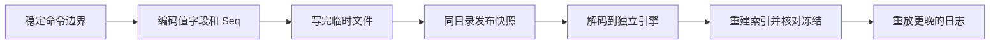

# Day 29 · 快照、索引重建与版本

## 1. 本期内容与学习目标

本课预计 4–5 小时，需要 Day 24 的工厂和 Day 28 的编解码。把当前状态保存到版本化快照，恢复时重建价格档与索引，再应用快照之后的日志。快照读取在独立对象上完成，全部校验通过才交给调用者。

## 2. 业务背景与原理

快照保存的是某个命令边界的状态。若在序号 20 获取快照，日志中 20 以前的命令可以跳过。索引和指针依赖当前进程的对象地址，因此只保存活动订单值及其优先序号。还需保存账户、冻结、费用、净入金和最后资金流水。漏掉流水号会让恢复后重复入金生效。

## 3. Java 原始项目的实现分析

Java `ApiPersistState` 发布撮合和风险两条快照命令。`DiskSerializationProcessor` 用模块及分片区分快照文件。Naive 构造器读入价格档后重建 ID 索引。课程的单写者同时获得簿与账本的稳定切点，输出一个文件。 [快照命令](https://github.com/exchange-core/exchange-core/blob/2f8548749839e9095c8dc597e4b61521d259fa5d/src/main/java/exchange/core2/core/ExchangeApi.java#L388-L422) · [磁盘序列化](https://github.com/exchange-core/exchange-core/blob/2f8548749839e9095c8dc597e4b61521d259fa5d/src/main/java/exchange/core2/core/processors/journaling/DiskSerializationProcessor.java#L126-L203) · [Naive 索引重建](https://github.com/exchange-core/exchange-core/blob/2f8548749839e9095c8dc597e4b61521d259fa5d/src/main/java/exchange/core2/core/orderbook/OrderBookNaiveImpl.java#L69-L81)

## 4. 本期 C++ 知识

快照与日志复用字段编码，使用不同 magic 和版本。`unique_ptr<Engine>` 拥有重建的状态，打开方只在验证完成后接收它。`friend class SnapshotStore` 允许快照模块读写内部表示，调用方仍通过只读报告观察业务状态。`std::filesystem::rename` 在本课目标环境采用同目录发布，进程中断时读者只打开发布路径。临时路径由应用独占，发生失败可留待下次清理。`flush`、关闭、rename 和断电持久性是不同条件。 [POSIX rename](https://pubs.opengroup.org/onlinepubs/9799919799/functions/rename.html)

## 5. 架构设计与技术选型

快照记录引擎序号、簿布局与容量、品种规格和规范活动订单，再保存账本状态。受信的课堂状态最多 1 MiB、每个集合最多 4096 项。单个池最多 4096 个对外槽，所有市场的预分配槽合计最多 65,536 个。读取时检查版本、长度、校验、重复键、订单入队、冻结归属和逐币种守恒。重建索引的成本随活动订单量增长，解码期间内存同时持有字节和临时状态。



## 6. 从零逐步实现

### 29.1 给工厂增加规范重建入口

在 `order_book.hpp` 将 Day 17 的 `OrderBook::from_resting` 声明尾部改为 `SymbolId symbol, const std::vector<RestingOrder>& orders, BookKind kind = BookKind::list, std::size_t capacity = 4096);`。在定义中加入同名参数，将 `std::make_unique<OrderBook>(symbol)` 改成 `std::make_unique<OrderBook>(symbol, kind, capacity)`。其余校验保持原样。给 `SymbolCatalog`、`Engine` 和 `Ledger` 三个类各在私有区加入 `friend class SnapshotStore;`。

在 `persistence.hpp` 引入 `<filesystem>` 和 `<memory>`，于命名空间内添加如下声明。另在 `JournaledEngine` 加一个构造函数声明 `JournaledEngine(Append append, std::unique_ptr<Engine> recovered);`。把它的 `engine_` 字段换成 `std::unique_ptr<Engine> engine_;`，将 `state()` 返回表达式改为 `*engine_`。在 `persistence.cpp` 把原构造器改为用 `std::make_unique<Engine>(kind, capacity)` 初始化字段，将 `execute` 中的 `engine_.` 调用换为 `engine_->`。新构造器可接收恢复状态。

```cpp
class SnapshotStore {
public:
    static Bytes encode(const Engine& engine);
    static std::unique_ptr<Engine> decode(std::span<const std::byte> bytes);
    static void publish(const std::filesystem::path& destination, const Engine& engine);
};
```

### 29.2 写出和读取状态

创建 `src/snapshot.cpp`。快照前缀含 4 字节 magic、1 字节版本和 4 字节载荷长度，末尾含校验。每个集合先写元素数。映射按其自身有序迭代导出。解码用 `try_emplace` 拒绝重复键，空冻结量不能出现。恢复后优先级序号不能晚于快照切点。课程编码保留零余额行，恢复后同一指纹可按字段核对。布局与容量也在快照中。只从日志重放时必须使用原先的布局和容量配置，因为池满会改变命令的业务结果。 本课把快照和日志放在同一实验目录，由调用者保证它们来自同一条命令历史。序号只能判断重放起点，不能证明两个文件有相同来源。

```cpp
#include "exchange/persistence.hpp"

#include <fstream>
#include <limits>
#include <utility>

namespace exchange {
namespace {

using wire::Reader;
using wire::Writer;
constexpr std::uint32_t snapshot_magic = 0x31504e53;
constexpr unsigned snapshot_version = 1;
constexpr std::uint64_t max_total_slots = 65'536;

bool valid_layout(BookKind kind, std::uint64_t capacity, std::size_t markets) {
    return capacity <= wire::max_batch &&
           (kind != BookKind::pooled || markets <= max_total_slots / (capacity + 1));
}

void count(Writer& out, std::size_t size) {
    if (size > wire::max_batch) {
        throw std::length_error{"snapshot collection too large"};
    }
    out.u(size, 4);
}

std::size_t count(Reader& in) {
    const auto size = in.u(4);
    if (size > wire::max_batch) {
        throw std::runtime_error{"snapshot collection too large"};
    }
    return static_cast<std::size_t>(size);
}

CurrencyId currency(Reader& in) {
    const CurrencyId id{static_cast<std::uint32_t>(in.u(4))};
    if (id.value() == 0) {
        throw std::runtime_error{"zero currency"};
    }
    return id;
}

template<class Map>
void amounts(Writer& out, const Map& map) {
    count(out, map.size());
    for (const auto& [id, units] : map) {
        out.u(id.value(), 4);
        out.i(units);
    }
}

template<class Map>
void amounts(Reader& in, Map& map) {
    const auto size = count(in);
    for (std::size_t i = 0; i < size; ++i) {
        const auto id = currency(in);
        const auto units = in.i();
        if (units < 0 || !map.try_emplace(id, units).second) {
            throw std::runtime_error{"invalid balance row"};
        }
    }
}

void write_order(Writer& out, const RestingOrder& order) {
    out.u(order.key.order.value());
    out.u(order.user.value());
    out.u(order.side == Side::bid, 1);
    out.i(order.price.value());
    out.i(order.remaining.value());
    out.u(order.reserve_bid_price.has_value(), 1);
    if (order.reserve_bid_price) {
        out.i(order.reserve_bid_price->value());
    }
    out.u(order.priority_seq.value());
    out.i(order.timestamp_ns);
}

RestingOrder read_order(Reader& in, SymbolId symbol, Seq checkpoint) {
    const OrderId id{in.u()};
    const UserId user{in.u()};
    const auto side = in.flag() ? Side::bid : Side::ask;
    const Price price{in.i()};
    const Quantity remaining{in.i()};
    std::optional<Price> reserve;
    if (in.flag()) {
        reserve = Price{in.i()};
    }
    const Seq priority{in.u()};
    if (priority > checkpoint) {
        throw std::runtime_error{"priority beyond checkpoint"};
    }
    return {{symbol, id}, user, side, price, remaining, reserve, priority, in.i()};
}

}

Bytes SnapshotStore::encode(const Engine& engine) {
    if (!valid_layout(engine.book_kind_, engine.pool_capacity_, engine.catalog_.markets_.size())) {
        throw std::length_error{"snapshot pool capacity too large"};
    }
    Writer payload;
    payload.u(engine.last_sequence().value());
    payload.u(engine.book_kind_ == BookKind::pooled, 1);
    payload.u(engine.pool_capacity_);
    count(payload, engine.catalog_.markets_.size());
    for (const auto& [id, market] : engine.catalog_.markets_) {
        wire::write_spec(payload, market.spec);
        const auto orders = market.book->resting_orders();
        count(payload, orders.size());
        for (const auto& order : orders) {
            write_order(payload, order);
        }
    }
    const auto& ledger = engine.ledger_;
    count(payload, ledger.accounts_.size());
    for (const auto& [user, account] : ledger.accounts_) {
        payload.u(user.value());
        payload.u(account.last_funding);
        payload.u(account.suspended, 1);
        amounts(payload, account.balances);
    }
    count(payload, ledger.holds_.size());
    for (const auto& [key, hold] : ledger.holds_) {
        payload.u(key.first.value(), 4);
        payload.u(key.second.value());
        payload.u(hold.user.value());
        payload.u(hold.money.currency.value(), 4);
        payload.i(hold.money.units);
    }
    amounts(payload, ledger.fees_);
    amounts(payload, ledger.net_deposits_);
    if (payload.data.size() > wire::max_payload) {
        throw std::length_error{"snapshot payload too large"};
    }

    Writer out;
    out.u(snapshot_magic, 4);
    out.u(snapshot_version, 1);
    out.u(payload.data.size(), 4);
    out.data.insert(out.data.end(), payload.data.begin(), payload.data.end());
    out.u(wire::checksum(out.data), 4);
    return std::move(out.data);
}

std::unique_ptr<Engine> SnapshotStore::decode(std::span<const std::byte> bytes) {
    Reader frame{bytes};
    if (frame.u(4) != snapshot_magic || frame.u(1) != snapshot_version) {
        throw std::runtime_error{"unsupported snapshot header"};
    }
    const auto length = frame.u(4);
    if (length > wire::max_payload || frame.left() != length + 4) {
        throw std::runtime_error{"invalid snapshot length"};
    }
    Reader in{frame.take(static_cast<std::size_t>(length))};
    const auto covered = bytes.first(frame.pos);
    if (frame.u(4) != wire::checksum(covered)) {
        throw std::runtime_error{"snapshot checksum mismatch"};
    }
    const Seq seq{in.u()};
    const auto kind = in.flag() ? BookKind::pooled : BookKind::list;
    const auto capacity = in.u();
    const auto markets = count(in);
    if (!valid_layout(kind, capacity, markets)) {
        throw std::runtime_error{"snapshot pool capacity too large"};
    }
    auto engine = std::make_unique<Engine>(kind, static_cast<std::size_t>(capacity));
    engine->last_seq_ = seq.value();

    for (std::size_t m = 0; m < markets; ++m) {
        const auto spec = wire::read_spec(in);
        const auto size = count(in);
        std::vector<RestingOrder> orders;
        orders.reserve(size);
        for (std::size_t i = 0; i < size; ++i) {
            orders.push_back(read_order(in, spec.symbol, seq));
        }
        if (!valid_symbol(spec) || engine->catalog_.markets_.contains(spec.symbol)) {
            throw std::runtime_error{"invalid snapshot market"};
        }
        auto book = OrderBook::from_resting(spec.symbol, orders, kind,
                                            static_cast<std::size_t>(capacity));
        engine->catalog_.markets_.try_emplace(spec.symbol,
            SymbolCatalog::Market{spec, std::move(book)});
    }

    auto& ledger = engine->ledger_;
    const auto users = count(in);
    for (std::size_t i = 0; i < users; ++i) {
        const UserId user{in.u()};
        const auto funding = in.u();
        const auto suspended = in.flag();
        if (ledger.add_user(user) != Status::processed) {
            throw std::runtime_error{"invalid snapshot user"};
        }
        auto& account = ledger.accounts_.at(user);
        account.last_funding = funding;
        account.suspended = suspended;
        amounts(in, account.balances);
        if (suspended) {
            for (const auto& entry : account.balances) {
                if (entry.second != 0) {
                    throw std::runtime_error{"suspended user has funds"};
                }
            }
        }
    }
    const auto holds = count(in);
    for (std::size_t i = 0; i < holds; ++i) {
        const SymbolId symbol{static_cast<std::uint32_t>(in.u(4))};
        const OrderId order{in.u()};
        const UserId user{in.u()};
        const Money money{currency(in), in.i()};
        if (money.units <= 0 || !ledger.holds_.try_emplace(
                Ledger::HoldKey{symbol, order}, Ledger::Hold{user, money}).second) {
            throw std::runtime_error{"invalid snapshot hold"};
        }
    }
    amounts(in, ledger.fees_);
    amounts(in, ledger.net_deposits_);
    in.end();

    std::size_t checked = 0;
    for (const auto& [id, market] : engine->catalog_.markets_) {
        for (const auto& order : market.book->resting_orders()) {
            const auto account = ledger.accounts_.find(order.user);
            const auto hold = ledger.holds_.find({id, order.key.order});
            const auto expected = order.side == Side::bid
                ? bid_hold(order.remaining, *order.reserve_bid_price, market.spec)
                : base_amount(order.remaining, market.spec);
            if (account == ledger.accounts_.end() || account->second.suspended ||
                hold == ledger.holds_.end() || hold->second.user != order.user ||
                !expected || hold->second.money != *expected) {
                throw std::runtime_error{"snapshot order and hold differ"};
            }
            ++checked;
        }
    }
    if (checked != ledger.holds_.size()) {
        throw std::runtime_error{"orphan hold"};
    }
    for (const auto& row : ledger.totals().currencies) {
        if (!row.conserved()) {
            throw std::runtime_error{"snapshot totals do not conserve"};
        }
    }
    return engine;
}

void SnapshotStore::publish(const std::filesystem::path& destination, const Engine& engine) {
    const auto bytes = encode(engine);
    auto temporary = destination;
    temporary += ".tmp";
    std::ofstream output{temporary, std::ios::binary | std::ios::trunc};
    write_binary(output, bytes);
    output.close();
    if (!output) {
        throw std::runtime_error{"could not close temporary snapshot"};
    }
    std::filesystem::rename(temporary, destination);
}

JournaledEngine::JournaledEngine(Append append, std::unique_ptr<Engine> recovered)
    : engine_(std::move(recovered)), append_(std::move(append)) {
    if (!engine_) {
        throw std::invalid_argument{"missing recovered engine"};
    }
}

}
```

`OrderBook::from_resting` 校验价格、序号、用户 ID、档位顺序和不交叉。读回账本后，再比较每笔活动单的冻结金额。若有额外冻结，数量检查也会拦下。此处快照仅用于现货教学状态，期货扩展需给状态版本与持仓字段定义契约。

## 7. 测试、调试与验证

创建 `tests/snapshot_test.cpp`。在两笔同价卖单后取快照，先查询制造序号空洞，再买入 2 手。两个恢复路径都应获得相同的 maker 顺序、末态和资金。

```cpp
#include "exchange/persistence.hpp"
#include "test_checks.hpp"

int main() {
    using namespace exchange;
    TestChecks checks;
    Bytes log;
    JournaledEngine live{[&](auto frame) { log.insert(log.end(), frame.begin(), frame.end()); },
                         BookKind::pooled, 16};
    const SymbolSpec spec{SymbolId{1}, CurrencyId{10}, CurrencyId{20}, 10, 2, 1, 3};
    const UserId buyer{1};
    const UserId seller{2};
    live.execute(RegisterSymbol{spec});
    live.execute(AddUsers{{buyer, seller}});
    live.execute(AdjustBalance{buyer, {spec.quote, 1000}, 1});
    live.execute(AdjustBalance{seller, {spec.base, 50}, 1});
    PlaceOrder ask{{spec.symbol, OrderId{7}}, seller, Side::ask, Quantity{1},
                   LimitPrice{Price{100}, LimitPolicy::gtc, {}}, 99};
    live.execute(ask);
    ask.key.order = OrderId{8};
    ask.timestamp_ns = 98;
    live.execute(ask);
    const auto checkpoint = SnapshotStore::encode(live.state());
    live.execute(QueryTotals{});
    const PlaceOrder buy{{spec.symbol, OrderId{9}}, buyer, Side::bid, Quantity{2},
                         LimitPrice{Price{105}, LimitPolicy::ioc, {}}, 0};
    const auto expected = live.execute(buy);
    const auto journal = scan_log(log);

    auto restored = SnapshotStore::decode(checkpoint);
    Engine pure{BookKind::pooled, 16};
    const auto with_tail = replay_log(*restored, journal);
    const auto from_start = replay_log(pure, journal);
    checks.require(with_tail.size() == 1 && with_tail.front().seq == Seq{8} &&
                   with_tail.front().outcome == expected.outcome &&
                   from_start.back().outcome == expected.outcome,
                   "checkpoint and full replay preserve tail events");
    checks.require(SnapshotStore::encode(*restored) == SnapshotStore::encode(live.state()) &&
                   SnapshotStore::encode(pure) == SnapshotStore::encode(live.state()),
                   "all three paths have identical canonical bytes");
    checks.require(std::get<Trade>(expected.outcome.events.at(0)).maker.order == OrderId{7} &&
                   std::get<Trade>(expected.outcome.events.at(1)).maker.order == OrderId{8},
                   "FIFO survived out-of-order timestamps");

    const auto saved = SnapshotStore::encode(*restored);
    auto corrupt = checkpoint;
    corrupt.back() ^= std::byte{1};
    bool refused = false;
    try {
        auto replacement = SnapshotStore::decode(corrupt);
        restored.swap(replacement);
    } catch (const std::runtime_error&) {
        refused = true;
    }
    checks.require(refused && SnapshotStore::encode(*restored) == saved, "bad snapshot leaves live engine");
    return checks.exit_code();
}
```

把 `src/snapshot.cpp` 加入库源列表，附加测试目标。运行 `cmake --build build-debug` 与 `ctest --test-dir build-debug -R '^snapshot$' --output-on-failure`。全套应有 28 项。若末态相等但事件先后错，核对序号与每档导出顺序。若恢复以后出现重复 ID，检查是否真的通过 `from_resting` 重建。

```cmake
add_executable(snapshot_tests tests/snapshot_test.cpp)
target_link_libraries(snapshot_tests PRIVATE exchange_core)
add_test(NAME snapshot COMMAND snapshot_tests)
```

## 8. Java 与 C++ 实现深度对比

Java 多分片各保存自己的字段，课程用单文件描述同一个稳定切点。两边都应显式重建对象关系。教学版字节相等测试覆盖规范排序和保存的状态字段。快照格式与 Java 序列化不互通。

## 9. 课后练习

1. **基础。** 在快照点读回两笔卖单，核对 ID 7 在 ID 8 之前。
2. **工程。** 在快照后调整余额，恢复时验证原流水号和新流水号各按一次处理。
3. **思考。** 为什么恢复后只比较总余额不能证明快照正确？

## 10. 总结与下一期

快照和日志可以合并恢复。Day 30 将用真实文件和独立进程执行截断、发布中断和确认丢失场景。

[Day 28](day-28.md) · [课程目录](../00-overview/learning-roadmap.md) · [Day 30](day-30.md)

<details>
<summary>练习参考答案</summary>

1. 用 `book_orders` 对照两条活动记录，按 priority 顺序而非 timestamp。
2. 从快照序号开始应用尾段日志，最后重发旧流水号，预期为重复或过期。
3. 总额相同仍可能分配给错误用户、冻结到错误订单或颠倒同价队列。

</details>
