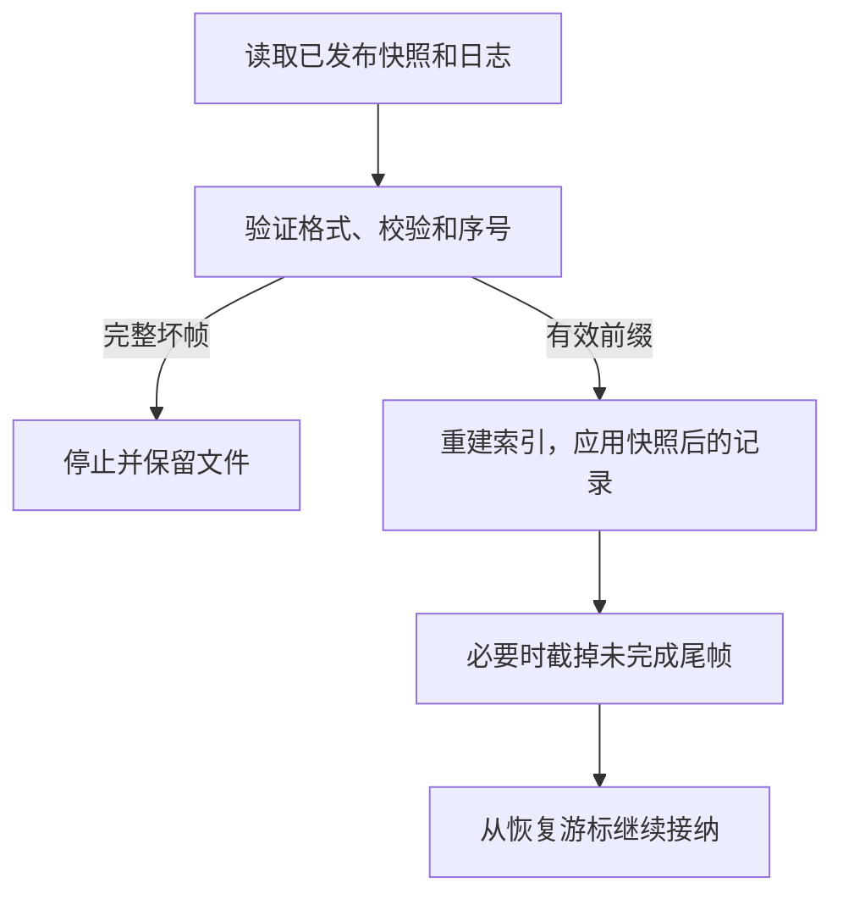

# Day 30 · 故障注入和恢复核对

## 1. 本期内容与学习目标

本课预计 3–4 小时，需要 Day 27 的关停、Day 28 的日志和 Day 29 的快照。用独立进程模拟写入截断、确认丢失、快照发布中断和正常关停，再重启核对交易结果。

## 2. 业务背景与原理

| 切点 | 恢复规则 |
| --- | --- |
| 尾帧未写完 | 截掉尾帧，保留完整前缀 |
| 完整帧已写，回执未送达 | 重放完整帧，客户端需重查 |
| 新快照只写了临时文件 | 读取已发布的旧快照和日志尾段 |
| 快照已发布 | 跳过已纳入快照的日志 |
| 完整帧校验失败 | 停止并保留原文件 |
| 异步正常关闭 | 排空后，恢复已确认的变更 |

超时本身不能说明业务是否发生。资金调整可通过原流水号防重。普通订单 ID 离簿后可复用，「目前没有该 ID」可能是已经成交、已撤单，或者从未接纳。恢复前后的观察序号与运行实例标识一起使用。

## 3. Java 原始项目的实现分析

Java 恢复用例比较状态哈希及全局余额。课程另外检查序号、FIFO、冻结和实际成交。模式名保留在测试日志，出错时可以查看该次运行目录中的原始文件。原实现按多个日志分区推进，实验用单一文件明确每个切点。 [日志恢复用例](https://github.com/exchange-core/exchange-core/blob/2f8548749839e9095c8dc597e4b61521d259fa5d/src/test/java/exchange/core2/tests/util/JournalingTestsModule.java#L53-L98) · [快照恢复用例](https://github.com/exchange-core/exchange-core/blob/2f8548749839e9095c8dc597e4b61521d259fa5d/src/test/java/exchange/core2/tests/util/PersistenceTestsModule.java#L59-L112)

## 4. 本期 C++ 知识

`std::_Exit` 结束进程且不展开局部对象，只有已 flush 的字节才计入本实验。`filesystem::resize_file` 可在重新追加前截掉尾帧。它不会把损坏帧变成合法数据，只能使用已验证前缀的末端偏移。CTest 通过 `execute_process` 启动独立子进程，检查退出码和标准输出。实验验证进程退出，不模拟内核崩溃或断电。更强耐久性要按目标平台定义文件和目录的同步边界。 [POSIX fsync](https://pubs.opengroup.org/onlinepubs/9799919799/functions/fsync.html)

## 5. 架构设计与技术选型

先读取快照和日志到独立状态，再重放，成功后才修改文件。读取流退出后再截尾。每次实验使用自己的目录，由 CTest 顺序启动写入与恢复进程。目录只允许一名写者；真正部署时应把这一限制放入进程互斥约定。



## 6. 从零逐步实现

创建 `app/recovery_lab.cpp`。每次写入从同一个现货夹具开始，在序号 5 保存快照，故障集中于第二笔同价卖单。恢复后再买入两手，检查 maker 顺序、资产和冻结。

```cpp
#include "exchange/async_engine.hpp"
#include "exchange/persistence.hpp"

#include <cstdlib>
#include <filesystem>
#include <fstream>
#include <iostream>
#include <memory>
#include <string_view>

namespace {
using namespace exchange;
namespace fs = std::filesystem;

const SymbolSpec spec{SymbolId{1}, CurrencyId{10}, CurrencyId{20}, 10, 2, 1, 3};
const UserId buyer{1};
const UserId seller{2};

void require(bool ok, const char* label) {
    if (!ok) {
        throw std::logic_error{label};
    }
}

PlaceOrder ask(OrderId id, std::int64_t timestamp) {
    return {{spec.symbol, id}, seller, Side::ask, Quantity{1},
            LimitPrice{Price{100}, LimitPolicy::gtc, {}}, timestamp};
}

PlaceOrder bid() {
    return {{spec.symbol, OrderId{9}}, buyer, Side::bid, Quantity{2},
            LimitPrice{Price{105}, LimitPolicy::ioc, {}}, 0};
}

Bytes read_file(const fs::path& path) {
    std::ifstream input{path, std::ios::binary};
    if (!input) {
        throw std::runtime_error{"missing recovery file"};
    }
    return read_binary(input);
}

void produce(const fs::path& dir, std::string_view mode) {
    fs::create_directories(dir);
    std::ofstream log{dir / "journal.bin", std::ios::binary | std::ios::trunc};
    auto append = [&](std::span<const std::byte> bytes) { write_binary(log, bytes); };
    auto live = std::make_shared<JournaledEngine>(append);
    const auto submit = [&](const Command& command) {
        require(live->execute(command).outcome.status == Status::processed, "setup rejected");
    };
    submit(RegisterSymbol{spec});
    submit(AddUsers{{buyer, seller}});
    submit(AdjustBalance{buyer, {spec.quote, 1000}, 1});
    submit(AdjustBalance{seller, {spec.base, 50}, 1});
    submit(ask(OrderId{7}, 99));
    SnapshotStore::publish(dir / "snapshot.bin", live->state());

    if (mode == "async_close") {
        AsyncEngine async{2, [live](const Command& cmd) { return live->execute(cmd); }};
        auto accepted = async.submit(ask(OrderId{8}, 98));
        async.close();
        require(std::get<std::future<Result>>(accepted).get().seq == Seq{6}, "close did not drain");
        return;
    }

    const auto frame = encode_record(Seq{6}, ask(OrderId{8}, 98));
    if (mode == "torn") {
        append(std::span<const std::byte>{frame}.first(frame.size() - 3));
    } else if (mode == "ack_lost") {
        append(frame);
    } else if (mode == "bad") {
        auto corrupted = frame;
        corrupted.back() ^= std::byte{1};
        append(corrupted);
    } else {
        submit(ask(OrderId{8}, 98));
        if (mode == "before_publish") {
            std::ofstream temp{dir / "snapshot.bin.tmp", std::ios::binary | std::ios::trunc};
            write_binary(temp, SnapshotStore::encode(live->state()));
            temp.close();
            require(static_cast<bool>(temp), "could not close staged snapshot");
        } else if (mode == "after_publish") {
            SnapshotStore::publish(dir / "snapshot.bin", live->state());
        } else {
            throw std::invalid_argument{"unknown failure mode"};
        }
    }
    std::_Exit(42);
}

void check_restart(const fs::path& dir, std::string_view mode) {
    auto restored = SnapshotStore::decode(read_file(dir / "snapshot.bin"));
    require(restored->last_sequence() == Seq{mode == "after_publish" ? 6u : 5u},
            "wrong checkpoint");
    const auto journal = scan_log(read_file(dir / "journal.bin"));
    const auto replayed = replay_log(*restored, journal);
    const bool torn = mode == "torn";
    require(journal.truncated_tail == torn, "tail classification");
    const auto last = Seq{torn ? 5u : 6u};
    require(restored->last_sequence() == last, "wrong recovery cursor");
    require(replayed.size() == (torn || mode == "after_publish" ? 0u : 1u), "wrong replay suffix");
    const auto before = restored->book_orders(spec.symbol);
    require(before && before->size() == (torn ? 1u : 2u), "wrong resting count");
    require(before->front().key.order == OrderId{7}, "first maker changed");
    if (!torn) {
        require(before->at(1).key.order == OrderId{8}, "second maker changed");
    }

    if (journal.truncated_tail) {
        fs::resize_file(dir / "journal.bin", journal.valid_bytes);
    }
    std::ofstream out{dir / "journal.bin", std::ios::binary | std::ios::app};
    JournaledEngine resumed{[&](auto bytes) { write_binary(out, bytes); }, std::move(restored)};
    const auto result = resumed.execute(bid());
    require(result.seq == Seq{last.value() + 1}, "sequence did not continue");
    require(result.outcome.events.size() == 2, "wrong trade or reject count");
    require(std::get<Trade>(result.outcome.events.at(0)).maker.order == OrderId{7},
            "wrong recovered FIFO");
    if (torn) {
        require(std::get<RejectRemainder>(result.outcome.events.at(1)).quantity == Quantity{1},
                "missing IOC tail");
    } else {
        require(std::get<Trade>(result.outcome.events.at(1)).maker.order == OrderId{8},
                "second maker missing");
    }
    const auto duplicate = resumed.execute(AdjustBalance{buyer, {spec.quote, 1000}, 1});
    require(duplicate.outcome.status == Status::duplicate_funding, "funding applied twice");
    require(resumed.state().ledger().available(buyer, spec.base) ==
            Money{spec.base, torn ? 10 : 20}, "wrong buyer asset");
    require(resumed.state().ledger().available(buyer, spec.quote) ==
            Money{spec.quote, torn ? 797 : 594}, "wrong buyer cash");
    require(!resumed.state().ledger().held({spec.symbol, OrderId{7}}), "hold leaked");

    const auto totals = resumed.execute(QueryTotals{});
    for (const auto& row : std::get<TotalsReport>(totals.report).currencies) {
        require(row.conserved(), "currency did not conserve");
    }
    out.close();
    require(static_cast<bool>(out), "could not close resumed journal");
    const auto appended = scan_log(read_file(dir / "journal.bin"));
    require(!appended.truncated_tail && appended.records.back().seq == duplicate.seq,
            "appended log unreadable");
    auto second = SnapshotStore::decode(read_file(dir / "snapshot.bin"));
    const auto again = replay_log(*second, appended);
    require(again.size() >= 2 && again[again.size() - 2].outcome == result.outcome,
            "second replay changed trade events");
    second->execute_at(QueryTotals{}, totals.seq);
    require(SnapshotStore::encode(*second) == SnapshotStore::encode(resumed.state()),
            "second replay changed canonical state");
    std::cout << "run_id=restart seq=" << totals.seq.value() << '\n';
}

}

int main(int argc, char** argv) {
    if (argc != 4) {
        return 2;
    }
    const std::string_view action{argv[1]};
    const fs::path dir{argv[2]};
    const std::string_view mode{argv[3]};
    try {
        if (action == "produce") {
            produce(dir, mode);
        } else if (action == "restart") {
            check_restart(dir, mode);
        } else {
            return 2;
        }
    } catch (const std::exception& ex) {
        std::cerr << ex.what() << '\n';
        return 3;
    }
}
```

`produce` 的确认丢失路径先追加完整帧，再结束进程，故意跳过内存执行和回执。`restart` 每个目录只执行一次，因为它会继续追加。末尾从磁盘重新加载追加后的日志并核对事件。查询没有写日志，代码用 `execute_at` 对齐查询序号后再比较完整快照。`run_id=restart` 是本实验标签，应用需要为每次启动分配可区分的标识。

## 7. 测试、调试与验证

创建 `tests/recovery_matrix.cmake`。把 `ROOT` 限定为测试自己的路径，脚本只删除这个根目录下由测试创建的模式子目录。

```cmake
if(NOT DEFINED ROOT OR NOT IS_ABSOLUTE "${ROOT}")
    message(FATAL_ERROR "an absolute test root is required")
endif()
string(RANDOM LENGTH 16 ALPHABET 0123456789abcdef nonce)
set(run "${ROOT}/run-${nonce}")
if(EXISTS "${run}")
    message(FATAL_ERROR "test directory already exists")
endif()
file(MAKE_DIRECTORY "${run}")

foreach(mode IN ITEMS torn ack_lost before_publish after_publish bad async_close)
    set(dir "${run}/${mode}")
    execute_process(COMMAND "${LAB}" produce "${dir}" "${mode}"
                    RESULT_VARIABLE producer OUTPUT_VARIABLE producer_out
                    ERROR_VARIABLE producer_err)
    set(expected 42)
    if(mode STREQUAL "async_close")
        set(expected 0)
    endif()
    if(NOT "${producer}" STREQUAL "${expected}")
        message(FATAL_ERROR "producer ${mode}: ${producer}: ${producer_out}${producer_err}")
    endif()

    execute_process(COMMAND "${LAB}" restart "${dir}" "${mode}"
                    RESULT_VARIABLE restart OUTPUT_VARIABLE restart_out
                    ERROR_VARIABLE restart_err)
    if(mode STREQUAL "bad")
        if(NOT "${restart}" STREQUAL "3" OR NOT restart_err MATCHES "checksum mismatch")
            message(FATAL_ERROR "bad log should be refused: ${restart_err}")
        endif()
    elseif(NOT "${restart}" STREQUAL "0" OR NOT restart_out MATCHES "run_id=restart seq=")
        message(FATAL_ERROR "restart ${mode}: ${restart}: ${restart_out}${restart_err}")
    endif()
    message(STATUS "recovery case ${mode} checked")
endforeach()
file(REMOVE_RECURSE "${run}")
```

追加构建目标。生成器表达式会取得当前构建配置下的二进制和专用测试目录。

```cmake
add_executable(recovery_lab app/recovery_lab.cpp)
target_link_libraries(recovery_lab PRIVATE exchange_core Threads::Threads)
add_test(NAME recovery_matrix
    COMMAND ${CMAKE_COMMAND}
        "-DLAB=$<TARGET_FILE:recovery_lab>"
        "-DROOT=$<TARGET_FILE_DIR:recovery_lab>/recovery-matrix-data"
        -P "${CMAKE_CURRENT_SOURCE_DIR}/tests/recovery_matrix.cmake")
set_tests_properties(recovery_matrix PROPERTIES TIMEOUT 30)
```

从项目根构建，运行 `ctest --test-dir build-debug -R '^recovery_matrix$' -V`。六个模式都应出现 `checked`，全套为 29 项。再执行 Day 05 的 Release 和 ASan/UBSan 流程。三个并发测试可在 Day 26 的 TSan 构建中另跑，构建目标为 `bounded_queue_tests`、`spsc_tests`、`async_engine_tests`，CTest 过滤器用 `'^(bounded_queue|spsc|async_engine)$'`。若截尾后续写读不到新帧，检查是否先按 `valid_bytes` 截断旧半帧，再打开追加流。

本阶段从 Day 01 的 Markdown 示例顺序重建，在 macOS arm64、Apple Clang 17、CMake 4.3.1 下验证。Debug、Release、ASan/UBSan 各通过 29 项 CTest，恢复矩阵的六个模式均通过。独立的 TSan 构建通过队列、SPSC 和异步入口三个用例。

## 8. Java 与 C++ 实现深度对比

Java 持久化和结果阶段有各自进度。课程用同步包装明确写入先于执行，再通过异步入口排空。现有文件实验可验证进程重启、恢复游标和结果不确定性。更强的耐久性要结合平台文件接口测试。

## 9. 课后练习

1. **基础。** 写出 `torn` 与 `ack_lost` 恢复后的最后序号和成交量。
2. **工程。** 加入超长完整帧测试，预期恢复失败且原文件大小不变。
3. **思考。** 快照后只做查询再退出，如何区分旧查询序号和重启后的新序号？

## 10. 总结与下一期

第七阶段完成有界异步提交、可重放日志、快照和故障核对。下一阶段加入期货风险，并跑完整集成矩阵。

[Day 29](day-29.md) · [Day 31](../08-integration/day-31.md)

<details>
<summary>练习参考答案</summary>

1. `torn` 恢复到 5，成交 1 手并拒绝 1 手。`ack_lost` 恢复到 6，成交 2 手。
2. 修改帧头长度为大于 1 MiB，读取时抛错，不能进入截尾分支。
3. 用运行实例标识与序号共同关联观察位置，再用订单和资金报告核对业务。

</details>
