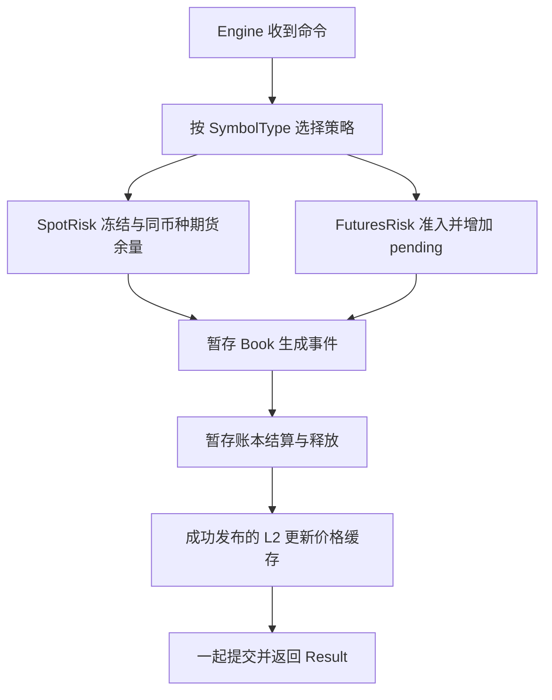

# Day 31 · 按 Java 源码接入期货风险与持仓

## 1. 本期内容与学习目标

本课预计 6–8 小时，可以分成风险计算、事件结算、Java 对照三个练习完成。前置是 Day 06 的受检算术、Day 19 的暂存结算、Day 24 的簿工厂，以及 Day 28–30 的序号和恢复边界。完成后，原来的 `Engine` 同时路由现货与期货，账户共用币种余额；期货有持仓、待成交量、盘口估值、开仓计费和空记录释放。

本课沿用 Java 的业务算法。估值使用原项目的 `LastPriceCacheRecord` 规则，准入不额外预留手续费，期货也可以执行已有的 FOK_BUDGET。下一课升级日志与快照，保存本课新增的全部决策状态。本课完成前，请先保存 Day 30 的学习版本。

## 2. 业务背景与原理

### 仓位、挂单与保证金是三件事

现货买入会交换两种资产，期货成交则改变双方的合约仓位。用有符号数量 `q` 表示多空：正数为多头，负数为空头持仓，零为无持仓。`pending_buy`、`pending_sell` 记录已通过风险、尚未释放的委托量。它们包括当前正在撮合的命令；稳定命令边界上才应当等于簿内同方向剩余量。

设每手多、空保证金为 `mb`、`ms`，Java 的计算是：

```text
buy_exposure  = pending_buy + q
sell_exposure = pending_sell - q
required     = max(buy_exposure * mb, sell_exposure * ms)
```

例如多头 3 手，买挂单 2 手、卖挂单 7 手，`mb=100`、`ms=120`，两侧候选为 500 和 480，需要 500。另一侧的负候选值会保留在计算中。当前仓位和挂单非负约束保证两侧不会同时为负。

新单若不增加这个最大值，源码允许继续下单，即使账户当前不足以增加风险。若最大值增加，才把同结算币种的现金、利润估计和其他品种保证金纳入准入。挂单不从现金扣走一笔“保证金冻结”；它通过 pending 影响所需保证金。现货逐订单冻结仍保留在 `Ledger::holds_`。

### 部分平仓的成本为什么可能变成负数

Java 的 `openPriceSum` 是会计累计量。开多 5 手于 100，再加多 2 手于 110，数量为 7，成本为 720。卖出 2 手于 120 后，数量变为 5，成本变为 `720-240=480`，此时不把利润写进 `profit`。随后卖出 7 手于 130，先平多 5 手，利润增加 `650-480=170`，余下 2 手开空，新的成本为 260。只有这 2 手属于本次开仓计费数量。

| 操作 | 有符号仓位 | 累计成本 | profit | 本次新开 |
| --- | ---: | ---: | ---: | ---: |
| 买 5 @ 100 | 5 | 500 | 0 | 5 |
| 买 2 @ 110 | 7 | 720 | 0 | 2 |
| 卖 2 @ 120 | 5 | 480 | 0 | 0 |
| 卖 7 @ 130 | -2 | 260 | 170 | 2 |
| 买 2 @ 120 | 0 | 0 | 190 | 0 |

若开多 2 手于 100，再卖 1 手于 300，剩余成本是 -100。直接给成本字段加“必须大于零”的校验，会拒绝算法自身可以产生的状态。源码调试校验中的正值断言与这条累计路径存在张力，应当用实际更新方法核对。不要自行换成平均开仓价算法。

### 风险估值与总账核对使用不同价格

多头有买一时，利润估计为 `profit + volume*bid - cost`；缺少买一时，源码返回 `profit + marginBuy*volume`。空头有卖一时为 `profit + cost - volume*ask`；缺少卖一时返回 `profit + marginSell*volume`。缺失行情的分支是源码现状，不能改成零，也不能换成自行指定的估值价。

全局余额报告要让同品种的多空采用相同价格。Java 先把缓存变成买卖均价；没有缓存时使用 42。否则把多头按买一、空头按卖一估值后相加，会多出买卖价差，不能用来检查资金守恒。相同价格下多空数量相抵，成本和利润与账户、冻结、费用共同核对。

## 3. Java 原始项目的实现分析

本课核对本地 `exchange-core`，先确认提交：

```bash
git -C ../exchange-core rev-parse HEAD
```

本次实际提交为 `2f8548749839e9095c8dc597e4b61521d259fa5d`，以下链接固定到这个提交。路径与方法是阅读顺序：

1. [`CoreSymbolSpecification`](https://github.com/exchange-core/exchange-core/blob/2f8548749839e9095c8dc597e4b61521d259fa5d/src/main/java/exchange/core2/core/common/CoreSymbolSpecification.java#L30-L61)：产品类型、结算币种、费用、两侧保证金。
2. [`SymbolPositionRecord`](https://github.com/exchange-core/exchange-core/blob/2f8548749839e9095c8dc597e4b61521d259fa5d/src/main/java/exchange/core2/core/common/SymbolPositionRecord.java#L111-L244)：盘口估值、最坏方向保证金、pending、部分平仓和反手。
3. [`RiskEngine.placeOrder / canPlaceMarginOrder`](https://github.com/exchange-core/exchange-core/blob/2f8548749839e9095c8dc597e4b61521d259fa5d/src/main/java/exchange/core2/core/processors/RiskEngine.java#L391-L555)：按产品分派、同结算币种汇总、准入后 pendingHold。
4. [`handleMatcherEventMargin / removePositionRecord`](https://github.com/exchange-core/exchange-core/blob/2f8548749839e9095c8dc597e4b61521d259fa5d/src/main/java/exchange/core2/core/processors/RiskEngine.java#L624-L655)：先更新仓位，按新开数量计费；记录空时把 profit 转回账户并删除记录。释放方法在同文件 793–796 行。
5. [`MatchingEngineRouter.processMatchingCommand`](https://github.com/exchange-core/exchange-core/blob/2f8548749839e9095c8dc597e4b61521d259fa5d/src/main/java/exchange/core2/core/processors/MatchingEngineRouter.java#L253-L269)：只有成功命令按配置发布 L2，风险阶段随后更新缓存。源码的 `sendL2ForEveryCmd` 可以开启；课程选择开启，并把配置保存到快照。
6. [`TotalCurrencyBalanceReportQuery`](https://github.com/exchange-core/exchange-core/blob/2f8548749839e9095c8dc597e4b61521d259fa5d/src/main/java/exchange/core2/core/common/api/reports/TotalCurrencyBalanceReportQuery.java#L80-L114)：公共估值与多空持仓量。

这里有一处影响移植的源码行为。`canPlaceMarginOrder` 的 547 行是 `freeMargin = position.estimateProfit(...)`。如果其他品种先被遍历，其贡献会被覆盖。把它写成 `+=` 会改变此提交的结果；改用有序 map 的遍历，也可能改变结果。本课保留赋值，并复现依赖 Eclipse Collections 11.0.0 的正品种 ID 遍历次序。第 7 节直接运行实际 Java 方法和集合，与 C++ 比较。修正这个缺陷应当另建版本、修改基准期望，不能混进移植步骤。

还要核对两个容易被“合理化”的行为：费用扣除以后现金可以为负；`UserProfileService.balanceAdjustment` 的出金检查只看现金，不重新检查保证金。C++ 保留这些规则。数值超出课程受检金额域时，沿用 Day 06、19 的失败边界，避免有符号 C++ 溢出。Java 报告中的 long 环绕则用无符号运算显式表达。

## 4. 本期 C++ 知识

### 给已有聚合类型追加默认字段

`SymbolSpec` 的末尾加入产品类型与保证金，原来的七字段初始化仍得到现货规格。`UserReport` 末尾加入持仓向量，旧的初始化式也得到空向量。默认值是兼容当前源码调用点的手段；磁盘字节必须另行版本化，内存初始化的兼容不能代替文件协议升级。

### 用独立键表保留具有业务影响的遍历顺序

C++ 的 `std::unordered_map` 不承诺和 Java 库相同的桶、探测与扩容。我们继续用 `std::map` 拥有仓位值，另用 `JavaPositionOrder` 保存与源依赖相同的键表。查找、报告和规范编码按 map 进行，只有那段有顺序敏感行为的准入循环采用兼容键表。删除保留墓碑，扩容依旧表顺序重新插入。`1` 在源集合中是特殊键，需要独立标记，不能当作普通桶值。

散列混合使用 `uint32_t`，乘法按模 2^32 运算，正好对应 Java int 的位模式。`std::bit_ceil` 获得不小于给定数的二次幂；`std::has_single_bit` 检查恢复的容量。值表和键表都按值复制，因此 Day 19 的暂存账本仍然拥有独立存储。

### 报告里的显式环绕

Java `long` 加乘溢出具有环绕语义，C++ 有符号溢出是未定义行为。总账报告复现 Java 均价和估值时，先转成 `uint64_t` 做运算，再用 `bit_cast<int64_t>` 解释位模式。这里的环绕有明确协议依据。订单金额和普通结算继续使用受检算术。两种数值约定应当在函数边界说清楚，不能通过关闭 UBSan 掩盖。

## 5. 架构设计与技术选型

保持同一个 `Engine`、品种目录、账户表和 `Book` 工厂。`SymbolType` 选择风险策略；风险函数只操作传入的暂存账本，提交依旧是簿与账本的交换。`LastPrice` 属于风险决策状态，须在成交结算之后更新。挂单、成交事件、缓存的顺序都要可重放。



产品差异还影响簿的预留价检查：Java 只对现货买单限制改价不得超过 `reserveBidPrice`。所以簿需要知道产品类型，工厂和克隆必须传递它。期货沿用 GTC、IOC、FOK_BUDGET、撤减改的撮合算法，保证金不依赖买单预留价。

## 6. 从零逐步实现

### 31.1 扩展规格、仓位与报告

在 `units.hpp` 的 `SymbolSpec` 前增加枚举，并在该结构末尾追加三个字段。

```cpp
enum class SymbolType { spot = 0, futures = 1 };
// 追加到 SymbolSpec 末尾：
SymbolType type = SymbolType::spot;
std::int64_t margin_buy{};
std::int64_t margin_sell{};
```

在 `units.cpp` 用下段替换 `valid_symbol`。期货不使用现货资产换算，保证金可以为零；零保证金边界会在测试中验证。

```cpp
bool valid_symbol(const SymbolSpec& spec) {
    const bool common = spec.symbol.value() > 0 && spec.quote.value() > 0 &&
        spec.maker_fee_per_lot >= 0 && spec.taker_fee_per_lot >= spec.maker_fee_per_lot;
    if (spec.type == SymbolType::futures) { return common && spec.margin_buy >= 0 && spec.margin_sell >= 0; }
    return common && spec.type == SymbolType::spot && spec.base.value() > 0 && spec.base != spec.quote &&
        spec.base_scale > 0 && spec.quote_scale > 0;
}
```

创建 `include/exchange/positions.hpp`。有符号仓位合并 Java 的方向与 openVolume，其他累计字段一一对应。

```cpp
#ifndef EXCHANGE_POSITIONS_HPP
#define EXCHANGE_POSITIONS_HPP
#include "exchange/units.hpp"
#include <limits>

namespace exchange {
struct MarginPosition {
    std::int64_t signed_quantity{};
    std::int64_t cost_sum{};
    std::int64_t profit{};
    std::int64_t pending_buy{};
    std::int64_t pending_sell{};
    bool empty() const { return signed_quantity == 0 && pending_buy == 0 && pending_sell == 0; }
    bool operator==(const MarginPosition&) const = default;
};
struct LastPrice {
    std::int64_t ask = std::numeric_limits<std::int64_t>::max();
    std::int64_t bid{};
    bool operator==(const LastPrice&) const = default;
};
struct PositionReport {
    SymbolId symbol;
    CurrencyId currency;
    MarginPosition position;
    std::int64_t estimated_profit;
    std::int64_t required_margin;
    bool operator==(const PositionReport&) const = default;
};
struct OpenInterest {
    SymbolId symbol;
    std::int64_t long_volume{};
    std::int64_t short_volume{};
    bool operator==(const OpenInterest&) const = default;
};
}
#endif
```

在 `model.hpp` 引入该头，给 `UserReport` 末尾加 `std::vector<PositionReport> positions;`，给 `CurrencyTotals` 末尾、`conserved()` 声明前加 `std::int64_t positions{};`，给 `TotalsReport` 末尾加 `std::vector<OpenInterest> open_interest;`。字段在 `namespace exchange` 内。

声明新的重载 `bool validate_command(const Command&, SymbolType);`，在 `model.cpp` 命名空间末尾加入下段。旧重载保留，现货校验和旧测试不变。期货先校验结构，预留价的现货含义不参与它的形状判断。

```cpp
bool validate_command(const Command& command, SymbolType type) {
    if (type == SymbolType::futures) {
        if (const auto* p = std::get_if<PlaceOrder>(&command)) {
            auto shape = *p;
            if (auto* limit = std::get_if<LimitPrice>(&shape.constraint)) { limit->reserve_bid_price.reset(); }
            return validate_command(Command{shape});
        }
    }
    return validate_command(command);
}
```

### 31.2 保留源依赖的仓位遍历顺序

创建 `include/exchange/java_position_order.hpp`。先读 `insert/erase/keys`，再读 `probe`。第一轮按 key 探测相邻 8 桶，第二轮按 spread2 探测，再用奇数步长覆盖整张二次幂表。表至少一半桶空着，所以探测能够停止。恢复入口同时检查负载、重复键和探测位置。此处仅实现课程合法的非零品种 ID 所需次序；它不承担仓位值的所有权。

源依赖为 `pom.xml` 固定的 Eclipse Collections 11.0.0，兼容算法对应 `IntObjectHashMap`、`SpreadFunctions`，遵循其 Apache-2.0 来源说明。读者可从 Maven 的该版本 sources 或 `javap -c -p` 核对；第 7 节验证实际运行行为。

```cpp
#ifndef EXCHANGE_JAVA_POSITION_ORDER_HPP
#define EXCHANGE_JAVA_POSITION_ORDER_HPP
#include <algorithm>
#include <bit>
#include <cstdint>
#include <limits>
#include <stdexcept>
#include <vector>

namespace exchange {
// Eclipse Collections 11.0.0 IntObjectHashMap 的正 symbol ID 遍历次序。
class JavaPositionOrder {
public:
    void insert(std::uint32_t key) {
        if (key == 0) { throw std::invalid_argument{"zero symbol"}; }
        if (key == 1) { one_ = true; return; }
        const auto at = probe(key);
        if (slots_[at] == key) { return; }
        if (slots_[at] == 1) { --removed_; }
        slots_[at] = key;
        ++size_;
        const auto max = slots_.size() / 2;
        if (size_ + removed_ > max) {
            auto capacity = std::max(max, std::bit_ceil((size_ + 1) * 2));
            if (removed_ && size_ > (max >> 1) + (max >> 2)) { capacity *= 2; }
            auto old = std::move(slots_);
            slots_.assign(capacity, 0); size_ = removed_ = 0;
            for (const auto k : old) { if (k > 1) { insert(k); } }
        }
    }
    void erase(std::uint32_t key) {
        if (key == 1) { one_ = false; return; }
        const auto at = probe(key);
        if (slots_[at] == key) { slots_[at] = 1; --size_; ++removed_; }
    }
    std::vector<std::uint32_t> keys() const {
        std::vector<std::uint32_t> result;
        if (one_) { result.push_back(1); }
        for (const auto key : slots_) { if (key > 1) { result.push_back(key); } }
        return result;
    }
    const std::vector<std::uint32_t>& slots() const { return slots_; }
    bool one() const { return one_; }
    static JavaPositionOrder restore(std::vector<std::uint32_t> slots, bool one) {
        if (slots.size() < 16 || !std::has_single_bit(slots.size())) {
            throw std::runtime_error{"position table size"};
        }
        JavaPositionOrder out;
        out.slots_ = std::move(slots); out.one_ = one;
        for (const auto k : out.slots_) { out.size_ += k > 1; out.removed_ += k == 1; }
        if (out.size_ + out.removed_ > out.slots_.size() / 2) { throw std::runtime_error{"position table load"}; }
        for (std::size_t i = 0; i < out.slots_.size(); ++i) {
            if (out.slots_[i] > 1 && out.probe(out.slots_[i]) != i) {
                throw std::runtime_error{"position table probe or duplicate"};
            }
        }
        return out;
    }
    bool operator==(const JavaPositionOrder&) const = default;
private:
    static std::uint32_t spread1(std::uint32_t k) {
        k ^= k >> 15; k *= std::uint32_t(-1398068659);
        k ^= k >> 15; k *= 1556602707u; return k ^ (k >> 12);
    }
    static std::uint32_t spread2(std::uint32_t k) {
        k ^= k >> 14; k *= std::uint32_t(-1172517581);
        k ^= k >> 13; k *= std::uint32_t(-1688037685); return k ^ (k >> 12);
    }
    static std::uint32_t reverse(std::uint32_t v) {
        std::uint32_t r{};
        for (unsigned i = 0; i < 32; ++i) { r = (r << 1) | (v & 1); v >>= 1; }
        return r;
    }
    std::size_t probe(std::uint32_t key) const {
        const auto mask = slots_.size() - 1;
        std::size_t removed = std::numeric_limits<std::size_t>::max();
        const auto check = [&](std::size_t at) -> std::size_t {
            const auto value = slots_[at];
            if (value == key) { return at; }
            if (value == 0) { return removed == std::numeric_limits<std::size_t>::max() ? at : removed; }
            if (value == 1 && removed == std::numeric_limits<std::size_t>::max()) { removed = at; }
            return std::numeric_limits<std::size_t>::max();
        };
        for (unsigned stage = 0; stage < 2; ++stage) {
            const auto start = stage == 0 ? key : spread2(key);
            for (unsigned i = 0; i < 8; ++i) {
                const auto at = check((start + i) & mask);
                if (at != std::numeric_limits<std::size_t>::max()) { return at; }
            }
        }
        auto at = spread1(key);
        const auto step = reverse(spread2(key)) | 1u;
        for (std::size_t i = 0; i < slots_.size(); ++i) {
            at = (at + step) & static_cast<std::uint32_t>(mask);
            const auto found = check(at);
            if (found != std::numeric_limits<std::size_t>::max()) { return found; }
        }
        throw std::logic_error{"position probe did not terminate"};
    }
    std::vector<std::uint32_t> slots_ = std::vector<std::uint32_t>(16);
    std::size_t size_{}, removed_{};
    bool one_{};
};
}
#endif
```

### 31.3 扩展账本所有权

在 `ledger.hpp` 引入 `exchange/java_position_order.hpp`。给 `Ledger::Account` 加两个成员，给 `Ledger` 私有区加策略友元和行情表；友元测试访问器只服务第 7 节夹具。

```cpp
// Account 内：
std::map<SymbolId, MarginPosition> positions;
JavaPositionOrder position_order;
// Ledger 私有区：
friend struct FuturesRisk;
friend struct SpotRisk;
friend struct MarginTestAccess;
std::map<SymbolId, LastPrice> last_prices_;
```

在 `Ledger::swap` 增加 `last_prices_.swap(other.last_prices_);`，账户表的交换已经包含仓位和键表。在 `Ledger::adjust` 将 `if (*next < 0)` 改为 `if (cmd.amount.units < 0 && *next < 0)`，去掉禁止 `*net < 0` 的分支；正向补款允许账户仍为负。`Ledger::suspend` 的非空判断加上 `|| !it->second.positions.empty()`。

在 `CurrencyTotals::conserved` 保留原来的 available、frozen、fees 受检加法，把最后返回改成：

```cpp
const auto including_positions = total ? checked_add(*total, positions) : std::nullopt;
return including_positions && *including_positions == net_deposits;
```

在 `Ledger::append_canonical` 的逐用户循环、余额输出之前追加仓位和键表编码；所有用户循环之后、冻结输出之前追加缓存编码。沿用该方法已有的 `number` lambda。

```cpp
out += "position-order:";
number(account.position_order.one());
number(account.position_order.slots().size());
for (const auto key : account.position_order.slots()) { number(key); }
for (const auto& [symbol, p] : account.positions) {
    out += "position:"; number(symbol.value()); number(p.signed_quantity); number(p.cost_sum);
    number(p.profit); number(p.pending_buy); number(p.pending_sell);
}
// 逐用户循环结束后：
for (const auto& [symbol, p] : last_prices_) {
    out += "last-price:"; number(symbol.value()); number(p.ask); number(p.bid);
}
```

### 31.4 写风险计算与结算

创建 `include/exchange/futures_risk.hpp`。`SpecLookup` 借用当前引擎的品种规格。函数只在本条同步命令期间调用，不保存 lambda，也不跨线程访问目录。

```cpp
#ifndef EXCHANGE_FUTURES_RISK_HPP
#define EXCHANGE_FUTURES_RISK_HPP
#include "exchange/ledger.hpp"
#include "exchange/order_book.hpp"
#include <functional>

namespace exchange {
using SpecLookup = std::function<const SymbolSpec&(SymbolId)>;

struct FuturesRisk {
    static std::int64_t margin(const MarginPosition&, const SymbolSpec&);
    static std::int64_t estimate(const MarginPosition&, const SymbolSpec&, const LastPrice*);
    static std::int64_t update(MarginPosition&, Side, Quantity, Price);
    static Status reserve(Ledger&, const PlaceOrder&, const SymbolSpec&, const SpecLookup&);
    static bool settle(Ledger&, const PlaceOrder* placed, OrderKey primary,
                       const std::vector<Event>&, const Book&, const SymbolSpec&);
    static std::int64_t free_margin(const Ledger&, UserId, CurrencyId, const SpecLookup&);
    static void refresh(Ledger&, SymbolId, const Book&);
    static void reports(const Ledger&, UserReport&, const SpecLookup&);
    static void totals(const Ledger&, TotalsReport&, const SpecLookup&);
};

struct SpotRisk {
    static Status reserve(Ledger&, const PlaceOrder&, const SymbolSpec&, const SpecLookup&);
    static bool settle(Ledger& ledger, OrderKey key, const std::vector<Event>& events,
                       const Book& book, const SymbolSpec& spec) {
        return ledger.apply_spot(key, events, book, spec);
    }
};
}
#endif
```

创建 `src/futures_risk.cpp`，依次写入下面四段。它们属于同一个文件，第一段打开的 `namespace exchange` 由最后一段闭合。

**1. 计算仓位、保证金与盘口利润。**
`update` 先释放本次成交的 pending，再关闭相反仓位，最后只把余量开成新仓，返回新开数量。调用方通过暂存账本提供整条命令的失败边界。

```cpp
#include "exchange/futures_risk.hpp"
#include <algorithm>
#include <bit>
#include <stdexcept>

namespace exchange {
namespace {
std::int64_t need(std::optional<std::int64_t> v) {
    if (!v) { throw std::overflow_error{"margin arithmetic"}; }
    return *v;
}
std::int64_t add(std::int64_t a, std::int64_t b) { return need(checked_add(a, b)); }
std::int64_t sub(std::int64_t a, std::int64_t b) { return need(checked_subtract(a, b)); }
std::int64_t mul(std::int64_t a, std::int64_t b) { return need(checked_multiply(a, b)); }
std::int64_t magnitude(std::int64_t n) { return n < 0 ? sub(0, n) : n; }
template<class Map, class Key> std::int64_t value(const Map& map, Key key) {
    const auto it = map.find(key); return it == map.end() ? 0 : it->second;
}
const LastPrice* price(const std::map<SymbolId, LastPrice>& prices, SymbolId symbol) {
    const auto it = prices.find(symbol); return it == prices.end() ? nullptr : &it->second;
}
}

std::int64_t FuturesRisk::margin(const MarginPosition& p, const SymbolSpec& s) {
    return std::max(mul(add(p.pending_buy, p.signed_quantity), s.margin_buy),
                    mul(sub(p.pending_sell, p.signed_quantity), s.margin_sell));
}
std::int64_t FuturesRisk::estimate(const MarginPosition& p, const SymbolSpec& s, const LastPrice* last) {
    if (p.signed_quantity == 0) { return p.profit; }
    if (p.signed_quantity > 0) {
        return add(p.profit, last && last->bid != 0
            ? sub(mul(p.signed_quantity, last->bid), p.cost_sum) : mul(s.margin_buy, p.signed_quantity));
    }
    const auto size = magnitude(p.signed_quantity);
    return add(p.profit, last && last->ask != std::numeric_limits<std::int64_t>::max()
        ? sub(p.cost_sum, mul(size, last->ask)) : mul(s.margin_sell, size));
}
std::int64_t FuturesRisk::update(MarginPosition& p, Side side, Quantity qty, Price price) {
    auto& pending = side == Side::bid ? p.pending_buy : p.pending_sell;
    pending = sub(pending, qty.value());
    if (pending < 0) { throw std::logic_error{"negative pending"}; }
    const std::int64_t sign = side == Side::bid ? 1 : -1;
    auto opened = qty.value();
    if (p.signed_quantity && (p.signed_quantity > 0 ? 1 : -1) != sign) {
        const auto old = magnitude(p.signed_quantity);
        const auto closed = std::min(old, opened);
        const auto proceeds = mul(closed, price.value());
        if (closed < old) { p.cost_sum = sub(p.cost_sum, proceeds); }
        else {
            const auto difference = sub(proceeds, p.cost_sum);
            p.profit = add(p.profit, p.signed_quantity > 0 ? difference : sub(0, difference));
            p.cost_sum = 0;
        }
        p.signed_quantity = add(p.signed_quantity, mul(sign, closed));
        opened = sub(opened, closed);
    }
    p.signed_quantity = add(p.signed_quantity, mul(sign, opened));
    p.cost_sum = add(p.cost_sum, mul(opened, price.value()));
    return opened;
}
```

**2. 按源码准入，并让现货读取同币种期货余量。**
期货新单只改变 pending，未从现金扣保证金。新建记录因保证金不足而释放时，源码仍留下键表墓碑和零余额槽；这一兼容状态也提交，避免后续遍历顺序改变。`required <= current` 的路径直接允许。现货的扣款允许现金为负，只要现金加期货可用余量足够；实际冻结仍有订单归属。

```cpp
Status FuturesRisk::reserve(Ledger& ledger, const PlaceOrder& order, const SymbolSpec& spec,
                            const SpecLookup& lookup) {
    const auto found = ledger.accounts_.find(order.user);
    if (found == ledger.accounts_.end()) { return Status::unknown_user; }
    auto& account = found->second;
    if (account.suspended) { return Status::user_suspended; }
    auto [at, created] = account.positions.try_emplace(spec.symbol);
    if (created) { account.position_order.insert(spec.symbol.value()); }
    auto after = at->second;
    auto& pending = order.side == Side::bid ? after.pending_buy : after.pending_sell;
    pending = add(pending, order.quantity.value());
    const auto required = margin(after, spec);
    if (required > margin(at->second, spec)) {
        std::int64_t free{};
        for (const auto id : account.position_order.keys()) {
            const SymbolId symbol{id}; const auto& p = account.positions.at(symbol);
            if (symbol == spec.symbol) {
                // 保留 RiskEngine.java:547 的赋值语义，不能改成 +=。
                free = estimate(p, spec, price(ledger.last_prices_, symbol));
            } else {
                const auto& other = lookup(symbol);
                if (other.quote == spec.quote) {
                    free = add(free, sub(estimate(p, other, price(ledger.last_prices_, symbol)), margin(p, other)));
                }
            }
        }
        if (required > add(value(account.balances, spec.quote), free)) {
            if (created) {
                account.balances.try_emplace(spec.quote, 0);
                account.positions.erase(at); account.position_order.erase(spec.symbol.value());
            }
            return Status::insufficient_funds;
        }
    }
    at->second = after;
    return Status::processed;
}

std::int64_t FuturesRisk::free_margin(const Ledger& ledger, UserId user, CurrencyId currency,
                                     const SpecLookup& lookup) {
    const auto found = ledger.accounts_.find(user);
    if (found == ledger.accounts_.end()) { return 0; }
    std::int64_t total{};
    for (const auto& [symbol, p] : found->second.positions) {
        const auto& s = lookup(symbol);
        if (s.quote == currency) {
            total = add(total, sub(estimate(p, s, price(ledger.last_prices_, symbol)), margin(p, s)));
        }
    }
    return total;
}

Status SpotRisk::reserve(Ledger& ledger, const PlaceOrder& order, const SymbolSpec& spec,
                         const SpecLookup& lookup) {
    const auto account = ledger.accounts_.find(order.user);
    if (account == ledger.accounts_.end()) { return Status::unknown_user; }
    if (account->second.suspended) { return Status::user_suspended; }
    const Ledger::HoldKey key{order.key.symbol, order.key.order};
    if (ledger.holds_.contains(key)) { return Status::duplicate_order; }
    const auto hold = required_hold(order, spec);
    if (!hold || hold->units <= 0) { return Status::invalid_input; }
    const auto next = sub(value(account->second.balances, hold->currency), hold->units);
    if (add(next, FuturesRisk::free_margin(ledger, order.user, hold->currency, lookup)) < 0) {
        return Status::insufficient_funds;
    }
    ledger.holds_.try_emplace(key, Ledger::Hold{order.user, *hold});
    account->second.balances[hold->currency] = next;
    return Status::processed;
}
```

**3. 按事件释放 pending、平仓与计费。**
Java 先处理 REJECT 的事件链顺序与 Day 07 的对外顺序不同。结算器先释放拒绝量，再按成交顺序逐笔处理，返回给调用者的事件顺序保持课程已有契约。记录仅在仓位和两侧 pending 都为空时释放。末尾从簿重新计算 pending 是独立核对，不代替增量释放。当前核对成本为 O(用户数 × 活动单数)，方便定位错误；Day 32 会把它列入性能分析。

```cpp
bool FuturesRisk::settle(Ledger& ledger, const PlaceOrder* placed, OrderKey primary,
                         const std::vector<Event>& events, const Book& book, const SymbolSpec& spec) {
    const auto cleanup = [&](UserId user) {
        auto& a = ledger.accounts_.at(user);
        const auto it = a.positions.find(spec.symbol);
        if (it != a.positions.end() && it->second.empty()) {
            a.balances[spec.quote] = add(value(a.balances, spec.quote), it->second.profit);
            a.positions.erase(it); a.position_order.erase(spec.symbol.value());
        }
    };
    const auto release = [&](UserId user, Side side, Quantity qty) {
        auto& p = ledger.accounts_.at(user).positions.at(spec.symbol);
        auto& pending = side == Side::bid ? p.pending_buy : p.pending_sell;
        pending = sub(pending, qty.value());
        if (pending < 0) { throw std::logic_error{"negative released pending"}; }
        cleanup(user);
    };
    const auto trade = [&](UserId user, Side side, const Trade& fill, std::int64_t rate) {
        auto& a = ledger.accounts_.at(user);
        auto& p = a.positions.at(spec.symbol);
        const auto opened = update(p, side, fill.quantity, fill.price);
        const auto fee = mul(opened, rate);
        a.balances[spec.quote] = sub(value(a.balances, spec.quote), fee);
        ledger.fees_[spec.quote] = add(value(ledger.fees_, spec.quote), fee);
        cleanup(user);
    };
    // Java 事件链的 REJECT 在成交前；课程事件输出顺序仍沿用 Day 07。
    for (const auto& e : events) {
        if (const auto* reject = std::get_if<RejectRemainder>(&e)) {
            if (!placed) { return false; }
            release(reject->user, placed->side, reject->quantity);
        }
    }
    for (const auto& e : events) {
        if (const auto* fill = std::get_if<Trade>(&e)) {
            trade(fill->taker_user, fill->taker_side, *fill, spec.taker_fee_per_lot);
            trade(fill->maker_user, fill->taker_side == Side::bid ? Side::ask : Side::bid,
                  *fill, spec.maker_fee_per_lot);
        } else if (const auto* reduced = std::get_if<Reduce>(&e)) {
            release(reduced->user, reduced->side, reduced->quantity);
        }
    }
    if (placed && events.empty()) { static_cast<void>(primary); }
    // 从最终簿独立核对增量 pending，不能以重算代替释放协议。
    for (const auto& [user, a] : ledger.accounts_) {
        std::int64_t buy{}, sell{};
        for (const auto& o : book.resting_orders()) {
            if (o.user == user) { (o.side == Side::bid ? buy : sell) = add(o.side == Side::bid ? buy : sell, o.remaining.value()); }
        }
        const auto p = a.positions.find(spec.symbol);
        if (p == a.positions.end() ? buy != 0 || sell != 0 :
            p->second.pending_buy != buy || p->second.pending_sell != sell) { return false; }
    }
    return true;
}
```

**4. 更新缓存并生成报告。**
`refresh` 取成交完成后的盘口，后续准入才读这份缓存。风险报告按方向估值；总账报告按源码的公共均价估值，long 环绕通过显式位运算保留。`open_interest` 另外核对多空数量。

```cpp
void FuturesRisk::refresh(Ledger& ledger, SymbolId symbol, const Book& book) {
    const auto l2 = book.snapshot(1);
    ledger.last_prices_[symbol] = LastPrice{
        l2.asks.empty() ? std::numeric_limits<std::int64_t>::max() : l2.asks.front().price.value(),
        l2.bids.empty() ? 0 : l2.bids.front().price.value()};
}

void FuturesRisk::reports(const Ledger& ledger, UserReport& report, const SpecLookup& lookup) {
    const auto& a = ledger.accounts_.at(report.user);
    for (const auto& [symbol, p] : a.positions) {
        const auto& spec = lookup(symbol);
        report.positions.push_back({symbol, spec.quote, p,
            estimate(p, spec, price(ledger.last_prices_, symbol)), margin(p, spec)});
    }
}

void FuturesRisk::totals(const Ledger& ledger, TotalsReport& report, const SpecLookup& lookup) {
    const auto ja=[](std::int64_t a,std::int64_t b) { return std::bit_cast<std::int64_t>(std::uint64_t(a)+std::uint64_t(b)); };
    const auto js=[](std::int64_t a,std::int64_t b) { return std::bit_cast<std::int64_t>(std::uint64_t(a)-std::uint64_t(b)); };
    const auto jm=[](std::int64_t a,std::int64_t b) { return std::bit_cast<std::int64_t>(std::uint64_t(a)*std::uint64_t(b)); };
    std::map<CurrencyId,std::int64_t> pnl;
    std::map<SymbolId,OpenInterest> interests;
    for(const auto& [user,a]:ledger.accounts_) {
        for(const auto& [symbol,p]:a.positions) {
            const auto& spec=lookup(symbol);
            LastPrice common{42,42};
            if(const auto* last=price(ledger.last_prices_,symbol)) {
                const auto average=ja(last->ask,last->bid)>>1;
                common={average,average};
            }
            auto estimate=p.profit;
            if(p.signed_quantity>0) estimate=ja(estimate,common.bid!=0?
                js(jm(p.signed_quantity,common.bid),p.cost_sum):jm(spec.margin_buy,p.signed_quantity));
            if(p.signed_quantity<0) estimate=ja(estimate,common.ask!=std::numeric_limits<std::int64_t>::max()?
                js(p.cost_sum,jm(magnitude(p.signed_quantity),common.ask)):jm(spec.margin_sell,magnitude(p.signed_quantity)));
            pnl[spec.quote]=ja(pnl[spec.quote],estimate);
            auto& oi=interests.try_emplace(symbol,OpenInterest{symbol}).first->second;
            if(p.signed_quantity>0) oi.long_volume=add(oi.long_volume,p.signed_quantity);
            if(p.signed_quantity<0) oi.short_volume=add(oi.short_volume,magnitude(p.signed_quantity));
        }
    }
    for(const auto& [currency,units]:pnl) {
        auto row=std::find_if(report.currencies.begin(),report.currencies.end(),[&](const auto& r){return r.currency==currency;});
        if(row==report.currencies.end()) {report.currencies.push_back(CurrencyTotals{currency});row=std::prev(report.currencies.end());}
        row->positions=units;
    }
    for(const auto& [symbol,oi]:interests) { report.open_interest.push_back(oi); }
}
}
```

### 31.5 让簿识别产品类型

编辑 `order_book.hpp/.cpp`，不用重写撮合算法。以下改动必须一起完成：

1. `OrderBook` 构造函数最后加 `SymbolType type = SymbolType::spot`；静态 `from_resting` 和 `make_book` 最后也加同样的参数。默认实参只写在声明。
2. 在 `symbol_` 后加入 `SymbolType type_;`。构造初始化加入 `type_{type}`；工厂、`from_resting` 创建簿时传 `type`；`clone()` 创建簿时传 `type_`。
3. `valid_resting` 买侧返回条件改为 `order.reserve_bid_price && (type_ == SymbolType::futures || *order.reserve_bid_price >= order.price)`。
4. `place` 的结构检查改用 `validate_command(order, type_)`。
5. `move` 超预留价的条件前加 `type_ == SymbolType::spot &&`。更新后的条件为 `if (type_ == SymbolType::spot && moved.reserve_bid_price && command.new_price > *moved.reserve_bid_price)`。

`Book` 的纯虚撮合接口无须增加参数。`SymbolCatalog::add` 创建簿时改用 `make_book(kind, spec.symbol, capacity, spec.type)`。两种布局仍共用所有撮合方法。

### 31.6 接回现有同步入口

在 `engine.cpp` 引入 `exchange/futures_risk.hpp`。`Engine` 构造器最后加 `bool send_l2 = true`，初始化成员 `send_l2_{send_l2}`，私有区增加 `bool send_l2_;`。这个值对应 Java 开启或关闭逐命令 L2 发布的配置；第 32 课把它写进快照。用以下版本替换订单分派模板。

```cpp
template<class T>
CommandResult Engine::dispatch(const T& command, Seq seq) {
    const auto found = catalog_.markets_.find(command.key.symbol);
    if (found == catalog_.markets_.end()) { return {Status::unknown_symbol, {}}; }
    auto& market = found->second;
    if (!validate_command(command, market.spec.type)) { return {Status::invalid_input, {}}; }
    const SpecLookup lookup = [&](SymbolId id) -> const SymbolSpec& { return catalog_.markets_.at(id).spec; };
    const bool futures = market.spec.type == SymbolType::futures;
    auto staged_ledger = ledger_;
    try {
        if constexpr (std::is_same_v<T, PlaceOrder>) {
            if (market.book->find_order(command.key.order)) { return {Status::duplicate_order, {}}; }
            const auto status = futures ? FuturesRisk::reserve(staged_ledger, command, market.spec, lookup)
                                        : SpotRisk::reserve(staged_ledger, command, market.spec, lookup);
            if (status != Status::processed) {
                if (futures && status == Status::insufficient_funds) { ledger_.swap(staged_ledger); }
                return {status, {}};
            }
        }
        auto staged = market.book->clone();
        auto result = [&] {
            if constexpr (std::is_same_v<T, PlaceOrder>) { return staged->place(command, seq); }
            else if constexpr (std::is_same_v<T, CancelOrder>) { return staged->cancel(command); }
            else if constexpr (std::is_same_v<T, ReduceOrder>) { return staged->reduce(command); }
            else { return staged->move(command, seq); }
        }();
        if (result.status != Status::processed) { return result; }
        if constexpr (std::is_same_v<T, MoveOrder>) {
            const auto original = market.book->find_order(command.key.order);
            if (!futures && original && original->side == Side::ask) {
                const auto amount = quote_notional(Quantity{1}, command.new_price, market.spec);
                if (!amount || amount->units < market.spec.taker_fee_per_lot) { return {Status::invalid_input, {}}; }
            }
        }
        const PlaceOrder* placed = nullptr;
        if constexpr (std::is_same_v<T, PlaceOrder>) { placed = &command; }
        const auto settled = futures ? FuturesRisk::settle(staged_ledger, placed, command.key, result.events, *staged, market.spec)
                                     : SpotRisk::settle(staged_ledger, command.key, result.events, *staged, market.spec);
        if (!settled) { return {Status::settlement_failed, {}}; }
        if (send_l2_) { FuturesRisk::refresh(staged_ledger, market.spec.symbol, *staged); }
        market.book.swap(staged); ledger_.swap(staged_ledger);
        return result;
    } catch (const std::overflow_error&) { return {Status::settlement_failed, {}}; }
}
```

在 `Engine::answer(QueryUser...)` 收集所有订单后、返回前，追加策略报告；把 `QueryTotals` 的方法体替换为下段对应内容。

```cpp
// QueryUser 返回之前：
FuturesRisk::reports(ledger_, *report, [&](SymbolId id) -> const SymbolSpec& {
    return catalog_.markets_.at(id).spec;
});
// QueryTotals 的方法体：
auto report = ledger_.totals();
FuturesRisk::totals(ledger_, report, [&](SymbolId id) -> const SymbolSpec& {
    return catalog_.markets_.at(id).spec;
});
return {seq, {Status::processed, {}}, std::move(report)};
```

在 `QueryFingerprint` 的 `ledger_.append_canonical(canonical)` 后追加 `canonical += send_l2_ ? "l2=1;" : "l2=0;";`。逐品种输出 `taker_fee_per_lot` 后再输出 `number(static_cast<int>(spec.type)); number(spec.margin_buy); number(spec.margin_sell);`。

把 `src/futures_risk.cpp` 加进 `exchange_core`。本课改变了待持久化状态，接着完成 Day 32 的编解码后再做全套恢复回归。不要用 Day 29 的 v1 写入器保存期货状态。

## 7. 测试、调试与验证

### 用手算用例检查真实 Engine

创建 `tests/trading_integration_fixtures.hpp`。它只构造命令，不计算撮合或结算。种子决定一个小幅变化的成交价。最后一条为可记录的业务拒绝，使日志恢复的切点与在线状态一致；查询仍保留中间序号空洞。

```cpp
#ifndef EXCHANGE_TRADING_INTEGRATION_FIXTURES_HPP
#define EXCHANGE_TRADING_INTEGRATION_FIXTURES_HPP
#include "exchange/engine.hpp"
namespace integration_fixture {
using namespace exchange;
inline SymbolSpec spec(bool futures) {
    return {SymbolId{1},CurrencyId{10},CurrencyId{20},1,1,1,2,
            futures ? SymbolType::futures : SymbolType::spot,100,120};
}
inline PlaceOrder limit(std::uint64_t id,std::uint64_t user,Side side,std::int64_t q,std::int64_t p,
                        LimitPolicy policy=LimitPolicy::gtc) {
    return {{SymbolId{1},OrderId{id}},UserId{user},side,Quantity{q},
            LimitPrice{Price{p},policy,side==Side::bid?std::optional{Price{p+50}}:std::nullopt},0};
}
inline std::vector<Command> history(bool futures,std::uint32_t seed) {
    const std::int64_t p=98+seed%5;
    auto s=spec(futures);
    std::vector<Command> out{RegisterSymbol{s},AddUsers{{UserId{1},UserId{2},UserId{3}}},
        AdjustBalance{UserId{1},{s.quote,10000},1},AdjustBalance{UserId{2},{s.quote,10000},1},
        AdjustBalance{UserId{3},{s.quote,1},1}};
    if (!futures) { out.push_back(AdjustBalance{UserId{2},{s.base,10},2}); out.push_back(AdjustBalance{UserId{1},{s.base,10},2}); }
    const std::vector<Command> tail{limit(1,2,Side::ask,5,p),limit(2,1,Side::bid,5,p),
        QueryUser{UserId{1}},QueryFingerprint{},limit(3,2,Side::bid,2,p+10),
        limit(4,1,Side::ask,2,p+10,LimitPolicy::ioc),limit(5,1,Side::ask,3,p+20),
        ReduceOrder{{s.symbol,OrderId{5}},UserId{1},Quantity{1}},
        MoveOrder{{s.symbol,OrderId{5}},UserId{1},Price{p+21}},
        CancelOrder{{s.symbol,OrderId{5}},UserId{1}},limit(6,3,Side::bid,1,p),
        AdjustBalance{UserId{1},{s.quote,1},1},limit(7,2,Side::bid,3,p+30),
        limit(8,1,Side::ask,3,p+30,LimitPolicy::ioc),QueryTotals{},AdjustBalance{UserId{1},{s.quote,1},1}};
    out.insert(out.end(),tail.begin(),tail.end());return out;
}
}
#endif
```

创建 `tests/futures_risk_test.cpp`。测试包括费用边界、盘口缓存开启与关闭、保证金不足、期货超预留价改价、FOK 成功与失败、现货借用期货余量、现金出金和空记录删除。

```cpp
#include "exchange/futures_risk.hpp"
#include "trading_integration_fixtures.hpp"
#include "test_checks.hpp"
namespace exchange {
struct MarginTestAccess {
    static bool refused_record_keeps_tombstone(const Engine& e) {
        const auto& a=e.ledger().accounts_.at(UserId{1});
        return a.positions.empty() && a.position_order.slots().at(2)==1 &&
               a.balances.contains(CurrencyId{20}) && a.balances.at(CurrencyId{20})==0;
    }
};
}
int main() {
    using namespace integration_fixture;
    TestChecks checks;
    const auto s=spec(true);
    MarginPosition p{3,300,7,2,7}; const LastPrice last{120,90};
    checks.require(FuturesRisk::margin(p,s)==500 && FuturesRisk::estimate(p,s,nullptr)==307 &&
        FuturesRisk::estimate(p,s,&last)==-23,"Java margin and missing-price fallback");
    for(const auto kind:{BookKind::list,BookKind::pooled}) {
        Engine e{kind,64}; const auto commands=history(true,7);
        for(std::size_t i=0;i<commands.size();++i) {
            auto r=e.execute(commands[i]);
            if(const auto* place=std::get_if<PlaceOrder>(&commands[i]);place&&place->key.order==OrderId{6}) {
                checks.require(r.outcome.status==Status::insufficient_funds,"NSF has no trade");
            }
        }
        const auto user=e.execute(QueryUser{UserId{1}});
        const auto& report=std::get<UserReport>(user.report);
        checks.require(report.positions.empty() && e.ledger().available(UserId{1},s.quote)==Money{s.quote,10100} &&
            e.ledger().fees(s.quote).units==15,"empty position releases profit and charges opening quantity only");
        const auto totals=e.execute(QueryTotals{});
        for(const auto& row:std::get<TotalsReport>(totals.report).currencies) { checks.require(row.conserved(),"futures currency conservation"); }
    }
    Engine fee_boundary;
    fee_boundary.execute(RegisterSymbol{s}); fee_boundary.execute(AddUser{UserId{1}});
    fee_boundary.execute(AdjustBalance{UserId{1},{s.quote,100},1});
    checks.require(fee_boundary.execute(limit(1,1,Side::bid,1,100)).outcome.status==Status::processed,
                   "exact margin admitted without extra fee reserve");
    checks.require(fee_boundary.execute(MoveOrder{{s.symbol,OrderId{1}},UserId{1},Price{200}}).outcome.status==Status::processed,
                   "futures move ignores spot reserve price");
    fee_boundary.execute(CancelOrder{{s.symbol,OrderId{1}},UserId{1}});
    checks.require(std::get<UserReport>(fee_boundary.execute(QueryUser{UserId{1}}).report).positions.empty(),"cancel releases pending and removes empty record");
    Engine budget;
    budget.execute(RegisterSymbol{s});budget.execute(AddUsers{{UserId{1},UserId{2}}});
    for(auto u:{UserId{1},UserId{2}}) budget.execute(AdjustBalance{u,{s.quote,1000},1});
    budget.execute(limit(1,2,Side::ask,2,100));
    auto fok=limit(2,1,Side::bid,2,100);fok.constraint=BudgetLimit{NotionalSteps{200}};
    checks.require(budget.execute(fok).outcome.events.size()==1 && budget.ledger().fees(s.quote).units==6,"futures FOK budget settles positions");
    fok.key.order=OrderId{3};
    checks.require(budget.execute(fok).outcome.events.size()==1 &&
        std::get<UserReport>(budget.execute(QueryUser{UserId{1}}).report).positions.front().position.pending_buy==0,
        "FOK rejection releases full pending");
    for(const bool cache:{false,true}) {
        Engine e{BookKind::list,64,cache};auto f=s;f.maker_fee_per_lot=f.taker_fee_per_lot=0;
        e.execute(RegisterSymbol{f});e.execute(AddUsers{{UserId{1},UserId{2},UserId{3}}});
        for(auto u:{UserId{1},UserId{2},UserId{3}}) e.execute(AdjustBalance{u,{f.quote,u==UserId{2}?200:100},1});
        e.execute(limit(1,2,Side::ask,1,100));e.execute(limit(2,1,Side::bid,1,100));
        e.execute(limit(3,3,Side::bid,1,90));
        const auto u=e.execute(QueryUser{UserId{1}});
        checks.require(std::get<UserReport>(u.report).positions.front().estimated_profit==(cache?-10:100),
                       "estimate uses prior published BBO or exact Java fallback");
        checks.require(e.execute(limit(4,1,Side::bid,1,80)).outcome.status==
            (cache?Status::insufficient_funds:Status::processed),"price cache changes admission");
    }
    Engine shared;auto f=s;f.margin_buy=f.margin_sell=50;f.maker_fee_per_lot=f.taker_fee_per_lot=0;
    auto spot=spec(false);spot.symbol=SymbolId{2};spot.maker_fee_per_lot=spot.taker_fee_per_lot=0;
    shared.execute(RegisterSymbols{{f,spot}});shared.execute(AddUsers{{UserId{1},UserId{2}}});
    for(auto u:{UserId{1},UserId{2}}) shared.execute(AdjustBalance{u,{s.quote,100},1});
    shared.execute(limit(1,2,Side::ask,1,100));shared.execute(limit(2,1,Side::bid,1,100));
    shared.execute(limit(3,2,Side::bid,1,200));
    auto cash_buy=limit(4,1,Side::bid,1,120);cash_buy.key.symbol=spot.symbol;
    cash_buy.constraint=LimitPrice{Price{120},LimitPolicy::gtc,Price{120}};
    checks.require(shared.execute(cash_buy).outcome.status==Status::processed &&
        shared.ledger().available(UserId{1},s.quote)->units==-20,"spot hold can use same-currency futures surplus");
    shared.execute(CancelOrder{cash_buy.key,cash_buy.user});
    checks.require(shared.execute(AdjustBalance{UserId{1},{s.quote,-100},2}).outcome.status==Status::processed,
        "Java withdrawal checks cash rather than required margin");
    Engine rejected;auto failed_spec=s;failed_spec.symbol=SymbolId{2};
    rejected.execute(RegisterSymbol{failed_spec});rejected.execute(AddUser{UserId{1}});
    auto failed=limit(1,1,Side::bid,1,100);failed.key.symbol=failed_spec.symbol;
    checks.require(rejected.execute(failed).outcome.status==Status::insufficient_funds &&
        MarginTestAccess::refused_record_keeps_tombstone(rejected),
        "Java NSF cleanup preserves key-table history and zero balance slot");
    return checks.exit_code();
}
```

### 运行实际 Java 方法作对照

在学习工程创建 `tests/JavaRiskOracle.java`，放入下段。它使用参考项目实际类；反射只用于测试私有准入方法，生产路径不使用反射。随机数采用相同的 32 位线性递推，避免 Java 与 C++ 默认随机库不同。输出共 408 行：5 行持仓、1 行保证金、2 行估值、300 行集合次序、100 行多品种准入。

```java
import exchange.core2.core.common.*;
import exchange.core2.core.common.cmd.OrderCommand;
import exchange.core2.core.common.config.ExchangeConfiguration;
import exchange.core2.core.processors.*;
import exchange.core2.core.processors.journaling.DummySerializationProcessor;
import org.eclipse.collections.impl.map.mutable.primitive.IntObjectHashMap;
import java.lang.reflect.Method;

public class JavaRiskOracle {
    static long rng = 2026;
    static int next(int n) { rng = (rng * 1664525 + 1013904223) & 0xffff_ffffL; return (int)(rng % n); }
    static CoreSymbolSpecification spec(int id, int currency) {
        return CoreSymbolSpecification.builder().symbolId(id).type(SymbolType.FUTURES_CONTRACT)
            .baseCurrency(10).quoteCurrency(currency).baseScaleK(1).quoteScaleK(1)
            .marginBuy(100).marginSell(120).makerFee(1).takerFee(2).build();
    }
    public static void main(String[] args) throws Exception {
        SymbolPositionRecord p = new SymbolPositionRecord(); p.initialize(1, 1, 20);
        long[][] trades = {{1,5,100},{1,2,110},{-1,2,120},{-1,7,130},{1,2,120}};
        for (long[] t : trades) {
            OrderAction side = t[0] == 1 ? OrderAction.BID : OrderAction.ASK;
            p.pendingHold(side, t[1]); long opened = p.updatePositionForMarginTrade(side,t[1],t[2]);
            System.out.println("position " + p.openVolume*p.direction.getMultiplier() + " " + p.openPriceSum + " " + p.profit + " " + opened);
        }
        p.direction=PositionDirection.LONG; p.openVolume=3; p.openPriceSum=300; p.profit=7;
        p.pendingBuySize=2; p.pendingSellSize=7;
        System.out.println("margin " + p.calculateRequiredMarginForFutures(spec(1,20)));
        System.out.println("estimate " + p.estimateProfit(spec(1,20),null) + " " + p.estimateProfit(spec(1,20),new RiskEngine.LastPriceCacheRecord(120,90)));
        p.direction=PositionDirection.SHORT;
        System.out.println("estimate " + p.estimateProfit(spec(1,20),null) + " " + p.estimateProfit(spec(1,20),new RiskEngine.LastPriceCacheRecord(120,90)));
        IntObjectHashMap<Integer> order = new IntObjectHashMap<>();
        for (int i=0;i<300;i++) {
            int key=1+next(80); boolean add=next(3)!=0;
            if(add) order.put(key,key); else order.removeKey(key);
            StringBuilder row=new StringBuilder("order"); for(int k:order) row.append(' ').append(k);
            System.out.println(row);
        }
        RiskEngine risk = new RiskEngine(0,1,DummySerializationProcessor.INSTANCE,
            SharedPool.createTestSharedPool(),ExchangeConfiguration.defaultBuilder().build());
        for(int id=1;id<=30;id++) risk.getSymbolSpecificationProvider().addSymbol(spec(id,id%5==0?30:20));
        Method can=RiskEngine.class.getDeclaredMethod("canPlaceMarginOrder",OrderCommand.class,UserProfile.class,CoreSymbolSpecification.class,SymbolPositionRecord.class);
        can.setAccessible(true);
        for(int i=0;i<100;i++) {
            UserProfile user=new UserProfile(1,UserStatus.ACTIVE); user.accounts.put(20,next(2000));
            for(int id=1;id<=30;id++) {
                SymbolPositionRecord q=new SymbolPositionRecord();q.initialize(1,id,id%5==0?30:20);
                q.direction=next(2)==0?PositionDirection.LONG:PositionDirection.SHORT;
                q.openVolume=1+next(4);q.openPriceSum=q.openVolume*(90+next(20));
                q.profit=next(21)-10;q.pendingBuySize=next(3);q.pendingSellSize=next(3);
                user.positions.put(id,q);
            }
            int symbol=1+next(29); OrderCommand cmd=new OrderCommand();cmd.symbol=symbol;cmd.action=next(2)==0?OrderAction.BID:OrderAction.ASK;cmd.size=1+next(8);
            System.out.println("admit " + can.invoke(risk,cmd,user,spec(symbol,symbol%5==0?30:20),user.positions.get(symbol)));
        }
    }
}
```

从 `exchange-lab` 根目录执行。Maven 编译参考源码并提供它自己的依赖列表，不要把整个本地 Maven 缓存全部塞入 classpath。`mktemp` 创建本次独享的目录，Java 的诊断输出留在标准错误，标准输出单独成为基准。

```bash
oracle_dir=$(mktemp -d)
reference_dir=$(cd ../exchange-core && pwd)
(cd "$reference_dir" && mvn -q -DskipTests compile dependency:build-classpath -Dmdep.outputFile="$oracle_dir/classpath.txt")
reference_cp="$reference_dir/target/classes:$(cat "$oracle_dir/classpath.txt")"
javac -cp "$reference_cp" -d "$oracle_dir" tests/JavaRiskOracle.java
java -cp "$oracle_dir:$reference_cp" JavaRiskOracle > tests/java-risk.txt
wc -l tests/java-risk.txt
```

创建 `tests/java_futures_parity_test.cpp`。`MarginTestAccess` 只在测试中建立同一风险初态，不调用待测方法生成期望。第一种运行方式输出 C++ 轨迹，第二种逐字节对照 Java 文件。

```cpp
#include "exchange/futures_risk.hpp"
#include "test_checks.hpp"
#include <fstream>
#include <iostream>
#include <sstream>

namespace exchange {
struct MarginTestAccess {
    static void setup(Ledger& l, std::int64_t cash,
                      const std::map<SymbolId, MarginPosition>& positions) {
        auto& a = l.accounts_[UserId{1}]; a.balances[CurrencyId{20}] = cash;
        for (const auto& [symbol, p] : positions) { a.positions[symbol] = p; a.position_order.insert(symbol.value()); }
    }
};
}
namespace {
using namespace exchange;
std::uint32_t rng = 2026;
unsigned next(unsigned n) { rng = rng * 1664525u + 1013904223u; return rng % n; }
SymbolSpec spec(unsigned id, unsigned currency = 20) {
    return {SymbolId{id}, CurrencyId{10}, CurrencyId{currency}, 1, 1, 1, 2, SymbolType::futures, 100, 120};
}
}
int main(int argc, char** argv) {
    using namespace exchange;
    std::ostringstream out;
    MarginPosition p;
    const std::int64_t trades[][3] = {{1,5,100},{1,2,110},{-1,2,120},{-1,7,130},{1,2,120}};
    for (const auto& t : trades) {
        const auto side = t[0] == 1 ? Side::bid : Side::ask;
        (side == Side::bid ? p.pending_buy : p.pending_sell) += t[1];
        const auto opened = FuturesRisk::update(p, side, Quantity{t[1]}, Price{t[2]});
        out << "position " << p.signed_quantity << ' ' << p.cost_sum << ' ' << p.profit << ' ' << opened << '\n';
    }
    p = {3, 300, 7, 2, 7}; const LastPrice price{120, 90};
    out << "margin " << FuturesRisk::margin(p, spec(1)) << '\n';
    out << "estimate " << FuturesRisk::estimate(p, spec(1), nullptr) << ' ' << FuturesRisk::estimate(p,spec(1),&price) << '\n';
    p.signed_quantity = -3;
    out << "estimate " << FuturesRisk::estimate(p, spec(1), nullptr) << ' ' << FuturesRisk::estimate(p,spec(1),&price) << '\n';
    JavaPositionOrder order;
    for (int i = 0; i < 300; ++i) {
        const auto key = 1 + next(80); const bool add = next(3) != 0;
        if (add) { order.insert(key); } else { order.erase(key); }
        out << "order"; for (const auto key : order.keys()) { out << ' ' << key; } out << '\n';
    }
    std::map<SymbolId, SymbolSpec> specs;
    for (unsigned id=1; id<=30; ++id) { specs.emplace(SymbolId{id},spec(id,id%5==0?30:20)); }
    for (int i=0; i<100; ++i) {
        const auto cash = next(2000);
        std::map<SymbolId, MarginPosition> positions;
        for (unsigned id=1; id<=30; ++id) {
            const auto sign = next(2)==0 ? 1 : -1;
            const auto volume = 1 + next(4); const auto cost = volume * (90 + next(20));
            const auto profit = static_cast<std::int64_t>(next(21)) - 10;
            const auto buy=next(3), sell=next(3);
            positions.emplace(SymbolId{id},MarginPosition{sign*static_cast<std::int64_t>(volume),cost,profit,buy,sell});
        }
        const auto id=1+next(29); const auto side=next(2)==0?Side::bid:Side::ask; const auto size=1+next(8);
        Ledger l; MarginTestAccess::setup(l,cash,positions);
        const PlaceOrder cmd{{SymbolId{id},OrderId{1}},UserId{1},side,Quantity{size},LimitPrice{Price{100},LimitPolicy::gtc,{}},0};
        const auto status=FuturesRisk::reserve(l,cmd,specs.at(SymbolId{id}),[&](SymbolId s)->const SymbolSpec&{return specs.at(s);});
        out << "admit " << std::boolalpha << (status==Status::processed) << '\n';
    }
    if (argc == 1) { std::cout << out.str(); return 0; }
    std::ifstream expected{argv[1]};
    const std::string text{std::istreambuf_iterator<char>{expected}, {}};
    TestChecks checks;
    checks.require(expected.is_open() && !expected.bad() && text == out.str(), "408 rows agree with actual Java methods and collection order");
    return checks.exit_code();
}
```

在 CMake 末尾追加：

```cmake
add_executable(futures_risk_tests tests/futures_risk_test.cpp)
target_link_libraries(futures_risk_tests PRIVATE exchange_core)
add_test(NAME futures_risk COMMAND futures_risk_tests)
add_executable(java_futures_parity_tests tests/java_futures_parity_test.cpp)
target_link_libraries(java_futures_parity_tests PRIVATE exchange_core)
add_test(NAME java_futures_parity COMMAND java_futures_parity_tests ${CMAKE_CURRENT_SOURCE_DIR}/tests/java-risk.txt)
```

```bash
cmake -S . -B build-debug -DCMAKE_BUILD_TYPE=Debug
cmake --build build-debug --parallel
ctest --test-dir build-debug -R '^(futures_risk|java_futures_parity)$' --output-on-failure
./build-debug/java_futures_parity_tests > build-debug/cpp-risk.txt
cmp tests/java-risk.txt build-debug/cpp-risk.txt
```

成功时两个 CTest 通过，`cmp` 不输出差异。前八行应依次显示表中的五段仓位、`margin 500`、`estimate 307 -23`、`estimate 367 -53`。如果后 100 行不一致，先比较前 300 行集合次序，再检查 `free =` 是否被写成累加。如果仓位对而费用错，检查计费数量是 `opened` 还是成交总量。

本次实际运行了参考项目编译类和 C++ 轨迹，408 行一致；固定 Engine 测试也通过。完整构建和恢复证据在 Day 32 统一记录。

## 8. Java 与 C++ 实现深度对比

| 观察点 | 此 Java 提交 | 本课 C++ |
| --- | --- | --- |
| 风险状态 | 用户 positions、币种 accounts、全局 lastPriceCache | 同一个 Ledger 内的账户仓位、余额和缓存 |
| 仓位表示 | direction 与 openVolume | signed_quantity，其他累计字段保持对应 |
| 准入 | 最大方向保证金、同币种利润估计 | 相同公式与当前赋值行为，实际方法对照 |
| 待成交释放 | 事件阶段减量，空记录归还池 | 同序结算，删除拥有的值记录，并校验最终簿 |
| 成交费用 | 新开数量乘 maker/taker 费 | 相同；纯平仓费用为零 |
| 品种遍历 | Eclipse 的键表次序可影响当前缺陷 | 兼容键表保留该次序，map 拥有值 |
| 提交边界 | 风险与撮合处理器通过流水线屏障协调 | 暂存账本与簿共同交换，分配故障不发布部分事件 |
| 持久化 | Chronicle 按字段序列化模块与分片 | Day 32 的自有版本协议，不与 Java 二进制互通 |

源行为一致不意味着照搬对象内存布局。C++ 的容器、暂存成本和所有权需要自己测量，不能由语言名称推断速度。原有课程的强类型、入站校验和受检金额域继续有效；Java 原始 API 的全部配置开关、网络协议和处理器分片不属于这两课的接口承诺。

## 9. 课后练习

1. **基础。** 手算开空 4 @ 110、买回 1 @ 100、买回 5 @ 120 的仓位、成本、利润和新开数量，再与 Java 更新方法核对。
2. **工程。** 在固定测试加入同一用户成交双方相同的情况，观察两边 pending 与空记录删除顺序；再加 IOC 部分成交和余量拒绝，断言事件及最后仓位。
3. **思考。** 找出一个多品种初态，使 `free =` 与 `free +=` 返回不同准入结果。为修正版定义新语义版本，列出日志重放需要固定的配置和期望。

## 10. 总结与下一期

现有 Engine 已按产品类型选择现货或期货策略，共用币种账户、撮合算法和结果通道。期货风险覆盖 pending、盘口估值、开平仓、反手、开仓费和记录释放。Java 对照测试把源码中的顺序敏感行为固定下来。下一课保存这些决策状态，运行完整矩阵并审查恢复与性能证据。

[Day 30](../07-concurrency/day-30.md) · [Day 32](day-32.md) · [教程首页](../README.md)

<details>
<summary>练习参考答案</summary>

1. 开空后 `q=-4,cost=440,profit=0,opened=4`；买 1 后 `q=-3,cost=340,profit=0,opened=0`；买 5 后先平空，利润 `340-360=-20`，再开多 2，`q=2,cost=240,opened=2`。
2. pending 包含双方未完成委托，不能只凭有符号仓位为零就删除。部分 IOC 的拒绝先释放，成交逐笔释放，最终 pending 与簿剩余量相符。
3. 让另一品种贡献负的可用余量，并在当前品种之前遍历；赋值会抹掉该贡献。修正版必须改变固定轨迹，使用新语义版本的回放入口。

</details>
