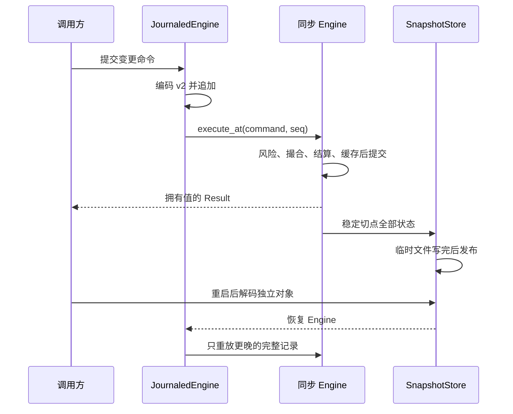
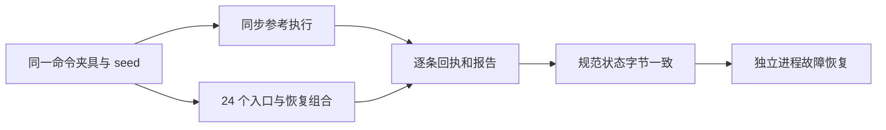

# Day 32 · 版本升级、完整集成验收与架构复盘

## 1. 本期内容与学习目标

本课预计 6–8 小时，前置为 Day 31 的全部代码和 Java 对照基准。升级现有日志和快照，使规格、持仓、集合次序、价格缓存和 L2 发布配置可以恢复。随后用同步与异步入口运行同一组现货、期货命令，核对逐条回执、报告、尾段事件和最终状态。最后在独立进程中验证期货完整记录与半帧恢复。

课程到这里共 32 课。验收依据包括业务手算、实际 Java 轨迹、独立参考簿、布局差分、并发测试、版本测试和进程故障测试。每种证据回答不同问题，执行次数与测试覆盖范围要分别记录。

## 2. 业务背景与原理

### 决策状态也必须保存

同样的现金、持仓和订单，配上不同 `LastPrice`，下一条期货订单可能一个接受、一个拒绝。因此价格缓存不能恢复时从当前簿临时推导。关闭逐命令 L2 发布时，缓存缺失或滞后就是当前状态，必须原样保存。

Day 31 又暴露了依赖遍历顺序的源码行为。只保存 sorted positions 再插入集合，可能重排碰撞与墓碑，改变准入结果。本课的自有快照保存兼容键表的槽位、特殊键与仓位值，并重新校验两者相符。Java 的快照是另一种字段协议；C++ 文件格式不承诺与它互读。

旧 v1 文件只有现货规格和资金。v2 写入新字段；新读取器同时识别 v1、v2。v1 规格恢复成现货，仓位和缓存为空，L2 配置采用升级后的默认 true。旧版本的程序不能读取 v2 文件，部署或练习版本切换前要保留旧文件副本。

### 在线回执与恢复序号

查询占用序号，但课程日志只记录变更命令。恢复位置由快照或完整变更记录确定，不能用它还原上一进程最后发生的查询。矩阵在末尾放一条会拒绝的资金命令：拒绝仍记日志，所以在线和恢复的比较切点明确一致。中间查询产生的空洞继续存在。



## 3. Java 原始项目的实现分析

继续使用本地相同提交，重点回读四条路径：

- [`RiskEngine.writeMarshallable`](https://github.com/exchange-core/exchange-core/blob/2f8548749839e9095c8dc597e4b61521d259fa5d/src/main/java/exchange/core2/core/processors/RiskEngine.java#L799-L814) 同时保存规格、用户、价格缓存、费用和资金调整；恢复构造器读取这些模块。缓存参与风险决策是保存它的直接原因。
- [`UserProfile` 的读写](https://github.com/exchange-core/exchange-core/blob/2f8548749839e9095c8dc597e4b61521d259fa5d/src/main/java/exchange/core2/core/common/UserProfile.java#L56-L89) 包含 positions、资金流水计数器、账户和暂停状态。
- [`SymbolPositionRecord.writeMarshallable`](https://github.com/exchange-core/exchange-core/blob/2f8548749839e9095c8dc597e4b61521d259fa5d/src/main/java/exchange/core2/core/common/SymbolPositionRecord.java#L244-L254) 保存方向、数量、成本、利润和两侧 pending。
- 结合 `src/test/java/exchange/core2/tests` 下的费用、持久化、journaling 和 futures 测试阅读事件、资金与恢复断言。测试名称以当前 checkout 的 `rg --files` 输出为准，不从测试类名推断未读到的行为。

Java 的处理器分片在各自序列位置保存状态。课程通过同一个单写者获得整簿与账本切点，这是当前 C++ 架构的选择。业务公式和费用由 Day 31 的实际方法对照固定；处理器拓扑、磁盘协议与复制机制应当分别评价。

## 4. 本期 C++ 知识

### 版本贯穿整个解析调用链

读取到版本之后，不能只改最外层判断。`scan_log` 必须把每帧版本传给 `decode_command`，后者再把版本传给 `read_spec`。批量规格同样如此。否则 v1 规格会误读后续字段，轻则长度错误，重则错位成另一个合法值。

### 恢复是独立构造与语义校验

校验和只证明载荷与写入的校验值相符。它不证明 pending 和订单相符、持仓属于已注册期货、冻结归属正确或多空数量相等。读取器在独立 `unique_ptr<Engine>` 上重建，再检查这些业务关系，成功后才交给包装器。文件范围仍沿用 Day 29 的 1 MiB 载荷与集合上限。

### 同步可调用对象复用到异步入口

矩阵把同一 `Processor` 交给 Day 27 的 `AsyncEngine`。一次只提交一条并等待结果，测试的是入口组合的可替换性；多生产者竞争、满队列与关停由 Day 25–27 的专门用例验证。工作线程编码快照、日志和末态；主线程等 future 完成或 close 以后读取，避免直接并发观察 Engine。

## 5. 架构设计与技术选型

| 维度 | 取值 | 核对对象 |
| --- | --- | --- |
| 产品 | 现货、期货 | 规格、账户、持仓和费用 |
| 簿布局 | list、pooled | 事件、FIFO、规范订单 |
| 入口 | 同步、异步 | 序号、回执与报告 |
| 持久化路径 | 内存、纯日志、快照加日志 | 在线与恢复的完整编码状态 |
| 固定种子 | 7、31、2026 | 可复现的小范围价位变化 |

前四维共有 24 个组合，三个种子运行 72 次。这些种子变化的只是夹具价格，不能称为 72 轮任意命令模糊测试。任意命令序列的簿差分继续由 Day 16、24 的 7200 条比较承担。独立 Java 轨迹另有 408 行。



## 6. 从零逐步实现

### 32.1 升级规格与日志载荷

在 `persistence.hpp` 把 `read_spec` 声明改为 `SymbolSpec read_spec(Reader&, unsigned version = 2);`。用以下两个定义替换 `persistence.cpp` 的规格编解码。

```cpp
void write_spec(Writer& out, const SymbolSpec& spec) {
    out.u(spec.symbol.value(), 4);
    out.u(spec.base.value(), 4);
    out.u(spec.quote.value(), 4);
    out.i(spec.base_scale);
    out.i(spec.quote_scale);
    out.i(spec.maker_fee_per_lot);
    out.i(spec.taker_fee_per_lot);
    out.i(static_cast<std::int64_t>(spec.type)); out.i(spec.margin_buy); out.i(spec.margin_sell);
}

SymbolSpec read_spec(Reader& in, unsigned version) {
    SymbolSpec spec{SymbolId{static_cast<std::uint32_t>(in.u(4))},
        CurrencyId{static_cast<std::uint32_t>(in.u(4))},
        CurrencyId{static_cast<std::uint32_t>(in.u(4))}, in.i(), in.i(), in.i(), in.i()};
    if (version >= 2) {
        const auto raw_type = in.i();
        if (!std::in_range<std::underlying_type_t<SymbolType>>(raw_type)) {
            throw std::runtime_error{"symbol type outside underlying range"};
        }
        spec.type = static_cast<SymbolType>(raw_type); spec.margin_buy = in.i(); spec.margin_sell = in.i();
    }
    return spec;
}
```

把同文件的 `log_version` 改为 2。`decode_command` 签名改为 `Command decode_command(Reader& in, unsigned version)`；它的单品种与批量规格分支均调用 `wire::read_spec(in, version)`。产品类型写成 8 字节有符号值，并在读取时检查底层枚举范围；这与 Day 28 保留非法方向值的做法一致。若只写一个字节，非法类型 256 会变成现货类型 0，回放可能把在线拒绝变成接受。其他字段、标签和形状保持 Day 28 的定义。

用以下版本替换 `scan_log`。一个文件中可以先有 v1 帧、后有 v2 帧，每帧独立选读取规则。头部、长度、序号和校验仍先验证，完整坏帧不能按半帧截掉。

```cpp
LogScan scan_log(std::span<const std::byte> bytes) {
    Reader in{bytes};
    LogScan result;
    Seq previous{0};
    while (in.left() != 0) {
        const auto start = in.pos;
        if (in.left() < log_header) {
            result.truncated_tail = true;
            break;
        }
        if (in.u(4) != log_magic) { throw std::runtime_error{"invalid log magic"}; }
        const auto version = static_cast<unsigned>(in.u(1));
        if (version != 1 && version != log_version) {
            throw std::runtime_error{"unsupported log header"};
        }
        const auto length = static_cast<std::size_t>(in.u(4));
        const Seq seq{in.u()};
        if (length == 0 || length > wire::max_payload || seq <= previous) {
            throw std::runtime_error{"invalid log length or sequence"};
        }
        if (in.left() < length + 4) {
            result.truncated_tail = true;
            break;
        }
        Reader payload{in.take(length)};
        const auto covered = bytes.subspan(start, in.pos - start);
        if (in.u(4) != wire::checksum(covered)) {
            throw std::runtime_error{"log checksum mismatch"};
        }
        auto command = decode_command(payload, version);
        payload.end();
        result.records.push_back({seq, std::move(command)});
        previous = seq;
        result.valid_bytes = in.pos;
    }
    return result;
}
```

将 `tests/journal_test.cpp` 里用于未知版本的 `version.at(4) = std::byte{2};` 改为 `std::byte{9}`。2 已经是支持的版本，继续期待它失败会让测试表达旧需求。

### 32.2 保存全部风险状态并重建校验

用下方版本替换 `src/snapshot.cpp`。沿用 `SnapshotStore` 的公开接口和 Day 29 的友元声明。按顺序读 encode、decode，再看校验尾段：规格与簿、账户与仓位、冻结与费用、价格缓存，最后核对关系。

余额和净资金调整在 v2 可为有符号值。开仓费、现货使用期货余量、出金都可能产生这一状态。费用和冻结仍不能为负。不要把 v1 的“所有账户余额非负”校验直接复制到 v2。缓存允许缺失、滞后；读取器只检查字段和品种归属，不能用当前盘口覆盖它。

```cpp
#include "exchange/persistence.hpp"

#include <fstream>
#include "exchange/futures_risk.hpp"
#include <limits>
#include <algorithm>
#include <utility>

namespace exchange {
namespace {

using wire::Reader;
using wire::Writer;
constexpr std::uint32_t snapshot_magic = 0x31504e53;
constexpr unsigned snapshot_version = 2;
constexpr std::uint64_t max_total_slots = 65'536;

bool valid_layout(BookKind kind, std::uint64_t capacity, std::size_t markets) {
    return capacity <= wire::max_batch &&
           (kind != BookKind::pooled || markets <= max_total_slots / (capacity + 1));
}

void count(Writer& out, std::size_t size) {
    if (size > wire::max_batch) {
        throw std::length_error{"snapshot collection too large"};
    }
    out.u(size, 4);
}

std::size_t count(Reader& in) {
    const auto size = in.u(4);
    if (size > wire::max_batch) {
        throw std::runtime_error{"snapshot collection too large"};
    }
    return static_cast<std::size_t>(size);
}

CurrencyId currency(Reader& in) {
    const CurrencyId id{static_cast<std::uint32_t>(in.u(4))};
    if (id.value() == 0) {
        throw std::runtime_error{"zero currency"};
    }
    return id;
}

template<class Map>
void amounts(Writer& out, const Map& map) {
    count(out, map.size());
    for (const auto& [id, units] : map) {
        out.u(id.value(), 4);
        out.i(units);
    }
}

template<class Map>
void amounts(Reader& in, Map& map, bool nonnegative = true) {
    const auto size = count(in);
    for (std::size_t i = 0; i < size; ++i) {
        const auto id = currency(in);
        const auto units = in.i();
        if ((nonnegative && units < 0) || !map.try_emplace(id, units).second) {
            throw std::runtime_error{"invalid balance row"};
        }
    }
}

void write_order(Writer& out, const RestingOrder& order) {
    out.u(order.key.order.value());
    out.u(order.user.value());
    out.u(order.side == Side::bid, 1);
    out.i(order.price.value());
    out.i(order.remaining.value());
    out.u(order.reserve_bid_price.has_value(), 1);
    if (order.reserve_bid_price) {
        out.i(order.reserve_bid_price->value());
    }
    out.u(order.priority_seq.value());
    out.i(order.timestamp_ns);
}

RestingOrder read_order(Reader& in, SymbolId symbol, Seq checkpoint) {
    const OrderId id{in.u()};
    const UserId user{in.u()};
    const auto side = in.flag() ? Side::bid : Side::ask;
    const Price price{in.i()};
    const Quantity remaining{in.i()};
    std::optional<Price> reserve;
    if (in.flag()) {
        reserve = Price{in.i()};
    }
    const Seq priority{in.u()};
    if (priority > checkpoint) {
        throw std::runtime_error{"priority beyond checkpoint"};
    }
    return {{symbol, id}, user, side, price, remaining, reserve, priority, in.i()};
}

}

Bytes SnapshotStore::encode(const Engine& engine) {
    if (!valid_layout(engine.book_kind_, engine.pool_capacity_, engine.catalog_.markets_.size())) {
        throw std::length_error{"snapshot pool capacity too large"};
    }
    Writer payload;
    payload.u(engine.last_sequence().value());
    payload.u(engine.book_kind_ == BookKind::pooled, 1);
    payload.u(engine.pool_capacity_);
    payload.u(engine.send_l2_, 1);
    count(payload, engine.catalog_.markets_.size());
    for (const auto& [id, market] : engine.catalog_.markets_) {
        wire::write_spec(payload, market.spec);
        const auto orders = market.book->resting_orders();
        count(payload, orders.size());
        for (const auto& order : orders) {
            write_order(payload, order);
        }
    }
    const auto& ledger = engine.ledger_;
    count(payload, ledger.accounts_.size());
    for (const auto& [user, account] : ledger.accounts_) {
        payload.u(user.value());
        payload.u(account.last_funding);
        payload.u(account.suspended, 1);
        amounts(payload, account.balances);
        count(payload, account.positions.size());
        for (const auto& [symbol, p] : account.positions) {
            payload.u(symbol.value(), 4); payload.i(p.signed_quantity); payload.i(p.cost_sum);
            payload.i(p.profit); payload.i(p.pending_buy); payload.i(p.pending_sell);
        }
        payload.u(account.position_order.one(), 1);
        count(payload, account.position_order.slots().size());
        for (const auto key : account.position_order.slots()) { payload.u(key, 4); }

    }
    count(payload, ledger.holds_.size());
    for (const auto& [key, hold] : ledger.holds_) {
        payload.u(key.first.value(), 4);
        payload.u(key.second.value());
        payload.u(hold.user.value());
        payload.u(hold.money.currency.value(), 4);
        payload.i(hold.money.units);
    }
    amounts(payload, ledger.fees_);
    amounts(payload, ledger.net_deposits_);
    count(payload, ledger.last_prices_.size());
    for (const auto& [symbol, p] : ledger.last_prices_) { payload.u(symbol.value(), 4); payload.i(p.ask); payload.i(p.bid); }
    if (payload.data.size() > wire::max_payload) {
        throw std::length_error{"snapshot payload too large"};
    }

    Writer out;
    out.u(snapshot_magic, 4);
    out.u(snapshot_version, 1);
    out.u(payload.data.size(), 4);
    out.data.insert(out.data.end(), payload.data.begin(), payload.data.end());
    out.u(wire::checksum(out.data), 4);
    return std::move(out.data);
}

std::unique_ptr<Engine> SnapshotStore::decode(std::span<const std::byte> bytes) {
    Reader frame{bytes};
    if (frame.u(4) != snapshot_magic) { throw std::runtime_error{"invalid snapshot magic"}; }
    const auto version = static_cast<unsigned>(frame.u(1));
    if (version != 1 && version != snapshot_version) {
        throw std::runtime_error{"unsupported snapshot header"};
    }
    const auto length = frame.u(4);
    if (length > wire::max_payload || frame.left() != length + 4) {
        throw std::runtime_error{"invalid snapshot length"};
    }
    Reader in{frame.take(static_cast<std::size_t>(length))};
    const auto covered = bytes.first(frame.pos);
    if (frame.u(4) != wire::checksum(covered)) {
        throw std::runtime_error{"snapshot checksum mismatch"};
    }
    const Seq seq{in.u()};
    const auto kind = in.flag() ? BookKind::pooled : BookKind::list;
    const auto capacity = in.u();
    const bool send_l2 = version >= 2 ? in.flag() : true;
    const auto markets = count(in);
    if (!valid_layout(kind, capacity, markets)) {
        throw std::runtime_error{"snapshot pool capacity too large"};
    }
    auto engine = std::make_unique<Engine>(kind, static_cast<std::size_t>(capacity), send_l2);
    engine->last_seq_ = seq.value();

    for (std::size_t m = 0; m < markets; ++m) {
        const auto spec = wire::read_spec(in, version);
        const auto size = count(in);
        std::vector<RestingOrder> orders;
        orders.reserve(size);
        for (std::size_t i = 0; i < size; ++i) {
            orders.push_back(read_order(in, spec.symbol, seq));
        }
        if (!valid_symbol(spec) || engine->catalog_.markets_.contains(spec.symbol)) {
            throw std::runtime_error{"invalid snapshot market"};
        }
        auto book = OrderBook::from_resting(spec.symbol, orders, kind,
                                            static_cast<std::size_t>(capacity));
        engine->catalog_.markets_.try_emplace(spec.symbol,
            SymbolCatalog::Market{spec, std::move(book)});
    }

    auto& ledger = engine->ledger_;
    const auto users = count(in);
    for (std::size_t i = 0; i < users; ++i) {
        const UserId user{in.u()};
        const auto funding = in.u();
        const auto suspended = in.flag();
        if (ledger.add_user(user) != Status::processed) {
            throw std::runtime_error{"invalid snapshot user"};
        }
        auto& account = ledger.accounts_.at(user);
        account.last_funding = funding;
        account.suspended = suspended;
        amounts(in, account.balances, version == 1);
        if (version >= 2) {
            const auto positions = count(in);
            for (std::size_t j = 0; j < positions; ++j) {
                const SymbolId symbol{static_cast<std::uint32_t>(in.u(4))};
                const MarginPosition p{in.i(), in.i(), in.i(), in.i(), in.i()};
                const auto market = engine->catalog_.markets_.find(symbol);
                if (market == engine->catalog_.markets_.end() || market->second.spec.type != SymbolType::futures ||
                    p.signed_quantity == std::numeric_limits<std::int64_t>::min() || p.pending_buy < 0 || p.pending_sell < 0 ||
                    (p.signed_quantity == 0 && p.cost_sum != 0) || p.empty() || account.suspended ||
                    !account.positions.try_emplace(symbol, p).second) { throw std::runtime_error{"invalid margin position"}; }
            }
            const bool one = in.flag();
            std::vector<std::uint32_t> slots(count(in));
            for (auto& key : slots) { key = static_cast<std::uint32_t>(in.u(4)); }
            account.position_order = JavaPositionOrder::restore(std::move(slots), one);
            auto keys = account.position_order.keys();
            std::sort(keys.begin(), keys.end());
            std::vector<std::uint32_t> expected;
            for (const auto& [symbol, p] : account.positions) { expected.push_back(symbol.value()); }
            if (keys != expected) { throw std::runtime_error{"position table differs"}; }
        }
        if (suspended) {
            for (const auto& entry : account.balances) {
                if (entry.second != 0) {
                    throw std::runtime_error{"suspended user has funds"};
                }
            }
        }
    }
    const auto holds = count(in);
    for (std::size_t i = 0; i < holds; ++i) {
        const SymbolId symbol{static_cast<std::uint32_t>(in.u(4))};
        const OrderId order{in.u()};
        const UserId user{in.u()};
        const Money money{currency(in), in.i()};
        if (money.units <= 0 || !ledger.holds_.try_emplace(
                Ledger::HoldKey{symbol, order}, Ledger::Hold{user, money}).second) {
            throw std::runtime_error{"invalid snapshot hold"};
        }
    }
    amounts(in, ledger.fees_);
    amounts(in, ledger.net_deposits_, version == 1);
    if (version >= 2) {
        const auto prices = count(in);
        for (std::size_t j = 0; j < prices; ++j) {
            const SymbolId symbol{static_cast<std::uint32_t>(in.u(4))};
            const LastPrice p{in.i(), in.i()};
            if (!engine->catalog_.markets_.contains(symbol) || p.ask <= 0 || p.bid < 0 ||
                !ledger.last_prices_.try_emplace(symbol, p).second) { throw std::runtime_error{"invalid last price cache"}; }
        }
    }
    in.end();

    std::size_t checked = 0;
    for (const auto& [id, market] : engine->catalog_.markets_) {
        for (const auto& order : market.book->resting_orders()) {
            const auto account = ledger.accounts_.find(order.user);
            if (market.spec.type == SymbolType::futures) {
                if (account == ledger.accounts_.end() || account->second.suspended ||
                    !account->second.positions.contains(id)) { throw std::runtime_error{"missing position owner"}; }
                continue;
            }
            const auto hold = ledger.holds_.find({id, order.key.order});
            const auto expected = order.side == Side::bid
                ? bid_hold(order.remaining, *order.reserve_bid_price, market.spec)
                : base_amount(order.remaining, market.spec);
            if (account == ledger.accounts_.end() || account->second.suspended ||
                hold == ledger.holds_.end() || hold->second.user != order.user ||
                !expected || hold->second.money != *expected) {
                throw std::runtime_error{"snapshot order and hold differ"};
            }
            ++checked;
        }
    }
    if (checked != ledger.holds_.size()) {
        throw std::runtime_error{"orphan hold"};
    }
    for (const auto& [user, a] : ledger.accounts_) {
        for (const auto& [symbol, p] : a.positions) {
            std::int64_t buy{}, sell{};
            for (const auto& order : engine->catalog_.markets_.at(symbol).book->resting_orders()) {
                if (order.user == user) {
                    auto& total = order.side == Side::bid ? buy : sell;
                    const auto next = checked_add(total, order.remaining.value());
                    if (!next) { throw std::runtime_error{"pending overflow"}; }
                    total = *next;
                }
            }
            if (buy != p.pending_buy || sell != p.pending_sell) { throw std::runtime_error{"snapshot pending differs"}; }
        }
    }
    auto totals = ledger.totals();
    FuturesRisk::totals(ledger, totals, [&](SymbolId id) -> const SymbolSpec& { return engine->catalog_.markets_.at(id).spec; });
    for (const auto& oi : totals.open_interest) { if (oi.long_volume != oi.short_volume) { throw std::runtime_error{"snapshot open interest"}; } }
    for (const auto& row : totals.currencies) {
        if (!row.conserved()) {
            throw std::runtime_error{"snapshot totals do not conserve"};
        }
    }
    return engine;
}

void SnapshotStore::publish(const std::filesystem::path& destination, const Engine& engine) {
    const auto bytes = encode(engine);
    auto temporary = destination;
    temporary += ".tmp";
    std::ofstream output{temporary, std::ios::binary | std::ios::trunc};
    write_binary(output, bytes);
    output.close();
    if (!output) {
        throw std::runtime_error{"could not close temporary snapshot"};
    }
    std::filesystem::rename(temporary, destination);
}

JournaledEngine::JournaledEngine(Append append, std::unique_ptr<Engine> recovered)
    : engine_(std::move(recovered)), append_(std::move(append)) {
    if (!engine_) {
        throw std::invalid_argument{"missing recovered engine"};
    }
}

}
```

这里还验证：每个期货活动订单的用户持有对应记录；每条持仓的 pending 等于最终簿；兼容键表与仓位值键集合相等；总账报告逐币种核对，多空持仓量逐品种相等。部分平仓允许累计成本为负，有仓位时不能用“成本必须正”代替这些关系。

### 32.3 保存故障恢复用例的所有观察面

创建 `tests/futures_snapshot_test.cpp`。它覆盖两种布局、纯日志与快照尾日志、损坏数据、带有效校验的 pending 错误、v1 迁移、追加失败锁定和负现金恢复。

```cpp
#include "exchange/persistence.hpp"
#include "trading_integration_fixtures.hpp"
#include "test_checks.hpp"

namespace exchange {
struct MarginTestAccess {
    static void damage_pending(Engine& e) {
        auto& ledger=const_cast<Ledger&>(e.ledger());
        ++ledger.accounts_.at(UserId{1}).positions.at(SymbolId{1}).pending_buy;
    }
};
}
int main() {
    using namespace integration_fixture;
    TestChecks checks;
    for (const auto kind : {BookKind::list, BookKind::pooled}) {
        Bytes journal;
        JournaledEngine e{[&](std::span<const std::byte> bytes) {
            journal.insert(journal.end(), bytes.begin(), bytes.end());
        }, std::make_unique<Engine>(kind, 64)};
        const auto script = history(true,7);
        for (std::size_t i = 0; i < 12; ++i) { e.execute(script[i]); }
        const auto snap = SnapshotStore::encode(e.state());
        for (std::size_t i = 12; i < script.size(); ++i) { e.execute(script[i]); }
        const auto expected = SnapshotStore::encode(e.state());
        auto recovered = SnapshotStore::decode(snap);
        const auto results = replay_log(*recovered, scan_log(journal));
        checks.require(!results.empty() && SnapshotStore::encode(*recovered) == expected,
                       "position pending and funding survive suffix replay");
        auto only_log = std::make_unique<Engine>(kind, 64);
        replay_log(*only_log, scan_log(journal));
        checks.require(SnapshotStore::encode(*only_log) == expected, "log-only recovery agrees");
        const auto refuse = [&](Bytes damaged, const char* message) {
            bool caught = false;
            try { SnapshotStore::decode(damaged); } catch (const std::exception&) { caught = true; }
            checks.require(caught, message);
        };
        auto damaged = snap; damaged.pop_back(); refuse(damaged, "truncation refused");
        damaged = snap; damaged.at(20) ^= std::byte{1}; refuse(damaged, "checksum refused");
        damaged = snap; damaged.at(4) = std::byte{9}; refuse(damaged, "unknown version refused");
        auto invalid=SnapshotStore::decode(snap);
        MarginTestAccess::damage_pending(*invalid);
        refuse(SnapshotStore::encode(*invalid), "valid checksum cannot hide pending mismatch");

    }
    JournaledEngine failing{[](std::span<const std::byte>) { throw std::runtime_error{"disk"}; },
                          std::make_unique<Engine>()};
    for (int i = 0; i < 2; ++i) {
        bool refused = false;
        try { failing.execute(AddUser{UserId{1}}); } catch (const std::exception&) { refused = true; }
        checks.require(refused && failing.state().last_sequence() == Seq{0}, "append failure locks before execution");
    }
    wire::Writer payload;
    payload.u(0);payload.u(0,1);payload.u(64);
    for(int i=0;i<5;++i) payload.u(0,4); // markets,accounts,holds,fees,net
    wire::Writer old;old.u(0x31504e53,4);old.u(1,1);old.u(payload.data.size(),4);
    old.data.insert(old.data.end(),payload.data.begin(),payload.data.end());old.u(wire::checksum(old.data),4);
    checks.require(SnapshotStore::decode(old.data)->last_sequence()==Seq{0},"v1 snapshot migrates to spot defaults");
    Engine debt;auto zero=spec(true);zero.margin_buy=zero.margin_sell=0;
    debt.execute(RegisterSymbol{zero});debt.execute(AddUsers{{UserId{1},UserId{2}}});
    debt.execute(limit(1,2,Side::ask,1,100));debt.execute(limit(2,1,Side::bid,1,100));
    checks.require(debt.ledger().available(UserId{1},zero.quote)->units==-2 &&
        SnapshotStore::encode(*SnapshotStore::decode(SnapshotStore::encode(debt)))==SnapshotStore::encode(debt),
        "Java opening fee may produce signed cash and survives restore");
    return checks.exit_code();
}
```

### 32.4 实现 24 组合矩阵

创建 `tests/integration_matrix_test.cpp`。两个产品策略只提供不同夹具，状态和日志包装器统一为已有 Engine、JournaledEngine、SnapshotStore。`same_report` 比较持仓、冻结、资金流水、行情影响的风险估计和总账持仓量。逐条比较以后再比较最终完整状态，避免只核对一个哈希就掩盖差异。

```cpp
#include "exchange/async_engine.hpp"
#include "exchange/persistence.hpp"
#include "trading_integration_fixtures.hpp"
#include "test_checks.hpp"
#include <iostream>
#include <tuple>

namespace {
using namespace exchange;

bool same_report(const Report& a, const Report& b) {
    if (a.index() != b.index()) { return false; }
    return std::visit([&](const auto& left) {
        using T = std::decay_t<decltype(left)>;
        const auto& right = std::get<T>(b);
        if constexpr (std::is_same_v<T, std::monostate>) { return true; }
        else if constexpr (std::is_same_v<T, StateFingerprint>) { return left.value == right.value; }
        else if constexpr (std::is_same_v<T, UserReport>) {
            return left.user == right.user && left.suspended == right.suspended &&
                left.last_funding == right.last_funding && left.available == right.available &&
                left.frozen == right.frozen && left.orders == right.orders && left.positions == right.positions;
        } else if constexpr (std::is_same_v<T, TotalsReport>) {
            if (left.open_interest != right.open_interest) { return false; }
            if (left.currencies.size() != right.currencies.size()) { return false; }
            for (std::size_t i = 0; i < left.currencies.size(); ++i) {
                const auto& x = left.currencies[i]; const auto& y = right.currencies[i];
                if (std::tie(x.currency, x.available, x.frozen, x.fees, x.net_deposits,x.positions) !=
                    std::tie(y.currency, y.available, y.frozen, y.fees, y.net_deposits,y.positions)) { return false; }
            }
            return true;
        } else { return left == right; }
    }, a);
}

struct Spot {
    using State = Engine;
    using Journal = JournaledEngine;
    static const char* name() { return "spot"; }
    static auto fresh(BookKind kind) { return std::make_unique<State>(kind, 64); }
    static auto encode(const State& s) { return SnapshotStore::encode(s); }
    static auto decode(const Bytes& bytes) { return SnapshotStore::decode(bytes); }
    static auto replay(State& s, const LogScan& log) { return replay_log(s, log); }
    static auto history(std::uint32_t seed) { return integration_fixture::history(false,seed); }
};

struct Futures : Spot {
    static const char* name() { return "futures"; }
    static auto history(std::uint32_t seed) { return integration_fixture::history(true,seed); }
};

template<class Product>
void run(TestChecks& checks, BookKind kind, bool async, int mode, std::uint32_t seed) {
    const auto commands = Product::history(seed);
    auto reference = Product::fresh(kind);
    std::vector<Result> expected;
    for (const auto& c : commands) { expected.push_back(reference->execute(c)); }
    const auto expected_state = Product::encode(*reference);
    const auto cut = commands.size() / 2;
    const auto context = std::string{Product::name()} + " book=" +
        (kind == BookKind::list ? "list" : "pooled") + (async ? " async" : " sync") +
        " mode=" + std::to_string(mode) + " seed=" + std::to_string(seed);

    Bytes log, snapshot, final_state;
    auto state = std::shared_ptr<typename Product::State>{Product::fresh(kind)};
    std::shared_ptr<typename Product::Journal> journal;
    if (mode != 0) {
        journal = std::make_shared<typename Product::Journal>([&](std::span<const std::byte> b) {
            log.insert(log.end(), b.begin(), b.end());
        }, Product::fresh(kind));
    }
    std::size_t processed{};
    const AsyncEngine::Processor process = [&](const Command& c) {
        auto r = journal ? journal->execute(c) : state->execute(c);
        const auto& current = journal ? journal->state() : *state;
        ++processed;
        if (mode == 2 && processed == cut) { snapshot = Product::encode(current); }
        if (processed == commands.size()) { final_state = Product::encode(current); }
        return r;
    };
    std::unique_ptr<AsyncEngine> facade;
    if (async) { facade = std::make_unique<AsyncEngine>(8, process); }
    for (std::size_t i = 0; i < commands.size(); ++i) {
        Result result{Seq{0}, {Status::invalid_input, {}}};
        if (facade) {
            auto submission = facade->submit(commands[i]);
            if (!std::holds_alternative<std::future<Result>>(submission)) {
                checks.require(false, (context + " unexpected submit failure").c_str());
                facade->close(); return;
            }
            result = std::get<std::future<Result>>(submission).get();
        } else { result = process(commands[i]); }
        const auto& e = expected[i];
        checks.require(result.seq == e.seq && result.outcome == e.outcome && same_report(result.report, e.report),
                       (context + " first mismatch candidate seq=" + std::to_string(i + 1)).c_str());
    }
    if (facade) { facade->close(); }
    checks.require(final_state == expected_state, (context + " live state").c_str());
    if (mode == 0) { checks.require(log.empty() && snapshot.empty(), "memory-only has no persistence"); return; }
    auto recovered = mode == 2 ? Product::decode(snapshot) : Product::fresh(kind);
    const auto replayed = Product::replay(*recovered, scan_log(log));
    for (const auto& r : replayed) {
        const auto& e = expected.at(static_cast<std::size_t>(r.seq.value() - 1));
        checks.require(r.outcome == e.outcome && same_report(r.report, e.report), (context + " replay event").c_str());
    }
    checks.require(Product::encode(*recovered) == expected_state, (context + " recovered state").c_str());
}
}

int main() {
    TestChecks checks;
    std::size_t runs{};
    for (const auto seed : {7u, 31u, 2026u}) {
        for (const auto kind : {BookKind::list, BookKind::pooled}) {
            for (const bool async : {false, true}) {
                for (int mode = 0; mode < 3; ++mode) {
                    run<Spot>(checks, kind, async, mode, seed);
                    run<Futures>(checks, kind, async, mode, seed);
                    runs += 2;
                }
            }
        }
    }
    std::cout << runs << " scenario runs; 24 cells * 3 seeds; modes=memory,log,snapshot+log\n";
    return checks.exit_code();
}
```

`Result` 没有无参数默认构造器，因为 `Seq` 要求显式值。代码用 `{Seq{0}, {Status::invalid_input, {}}}` 初始化局部接收值，再由实际执行结果替换。读取报告时只在变体类型相同后使用 `get<T>`。

### 32.5 用独立进程验证期货文件恢复

创建 `app/futures_recovery_lab.cpp`。write 子进程在持仓和挂单同时存在时发布快照，随后写完整后缀或半条记录，以 42 退出。recover 子进程先对照相同命令的同步前缀，再按 `valid_bytes` 截尾并继续追加，最后第二次恢复与重复资金请求也必须一致。

```cpp
#include "exchange/persistence.hpp"
#include "trading_integration_fixtures.hpp"
#include <cstdlib>
#include <fstream>
#include <iostream>

namespace {
using namespace exchange;
Bytes load(const std::filesystem::path& path) {
    std::ifstream input{path, std::ios::binary};
    return read_binary(input);
}
void require(bool condition) {
    if (!condition) { throw std::runtime_error{"futures recovery check"}; }
}
void write(const std::filesystem::path& dir, bool torn) {
    std::filesystem::create_directories(dir);
    std::ofstream log{dir / "commands.bin", std::ios::binary | std::ios::trunc};
    JournaledEngine e{[&](std::span<const std::byte> b) { write_binary(log, b); },
                    std::make_unique<Engine>(BookKind::pooled, 64)};
    const auto commands = integration_fixture::history(true,7);
    const std::size_t committed = torn ? 17 : commands.size();
    for (std::size_t i = 0; i < committed; ++i) {
        e.execute(commands[i]);
        if (i == 11) { SnapshotStore::publish(dir / "state.bin", e.state()); }
    }
    if (torn) {
        const auto frame = encode_record(e.state().next_sequence(), commands.at(committed));
        write_binary(log, std::span<const std::byte>{frame}.first(frame.size() / 2));
    }
    std::_Exit(42);
}
void recover(const std::filesystem::path& dir, bool torn) {
    const auto scanned = scan_log(load(dir / "commands.bin"));
    require(scanned.truncated_tail == torn);
    auto e = SnapshotStore::decode(load(dir / "state.bin"));
    const auto results = replay_log(*e, scanned);
    const auto commands = integration_fixture::history(true,7);
    Engine expected{BookKind::pooled,64};
    const std::size_t committed = torn ? 17 : commands.size();
    std::vector<Result> receipts;
    for (std::size_t i = 0; i < committed; ++i) { receipts.push_back(expected.execute(commands[i])); }
    for (const auto& r : results) { require(r.outcome == receipts.at(r.seq.value() - 1).outcome); }
    require(SnapshotStore::encode(*e) == SnapshotStore::encode(expected));
    std::filesystem::resize_file(dir / "commands.bin", scanned.valid_bytes);
    {
        std::ofstream log{dir / "commands.bin", std::ios::binary | std::ios::app};
        JournaledEngine resumed{[&](std::span<const std::byte> b) { write_binary(log, b); }, std::move(e)};
        for (std::size_t i = committed; i < commands.size(); ++i) {
            require(resumed.execute(commands[i]).outcome == expected.execute(commands[i]).outcome);
        }
        require(SnapshotStore::encode(resumed.state()) == SnapshotStore::encode(expected));
        SnapshotStore::publish(dir / "state.bin", resumed.state());
    }
    auto again = SnapshotStore::decode(load(dir / "state.bin"));
    require(replay_log(*again, scan_log(load(dir / "commands.bin"))).empty());
    require(SnapshotStore::encode(*again) == SnapshotStore::encode(expected));
    const auto duplicate = again->execute(AdjustBalance{UserId{1}, {CurrencyId{20}, 1}, 1});
    require(duplicate.outcome.status == Status::duplicate_funding && std::get<TotalsReport>(again->execute(QueryTotals{}).report).currencies.front().conserved());
    std::cout << "futures recovered; torn=" << torn << "; cash=10100; fees=15\n";
}
}

int main(int argc, char** argv) {
    try {
        if (argc != 4) { throw std::invalid_argument{"write|recover directory complete|torn"}; }
        const std::string action{argv[1]}, mode{argv[3]};
        if (mode != "complete" && mode != "torn") { throw std::invalid_argument{"mode"}; }
        if (action == "write") { write(argv[2], mode == "torn"); }
        else if (action == "recover") { recover(argv[2], mode == "torn"); }
        else { throw std::invalid_argument{"action"}; }
    } catch (const std::exception& error) { std::cerr << error.what() << '\n'; return 1; }
}
```

创建 `tests/futures_recovery_matrix.cmake`。测试只清理自己随机创建的子目录；失败时保留目录，便于检查原始日志和快照。

```cmake
if(NOT DEFINED ROOT OR NOT IS_ABSOLUTE "${ROOT}" OR NOT DEFINED PROGRAM)
    message(FATAL_ERROR "absolute test ROOT and PROGRAM required")
endif()
string(RANDOM LENGTH 12 ALPHABET 0123456789abcdef suffix)
set(run "${ROOT}/futures-${suffix}")
foreach(mode complete torn)
    set(directory "${run}/${mode}")
    execute_process(COMMAND "${PROGRAM}" write "${directory}" "${mode}"
                    RESULT_VARIABLE code TIMEOUT 15)
    if(NOT code STREQUAL "42")
        message(FATAL_ERROR "futures writer ${mode}: ${code}; retained ${run}")
    endif()
    execute_process(COMMAND "${PROGRAM}" recover "${directory}" "${mode}"
                    RESULT_VARIABLE code TIMEOUT 15)
    if(NOT code STREQUAL "0")
        message(FATAL_ERROR "futures reader ${mode}: ${code}; retained ${run}")
    endif()
endforeach()
file(REMOVE_RECURSE "${run}")
```

把以下目标追加到 CMake。Day 31 已加入的两个测试目标保留，总计将有 34 项 CTest。

```cmake
add_executable(futures_snapshot_tests tests/futures_snapshot_test.cpp)
target_link_libraries(futures_snapshot_tests PRIVATE exchange_core)
add_test(NAME futures_snapshot COMMAND futures_snapshot_tests)
add_executable(integration_matrix_tests tests/integration_matrix_test.cpp)
target_link_libraries(integration_matrix_tests PRIVATE exchange_core Threads::Threads)
add_test(NAME integration_matrix COMMAND integration_matrix_tests)
set_tests_properties(integration_matrix PROPERTIES TIMEOUT 60)
add_executable(futures_recovery_lab app/futures_recovery_lab.cpp)
target_include_directories(futures_recovery_lab PRIVATE tests)
target_link_libraries(futures_recovery_lab PRIVATE exchange_core)
add_test(NAME futures_recovery_matrix
    COMMAND ${CMAKE_COMMAND} -DPROGRAM=$<TARGET_FILE:futures_recovery_lab>
            -DROOT=$<TARGET_FILE_DIR:futures_recovery_lab>/futures-recovery-tests
            -P ${CMAKE_CURRENT_SOURCE_DIR}/tests/futures_recovery_matrix.cmake)
set_tests_properties(futures_recovery_matrix PROPERTIES TIMEOUT 60)
```

### 32.6 单独增加可重放的兼容性测试

`futures_snapshot_test` 已手工构造一个 v1 空快照。日志也应使用旧格式构造，而不是让 v2 写入器编码后只改版本号。后者在含规格时会保留多出的 24 字节，无法代表真实旧文件。把以下片段插入 `tests/journal_test.cpp` 的 `return checks.exit_code()` 前。

```cpp
    wire::Writer old_spec;
    old_spec.u(5,1); // RegisterSymbol 标签
    old_spec.u(7,4);old_spec.u(10,4);old_spec.u(20,4);
    old_spec.i(1);old_spec.i(1);old_spec.i(0);old_spec.i(0);
    wire::Writer old_frame;
    old_frame.u(0x31474f4c,4);old_frame.u(1,1);old_frame.u(old_spec.data.size(),4);old_frame.u(1);
    old_frame.data.insert(old_frame.data.end(),old_spec.data.begin(),old_spec.data.end());
    old_frame.u(wire::checksum(old_frame.data),4);
    const auto newer=encode_record(Seq{2},AddUser{UserId{9}});
    old_frame.data.insert(old_frame.data.end(),newer.begin(),newer.end());
    Engine migrated;
    const auto mixed=scan_log(old_frame.data);
    const auto migrated_results=replay_log(migrated,mixed);
    checks.require(migrated_results.size()==2 &&
        migrated_results[0].outcome.status==Status::processed &&
        migrated_results[1].outcome.status==Status::processed,"mixed v1/v2 log migrates spot spec");
    for (const int raw : {-1,256}) {
        SymbolSpec invalid{SymbolId{1},CurrencyId{10},CurrencyId{20},1,1,0,0};
        invalid.type=static_cast<SymbolType>(raw);
        const auto encoded=encode_record(Seq{1},RegisterSymbol{invalid});
        const auto decoded=scan_log(encoded);
        Engine online, restored;
        const auto before=online.execute(RegisterSymbol{invalid});
        const auto replayed=replay_log(restored,decoded);
        checks.require(std::get<RegisterSymbol>(decoded.records.front().command).spec.type==invalid.type &&
            before.outcome.status==Status::invalid_input && replayed.size()==1 &&
            replayed.front().outcome==before.outcome,"invalid product type survives log replay");
    }
```

## 7. 测试、调试与验证

### 从干净构建目录验收

先完成 Day 31 的 Java 输出文件，然后从学习工程根目录执行。新的构建目录保证没有复用旧的目标文件；CMake 源码目录仍是读者按各课亲手完成的工程。

```bash
cmake -S . -B build-final-debug -DCMAKE_BUILD_TYPE=Debug
cmake --build build-final-debug --parallel
ctest --test-dir build-final-debug --output-on-failure
ctest --test-dir build-final-debug -R '^(java_futures_parity|integration_matrix|futures_recovery_matrix)$' -V
cmake -S . -B build-final-release -DCMAKE_BUILD_TYPE=Release
cmake --build build-final-release --parallel
ctest --test-dir build-final-release --output-on-failure
cmake -S . -B build-final-sanitize -DCMAKE_BUILD_TYPE=Debug   -DCMAKE_CXX_FLAGS="-fsanitize=address,undefined -fno-omit-frame-pointer"   -DCMAKE_EXE_LINKER_FLAGS="-fsanitize=address,undefined"
cmake --build build-final-sanitize --parallel
ctest --test-dir build-final-sanitize --output-on-failure
```

预期全套为 34 项。矩阵打印 `72 scenario runs; 24 cells * 3 seeds; modes=memory,log,snapshot+log`。期货进程恢复打印两行，分别 `torn=0` 和 `torn=1`，结算结果均为用户 1 现金 10100、总费用 15。加上 Day 30 的六种现货故障模式，共有八种进程场景。

TSan 单独配置，不能与 ASan 混用。沿用 Day 26 的编译开关，构建 `bounded_queue_tests spsc_tests async_engine_tests integration_matrix_tests`，执行过滤器 `'^(bounded_queue|spsc|async_engine|integration_matrix)$'`。矩阵中的异步处理器同时覆盖了新增风险与快照模块在工作线程中的使用。

### 性能和正确性分别记录

重新运行 Day 24 的四类负载与两种布局，保存每轮原始数据：

```bash
for mode in place cancel sweep mix; do
  for layout in list pooled; do
    ./build-final-release/engine_bench "$mode" "$layout"
  done
done
./build-final-release/layout_probe
```

每个组合三轮，共 24 行。先核对命令、事件与成交计数，再比较吞吐和 p50/p99。新增风险模块、价格缓存与键表复制改变了成本，Day 24 的历史数值不能当成本课测量。记录 CPU、系统、编译器、优化参数、种子、容量、准备时间，保留每轮数据。

当前每命令克隆目标簿、复制账本；期货 pending 独立核对还会扫描全部用户和活动单。这些都是可测量的成本。比较两种布局时要把池初始化和暂存成本计入准备时间与执行路径。若要优化核对，可以先收集本条命令触及的用户，再与全量核对做差分；改变提交策略则要重新证明异常安全。

### 出错时按观察面定位

| 现象 | 优先检查 |
| --- | --- |
| Java 前 8 行对、后续不同 | 键表扩容、墓碑、特殊键以及 free 赋值 |
| 在线与纯日志的仓位不同 | pendingHold、REJECT 先释放、逐笔新开数量 |
| 只在快照后不同 | type、send_l2、旧价格缓存、键表槽位是否漏存 |
| v1 文件解析错位 | version 是否传到批量与单品种 read_spec |
| 余额总计不同 | 风险估值与公共估值混用、遗漏 profit 转账或费用 |
| 尾部修复后下一帧仍读不到 | 是否先 resize_file(valid_bytes)，再打开追加流 |
| 异步用例卡住 | submit 是否成功、future 是否全部完成、close 是否排空 |

本次实际验证记录见本节末尾。记录只覆盖这里列出的配置和场景；断电、跨机器复制、磁盘介质错误和完整 Java 线协议没有从进程退出测试中得到证明。

### 本次实际验收记录

按 Day 01 起的 Markdown 片段与逐课编辑，在独立临时目录重建；Day 31–32 的完整新文件直接从正文代码块提取。未使用读者已有学习工程的目标文件。环境为 Apple M3、arm64、macOS 26.0.1、Apple Clang 17.0.0、CMake 4.3.1；Java 对照为 Zulu JDK 17.0.15，参考提交 `2f8548749839e9095c8dc597e4b61521d259fa5d`。

| 验收项 | 实际结果 |
| --- | --- |
| Debug | 34 / 34 CTest 通过 |
| Release，默认 `-O3 -DNDEBUG` | 34 / 34 CTest 通过 |
| ASan 与 UBSan | 34 / 34 CTest 通过 |
| 独立 TSan | 队列、SPSC、异步入口、集成矩阵，4 / 4 通过 |
| 实际 Java 对照 | 408 行与 C++ 完全相同，含 100 个多品种准入初态 |
| NSF 释放的额外源码核对 | Java 实际私有入口返回 RISK_NSF，保留键表墓碑与零余额槽；C++ 固定回归通过 |
| 集成矩阵 | 24 组合 × 3 种子，共 72 次场景，逐条回执、报告、恢复末态一致 |
| 进程恢复 | 六种现货与两种期货场景通过 |
| 文档 | 32 篇课文、41 个 Markdown；39 个 Mermaid 图解析通过，175 个本地链接检查通过 |

这次 macOS 环境生成的 Java 轨迹 SHA-256 为 `2ff29c8d504321ba541af29d278f3b9bf8496f3d21cffd4b859a64ca6dbd12d8`。它固定了正文中的随机种子、整数域、源方法和依赖版本，可与自己的输出比较。

在上述功能验证完成、停止并行构建和测试后，重新采集四种负载、两种布局、每种三轮。预热一轮，种子 2026，池容量 256。吞吐与延迟沿用 Day 21 的独立采样回合。下表是三轮中位数，原始轮次一并保留。

| 负载 | 布局 | 命令 / 事件 / 成交 | 吞吐中位数（ops/s） | p99 中位数（ns） |
| --- | --- | --- | ---: | ---: |
| place | list | 120 / 0 / 0 | 151015 | 13625 |
| place | pooled | 120 / 0 / 0 | 135294 | 12833 |
| cancel | list | 120 / 120 / 0 | 153567 | 13333 |
| cancel | pooled | 120 / 120 / 0 | 137464 | 13166 |
| sweep | list | 120 / 240 / 240 | 926641 | 1208 |
| sweep | pooled | 120 / 240 / 240 | 431526 | 2583 |
| mix | list | 480 / 240 / 0 | 1834100 | 625 |
| mix | pooled | 480 / 240 / 0 | 648393 | 1833 |

这些数字对应当前课程引擎的暂存、缓存更新与这四类小负载，不能外推到其他订单分布或处理器拓扑。尾延迟在不同轮次会波动，评估改动时应保留全轮次并使用相同负载与环境。

<details>
<summary>本次基准原始输出与布局资源计数</summary>

```text
book=list setup_seconds=3.833e-06 pool_capacity=256 mode=place round=1 seed=2026 ops=120 events=0 trades=0 seconds=0.000794625 ops_per_s=151015 p50_ns=6250 p99_ns=11875 max_ns=12000
book=list setup_seconds=3.625e-06 pool_capacity=256 mode=place round=2 seed=2026 ops=120 events=0 trades=0 seconds=0.000783 ops_per_s=153257 p50_ns=6250 p99_ns=13625 max_ns=13625
book=list setup_seconds=3.5e-06 pool_capacity=256 mode=place round=3 seed=2026 ops=120 events=0 trades=0 seconds=0.000804667 ops_per_s=149130 p50_ns=6500 p99_ns=34625 max_ns=45250
book=pooled setup_seconds=7.334e-06 pool_capacity=256 mode=place round=1 seed=2026 ops=120 events=0 trades=0 seconds=0.00113821 ops_per_s=105429 p50_ns=6958 p99_ns=12833 max_ns=38292
book=pooled setup_seconds=6.834e-06 pool_capacity=256 mode=place round=2 seed=2026 ops=120 events=0 trades=0 seconds=0.000885666 ops_per_s=135491 p50_ns=7000 p99_ns=13250 max_ns=13834
book=pooled setup_seconds=6.542e-06 pool_capacity=256 mode=place round=3 seed=2026 ops=120 events=0 trades=0 seconds=0.000886958 ops_per_s=135294 p50_ns=7250 p99_ns=12375 max_ns=12500
book=list setup_seconds=0.00157929 pool_capacity=256 mode=cancel round=1 seed=2026 ops=120 events=120 trades=0 seconds=0.000780584 ops_per_s=153731 p50_ns=6500 p99_ns=13333 max_ns=13750
book=list setup_seconds=0.00158162 pool_capacity=256 mode=cancel round=2 seed=2026 ops=120 events=120 trades=0 seconds=0.000781417 ops_per_s=153567 p50_ns=7125 p99_ns=14541 max_ns=14625
book=list setup_seconds=0.00160417 pool_capacity=256 mode=cancel round=3 seed=2026 ops=120 events=120 trades=0 seconds=0.000788042 ops_per_s=152276 p50_ns=6542 p99_ns=12750 max_ns=12959
book=pooled setup_seconds=0.00172879 pool_capacity=256 mode=cancel round=1 seed=2026 ops=120 events=120 trades=0 seconds=0.000860666 ops_per_s=139427 p50_ns=7375 p99_ns=12958 max_ns=13083
book=pooled setup_seconds=0.00175129 pool_capacity=256 mode=cancel round=2 seed=2026 ops=120 events=120 trades=0 seconds=0.000884583 ops_per_s=135657 p50_ns=7583 p99_ns=29459 max_ns=38750
book=pooled setup_seconds=0.00175625 pool_capacity=256 mode=cancel round=3 seed=2026 ops=120 events=120 trades=0 seconds=0.000872958 ops_per_s=137464 p50_ns=7375 p99_ns=13166 max_ns=13417
book=list setup_seconds=0.000345709 pool_capacity=256 mode=sweep round=1 seed=2026 ops=120 events=240 trades=240 seconds=0.000155084 ops_per_s=773774 p50_ns=1042 p99_ns=1250 max_ns=1375
book=list setup_seconds=0.00034825 pool_capacity=256 mode=sweep round=2 seed=2026 ops=120 events=240 trades=240 seconds=0.000128292 ops_per_s=935366 p50_ns=1000 p99_ns=1208 max_ns=1208
book=list setup_seconds=0.000336209 pool_capacity=256 mode=sweep round=3 seed=2026 ops=120 events=240 trades=240 seconds=0.0001295 ops_per_s=926641 p50_ns=1042 p99_ns=1125 max_ns=1208
book=pooled setup_seconds=0.00108821 pool_capacity=256 mode=sweep round=1 seed=2026 ops=120 events=240 trades=240 seconds=0.00026875 ops_per_s=446512 p50_ns=2125 p99_ns=2583 max_ns=2625
book=pooled setup_seconds=0.00114771 pool_capacity=256 mode=sweep round=2 seed=2026 ops=120 events=240 trades=240 seconds=0.000290208 ops_per_s=413497 p50_ns=2250 p99_ns=2917 max_ns=3041
book=pooled setup_seconds=0.00106037 pool_capacity=256 mode=sweep round=3 seed=2026 ops=120 events=240 trades=240 seconds=0.000278083 ops_per_s=431526 p50_ns=2250 p99_ns=2417 max_ns=2459
book=list setup_seconds=5.333e-06 pool_capacity=256 mode=mix round=1 seed=2026 ops=480 events=240 trades=0 seconds=0.000266292 ops_per_s=1.80253e+06 p50_ns=542 p99_ns=625 max_ns=667
book=list setup_seconds=5.125e-06 pool_capacity=256 mode=mix round=2 seed=2026 ops=480 events=240 trades=0 seconds=0.000261375 ops_per_s=1.83644e+06 p50_ns=542 p99_ns=625 max_ns=625
book=list setup_seconds=5.584e-06 pool_capacity=256 mode=mix round=3 seed=2026 ops=480 events=240 trades=0 seconds=0.000261709 ops_per_s=1.8341e+06 p50_ns=542 p99_ns=625 max_ns=625
book=pooled setup_seconds=6.916e-06 pool_capacity=256 mode=mix round=1 seed=2026 ops=480 events=240 trades=0 seconds=0.000733709 ops_per_s=654210 p50_ns=1500 p99_ns=1750 max_ns=1875
book=pooled setup_seconds=7.125e-06 pool_capacity=256 mode=mix round=2 seed=2026 ops=480 events=240 trades=0 seconds=0.000740292 ops_per_s=648393 p50_ns=1541 p99_ns=1833 max_ns=3125
book=pooled setup_seconds=7.875e-06 pool_capacity=256 mode=mix round=3 seed=2026 ops=480 events=240 trades=0 seconds=0.000786542 ops_per_s=610266 p50_ns=1500 p99_ns=1958 max_ns=2334
```

布局探针输出：

```text
copies=1 moves=1 sizeof_row=32 alignof_row=8
aos allocations=1 bytes=2097152 mean_ns=19635.4 variance_ns2=8418.24 base_checksum=262139
list allocations=65536 bytes=3145728 mean_ns=76326.6 variance_ns2=80688.4 base_checksum=262139
soa allocations=4 bytes=2097152 mean_ns=4784.75 variance_ns2=1690.69 base_checksum=262139
```

布局探针的字节数来自 PMR 资源回调，表示这组容器的申请量；它不包含整个引擎、线程和进程的全部内存。三种扫描的校验和相同，资源计数与时间分别观察。

</details>

## 8. Java 与 C++ 实现深度对比

Java 的风险状态由分片服务和池对象组织，C++ 用同一账本的值状态与暂存副本协调。两者都需要持久化影响下一个决定的字段。源码中的容器次序一旦进入业务结果，就必须在迁移时显式处理，不能把“无序”理解为可以随意重排。

v1 到 v2 的转换属于课程磁盘协议演进。新读取器给旧记录补现货默认字段；新写入器只写 v2。Java 对照检查业务方法和源依赖次序，课程恢复矩阵检查自己的协议和提交边界。两种验证结合，才能解释某次差异来自业务移植还是状态恢复。

## 9. 课后练习

1. **基础。** 在快照里找出所有会改变下一条准入结果的字段，逐项设计“删去后下一条命令分歧”的例子。
2. **工程。** 扩展一个独立 STP 版本：新增产品配置 `cancel_taker`，撮合前识别自成交，产生明确拒绝事件；现货退冻结，期货退 pending，把策略写入规格、日志和快照，并给出 Java 当前未开启该规则的对照版本。
3. **思考。** 按 Java 的用户分片与品种分片拆开当前 Engine，需要在哪些序号屏障上等待风险、撮合、结算和快照？画出 Mermaid 图，并列出每个阶段拥有和借用的状态。

## 10. 总结与后续扩展

这套工程已覆盖两种簿布局、现货与期货风险、账户和结果、单写者异步入口，以及版本化日志和快照。保留本次通过的代码版本、Java 对照输出、失败复现目录和基准原始轮次，再开始增加 STP、分片或网络入口。每个扩展都要把新增配置与决策状态带入回放和验收。

[Day 31](day-31.md) · [教程首页](../README.md) · [学习进度](../appendix/learning-progress.md)

<details>
<summary>练习参考答案</summary>

1. 除订单、现金、流水与仓位外，价格缓存、L2 发布配置、规格与保证金、兼容键表次序也影响后续决策。只存 position 数量和成本不足以保证准入一致。
2. STP 要在计划撮合时处理，不能等真实成交结算后再撤销。至少测试首次对手就是自己、跨档先成交他人再遇到自己、GTC/IOC/FOK，以及两种布局、两种入口和恢复。该扩展另用新语义版本，当前 408 行 Java 基准保留。
3. 风险准入完成后才能让对应品种撮合；所有相关成交结算完成后才能发布完整账户报告。快照切点需覆盖这些关联进度。不能用一条队列关闭就推断所有分片已落在同一个状态边界。

</details>
