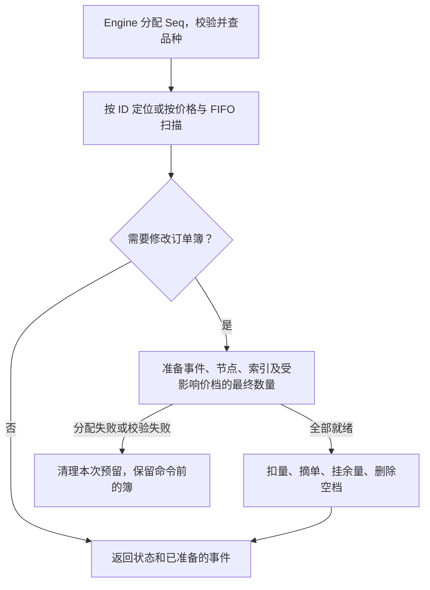
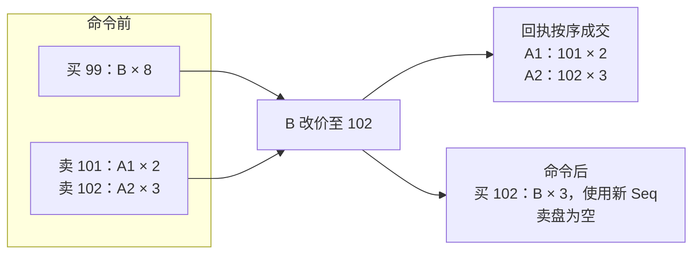

# 订单簿的局部提交方案

**建议保留一张由单写者持有的正式订单簿。撤单和减量先准备回执，再原地修改一笔订单。下单和改价先算出整条命令的成交、余量及所需资源，再一次提交。** 继续用 `from_resting` 做恢复和测试对照。第一步只迁移撤单、减量，跨档撮合等到提交路径具备强异常保证后再切换。

## 1. 撤一笔单，为什么会遍历整张簿

在仓库版本 `a26b388`，`Engine::dispatch` 先校验命令并查找品种。随后，`resting_orders()` 把目标簿的全部挂单导出为向量，`from_resting()` 逐单重建价档、FIFO 和 ID 索引，最后 `validate()` 再遍历一次。命令在新簿上执行，返回 `processed` 时交换两个指针。即使目标订单不存在，撤单也要等整张簿重建完才能返回 `unknown_order`。因此，即使命令执行到一半抛出异常，调用方仍能读到命令前的完整盘口。[引擎分派](../../exchange-lab/src/engine.cpp#L26-L66) · [导出挂单](../../exchange-lab/src/order_book.cpp#L204-L215) · [重建与校验](../../exchange-lab/src/order_book.cpp#L493-L504)

**在当前版本上实测**，只保留一个买价档，交替撤销不存在的 ID、对一笔大挂单减一手。两条命令触及的挂单数始终分别为零和一。

| 同价挂单数 | 撤单未命中 p50 | 撤单未命中 p99 | 减一手 p50 | 减一手 p99 |
| ---: | ---: | ---: | ---: | ---: |
| 64 | 7.54 µs | 9.08 µs | 7.58 µs | 9.08 µs |
| 512 | 31.04 µs | 31.75 µs | 31.21 µs | 31.96 µs |
| 4,096 | 266.50 µs | 272.88 µs | 266.13 µs | 273.67 µs |

测量环境为 Apple M3、Apple Clang 17、C++20、`-O3 -DNDEBUG`。单线程用 `steady_clock` 计量一次 `Engine::execute` 从调用到返回的时间。每种簿深跑三轮，每轮每类命令先预热 32 次，再取 1,000 个样本。表中为各轮相应分位数的中位数。预填、结果核对均在计时区间外。数字是现有实现的基线，新方案的收益须用同一负载复测。

## 2. 真实交易系统怎么做

| 系统与证据 | 公开实现 | 对本项目的启示 |
| --- | --- | --- |
| **LMAX Exchange，外汇交易场所** | 运营方披露，业务逻辑单线程处理内存状态。LMAX 在 QCon London 2017 的技术报告中说明，命令执行前完成校验，异常退出后用快照和输入日志重放恢复。[运营方白皮书，第 50–51 页](https://www.lmax.com/documents/LMAXExchange-Restoring-Trust-in-Global-FX-Whitepaper.pdf) · [撮合架构报告](https://qconlondon.com/london-2017/system/files/presentation-slides/lmax-architecture.pdf) | 把业务校验放在改簿之前。输入日志和快照可在重启时重建盘口，运行中的命令仍要自行保证多笔成交一起生效。 |
| **dYdX Chain，已部署的 v9.8.0** | 主网发布记录将实际部署版本对应到提交 `9ab4e17`。节点从订单 ID 找到链表节点，删除关联索引并从对应价档摘单。删空最优档时还会寻找新的最优价。[主网发布记录](https://github.com/dydxprotocol/v4-chain/releases/tag/protocol%2Fv9.8.0) · [按 ID 定位](https://github.com/dydxprotocol/v4-chain/blob/9ab4e17a21f99a408de2064af3bc82e1f5bc90a3/protocol/x/clob/memclob/memclob.go#L2061-L2069) · [摘单与空档处理](https://github.com/dydxprotocol/v4-chain/blob/9ab4e17a21f99a408de2064af3bc82e1f5bc90a3/protocol/x/clob/memclob/orderbook.go#L431-L489) | 可以借鉴按 ID 修改局部节点。dYdX 节点维护本地乐观订单簿，最终成交受区块共识约束。这里只对照节点内的数据结构操作。[dYdX 撮合模型](https://docs.dydx.exchange/concepts-limit-order-book-and-matching) |
| **exchange-core，课程对应的开源实现** | 固定版本的 `OrderBookDirectImpl` 对预算型 FOK 先按价档试算，再逐笔撮合。成交循环直接更新 maker 已成交量、档位量和 ID 索引。[预算试算](https://github.com/exchange-core/exchange-core/blob/2f8548749839e9095c8dc597e4b61521d259fa5d/src/main/java/exchange/core2/core/orderbook/OrderBookDirectImpl.java#L173-L220) · [成交循环](https://github.com/exchange-core/exchange-core/blob/2f8548749839e9095c8dc597e4b61521d259fa5d/src/main/java/exchange/core2/core/orderbook/OrderBookDirectImpl.java#L250-L335) | 本库已有类似的预算预检。沿用本库的入站重复 ID 检查和整数溢出检查。 |

## 3. 一条命令的准备与提交

**只有在首次不可撤销的写入之后能保证余下步骤完成，才可以安全地移除整簿复制。** 现有 `MatchPlan` 已经按价格和 FIFO 顺序准备了成交事件，但 `apply_trades` 还会按 ID 再找 maker，减量路径还可能抛出 `logic_error` 或由 `map::at` 抛异常。这些异常意味着内部索引或计划与盘口不一致。`move` 的风险尤其具体，它会先移动或移除旧单，再扣对手盘。若原样在正式簿上执行，后段报错时，旧单可能已经丢失原来的排队位置。[计划与成交应用](../../exchange-lab/src/order_book.cpp#L217-L280) · [改价顺序](../../exchange-lab/src/order_book.cpp#L449-L490)

**准备。** 在 `OrderBook` 内扩展现有撮合计划。它拥有最终 `CommandResult`，另保存每笔待扣 maker 的链表位置、扣减量，以及每个触及价档的最终总量。按档扫描时直接取得价档迭代器。同一命令中，价档只在其所有节点处理完后删除一次。引擎从准备开始到提交结束独占这张簿，查询和回调都在命令边界执行。

**预留。** GTC 需要挂余量时，先在临时 `list` 构造节点。若需新价档，先建立空档。若需新 ID，先建立指向临时节点的索引项。用预先构造的局部 RAII 对象保存两处插入的迭代器，登记、清理都无需分配。准备失败时依次删掉新索引项、新空档，再释放临时节点，既有挂单和 FIFO 保持原值。`unordered_map` 插入可能 rehash，所以在最后一次潜在扩容后才取得用于提交的索引迭代器、核对它们指向预期 maker。`reserve` 只准备桶容量，新索引节点本身仍可能分配失败。[本库的容器和索引](../../exchange-lab/include/exchange/order_book.hpp#L60-L80) · [C++ 无序容器的迭代器规则](https://eel.is/c++draft/unord.req#9)

**提交。** 此时事件缓冲已完整，价格、数量、算术边界和节点位置均已检查。用预存迭代器扣量、删除已成交订单的索引和链表节点、更新价档。用相同分配器的 `list::splice` 将余量节点接到档尾。改价有余量时可直接把旧节点移到目标档尾，并更新其价格、剩余量、优先序号及索引。最后解除预留的回滚保护，移动已准备好的结果给调用方。提交函数中禁止分配、按键 `at()`、追加事件或调用外部代码。逐项证明这些操作不会抛出后，再将该函数声明为 `noexcept`。[C++ 链表节点转移规则](https://eel.is/c++draft/list.ops)

| 命令 | 提交前要确定的事 | 提交后的可观察结果 |
| --- | --- | --- |
| 撤单、减量 | 按 ID 核对 owner、节点和所属价档，算出实际减量，先构造 `Reduce` 事件 | 部分减量保持原 FIFO。减量超过余量时按余量删除。整单删除同步清理索引和空档。错 owner 与未知 ID 都返回 `unknown_order`。 |
| 限价 GTC、IOC | 先查活动 ID 是否重复，再按价限生成全部 `Trade`。GTC 为余量准备档、节点和索引。IOC 把余量拒绝事件放在成交事件之后 | GTC 即使没有成交事件，也可能新增挂单。IOC 只扣实际成交量，余量不入簿。 |
| 预算 FOK | 保留 `trial_budget` 的按档试算和溢出检查。数量须全额满足，买方检查最高总支出，卖方检查最低总收入 | 试算失败返回 `processed` 加一条整量 `RejectRemainder`，簿变更为空。通过后才提交全部成交。 |
| 改价 | 检查归属、买单预留价和新优先序号。以旧单余量试撮对侧。计算同档最终总量时先扣掉旧量 | 同价改价也以新 `Seq` 排到队尾。全成则清除旧 ID，有余量则同一 ID 指向目标档节点。 |

`Engine::execute` 仍在分派前取号。业务拒绝占一个 `Seq`，基础设施异常可以留下序号空洞。提交判断看计划里的**簿变更**，因为 `processed` 和事件数都不足以判断簿是否变化。[同步引擎约定](../05-engine-architecture/day-17.md) · [预算单处理](../../exchange-lab/src/order_book.cpp#L325-L372)

### 用一笔跨档改价检查原子性

买单 B 原挂 99、剩 8 手、预留价 105。把它改到 102，对侧有 A1 在 101 挂 2 手、A2 在 102 挂 3 手。准备阶段应得到两笔成交和 3 手买方余量。若此时建立目标买价档失败，B 仍在 99 的原位置，A1、A2 的数量和优先级均保持原值，调用方收不到成交回执。成功后的盘口如下。

当前代码的事务范围是一张簿。后续接入账本时，`Engine` 应持有同一条命令的簿计划和账本试算结果，两者都准备成功后，在同一单写者区间内连续完成两次无抛出提交，再发布回执。课程中有一笔预算卖单，第一笔成交收入能覆盖手续费，第二笔收入不足。即使第一笔单独可结算，失败后两笔买单及其冻结都应保留。[结算失败用例](../05-engine-architecture/day-19.md#L382)

## 4. 取舍与验收

| 备选方案 | 适用条件 | 对本库的代价 |
| --- | --- | --- |
| 整簿重建后交换 | 实现基线、恢复、测试对照 | 设目标簿有 N 笔挂单和 P 个价档。常规哈希假设下，每条进入该路径的命令额外花约 `O(N log(P+1))` 时间和 `O(N+P)` 临时空间。 |
| **准备后局部提交** | 单写者、需要保留单命令强异常保证 | 撤减仅需一次期望常数时间的 ID 查找和一次 `O(log(P+1))` 的档位定位。撮合准备空间与触及的 maker、价档及输出事件数成正比。深度扫单仍可能触及全簿，新单触发哈希扩容也会产生延迟尖峰。 |
| 原地修改加撤销日志 | 后续业务有多处依赖中间写入的判定，提前准备困难 | 每次写前都要留好旧值、被摘节点、原 FIFO 位置和索引，逆序恢复也须保证无分配。当前订单操作已有只读计划，另写撤销逻辑会增加一套需要验证的行为。 |
| 按价档写时复制或持久化结构 | 读侧确实需要同时持有多个历史版本 | 当前 ID 索引持有链表迭代器。复制一个热价档还要处理档内全部句柄，并让价树与 ID 索引发布同一版本。只复制顶层指针无法隔离节点写入。 |

**迁移顺序。** 先把撤单、减量接到局部提交路径，其他命令继续使用现有暂存。随后迁移无挂单余量的 IOC、预算 FOK，再迁移 GTC 和改价。每一步都用同一批命令分别驱动旧、新两个引擎，逐条比较后再切换该类命令。保留公开的值返回接口和按品种隔离，避免查询结果借用即将删除的节点。

**正确性验收。** 在已有单簿差分测试之上增加 `Engine::execute` 级对照，逐条比 `Seq`、状态、事件内容与顺序、完整挂单序列和 L2，再检查 `validate()`。覆盖错 owner、两个品种共用同一订单号、同价改价、跨档部分成交、价档总量溢出及预算整单拒绝。对事件扩容、目标档、余量节点、索引插入逐点注入分配失败，并在索引发生 rehash 后、正式提交前模拟失败。每次验证原簿、另一品种和既有查询结果，再执行下一条正常命令。全簿校验放在测试和恢复路径。[现有单簿差分测试](../../exchange-lab/tests/book_differential_test.cpp) · [索引失败注入](../../exchange-lab/tests/order_index_test.cpp#L37-L55) · [引擎测试](../../exchange-lab/tests/engine_test.cpp)

**性能验收。** 复跑上表，再分别改变价档数和一次扫过的 maker 数，记录各命令的 p50、p99、分配次数及成交数。迁移后的撤减路径应做到每次整簿导出和重建次数均为零，在固定价档数、增加同价排队深度时消除原来的全簿遍历成本。对扫单按实际成交笔数分组，对新挂单单列 rehash 样本，避免用未成交或拒绝样本稀释尾延迟。[课程基准的计时口径](../06-performance/day-21.md)
